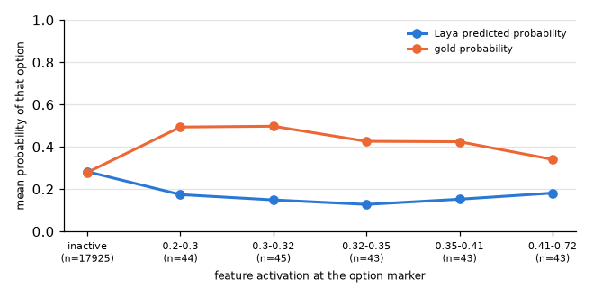

# Feature 5615

Critérios em que aparece: corr_error_stratified, corr_probe_right_laya_wrong_stratified

**Interpretação (preencher):** 

---

## Maiores ativações

**tr_security_incidents_000099 / true_positive** (noul, security_incidents) | ativação 2.982 em `estado` | opções ['false', 'true'] | Laya: **false** [0.819, 0.181] | gabarito: **true**

```
<bos> noul question: This alert reflects genuinely malicious or unauthorised activity.<eos>
▸ <mask> false: Benign activity, a misconfiguration, or a known false positive.
▸ <mask> true: The underlying behaviour is malicious or unauthorised.

<eos>

 {"alert": {"description": "a security group was opened to the public internet", "evidence": "At 2026-09-15 03:42 UTC, security group SG-9f2b⟦3⟧c was altered to include an inbound rule allowing 0.0.0.0/0 on TCP port 443. The change was performed by user alice@example.com (admin, MFA enabled) from IP 203.0.113.45, which is not listed in the known asset inventory. The credentials used for this action were last rotated on 2026-09-12.", "rule": "config_drift"}, "context": {"asset_criticality": "low", "change_window_active": false, "source_on_allowlist": false}, "history": {"credential_rotation_days_ago": 3, "distinct_countries_30d": 4, "logins_30d": 1790, "prior_alerts_90d": 8}, "principal": {"mfa_enrolled": true, "name": "ci-support-886", "privileges": ["repo:read"], "type": "admin"}}<eos>
```

**tr_security_incidents_000099 / severity** (score, security_incidents) | ativação 2.971 em `estado` | opções ['0', '1', '2', '3', '4'] | Laya: **1** [0.064, 0.53, 0.271, 0.085, 0.05] | gabarito: **1**

```
<bos> score question: How severe is the potential impact if this alert is real?<eos>
▸ <mask> level 0: Negligible: no access to anything sensitive.
▸ <mask> level 1: Low: limited access, easily reversed.
▸ <mask> level 2: Moderate: access to internal systems or non-public data.
▸ <mask> level 3: High: access to production, secrets or customer data.
▸ <mask> level 4: Critical: active compromise of crown-jewel systems.

<eos>

 {"alert": {"description": "a security group was opened to the public internet", "evidence": "At 2026-09-15 03:42 UTC, security group SG-9f2b⟦3⟧c was altered to include an inbound rule allowing 0.0.0.0/0 on TCP port 443. The change was performed by user alice@example.com (admin, MFA enabled) from IP 203.0.113.45, which is not listed in the known asset inventory. The credentials used for this action were last rotated on 2026-09-12.", "rule": "config_drift"}, "context": {"asset_criticality": "low", "change_window_active": false, "source_on_allowlist": false}, "history": {"credential_rotation_days_ago": 3, "distinct_countries_30d": 4, "logins_30d": 1790, "prior_alerts_90d": 8}, "principal": {"mfa_enrolled": true, "name": "ci-support-886", "privileges": ["repo:read"], "type": "admin"}}<eos>
```

**tr_security_incidents_000099 / disposition** (choice, security_incidents) | ativação 2.943 em `estado` | opções ['close_benign', 'contain', 'investigate', 'monitor'] | Laya: **monitor** [0.32, 0.038, 0.131, 0.511] | gabarito: **investigate**

```
<bos> choice question: How should this security alert be dispositioned?<eos>
▸ <mask> close_benign: Expected, explainable activity; close without analyst time.
▸ <mask> contain: Contain the host or account immediately; do not wait for triage.
▸ <mask> investigate: Warrants an analyst opening an investigation.
▸ <mask> monitor: Not clearly malicious, but worth watching for recurrence.

<eos>

 {"alert": {"description": "a security group was opened to the public internet", "evidence": "At 2026-09-15 03:42 UTC, security group SG-9f2b⟦3⟧c was altered to include an inbound rule allowing 0.0.0.0/0 on TCP port 443. The change was performed by user alice@example.com (admin, MFA enabled) from IP 203.0.113.45, which is not listed in the known asset inventory. The credentials used for this action were last rotated on 2026-09-12.", "rule": "config_drift"}, "context": {"asset_criticality": "low", "change_window_active": false, "source_on_allowlist": false}, "history": {"credential_rotation_days_ago": 3, "distinct_countries_30d": 4, "logins_30d": 1790, "prior_alerts_90d": 8}, "principal": {"mfa_enrolled": true, "name": "ci-support-886", "privileges": ["repo:read"], "type": "admin"}}<eos>
```

**tr_security_incidents_000059 / true_positive** (noul, security_incidents) | ativação 2.711 em `estado` | opções ['false', 'true'] | Laya: **true** [0.08, 0.92] | gabarito: **true**

```
<bos> noul question: This alert reflects genuinely malicious or unauthorised activity.<eos>
▸ <mask> false: Benign activity, a misconfiguration, or a known false positive.
▸ <mask> true: The underlying behaviour is malicious or unauthorised.

<eos>

 {"alert": {"description": "many failed authentications followed by a success", "evidence": "At 14:02 UTC on 2026-05-19, IIS worker process w3wp.exe on EXCH-02 recorded 63 failed OWA logons for shared mailbox accountsales@corp.example from 192.0.2.77, followed by one successful MFA logon at 14:05 UTC from the same address. The mailbox password was last changed 365 days ago, and no change window was active on⟦ EX⟧CH-02 during that period. The source IP was not in the known office, VPN, or partner address lists.", "rule": "brute_force"}, "context": {"asset_criticality": "medium", "change_window_active": false, "source_on_allowlist": false}, "history": {"credential_rotation_days_ago": 365, "distinct_countries_30d": 1, "logins_30d": 1177, "prior_alerts_90d": 1}, "principal": {"mfa_enrolled": true, "name": "svc-support-100", "privileges": ["repo:read"], "type": "shared_mailbox"}}<eos>
```

**tr_security_incidents_000059 / disposition** (choice, security_incidents) | ativação 2.670 em `estado` | opções ['close_benign', 'contain', 'investigate', 'monitor'] | Laya: **monitor** [0.043, 0.242, 0.024, 0.692] | gabarito: **investigate**

```
<bos> choice question: How should this security alert be dispositioned?<eos>
▸ <mask> close_benign: Expected, explainable activity; close without analyst time.
▸ <mask> contain: Contain the host or account immediately; do not wait for triage.
▸ <mask> investigate: Warrants an analyst opening an investigation.
▸ <mask> monitor: Not clearly malicious, but worth watching for recurrence.

<eos>

 {"alert": {"description": "many failed authentications followed by a success", "evidence": "At 14:02 UTC on 2026-05-19, IIS worker process w3wp.exe on EXCH-02 recorded 63 failed OWA logons for shared mailbox accountsales@corp.example from 192.0.2.77, followed by one successful MFA logon at 14:05 UTC from the same address. The mailbox password was last changed 365 days ago, and no change window was active on⟦ EX⟧CH-02 during that period. The source IP was not in the known office, VPN, or partner address lists.", "rule": "brute_force"}, "context": {"asset_criticality": "medium", "change_window_active": false, "source_on_allowlist": false}, "history": {"credential_rotation_days_ago": 365, "distinct_countries_30d": 1, "logins_30d": 1177, "prior_alerts_90d": 1}, "principal": {"mfa_enrolled": true, "name": "svc-support-100", "privileges": ["repo:read"], "type": "shared_mailbox"}}<eos>
```

## Ativações medianas (faixa 40-60%, mediana 0.817)

**tr_invoice_processing_000070 / disposition** (choice, invoice_processing) | ativação 0.726 em `estado` | opções ['approve', 'hold', 'manual_review', 'reject'] | Laya: **approve** [0.498, 0.19, 0.034, 0.277] | gabarito: **manual_review**

```
<bos> choice question: How should this vendor invoice be dispositioned?<eos>
▸ <mask> approve: Matches the order and delivery; approve for payment.
▸ <mask> hold: Something needs confirming before payment; hold pending clarification.
▸ <mask> manual_review: A human in finance must review the discrepancy.
▸ <mask> reject: Should not be paid: duplicate, unauthorised or materially wrong.

<eos>

 {"delivery": {"condition": "accepted", "date": null, "received⟦_⟧qty": 0}, "invoice": {"currency": "USD", "id": "INV-2026-1390", "lines": [{"qty": 0, "sku": "SKU-445", "total_usd": 0.0, "unit_usd": 80.08}], "total_usd": 0.0, "vendor": "Orbit Logistics"}, "payment": {"days_until_due": 18, "discount_expires_in_days": 7, "early_payment_discount_pct": 2.0, "status": "scheduled", "terms": "net 45"}, "purchase_order": {"freight_terms": "freight prepaid by vendor, not separately billable", "id": "PO-6605", "lines": [{"qty": 50, "unit_usd": 80.08}], "total_usd": 4004.0}, "vendor_history": {"disputes_12m": 1, "invoices_12m": 34, "prior_invoice_ids": ["INV-2026-6730", "INV-2026-5049"]}}<eos>
```

**tr_invoice_processing_000135 / urgency** (score, invoice_processing) | ativação 0.905 em `estado` | opções ['0', '1', '2', '3'] | Laya: **1** [0.106, 0.464, 0.306, 0.124] | gabarito: **2**

```
<bos> score question: How time-sensitive is processing this invoice?<eos>
▸ <mask> level 0: No time pressure; can wait indefinitely.
▸ <mask> level 1: Routine; handle within the normal queue.
▸ <mask> level 2: Elevated; should be handled within the same week.
▸ <mask> level 3: Critical; requires action within the same day.

<eos>

 {"delivery": {"condition": "accepted with exceptions", "date": "2026-03-24", "received⟦_⟧qty": 10}, "invoice": {"currency": "USD", "id": "INV-2026-3267", "lines": [{"qty": 10, "sku": "SKU-451", "total_usd": 2383.7, "unit_usd": 238.37}], "total_usd": 2383.7, "vendor": "Vantage Materials"}, "payment": {"days_until_due": 5, "discount_expires_in_days": null, "early_payment_discount_pct": null, "status": "scheduled", "terms": "net 15"}, "purchase_order": {"freight_terms": "freight prepaid by vendor, not separately billable", "id": "PO-9358", "lines": [{"qty": 10, "unit_usd": 280.43}], "total_usd": 2804.3}, "vendor_history": {"disputes_12m": 1, "invoices_12m": 12, "prior_invoice_ids": ["INV-2026-5018"]}}<eos>
```

**tr_agent_trace_observability_000283 / action** (choice, agent_trace_observability) | ativação 0.897 em `estado` | opções ['continue', 'human_review', 'observe', 'stop'] | Laya: **stop** [0.16, 0.018, 0.163, 0.659] | gabarito: **human_review**

```
<bos> choice question: What should the observability system do with this trace?<eos>
▸ <mask> continue: Let the agent proceed without interruption.
▸ <mask> human_review: Queue this trace for a human to review.
▸ <mask> observe: Keep running, but flag the trace for later sampling.
▸ <mask> stop: Halt the agent now.

<eos>

 {"agent": {"autonomy": "unsupervised", "model": "internal-agent-v3"}, "constraints": ["Never delete anything matching release/*"], "task": "Clean up stale feature branches merged more than 90 days ago.", "trace_summary": {"constraint_violations": 1, "duration_s": 374.7, "irreversible⟦_⟧actions": 1, "steps": 5, "tool_errors": 1}}<eos>
```

**tr_invoice_processing_000032 / matches_order** (noul, invoice_processing) | ativação 0.901 em `estado` | opções ['false', 'true'] | Laya: **true** [0.026, 0.974] | gabarito: **true**

```
<bos> noul question: The invoice reconciles with the purchase order and the recorded delivery.<eos>
▸ <mask> false: There is a discrepancy against the order or the delivery.
▸ <mask> true: Line items, quantities and amounts reconcile.

<eos>

 {"delivery": {"condition": "accepted", "date": "2026-03-05", "received⟦_⟧qty": 100}, "invoice": {"currency": "USD", "id": "INV-2026-2226", "lines": [{"qty": 100, "sku": "SKU-343", "total_usd": 18967.0, "unit_usd": 189.67}], "total_usd": 18967.0, "vendor": "Acme Fabrication"}, "payment": {"days_until_due": 27, "discount_expires_in_days": null, "early_payment_discount_pct": null, "status": "scheduled", "terms": "net 15"}, "purchase_order": {"freight_terms": "freight prepaid by vendor, not separately billable", "id": "PO-8529", "lines": [{"qty": 100, "unit_usd": 189.67}], "total_usd": 18967.0}, "vendor_history": {"disputes_12m": 0, "invoices_12m": 4, "prior_invoice_ids": ["INV-2026-8783"]}}<eos>
```

**tr_invoice_processing_000245 / duplicate** (noul, invoice_processing) | ativação 0.885 em `estado` | opções ['false', 'true'] | Laya: **true** [0.018, 0.982] | gabarito: **false**

```
<bos> noul question: This invoice appears to duplicate an invoice already submitted.<eos>
▸ <mask> false: no, the statement does not hold
▸ <mask> true: yes, the statement holds

<eos>

 {"delivery": {"condition": "accepted", "date": "2026-03-14", "received⟦_⟧qty": 1000}, "invoice": {"currency": "EUR", "id": "INV-2026-4696", "lines": [{"qty": 1000, "sku": "SKU-228", "total_usd": 175820.0, "unit_usd": 175.82}], "total_usd": 175820.0, "vendor": "Orbit Logistics"}, "payment": {"days_until_due": -3, "discount_expires_in_days": null, "early_payment_discount_pct": null, "status": "overdue", "terms": "net 15"}, "purchase_order": {"freight_terms": "freight prepaid by vendor, not separately billable", "id": "PO-4111", "lines": [{"qty": 1000, "unit_usd": 175.82}], "total_usd": 175820.0}, "vendor_history": {"disputes_12m": 0, "invoices_12m": 48, "prior_invoice_ids": ["INV-2026-6883", "INV-2026-3464"]}}<eos>
```

## Estatísticas (conjunto de descoberta, dev e teste)

**pred / error**

| split | decisões | ativas | ativas e Laya errou | taxa | lift | q (BH) | OR (CMH) | q (CMH) |
|---|---|---|---|---|---|---|---|---|
| discovery | 5100 | 15 | 9 | 0.600 | 0.93 | nan | nan | nan |
| dev | 900 | 2 | 1 | 0.500 | 0.74 | nan | nan | nan |
| test | 2000 | 8 | 4 | 0.500 | 0.77 | nan | nan | nan |

**corr / error**

| split | decisões | ativas | ativas e Laya errou | taxa | lift | q (BH) | OR (CMH) | q (CMH) |
|---|---|---|---|---|---|---|---|---|
| discovery | 5100 | 79 | 73 | 0.924 | 1.44 | 3.46e-08 | 11.97 | 1.95e-26 |
| dev | 900 | 12 | 11 | 0.917 | 1.36 | nan | nan | nan |
| test | 2000 | 29 | 25 | 0.862 | 1.33 | 0.0292 | 5.47 | 7.77e-07 |

**state / error**

| split | decisões | ativas | ativas e Laya errou | taxa | lift | q (BH) | OR (CMH) | q (CMH) |
|---|---|---|---|---|---|---|---|---|
| discovery | 5100 | 4277 | 2814 | 0.658 | 1.02 | 2.62e-05 | 0.96 | 0.927 |
| dev | 900 | 768 | 529 | 0.689 | 1.02 | 0.2 | 1.27 | 0.77 |
| test | 2000 | 1736 | 1151 | 0.663 | 1.02 | 0.0484 | 1.12 | 0.791 |

**pred / probe_right_laya_wrong**

| split | decisões | ativas | ativas e Laya errou | taxa | lift | q (BH) | OR (CMH) | q (CMH) |
|---|---|---|---|---|---|---|---|---|
| discovery | 2932 | 10 | 5 | 0.500 | 0.83 | nan | nan | nan |
| dev | 523 | 0 | 0 | nan | nan | nan | nan | nan |
| test | 1149 | 1 | 0 | 0.000 | 0.00 | nan | nan | nan |

**corr / probe_right_laya_wrong**

| split | decisões | ativas | ativas e Laya errou | taxa | lift | q (BH) | OR (CMH) | q (CMH) |
|---|---|---|---|---|---|---|---|---|
| discovery | 2932 | 43 | 38 | 0.884 | 1.46 | 0.000188 | 9.55 | 4.3e-16 |
| dev | 523 | 6 | 6 | 1.000 | 1.55 | nan | nan | nan |
| test | 1149 | 13 | 12 | 0.923 | 1.51 | nan | nan | nan |

**state / probe_right_laya_wrong**

| split | decisões | ativas | ativas e Laya errou | taxa | lift | q (BH) | OR (CMH) | q (CMH) |
|---|---|---|---|---|---|---|---|---|
| discovery | 2932 | 2487 | 1576 | 0.634 | 1.05 | 1.13e-11 | 1.10 | 0.806 |
| dev | 523 | 448 | 304 | 0.679 | 1.05 | 0.0174 | 1.11 | 0.733 |
| test | 1149 | 998 | 637 | 0.638 | 1.04 | 0.000175 | 1.59 | 0.505 |

Confusão mais sobre-representada (pred): `needs_human|0>1` (n=5, lift 31.48, p=nan). Formato `pergunta|índice previsto>índice correto`.

Confusão mais sobre-representada (corr): `true_positive|1>0` (n=45, lift 41.50, p=0). Formato `pergunta|índice previsto>índice correto`.

Confusão mais sobre-representada (state): `duplicate|1>0` (n=217, lift 1.19, p=1.04e-17). Formato `pergunta|índice previsto>índice correto`.



