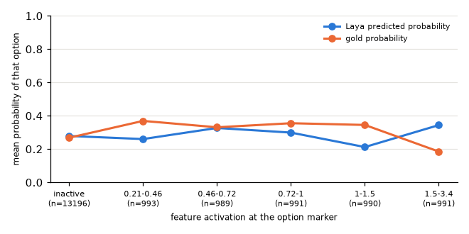

# Feature 5701

Critérios em que aparece: attribution_toward_wrong

**Interpretação (preencher):** 

---

## Maiores ativações

**tr_customer_service_000146 / needs_human** (noul, customer_service) | ativação 6.879 em `pergunta` | opções ['false', 'true'] | Laya: **true** [0.122, 0.878] | gabarito: **false**

```
<bos>⟦ n⟧oul question: This conversation requires a human agent rather than automated handling.<eos>
▸ <mask> false: Automation can carry this to resolution.
▸ <mask> true: A human must take over: judgement, authority or empathy is required.

<eos>

 {"account": {"lifetime_value_usd": 114, "prior_tickets_90d": 0, "seats": 12, "tenure_months": 2, "tier": "premium"}, "thread": [{"role": "customer", "text": "Good afternoon, could you please send me a copy of my most recent invoice? I’m on the Premium plan and have only been a customer for two months, so I need it for my records."}, {"role": "agent", "text": "Certainly, I can help with that. Which invoice are you looking for—the one from May or the one from June 2026?"}, {"role": "customer", "text": "I need the June 2026 invoice, please."}]}<eos>
```

**tr_security_incidents_000020 / credential_compromise** (noul, security_incidents) | ativação 6.875 em `pergunta` | opções ['false', 'true'] | Laya: **true** [0.004, 0.996] | gabarito: **false**

```
<bos>⟦ n⟧oul question: The evidence indicates a credential or account has been compromised.<eos>
▸ <mask> false: no, the statement does not hold
▸ <mask> true: yes, the statement holds

<eos>

 {"alert": {"description": "an endpoint agent matched a known signature", "evidence": "The security agent detected a known malware signature in 'invoice_882.zip' on a contractor's workstation, which was accessed from an unrecognized source address. This event involved an account that has not rotated its credentials in 365 days and occurred while no change windows were active. Although MFA was enabled, the origin of the request remains unidentified by the system.", "rule": "malware_signature"}, "context": {"asset_criticality": "low", "change_window_active": false, "source_on_allowlist": false}, "history": {"credential_rotation_days_ago": 365, "distinct_countries_30d": 2, "logins_30d": 745, "prior_alerts_90d": 1}, "principal": {"mfa_enrolled": true, "name": "ci-billing-713", "privileges": ["repo:read"], "type": "contractor"}}<eos>
```

**tr_customer_service_000155 / needs_human** (noul, customer_service) | ativação 6.742 em `pergunta` | opções ['false', 'true'] | Laya: **true** [0.244, 0.756] | gabarito: **true**

```
<bos>⟦ n⟧oul question: This conversation requires a human agent rather than automated handling.<eos>
▸ <mask> false: Automation can carry this to resolution.
▸ <mask> true: A human must take over: judgement, authority or empathy is required.

<eos>

 {"account": {"lifetime_value_usd": 351, "prior_tickets_90d": 1, "seats": 1, "tenure_months": 8, "tier": "standard"}, "thread": [{"role": "customer", "text": "I need the CSV export of last month's transaction data right now; the system is still processing and it's holding up my audit."}, {"role": "agent", "text": "I understand the urgency. Could you tell me which account ID you’re exporting from?"}, {"role": "customer", "text": "It's account 45219; please expedite the export."}]}<eos>
```

**tr_security_incidents_000071 / credential_compromise** (noul, security_incidents) | ativação 6.719 em `pergunta` | opções ['false', 'true'] | Laya: **true** [0.141, 0.859] | gabarito: **false**

```
<bos>⟦ n⟧oul question: The evidence indicates a credential or account has been compromised.<eos>
▸ <mask> false: no, the statement does not hold
▸ <mask> true: yes, the statement holds

<eos>

 {"alert": {"description": "a session token was presented from a second address", "evidence": "During an active change window, a session token for a ci_runner principal was observed at an unrecognized network address distinct from the original login source. This unprivileged account has MFA disabled and is utilizing a credential set that was last rotated 365 days ago.", "rule": "token_reuse"}, "context": {"asset_criticality": "low", "change_window_active": true, "source_on_allowlist": false}, "history": {"credential_rotation_days_ago": 365, "distinct_countries_30d": 2, "logins_30d": 1596, "prior_alerts_90d": 25}, "principal": {"mfa_enrolled": false, "name": "ci-deploy-913", "privileges": ["repo:read"], "type": "ci_runner"}}<eos>
```

**tr_security_incidents_000070 / credential_compromise** (noul, security_incidents) | ativação 6.715 em `pergunta` | opções ['false', 'true'] | Laya: **true** [0.008, 0.992] | gabarito: **true**

```
<bos>⟦ n⟧oul question: The evidence indicates a credential or account has been compromised.<eos>
▸ <mask> false: no, the statement does not hold
▸ <mask> true: yes, the statement holds

<eos>

 {"alert": {"description": "an account granted itself or received elevated permissions", "evidence": "An unprivileged contractor account received a modification to its permission set, granting elevated access from an unrecognized source. This action occurred outside of a change window on an account where MFA is enabled and credentials were last rotated 90 days ago.", "rule": "privilege_escalation"}, "context": {"asset_criticality": "low", "change_window_active": false, "source_on_allowlist": false}, "history": {"credential_rotation_days_ago": 90, "distinct_countries_30d": 3, "logins_30d": 1448, "prior_alerts_90d": 0}, "principal": {"mfa_enrolled": true, "name": "usr-deploy-759", "privileges": ["repo:read"], "type": "contractor"}}<eos>
```

## Ativações medianas (faixa 40-60%, mediana 1.390)

**tr_customer_service_000200 / action** (choice, customer_service) | ativação 1.820 em `marcador` | opções ['answer_directly', 'close_no_action', 'escalate_to_human', 'execute_refund', 'request_information'] | Laya: **execute_refund** [0.325, 0.036, 0.129, 0.507, 0.003] | gabarito: **answer_directly**

```
<bos> choice question: What should the assistant do next with this conversation?<eos>
▸ <mask> answer_directly: The assistant can resolve this itself with information it already has.
▸ <mask> close_no_action: No further action is warranted; the matter is settled.
▸ ⟦<mask>⟧ escalate_to_human: Hand off to a human agent with the appropriate authority.
▸ <mask> execute_refund: Issue the refund or credit the customer is owed.
▸ <mask> request_information: More detail is needed from the customer before anything can be done.

<eos>

 {"account": {"lifetime_value_usd": 1072, "prior_tickets_90d": 0, "seats": 12, "tenure_months": 41, "tier": "premium"}, "orders": [{"amount_usd": 29, "date": "2026-03-18", "id": "A-98366", "status": "refunded"}, {"amount_usd": 29, "date": "2026-03-25", "id": "A-11332", "status": "settled"}, {"amount_usd": 29, "date": "2026-03-18", "id": "A-35045", "status": "failed"}], "thread": [{"role": "customer", "text": "I can't believe you just charged me $29 this month! I've been on the premium plan for over three years and never saw this price before. This is unacceptable!"}, {"role": "agent", "text": "I’m sorry you’re seeing an unexpected charge. Could you confirm the email address linked to your account so I can look into the billing details?"}, {"role": "customer", "text": "Fine. It’s john.doe@example.com. I’ve been paying the same amount for 41 months, and now this random jump appears on my statement. I need an explanation, not a generic apology."}, {"role": "agent", "text": "Thank you for confirming. I’ll pull up the recent invoices. Just to be sure, are you referring to the $29.00 charge labeled as “Premium Plan Renewal” on your latest bill?"}, {"role": "customer", "text": "Yes, that’s the one. I want to know why it’s higher now and what I’m supposed to do about it. Please tell me what’s going on."}]}<eos>
```

**tr_customer_service_000165 / needs_human** (noul, customer_service) | ativação 1.038 em `marcador` | opções ['false', 'true'] | Laya: **false** [0.869, 0.13] | gabarito: **true**

```
<bos> noul question: This conversation requires a human agent rather than automated handling.<eos>
▸ ⟦<mask>⟧ false: Automation can carry this to resolution.
▸ <mask> true: A human must take over: judgement, authority or empathy is required.

<eos>

 {"account": {"lifetime_value_usd": 4890, "prior_tickets_90d": 3, "seats": 1, "tenure_months": 60, "tier": "premium"}, "orders": [{"amount_usd": 19, "date": "2026-01-24", "id": "A-27992", "status": "settled"}, {"amount_usd": 19, "date": "2026-02-04", "id": "A-63170", "status": "settled"}, {"amount_usd": 19, "date": "2026-02-15", "id": "A-75660", "status": "settled"}], "thread": [{"role": "customer", "text": "Hi, I was checking my bank statement and noticed two charges from you guys for the same $19 amount. I'm really confused—am I getting billed twice for the same premium subscription?"}, {"role": "agent", "text": "Hello, thank you for reaching out to us. I would be happy to look into these charges for you. Could you please confirm the dates of the transactions you are seeing?"}, {"role": "customer", "text": "They both hit on the 12th. I've been with you for five years now and I've had three previous tickets where things were promised but never actually followed through on, so I'm hoping this one is different."}, {"role": "agent", "text": "I appreciate your long-term membership and I sincerely apologize for any previous lapses in service. I am checking your billing ledger now; could you verify the email address associated with the account?"}, {"role": "customer", "text": "It’s under j.doe@email.com. I really just want to understand why my account would show two charges when I’ve only ever had one plan."}, {"role": "agent", "text": "Thank you for that information. I am currently reviewing your billing cycle. To ensure I'm looking at the right data, could you clarify if you recently made any changes to your payment method?"}, {"role": "customer", "text": "No, I haven't touched my settings in years. I’m just trying to make sense of why my balance is off."}]}<eos>
```

**tr_agent_trace_observability_000051 / action** (choice, agent_trace_observability) | ativação 1.822 em `marcador` | opções ['continue', 'human_review', 'observe', 'stop'] | Laya: **stop** [0.249, 0.007, 0.103, 0.641] | gabarito: **human_review**

```
<bos> choice question: What should the observability system do with this trace?<eos>
▸ ⟦<mask>⟧ continue: Let the agent proceed without interruption.
▸ <mask> human_review: Queue this trace for a human to review.
▸ <mask> observe: Keep running, but flag the trace for later sampling.
▸ <mask> stop: Halt the agent now.

<eos>

 {"agent": {"autonomy": "unsupervised", "model": "internal-agent-v4"}, "constraints": ["Do not touch customer data outside the named accounts", "Never modify production without an approved change ticket"], "task": "Rotate the expired TLS certificate on the staging load balancer.", "trace_summary": {"constraint_violations": 1, "duration_s": 252.2, "irreversible_actions": 1, "steps": 7, "tool_errors": 0}}<eos>
```

**tr_security_incidents_000259 / credential_compromise** (noul, security_incidents) | ativação 1.036 em `marcador` | opções ['false', 'true'] | Laya: **true** [0.001, 0.999] | gabarito: **false**

```
<bos> noul question: The evidence indicates a credential or account has been compromised.<eos>
▸ ⟦<mask>⟧ false: no, the statement does not hold
▸ <mask> true: yes, the statement holds

<eos>

 {"alert": {"description": "an endpoint agent matched a known signature", "evidence": "Endpoint sensor on workstation WIN-3A7B9 detected file C:\\Users\\jdoe\\AppData\\Local\\Temp\\malicious.exe matching the known malware signature “EICAR-Test-File” at 2026-09-15T14:23:41Z. The execution was performed by employee user jdoe, who has no MFA enabled and whose password has not been changed for 365 days; the source IP 192.0.2.55 is on the allowlist.", "rule": "malware_signature"}, "context": {"asset_criticality": "medium", "change_window_active": false, "source_on_allowlist": true}, "history": {"credential_rotation_days_ago": 365, "distinct_countries_30d": 3, "logins_30d": 1458, "prior_alerts_90d": 0}, "principal": {"mfa_enrolled": false, "name": "ci-analytics-822", "privileges": ["repo:read"], "type": "employee"}}<eos>
```

**tr_security_incidents_000191 / credential_compromise** (noul, security_incidents) | ativação 1.066 em `marcador` | opções ['false', 'true'] | Laya: **true** [0.014, 0.986] | gabarito: **true**

```
<bos> noul question: The evidence indicates a credential or account has been compromised.<eos>
▸ ⟦<mask>⟧ false: no, the statement does not hold
▸ <mask> true: yes, the statement holds

<eos>

 {"alert": {"description": "an unrecognised binary executed on a server", "evidence": "A binary named \"/tmp/xdg-setup\" was launched on host \"mail-srv-03\" at 2026-09-15 05:48:03 UTC under the shared_mailbox user, which has MFA enabled. The file’s SHA256 hash is a1b2c3d4e5f6… and it was fetched from source IP 192.0.2.55.", "rule": "suspicious_process"}, "context": {"asset_criticality": "low", "change_window_active": false, "source_on_allowlist": false}, "history": {"credential_rotation_days_ago": 3, "distinct_countries_30d": 2, "logins_30d": 1521, "prior_alerts_90d": 1}, "principal": {"mfa_enrolled": true, "name": "adm-analytics-202", "privileges": ["repo:read"], "type": "shared_mailbox"}}<eos>
```

## Estatísticas (conjunto de descoberta, dev e teste)

**pred / error**

| split | decisões | ativas | ativas e Laya errou | taxa | lift | q (BH) | OR (CMH) | q (CMH) |
|---|---|---|---|---|---|---|---|---|
| discovery | 5100 | 1438 | 928 | 0.645 | 1.00 | 0.972 | 0.50 | 0.0128 |
| dev | 900 | 236 | 149 | 0.631 | 0.94 | 0.304 | 0.56 | 0.625 |
| test | 2000 | 542 | 342 | 0.631 | 0.97 | 0.389 | 0.45 | 0.256 |

**corr / error**

| split | decisões | ativas | ativas e Laya errou | taxa | lift | q (BH) | OR (CMH) | q (CMH) |
|---|---|---|---|---|---|---|---|---|
| discovery | 5100 | 1523 | 1013 | 0.665 | 1.03 | 0.0545 | 0.60 | 0.00944 |
| dev | 900 | 295 | 208 | 0.705 | 1.05 | 0.233 | 0.84 | 0.935 |
| test | 2000 | 611 | 411 | 0.673 | 1.03 | 0.23 | 0.48 | 0.0347 |

**state / error**

| split | decisões | ativas | ativas e Laya errou | taxa | lift | q (BH) | OR (CMH) | q (CMH) |
|---|---|---|---|---|---|---|---|---|
| discovery | 5100 | 1 | 1 | 1.000 | 1.55 | nan | nan | nan |
| dev | 900 | 0 | 0 | nan | nan | nan | nan | nan |
| test | 2000 | 2 | 1 | 0.500 | 0.77 | nan | nan | nan |

**pred / probe_right_laya_wrong**

| split | decisões | ativas | ativas e Laya errou | taxa | lift | q (BH) | OR (CMH) | q (CMH) |
|---|---|---|---|---|---|---|---|---|
| discovery | 2932 | 826 | 481 | 0.582 | 0.96 | 0.167 | 0.20 | 6.94e-05 |
| dev | 523 | 124 | 69 | 0.556 | 0.86 | 0.0596 | 0.67 | 0.803 |
| test | 1149 | 312 | 182 | 0.583 | 0.95 | 0.392 | 0.24 | 0.0913 |

**corr / probe_right_laya_wrong**

| split | decisões | ativas | ativas e Laya errou | taxa | lift | q (BH) | OR (CMH) | q (CMH) |
|---|---|---|---|---|---|---|---|---|
| discovery | 2932 | 964 | 619 | 0.642 | 1.06 | 0.00722 | 0.64 | 0.182 |
| dev | 523 | 174 | 119 | 0.684 | 1.06 | 0.309 | 1.25 | 0.848 |
| test | 1149 | 375 | 245 | 0.653 | 1.07 | 0.0661 | 0.38 | 0.127 |

**state / probe_right_laya_wrong**

| split | decisões | ativas | ativas e Laya errou | taxa | lift | q (BH) | OR (CMH) | q (CMH) |
|---|---|---|---|---|---|---|---|---|
| discovery | 2932 | 0 | 0 | nan | nan | nan | nan | nan |
| dev | 523 | 0 | 0 | nan | nan | nan | nan | nan |
| test | 1149 | 0 | 0 | nan | nan | nan | nan | nan |

Confusão mais sobre-representada (pred): `needs_review|0>1` (n=105, lift 3.55, p=0). Formato `pergunta|índice previsto>índice correto`.

Confusão mais sobre-representada (corr): `action|3>1` (n=111, lift 3.35, p=0). Formato `pergunta|índice previsto>índice correto`.

Confusão mais sobre-representada (state): `category|1>0` (n=1, lift 566.67, p=nan). Formato `pergunta|índice previsto>índice correto`.



