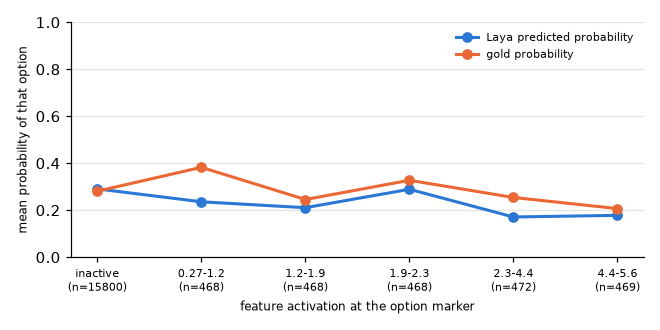

# Feature 5708

Critérios em que aparece: attribution_toward_wrong

**Interpretação (preencher):** 

---

## Maiores ativações

**tr_invoice_processing_000061 / disposition** (choice, invoice_processing) | ativação 5.570 em `marcador` | opções ['approve', 'hold', 'manual_review', 'reject'] | Laya: **approve** [0.439, 0.273, 0.027, 0.26] | gabarito: **manual_review**

```
<bos> choice question: How should this vendor invoice be dispositioned?<eos>
▸ <mask> approve: Matches the order and delivery; approve for payment.
▸ ⟦<mask>⟧ hold: Something needs confirming before payment; hold pending clarification.
▸ <mask> manual_review: A human in finance must review the discrepancy.
▸ <mask> reject: Should not be paid: duplicate, unauthorised or materially wrong.

<eos>

 {"delivery": {"condition": "accepted with exceptions", "date": null, "received_qty": 0}, "invoice": {"currency": "USD", "id": "INV-2026-6615", "lines": [{"qty": 400, "sku": "SKU-909", "total_usd": 127980.0, "unit_usd": 319.95}], "total_usd": 127980.0, "vendor": "Acme Fabrication"}, "payment": {"days_until_due": 44, "discount_expires_in_days": null, "early_payment_discount_pct": null, "status": "scheduled", "terms": "net 45"}, "purchase_order": {"freight_terms": "freight prepaid by vendor, not separately billable", "id": "PO-9226", "lines": [{"qty": 400, "unit_usd": 319.95}], "total_usd": 127980.0}, "vendor_history": {"disputes_12m": 2, "invoices_12m": 5, "prior_invoice_ids": ["INV-2026-5422", "INV-2026-8931", "INV-2026-8502"]}}<eos>
```

**tr_invoice_processing_000117 / disposition** (choice, invoice_processing) | ativação 5.566 em `marcador` | opções ['approve', 'hold', 'manual_review', 'reject'] | Laya: **reject** [0.359, 0.089, 0.032, 0.52] | gabarito: **approve**

```
<bos> choice question: How should this vendor invoice be dispositioned?<eos>
▸ <mask> approve: Matches the order and delivery; approve for payment.
▸ ⟦<mask>⟧ hold: Something needs confirming before payment; hold pending clarification.
▸ <mask> manual_review: A human in finance must review the discrepancy.
▸ <mask> reject: Should not be paid: duplicate, unauthorised or materially wrong.

<eos>

 {"delivery": {"condition": "accepted with exceptions", "date": "2026-03-17", "received_qty": 50}, "invoice": {"currency": "USD", "id": "INV-2026-4861", "lines": [{"qty": 50, "sku": "SKU-282", "total_usd": 15800.5, "unit_usd": 316.01}], "total_usd": 15800.5, "vendor": "Orbit Logistics"}, "payment": {"days_until_due": -3, "discount_expires_in_days": null, "early_payment_discount_pct": null, "status": "overdue", "terms": "net 45"}, "purchase_order": {"freight_terms": "freight prepaid by vendor, not separately billable", "id": "PO-1105", "lines": [{"qty": 50, "unit_usd": 316.01}], "total_usd": 15800.5}, "vendor_history": {"disputes_12m": 0, "invoices_12m": 12, "prior_invoice_ids": ["INV-2026-9359", "INV-2026-7417", "INV-2026-1162"]}}<eos>
```

**tr_invoice_processing_000220 / disposition** (choice, invoice_processing) | ativação 5.566 em `marcador` | opções ['approve', 'hold', 'manual_review', 'reject'] | Laya: **hold** [0.309, 0.394, 0.034, 0.262] | gabarito: **manual_review**

```
<bos> choice question: How should this vendor invoice be dispositioned?<eos>
▸ <mask> approve: Matches the order and delivery; approve for payment.
▸ ⟦<mask>⟧ hold: Something needs confirming before payment; hold pending clarification.
▸ <mask> manual_review: A human in finance must review the discrepancy.
▸ <mask> reject: Should not be paid: duplicate, unauthorised or materially wrong.

<eos>

 {"delivery": {"condition": "accepted", "date": null, "received_qty": 0}, "invoice": {"currency": "USD", "id": "INV-2026-2844", "lines": [{"qty": 25, "sku": "SKU-765", "total_usd": 9016.5, "unit_usd": 360.66}], "total_usd": 9016.5, "vendor": "Orbit Logistics"}, "payment": {"days_until_due": -21, "discount_expires_in_days": null, "early_payment_discount_pct": null, "status": "overdue", "terms": "net 30"}, "purchase_order": {"freight_terms": "freight prepaid by vendor, not separately billable", "id": "PO-7709", "lines": [{"qty": 25, "unit_usd": 360.66}], "total_usd": 9016.5}, "vendor_history": {"disputes_12m": 5, "invoices_12m": 40, "prior_invoice_ids": ["INV-2026-9442", "INV-2026-6144", "INV-2026-9561"]}}<eos>
```

**tr_invoice_processing_000034 / disposition** (choice, invoice_processing) | ativação 5.562 em `marcador` | opções ['approve', 'hold', 'manual_review', 'reject'] | Laya: **approve** [0.664, 0.102, 0.018, 0.215] | gabarito: **manual_review**

```
<bos> choice question: How should this vendor invoice be dispositioned?<eos>
▸ <mask> approve: Matches the order and delivery; approve for payment.
▸ ⟦<mask>⟧ hold: Something needs confirming before payment; hold pending clarification.
▸ <mask> manual_review: A human in finance must review the discrepancy.
▸ <mask> reject: Should not be paid: duplicate, unauthorised or materially wrong.

<eos>

 {"delivery": {"condition": "accepted", "date": "2026-03-16", "received_qty": 25}, "invoice": {"currency": "USD", "id": "INV-2026-2701", "lines": [{"qty": 25, "sku": "SKU-886", "total_usd": 2944.25, "unit_usd": 117.77}, {"qty": 1, "sku": "FREIGHT", "total_usd": 276.83, "unit_usd": 276.83}], "total_usd": 3221.08, "vendor": "Vantage Materials"}, "payment": {"days_until_due": 11, "discount_expires_in_days": null, "early_payment_discount_pct": null, "status": "scheduled", "terms": "net 30"}, "purchase_order": {"freight_terms": "freight prepaid by vendor, not separately billable", "id": "PO-3751", "lines": [{"qty": 25, "unit_usd": 117.77}], "total_usd": 2944.25}, "vendor_history": {"disputes_12m": 0, "invoices_12m": 9, "prior_invoice_ids": ["INV-2026-5941", "INV-2026-9758", "INV-2026-7863", "INV-2026-5149"]}}<eos>
```

**tr_invoice_processing_000175 / disposition** (choice, invoice_processing) | ativação 5.559 em `marcador` | opções ['approve', 'hold', 'manual_review', 'reject'] | Laya: **reject** [0.322, 0.052, 0.014, 0.612] | gabarito: **manual_review**

```
<bos> choice question: How should this vendor invoice be dispositioned?<eos>
▸ <mask> approve: Matches the order and delivery; approve for payment.
▸ ⟦<mask>⟧ hold: Something needs confirming before payment; hold pending clarification.
▸ <mask> manual_review: A human in finance must review the discrepancy.
▸ <mask> reject: Should not be paid: duplicate, unauthorised or materially wrong.

<eos>

 {"delivery": {"condition": "accepted with exceptions", "date": "2026-03-09", "received_qty": 50}, "invoice": {"currency": "USD", "id": "INV-2026-5139", "lines": [{"qty": 50, "sku": "SKU-975", "total_usd": 13907.0, "unit_usd": 278.14}, {"qty": 1, "sku": "FREIGHT", "total_usd": 1932.5, "unit_usd": 1932.5}], "total_usd": 15839.5, "vendor": "Kestrel Supply"}, "payment": {"days_until_due": 18, "discount_expires_in_days": null, "early_payment_discount_pct": null, "status": "scheduled", "terms": "net 60"}, "purchase_order": {"freight_terms": "freight prepaid by vendor, not separately billable", "id": "PO-2691", "lines": [{"qty": 50, "unit_usd": 278.14}], "total_usd": 13907.0}, "vendor_history": {"disputes_12m": 1, "invoices_12m": 18, "prior_invoice_ids": ["INV-2026-8887", "INV-2026-8850", "INV-2026-6069", "INV-2026-1563"]}}<eos>
```

## Ativações medianas (faixa 40-60%, mediana 2.162)

**tr_customer_service_000086 / category** (choice, customer_service) | ativação 2.064 em `marcador` | opções ['account', 'billing', 'delivery', 'refund', 'technical'] | Laya: **billing** [0.0, 1.0, 0.0, 0.0, 0.0] | gabarito: **billing**

```
<bos> choice question: What is this customer conversation primarily about?<eos>
▸ ⟦<mask>⟧ account: Login, plan changes, profile or access management.
▸ <mask> billing: A charge, invoice, subscription or payment problem.
▸ <mask> delivery: Shipping, fulfilment or delivery of a physical item.
▸ <mask> refund: The customer is explicitly asking for money back.
▸ <mask> technical: The product or service is not working as expected.

<eos>

 {"account": {"lifetime_value_usd": 1071, "prior_tickets_90d": 2, "seats": 1, "tenure_months": 19, "tier": "standard"}, "thread": [{"role": "customer", "text": "I just got a bill that’s higher than what I expected, and I don’t understand why the charge jumped. Can someone explain what’s going on? I need this cleared up by tomorrow."}, {"role": "agent", "text": "I’m sorry for the surprise. Could you tell me the date and amount shown on the statement so I can compare it to your plan details?"}, {"role": "customer", "text": "It’s the charge dated 9/14 and I need to know if this is a mistake or a new fee before the end of the day."}]}<eos>
```

**tr_customer_service_000056 / category** (choice, customer_service) | ativação 1.928 em `marcador` | opções ['account', 'billing', 'delivery', 'refund', 'technical'] | Laya: **delivery** [0.014, 0.001, 0.97, 0.001, 0.014] | gabarito: **delivery**

```
<bos> choice question: What is this customer conversation primarily about?<eos>
▸ ⟦<mask>⟧ account: Login, plan changes, profile or access management.
▸ <mask> billing: A charge, invoice, subscription or payment problem.
▸ <mask> delivery: Shipping, fulfilment or delivery of a physical item.
▸ <mask> refund: The customer is explicitly asking for money back.
▸ <mask> technical: The product or service is not working as expected.

<eos>

 {"account": {"lifetime_value_usd": 2311, "prior_tickets_90d": 1, "seats": 1, "tenure_months": 26, "tier": "premium"}, "thread": [{"role": "customer", "text": "I’ve been a premium member for 26 months and the package I got today is completely wrong – it’s not even the model I ordered."}, {"role": "agent", "text": "I’m sorry to hear that. Could you share the order number so I can look into it?"}, {"role": "customer", "text": "It’s the same issue we fought over in ticket #12345 – you promised it would be fixed and now you’ve shipped the wrong item again. I’m done with this."}, {"role": "agent", "text": "I understand your frustration. Would you be able to send a photo of what you received?"}, {"role": "customer", "text": "I’ve been paying for the premium plan for over two years and I expect this to be sorted out fast, otherwise I’m walking away."}, {"role": "agent", "text": "I hear you. I’ll forward this to our escalation team right away. Could you confirm the shipping address on the account?"}, {"role": "customer", "text": "I need this sorted now, or I’m out."}]}<eos>
```

**tr_invoice_processing_000076 / disposition** (choice, invoice_processing) | ativação 2.152 em `marcador` | opções ['approve', 'hold', 'manual_review', 'reject'] | Laya: **approve** [0.504, 0.154, 0.019, 0.323] | gabarito: **manual_review**

```
<bos> choice question: How should this vendor invoice be dispositioned?<eos>
▸ ⟦<mask>⟧ approve: Matches the order and delivery; approve for payment.
▸ <mask> hold: Something needs confirming before payment; hold pending clarification.
▸ <mask> manual_review: A human in finance must review the discrepancy.
▸ <mask> reject: Should not be paid: duplicate, unauthorised or materially wrong.

<eos>

 {"delivery": {"condition": "accepted", "date": "2026-03-03", "received_qty": 50}, "invoice": {"currency": "USD", "id": "INV-2026-7325", "lines": [{"qty": 50, "sku": "SKU-282", "total_usd": 24438.5, "unit_usd": 488.77}], "total_usd": 24438.5, "vendor": "Pallas Industrial"}, "payment": {"days_until_due": 11, "discount_expires_in_days": null, "early_payment_discount_pct": null, "status": "scheduled", "terms": "net 30"}, "purchase_order": {"freight_terms": "freight prepaid by vendor, not separately billable", "id": "PO-3572", "lines": [{"qty": 50, "unit_usd": 436.4}], "total_usd": 21820.0}, "vendor_history": {"disputes_12m": 0, "invoices_12m": 20, "prior_invoice_ids": ["INV-2026-6186", "INV-2026-6194", "INV-2026-8302"]}}<eos>
```

**tr_customer_service_000007 / category** (choice, customer_service) | ativação 1.941 em `marcador` | opções ['account', 'billing', 'delivery', 'refund', 'technical'] | Laya: **technical** [0.164, 0.004, 0.001, 0.001, 0.83] | gabarito: **technical**

```
<bos> choice question: What is this customer conversation primarily about?<eos>
▸ ⟦<mask>⟧ account: Login, plan changes, profile or access management.
▸ <mask> billing: A charge, invoice, subscription or payment problem.
▸ <mask> delivery: Shipping, fulfilment or delivery of a physical item.
▸ <mask> refund: The customer is explicitly asking for money back.
▸ <mask> technical: The product or service is not working as expected.

<eos>

 {"account": {"lifetime_value_usd": 46, "prior_tickets_90d": 0, "seats": 1, "tenure_months": 1, "tier": "premium"}, "thread": [{"role": "customer", "text": "I'm trying to use the new collaboration feature I just paid for, but the invite link doesn't seem to do anything when my partner clicks it, am I missing a step?"}, {"role": "agent", "text": "I'd like to help you get that working. When your partner clicks the link, what exactly do they see on their screen?"}, {"role": "customer", "text": "They just see a blank white page, and I thought this was supposed to be a simple process for premium users."}, {"role": "agent", "text": "I see. Have you tried generating a new link to see if the same issue persists, or does it happen with every invite you send?"}, {"role": "customer", "text": "I tried creating three different links and they all lead to the same blank page, so I'm really confused about what the problem is."}]}<eos>
```

**tr_customer_service_000230 / category** (choice, customer_service) | ativação 2.113 em `marcador` | opções ['account', 'billing', 'delivery', 'refund', 'technical'] | Laya: **billing** [0.001, 0.987, 0.006, 0.001, 0.006] | gabarito: **billing**

```
<bos> choice question: What is this customer conversation primarily about?<eos>
▸ ⟦<mask>⟧ account: Login, plan changes, profile or access management.
▸ <mask> billing: A charge, invoice, subscription or payment problem.
▸ <mask> delivery: Shipping, fulfilment or delivery of a physical item.
▸ <mask> refund: The customer is explicitly asking for money back.
▸ <mask> technical: The product or service is not working as expected.

<eos>

 {"account": {"lifetime_value_usd": 284, "prior_tickets_90d": 1, "seats": 1, "tenure_months": 8, "tier": "free"}, "orders": [{"amount_usd": 18, "date": "2026-02-04", "id": "A-58579", "status": "refunded"}, {"amount_usd": 18, "date": "2026-02-26", "id": "A-36822", "status": "settled"}, {"amount_usd": 18, "date": "2026-02-07", "id": "A-33566", "status": "settled"}], "thread": [{"role": "customer", "text": "I’m furious that I still haven’t received the invoice copy for the $18 charge—this is the second time I’ve had to chase you about it!"}, {"role": "agent", "text": "I’m sorry you’ve had to follow up again. Could you tell me the date of the transaction or the invoice number you’re looking for?"}, {"role": "customer", "text": "It was on July 12, reference #FRE-2023-07-12. I opened a ticket about this last week and only got a vague reply, which didn’t include the document."}, {"role": "agent", "text": "Thank you for that information. Just to double‑check, is the email address jane.free@example.com still the best way to send the PDF?"}, {"role": "customer", "text": "Yes, that’s the address. Send me the proper invoice this time; I’m tired of being bounced around."}]}<eos>
```

## Estatísticas (conjunto de descoberta, dev e teste)

**pred / error**

| split | decisões | ativas | ativas e Laya errou | taxa | lift | q (BH) | OR (CMH) | q (CMH) |
|---|---|---|---|---|---|---|---|---|
| discovery | 5100 | 442 | 248 | 0.561 | 0.87 | 0.000672 | 0.32 | 0.165 |
| dev | 900 | 77 | 42 | 0.545 | 0.81 | 0.0677 | 0.30 | 0.663 |
| test | 2000 | 177 | 101 | 0.571 | 0.88 | 0.0523 | 0.67 | 0.928 |

**corr / error**

| split | decisões | ativas | ativas e Laya errou | taxa | lift | q (BH) | OR (CMH) | q (CMH) |
|---|---|---|---|---|---|---|---|---|
| discovery | 5100 | 680 | 486 | 0.715 | 1.11 | 6.34e-05 | 0.22 | 2.35e-06 |
| dev | 900 | 124 | 89 | 0.718 | 1.07 | 0.379 | 0.19 | 0.119 |
| test | 2000 | 277 | 201 | 0.726 | 1.12 | 0.00842 | 0.36 | 0.147 |

**state / error**

| split | decisões | ativas | ativas e Laya errou | taxa | lift | q (BH) | OR (CMH) | q (CMH) |
|---|---|---|---|---|---|---|---|---|
| discovery | 5100 | 65 | 49 | 0.754 | 1.17 | 0.169 | 1.69 | 0.34 |
| dev | 900 | 6 | 6 | 1.000 | 1.49 | nan | nan | nan |
| test | 2000 | 17 | 13 | 0.765 | 1.18 | nan | nan | nan |

**pred / probe_right_laya_wrong**

| split | decisões | ativas | ativas e Laya errou | taxa | lift | q (BH) | OR (CMH) | q (CMH) |
|---|---|---|---|---|---|---|---|---|
| discovery | 2932 | 251 | 112 | 0.446 | 0.74 | 6.27e-07 | 0.15 | 0.00669 |
| dev | 523 | 47 | 20 | 0.426 | 0.66 | 0.00942 | 0.27 | 0.386 |
| test | 1149 | 109 | 49 | 0.450 | 0.74 | 0.00144 | 0.46 | 0.621 |

**corr / probe_right_laya_wrong**

| split | decisões | ativas | ativas e Laya errou | taxa | lift | q (BH) | OR (CMH) | q (CMH) |
|---|---|---|---|---|---|---|---|---|
| discovery | 2932 | 368 | 229 | 0.622 | 1.03 | 0.563 | 0.60 | 0.559 |
| dev | 523 | 74 | 47 | 0.635 | 0.98 | 0.983 | 0.81 | 0.901 |
| test | 1149 | 155 | 95 | 0.613 | 1.00 | 1 | 0.79 | 0.847 |

**state / probe_right_laya_wrong**

| split | decisões | ativas | ativas e Laya errou | taxa | lift | q (BH) | OR (CMH) | q (CMH) |
|---|---|---|---|---|---|---|---|---|
| discovery | 2932 | 32 | 24 | 0.750 | 1.24 | 0.217 | 2.00 | 0.316 |
| dev | 523 | 2 | 2 | 1.000 | 1.55 | nan | nan | nan |
| test | 1149 | 10 | 9 | 0.900 | 1.47 | nan | nan | nan |

Confusão mais sobre-representada (pred): `action|0>2` (n=57, lift 10.61, p=0). Formato `pergunta|índice previsto>índice correto`.

Confusão mais sobre-representada (corr): `action|3>2` (n=103, lift 6.72, p=0). Formato `pergunta|índice previsto>índice correto`.

Confusão mais sobre-representada (state): `needs_review|0>1` (n=12, lift 8.97, p=4.99e-09). Formato `pergunta|índice previsto>índice correto`.



