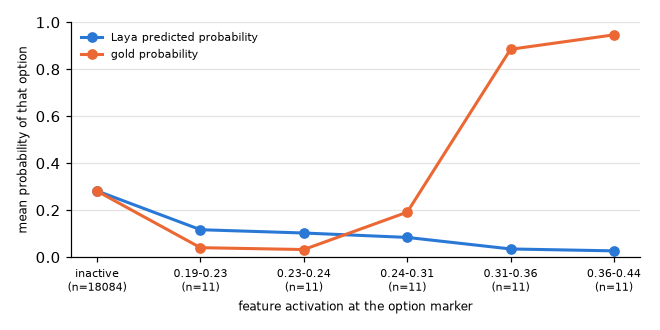

# Feature 5896

Critérios em que aparece: corr_probe_right_laya_wrong

**Interpretação (preencher):** 

---

## Maiores ativações

**tr_customer_service_000198 / churn_risk** (score, customer_service) | ativação 3.836 em `estado` | opções ['0', '1', '2', '3'] | Laya: **2** [0.086, 0.198, 0.675, 0.041] | gabarito: **2**

```
<bos> score question: How likely is this customer to stop doing business with us because of this interaction?<eos>
▸ <mask> level 0: No sign of dissatisfaction.
▸ <mask> level 1: Mild frustration, but the relationship is intact.
▸ <mask> level 2: Clearly unhappy; repeat problems or explicit complaints.
▸ <mask> level 3: Imminent: threatening to cancel, dispute or leave.

<eos>

 {"account": {"lifetime_value_usd": 495, "prior_tickets_90d": 0, "seats": 1, "tenure_months": 8, "tier": "standard"}, "thread": [{"role": "customer", "text": "My payment failed again for the standard plan. I suppose it’⟦s⟧ just my luck, but I’m not really surprised at this point given how things have been going."}]}<eos>
```

**tr_customer_service_000198 / churn_risk** (score, customer_service) | ativação 3.297 em `estado` | opções ['0', '1', '2', '3'] | Laya: **2** [0.086, 0.198, 0.675, 0.041] | gabarito: **2**

```
<bos> score question: How likely is this customer to stop doing business with us because of this interaction?<eos>
▸ <mask> level 0: No sign of dissatisfaction.
▸ <mask> level 1: Mild frustration, but the relationship is intact.
▸ <mask> level 2: Clearly unhappy; repeat problems or explicit complaints.
▸ <mask> level 3: Imminent: threatening to cancel, dispute or leave.

<eos>

 {"account": {"lifetime_value_usd": 495, "prior_tickets_90d": 0, "seats": 1, "tenure_months": 8, "tier": "standard"}, "thread": [{"role": "customer", "text": "My payment failed again for the standard plan. I suppose it’s⟦ just⟧ my luck, but I’m not really surprised at this point given how things have been going."}]}<eos>
```

**tr_customer_service_000198 / churn_risk** (score, customer_service) | ativação 3.066 em `estado` | opções ['0', '1', '2', '3'] | Laya: **2** [0.086, 0.198, 0.675, 0.041] | gabarito: **2**

```
<bos> score question: How likely is this customer to stop doing business with us because of this interaction?<eos>
▸ <mask> level 0: No sign of dissatisfaction.
▸ <mask> level 1: Mild frustration, but the relationship is intact.
▸ <mask> level 2: Clearly unhappy; repeat problems or explicit complaints.
▸ <mask> level 3: Imminent: threatening to cancel, dispute or leave.

<eos>

 {"account": {"lifetime_value_usd": 495, "prior_tickets_90d": 0, "seats": 1, "tenure_months": 8, "tier": "standard"}, "thread": [{"role": "customer", "text": "My payment failed again for the standard plan. I suppose⟦ it⟧’s just my luck, but I’m not really surprised at this point given how things have been going."}]}<eos>
```

**tr_customer_service_000128 / needs_human** (noul, customer_service) | ativação 3.059 em `estado` | opções ['false', 'true'] | Laya: **true** [0.176, 0.824] | gabarito: **true**

```
<bos> noul question: This conversation requires a human agent rather than automated handling.<eos>
▸ <mask> false: Automation can carry this to resolution.
▸ <mask> true: A human must take over: judgement, authority or empathy is required.

<eos>

 {"account": {"lifetime_value_usd": 820, "prior_tickets_90d": 5, "seats": 12, "tenure_months": 11, "tier": "enterprise"}, "thread": [{"role": "customer", "text": "Hello, I'm reaching out because the analytics dashboard we rely⟦ on⟧ has stopped updating. We've been on the enterprise plan for about 11 months, and I've already opened several tickets (five in total) where the issue was only partially resolved."}, {"role": "agent", "text": "I’m sorry to hear the dashboard isn’t updating. Could you let me know when you first noticed the problem and whether any error messages appear?"}, {"role": "customer", "text": "It started this morning; the page loads but the charts stay blank, and the console shows a 502 error. I’ve tried clearing caches and restarting the service, but nothing changes."}]}<eos>
```

**tr_customer_service_000122 / action** (choice, customer_service) | ativação 3.055 em `estado` | opções ['answer_directly', 'close_no_action', 'escalate_to_human', 'execute_refund', 'request_information'] | Laya: **answer_directly** [0.776, 0.208, 0.007, 0.004, 0.004] | gabarito: **escalate_to_human**

```
<bos> choice question: What should the assistant do next with this conversation?<eos>
▸ <mask> answer_directly: The assistant can resolve this itself with information it already has.
▸ <mask> close_no_action: No further action is warranted; the matter is settled.
▸ <mask> escalate_to_human: Hand off to a human agent with the appropriate authority.
▸ <mask> execute_refund: Issue the refund or credit the customer is owed.
▸ <mask> request_information: More detail is needed from the customer before anything can be done.

<eos>

 {"account": {"lifetime_value_usd": 5572, "prior_tickets_90d": 0, "seats": 5, "tenure_months": 60, "tier": "enterprise"}, "orders": [{"amount_usd": 29, "date": "2026-01-18", "id": "A-22153", "status": "failed"}, {"amount_usd": 29, "date": "2026-03-14", "id": "A-61350", "status": "settled"}, {"amount_usd": 29, "date": "2026-03-23", "id": "A-25594", "status": "settled"}], "thread": [{"role": "customer", "text": "I've been using this service for 60 months without much trouble, but I've been trying to export our legacy data for a compliance audit due tomorrow morning and the tool just keeps failing. I'm honestly just exhausted from trying to get this to work⟦ on⟧ my own."}, {"role": "agent", "text": "I'm sorry to hear you're running into issues with the export tool after so many years with us. Could you tell me if you're attempting a full account export or just a specific date range, and what format you've selected?"}, {"role": "customer", "text": "It's a full export of all records. It gets to about 12% and then the browser just times out or the file says it's corrupted. I really need this data for the auditors by tomorrow and I just don't have the energy to keep troubleshooting the same button."}]}<eos>
```

## Ativações medianas (faixa 40-60%, mediana 0.720)

**tr_customer_service_000087 / needs_human** (noul, customer_service) | ativação 0.738 em `pergunta` | opções ['false', 'true'] | Laya: **false** [0.588, 0.412] | gabarito: **true**

```
<bos> noul question: This conversation⟦ requires⟧ a human agent rather than automated handling.<eos>
▸ <mask> false: Automation can carry this to resolution.
▸ <mask> true: A human must take over: judgement, authority or empathy is required.

<eos>

 {"account": {"lifetime_value_usd": 193, "prior_tickets_90d": 5, "seats": 1, "tenure_months": 5, "tier": "standard"}, "orders": [{"amount_usd": 299, "date": "2026-01-09", "id": "A-83690", "status": "settled"}], "thread": [{"role": "customer", "text": "The new analytics dashboard stopped loading a week ago, and I’ve been sent around to different reps without any fix. I’m tired of hearing the same generic apologies."}, {"role": "agent", "text": "I’m really sorry you’re still seeing that issue. Can you let me know which browser and version you’re using, and whether you’ve tried clearing the cache?"}, {"role": "customer", "text": "I’m on Chrome 117, cleared everything, and it still just shows a spinning wheel. This has been happening since the last update."}, {"role": "agent", "text": "Got it, thanks. I’ll open a deeper look at the logs for your account. Do you recall the exact time you first noticed the dashboard freeze, or any error messages that appeared?"}, {"role": "customer", "text": "It started around 3 PM GMT on the 10th, and the only thing I see is ‘Failed to load data’. I’ve already tried re‑logging, no change."}, {"role": "agent", "text": "Understood. I’m flagging this to our UI team and will keep the ticket open while we investigate. Could you also confirm the account ID you’re using so I can tie the logs correctly?"}, {"role": "customer", "text": "The account ID is ACC‑9987; please let me know when you have any update, because I can’t keep working without those reports."}]}<eos>
```

**tr_customer_service_000286 / action** (choice, customer_service) | ativação 0.750 em `opção` | opções ['answer_directly', 'close_no_action', 'escalate_to_human', 'execute_refund', 'request_information'] | Laya: **answer_directly** [0.43, 0.404, 0.028, 0.102, 0.035] | gabarito: **request_information**

```
<bos> choice question: What should the assistant do next with this conversation?<eos>
▸ <mask> answer_directly: The assistant can resolve this itself⟦ with⟧ information it already has.
▸ <mask> close_no_action: No further action is warranted; the matter is settled.
▸ <mask> escalate_to_human: Hand off to a human agent with the appropriate authority.
▸ <mask> execute_refund: Issue the refund or credit the customer is owed.
▸ <mask> request_information: More detail is needed from the customer before anything can be done.

<eos>

 {"account": {"lifetime_value_usd": 2881, "prior_tickets_90d": 1, "seats": 1, "tenure_months": 49, "tier": "premium"}, "orders": [{"amount_usd": 9, "date": "2026-01-14", "id": "A-85515", "status": "failed"}], "thread": [{"role": "customer", "text": "My package was supposed to arrive yesterday and it still isn’t here—this is a hard deadline for me and I need it today!"}]}<eos>
```

**tr_security_incidents_000206 / severity** (score, security_incidents) | ativação 0.835 em `estado` | opções ['0', '1', '2', '3', '4'] | Laya: **2** [0.122, 0.261, 0.374, 0.122, 0.122] | gabarito: **2**

```
<bos> score question: How severe is the potential impact if this alert is real?<eos>
▸ <mask> level 0: Negligible: no access to anything sensitive.
▸ <mask> level 1: Low: limited access, easily reversed.
▸ <mask> level 2: Moderate: access to internal systems or non-public data.
▸ <mask> level 3: High: access to production, secrets or customer data.
▸ <mask> level 4: Critical: active compromise of crown-jewel systems.

<eos>

 {"alert": {"description": "a large transfer to an external destination", "evidence": "A data transfer of 4.8 TB was observed at 2026-09-16 08:15:02 UTC from the internal server DB‑APP-01 to external IP 52.23.45.67, which is on the allow‑list for outbound connections. The operation was initiated⟦ by⟧ an admin account (privileged) that successfully completed MFA and whose password was rotated on 2026-09-13. No change window was specified for this activity.", "rule": "data_egress"}, "context": {"asset_criticality": "low", "change_window_active": false, "source_on_allowlist": true}, "history": {"credential_rotation_days_ago": 3, "distinct_countries_30d": 1, "logins_30d": 722, "prior_alerts_90d": 0}, "principal": {"mfa_enrolled": true, "name": "svc-support-965", "privileges": ["deploy:production", "secrets:read"], "type": "admin"}}<eos>
```

**tr_security_incidents_000121 / urgency** (score, security_incidents) | ativação 0.725 em `estado` | opções ['0', '1', '2', '3'] | Laya: **3** [0.152, 0.303, 0.184, 0.36] | gabarito: **3**

```
<bos> score question: How quickly must a responder act on this alert?<eos>
▸ <mask> level 0: No time pressure; can wait indefinitely.
▸ <mask> level 1: Routine; handle within the normal queue.
▸ <mask> level 2: Elevated; should be handled within the same week.
▸ <mask> level 3: Critical; requires action within the same day.

<eos>

 {"alert": {"description": "a security group was opened to the public internet", "evidence⟦":⟧ "During an active change window, the privileged service account 'svc-automation' modified security group 'sg-web-ingress' to allow traffic from 0.0.0.0/0. The command was issued from a known allowlist source and authenticated via MFA using credentials rotated 14 days ago.", "rule": "config_drift"}, "context": {"asset_criticality": "crown_jewel", "change_window_active": true, "source_on_allowlist": true}, "history": {"credential_rotation_days_ago": 14, "distinct_countries_30d": 3, "logins_30d": 1632, "prior_alerts_90d": 0}, "principal": {"mfa_enrolled": true, "name": "adm-infra-171", "privileges": ["deploy:production", "secrets:read"], "type": "service_account"}}<eos>
```

**tr_security_incidents_000072 / credential_compromise** (noul, security_incidents) | ativação 0.662 em `estado` | opções ['false', 'true'] | Laya: **true** [0.007, 0.993] | gabarito: **true**

```
<bos> noul question: The evidence indicates a credential or account has been compromised.<eos>
▸ <mask> false: no, the statement does not hold
▸ <mask> true: yes, the statement holds

<eos>

 {"alert": {"description": "an unrecognised binary executed on a server", "evidence⟦":⟧ "The unrecognised binary `svc_init.bin` was executed by an unprivileged admin principal on server `srv-prod-09` at 14:22 UTC. This execution originated from the unrecognised IP 198.51.100.12 outside of a change window using credentials last rotated 90 days ago.", "rule": "suspicious_process"}, "context": {"asset_criticality": "medium", "change_window_active": false, "source_on_allowlist": false}, "history": {"credential_rotation_days_ago": 90, "distinct_countries_30d": 1, "logins_30d": 1141, "prior_alerts_90d": 1}, "principal": {"mfa_enrolled": true, "name": "ci-infra-555", "privileges": ["repo:read"], "type": "admin"}}<eos>
```

## Estatísticas (conjunto de descoberta, dev e teste)

**pred / error**

| split | decisões | ativas | ativas e Laya errou | taxa | lift | q (BH) | OR (CMH) | q (CMH) |
|---|---|---|---|---|---|---|---|---|
| discovery | 5100 | 0 | 0 | nan | nan | nan | nan | nan |
| dev | 900 | 0 | 0 | nan | nan | nan | nan | nan |
| test | 2000 | 0 | 0 | nan | nan | nan | nan | nan |

**corr / error**

| split | decisões | ativas | ativas e Laya errou | taxa | lift | q (BH) | OR (CMH) | q (CMH) |
|---|---|---|---|---|---|---|---|---|
| discovery | 5100 | 23 | 23 | 1.000 | 1.55 | 0.000149 | inf | 0.923 |
| dev | 900 | 4 | 4 | 1.000 | 1.49 | nan | nan | nan |
| test | 2000 | 3 | 3 | 1.000 | 1.54 | nan | nan | nan |

**state / error**

| split | decisões | ativas | ativas e Laya errou | taxa | lift | q (BH) | OR (CMH) | q (CMH) |
|---|---|---|---|---|---|---|---|---|
| discovery | 5100 | 1047 | 603 | 0.576 | 0.89 | 6.56e-06 | 0.93 | 0.703 |
| dev | 900 | 162 | 99 | 0.611 | 0.91 | 0.38 | 1.07 | 0.915 |
| test | 2000 | 382 | 221 | 0.579 | 0.89 | 0.0269 | 0.92 | 0.826 |

**pred / probe_right_laya_wrong**

| split | decisões | ativas | ativas e Laya errou | taxa | lift | q (BH) | OR (CMH) | q (CMH) |
|---|---|---|---|---|---|---|---|---|
| discovery | 2932 | 0 | 0 | nan | nan | nan | nan | nan |
| dev | 523 | 0 | 0 | nan | nan | nan | nan | nan |
| test | 1149 | 0 | 0 | nan | nan | nan | nan | nan |

**corr / probe_right_laya_wrong**

| split | decisões | ativas | ativas e Laya errou | taxa | lift | q (BH) | OR (CMH) | q (CMH) |
|---|---|---|---|---|---|---|---|---|
| discovery | 2932 | 22 | 22 | 1.000 | 1.65 | 5.81e-05 | nan | nan |
| dev | 523 | 4 | 4 | 1.000 | 1.55 | nan | nan | nan |
| test | 1149 | 3 | 3 | 1.000 | 1.64 | nan | nan | nan |

**state / probe_right_laya_wrong**

| split | decisões | ativas | ativas e Laya errou | taxa | lift | q (BH) | OR (CMH) | q (CMH) |
|---|---|---|---|---|---|---|---|---|
| discovery | 2932 | 590 | 291 | 0.493 | 0.81 | 1.43e-08 | 0.91 | 0.643 |
| dev | 523 | 82 | 44 | 0.537 | 0.83 | 0.186 | 1.30 | 0.681 |
| test | 1149 | 238 | 122 | 0.513 | 0.84 | 0.0103 | 0.87 | 0.724 |

Confusão mais sobre-representada (corr): `duplicate|1>0` (n=22, lift 22.48, p=5.28e-30). Formato `pergunta|índice previsto>índice correto`.

Confusão mais sobre-representada (state): `true_positive|1>0` (n=35, lift 2.44, p=3.18e-08). Formato `pergunta|índice previsto>índice correto`.



