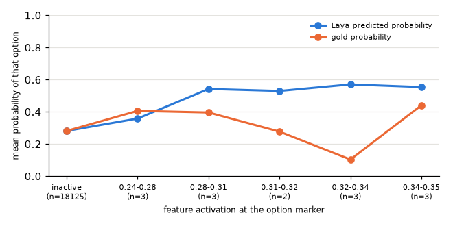

# Feature 5954

Critérios em que aparece: state_error_stratified

**Interpretação (preencher):** 

---

## Maiores ativações

**tr_customer_service_000078 / category** (choice, customer_service) | ativação 2.295 em `estado` | opções ['account', 'billing', 'delivery', 'refund', 'technical'] | Laya: **billing** [0.039, 0.831, 0.04, 0.003, 0.087] | gabarito: **delivery**

```
<bos> choice question: What is this customer conversation primarily about?<eos>
▸ <mask> account: Login, plan changes, profile or access management.
▸ <mask> billing: A charge, invoice, subscription or payment problem.
▸ <mask> delivery: Shipping, fulfilment or delivery of a physical item.
▸ <mask> refund: The customer is explicitly asking for money back.
▸ <mask> technical: The product or service is not working as expected.

<eos>

 {"account": {"lifetime_value_usd": 1592, "prior_tickets_90d": 0, "seats": 12, "tenure_months": 60, "tier": "premium"}, "orders": [{"amount_usd": 598, "date": "2026-01-10", "id": "A-12739", "status": "refunded"}, {"amount_usd": 598, "date": "2026-03-19", "id": "A-59410", "status": "failed"}, {"amount_usd": 598, "date": "2026-01-16", "id": "A-91127", "status": "failed"}], "thread": [{"role": "customer", "text": "Hello, I am a long-time premium member and my latest order of $598 just arrived with significant damage to the exterior packaging and the item itself. I have an event this Friday and really need this resolved."}, {"role": "agent", "text": "I am very sorry to hear that your order arrived in that condition. To help me understand the extent of the damage, could you please describe exactly what looks broken?"}, {"role": "customer", "text": "The glass display is completely shattered,⟦ and⟧ there is a deep dent on the base unit. It looks like it was crushed during transit."}, {"role": "agent", "text": "Thank you for those details. Would you be able to upload a few clear photographs of the damage to this chat so I can review them?"}, {"role": "customer", "text": "I have taken photos of the unit from several angles. Please let me know if there's anything else you need from me before the end of the day."}]}<eos>
```

**tr_customer_service_000078 / action** (choice, customer_service) | ativação 2.197 em `estado` | opções ['answer_directly', 'close_no_action', 'escalate_to_human', 'execute_refund', 'request_information'] | Laya: **close_no_action** [0.155, 0.447, 0.068, 0.31, 0.021] | gabarito: **request_information**

```
<bos> choice question: What should the assistant do next with this conversation?<eos>
▸ <mask> answer_directly: The assistant can resolve this itself with information it already has.
▸ <mask> close_no_action: No further action is warranted; the matter is settled.
▸ <mask> escalate_to_human: Hand off to a human agent with the appropriate authority.
▸ <mask> execute_refund: Issue the refund or credit the customer is owed.
▸ <mask> request_information: More detail is needed from the customer before anything can be done.

<eos>

 {"account": {"lifetime_value_usd": 1592, "prior_tickets_90d": 0, "seats": 12, "tenure_months": 60, "tier": "premium"}, "orders": [{"amount_usd": 598, "date": "2026-01-10", "id": "A-12739", "status": "refunded"}, {"amount_usd": 598, "date": "2026-03-19", "id": "A-59410", "status": "failed"}, {"amount_usd": 598, "date": "2026-01-16", "id": "A-91127", "status": "failed"}], "thread": [{"role": "customer", "text": "Hello, I am a long-time premium member and my latest order of $598 just arrived with significant damage to the exterior packaging and the item itself. I have an event this Friday and really need this resolved."}, {"role": "agent", "text": "I am very sorry to hear that your order arrived in that condition. To help me understand the extent of the damage, could you please describe exactly what looks broken?"}, {"role": "customer", "text": "The glass display is completely shattered,⟦ and⟧ there is a deep dent on the base unit. It looks like it was crushed during transit."}, {"role": "agent", "text": "Thank you for those details. Would you be able to upload a few clear photographs of the damage to this chat so I can review them?"}, {"role": "customer", "text": "I have taken photos of the unit from several angles. Please let me know if there's anything else you need from me before the end of the day."}]}<eos>
```

**tr_customer_service_000034 / needs_human** (noul, customer_service) | ativação 2.090 em `estado` | opções ['false', 'true'] | Laya: **false** [0.52, 0.48] | gabarito: **true**

```
<bos> noul question: This conversation requires a human agent rather than automated handling.<eos>
▸ <mask> false: Automation can carry this to resolution.
▸ <mask> true: A human must take over: judgement, authority or empathy is required.

<eos>

 {"account": {"lifetime_value_usd": 102, "prior_tickets_90d": 1, "seats": 1, "tenure_months": 2, "tier": "standard"}, "thread": [{"role": "customer", "text": "I just opened my delivery and the item is in pieces, but the shipping box looks totally fine? I don't understand how this happened. I have a hard deadline for a project this Friday and if this isn't resolved by then, I'm closing my account and going to a competitor."}, {"role": "agent", "text": "I'm sorry to hear that your item arrived damaged. Could you please provide a few more details about the state of the internal protective packaging when you first opened it?"}, {"role": "customer", "text": "The bubble wrap was there⟦ but⟧ it clearly didn't do anything. I've only been with you for two months and my first ticket about the setup is still unresolved; I really can't afford to wait past Friday for a solution on this."}]}<eos>
```

**tr_customer_service_000034 / churn_risk** (score, customer_service) | ativação 2.061 em `estado` | opções ['0', '1', '2', '3'] | Laya: **1** [0.102, 0.442, 0.423, 0.032] | gabarito: **3**

```
<bos> score question: How likely is this customer to stop doing business with us because of this interaction?<eos>
▸ <mask> level 0: No sign of dissatisfaction.
▸ <mask> level 1: Mild frustration, but the relationship is intact.
▸ <mask> level 2: Clearly unhappy; repeat problems or explicit complaints.
▸ <mask> level 3: Imminent: threatening to cancel, dispute or leave.

<eos>

 {"account": {"lifetime_value_usd": 102, "prior_tickets_90d": 1, "seats": 1, "tenure_months": 2, "tier": "standard"}, "thread": [{"role": "customer", "text": "I just opened my delivery and the item is in pieces, but the shipping box looks totally fine? I don't understand how this happened. I have a hard deadline for a project this Friday and if this isn't resolved by then, I'm closing my account and going to a competitor."}, {"role": "agent", "text": "I'm sorry to hear that your item arrived damaged. Could you please provide a few more details about the state of the internal protective packaging when you first opened it?"}, {"role": "customer", "text": "The bubble wrap was there⟦ but⟧ it clearly didn't do anything. I've only been with you for two months and my first ticket about the setup is still unresolved; I really can't afford to wait past Friday for a solution on this."}]}<eos>
```

**tr_customer_service_000078 / needs_human** (noul, customer_service) | ativação 2.039 em `estado` | opções ['false', 'true'] | Laya: **false** [0.55, 0.45] | gabarito: **true**

```
<bos> noul question: This conversation requires a human agent rather than automated handling.<eos>
▸ <mask> false: Automation can carry this to resolution.
▸ <mask> true: A human must take over: judgement, authority or empathy is required.

<eos>

 {"account": {"lifetime_value_usd": 1592, "prior_tickets_90d": 0, "seats": 12, "tenure_months": 60, "tier": "premium"}, "orders": [{"amount_usd": 598, "date": "2026-01-10", "id": "A-12739", "status": "refunded"}, {"amount_usd": 598, "date": "2026-03-19", "id": "A-59410", "status": "failed"}, {"amount_usd": 598, "date": "2026-01-16", "id": "A-91127", "status": "failed"}], "thread": [{"role": "customer", "text": "Hello, I am a long-time premium member and my latest order of $598 just arrived with significant damage to the exterior packaging and the item itself. I have an event this Friday and really need this resolved."}, {"role": "agent", "text": "I am very sorry to hear that your order arrived in that condition. To help me understand the extent of the damage, could you please describe exactly what looks broken?"}, {"role": "customer", "text": "The glass display is completely shattered,⟦ and⟧ there is a deep dent on the base unit. It looks like it was crushed during transit."}, {"role": "agent", "text": "Thank you for those details. Would you be able to upload a few clear photographs of the damage to this chat so I can review them?"}, {"role": "customer", "text": "I have taken photos of the unit from several angles. Please let me know if there's anything else you need from me before the end of the day."}]}<eos>
```

## Ativações medianas (faixa 40-60%, mediana 0.559)

**tr_agent_trace_observability_000298 / needs_review** (noul, agent_trace_observability) | ativação 0.592 em `estado` | opções ['false', 'true'] | Laya: **false** [0.877, 0.123] | gabarito: **false**

```
<bos> noul question: This trace requires human review.<eos>
▸ <mask> false: No human attention is warranted.
▸ <mask> true: A human should inspect this run.

<eos>

 {"agent": {"autonomy": "checkpointed", "model": "internal-agent-v4"}, "constraints": ["Never delete anything matching release/*", "Do not exceed a $50 spend on cloud resources"], "task": "Backfill missing analytics events for the last seven days.", "trace_summary": {"constraint_violations": 0, "duration_s":⟦ ⟧198.2, "irreversible_actions": 1, "steps": 3, "tool_errors": 0}}<eos>
```

**tr_customer_service_000242 / needs_human** (noul, customer_service) | ativação 0.541 em `estado` | opções ['false', 'true'] | Laya: **true** [0.164, 0.836] | gabarito: **true**

```
<bos> noul question: This conversation requires a human agent rather than automated handling.<eos>
▸ <mask> false: Automation can carry this to resolution.
▸ <mask> true: A human must take over: judgement, authority or empathy is required.

<eos>

 {"account": {"lifetime_value_usd": 173, "prior_tickets_90d": 3, "seats": 1, "tenure_months": 8, "tier": "enterprise"}, "orders": [{"amount_usd": 9, "date": "2026-02-12", "id": "A-38723", "status": "settled"}, {"amount_usd": 9, "date": "2026-03-02", "id": "A-97049", "status": "pending"}, {"amount_usd": 9, "date": "2026-02-13", "id": "A-82820", "status": "refunded⟦"}⟧], "thread": [{"role": "customer", "text": "I’m really upset—my latest invoice shows an extra $9 charge I never approved, and I need this cleared before the end of the week."}, {"role": "agent", "text": "I’m sorry to hear that. To investigate, could you provide the invoice number and the date it was issued?"}, {"role": "customer", "text": "The invoice is #E20230908, dated September 1st. Please look into why that $9 appears and let me know what’s needed to fix it before Friday."}]}<eos>
```

**tr_security_incidents_000065 / urgency** (score, security_incidents) | ativação 0.556 em `opção` | opções ['0', '1', '2', '3'] | Laya: **3** [0.137, 0.188, 0.319, 0.356] | gabarito: **2**

```
<bos> score question: How quickly must a responder act on this alert?<eos>
▸ <mask> level 0: No time pressure; can wait⟦ indefinitely⟧.
▸ <mask> level 1: Routine; handle within the normal queue.
▸ <mask> level 2: Elevated; should be handled within the same week.
▸ <mask> level 3: Critical; requires action within the same day.

<eos>

 {"alert": {"description": "an unrecognised binary executed on a server", "evidence": "At 2026-09-15 14:23:08 UTC, an employee workstation \"workstation-12\" launched the unknown binary \"/tmp/lsass_helper\" (PID 5874) on server \"app-prod-01\" during an open change window. The execution originated from an unrecognised source IP 192.0.2.55, and the employee’s MFA token was validated. The user’s credentials were last rotated 90 days ago.", "rule": "suspicious_process"}, "context": {"asset_criticality": "low", "change_window_active": true, "source_on_allowlist": false}, "history": {"credential_rotation_days_ago": 90, "distinct_countries_30d": 4, "logins_30d": 1617, "prior_alerts_90d": 0}, "principal": {"mfa_enrolled": true, "name": "usr-billing-187", "privileges": ["repo:read"], "type": "employee"}}<eos>
```

**tr_invoice_processing_000252 / disposition** (choice, invoice_processing) | ativação 0.542 em `estado` | opções ['approve', 'hold', 'manual_review', 'reject'] | Laya: **approve** [0.467, 0.19, 0.022, 0.321] | gabarito: **approve**

```
<bos> choice question: How should this vendor invoice be dispositioned?<eos>
▸ <mask> approve: Matches the order and delivery; approve for payment.
▸ <mask> hold: Something needs confirming before payment; hold pending clarification.
▸ <mask> manual_review: A human in finance must review the discrepancy.
▸ <mask> reject: Should not be paid: duplicate, unauthorised or materially wrong.

<eos>

 {"delivery": {"condition": "accepted", "date": "2026-03-13", "received_qty": 100}, "invoice": {"currency": "USD", "id": "INV-2026-6719", "lines": [{"qty": 100, "sku": "SKU-476", "total_usd": 8113.0, "unit_usd": 81.13}], "total_usd": 8113.0, "vendor": "Acme Fabrication"}, "payment": {"days_until_due": 18, "discount_expires_in_days": null, "early_payment_discount_pct": null, "status": "scheduled", "terms": "net 15"}, "purchase_order": {"freight_terms": "freight prepaid by vendor, not separately billable", "id": "PO-1307", "lines": [{"qty": 100, "unit_usd": 81.13}], "total_usd": 8113.0}, "vendor_history": {"disputes_12m": 0, "invoices_12m": 29, "prior_invoice_ids": ["INV-2026-7735", "INV-2026-2980⟦",⟧ "INV-2026-5813"]}}<eos>
```

**tr_invoice_processing_000166 / duplicate** (noul, invoice_processing) | ativação 0.565 em `estado` | opções ['false', 'true'] | Laya: **true** [0.006, 0.994] | gabarito: **false**

```
<bos> noul question: This invoice appears to duplicate an invoice already submitted.<eos>
▸ <mask> false: no, the statement does not hold
▸ <mask> true: yes, the statement holds

<eos>

 {"delivery": {"condition": "accepted", "date": "2026-03-17", "received_qty": 395}, "invoice": {"currency": "USD", "id": "INV-2026-4266", "lines": [{"qty": 395, "sku": "SKU-688", "total_usd": 111188.55, "unit_usd": 281.49}], "total_usd": 111188.55, "vendor": "Orbit Logistics"}, "payment": {"days_until_due": 0, "discount_expires_in_days": 3, "early_payment_discount_pct": 2.0, "status": "scheduled", "terms": "net 30"}, "purchase_order": {"freight_terms": "freight prepaid by vendor, not separately billable", "id": "PO-1399", "lines": [{"qty": 400, "unit_usd": 281.49}], "total_usd": 112596.0}, "vendor_history": {"disputes_12m": 0, "invoices_12m": 19, "prior_invoice_ids": ["INV-2026-2803",⟦ "⟧INV-2026-7039", "INV-2026-5065"]}}<eos>
```

## Estatísticas (conjunto de descoberta, dev e teste)

**pred / error**

| split | decisões | ativas | ativas e Laya errou | taxa | lift | q (BH) | OR (CMH) | q (CMH) |
|---|---|---|---|---|---|---|---|---|
| discovery | 5100 | 13 | 9 | 0.692 | 1.08 | nan | nan | nan |
| dev | 900 | 4 | 3 | 0.750 | 1.12 | nan | nan | nan |
| test | 2000 | 6 | 5 | 0.833 | 1.28 | nan | nan | nan |

**corr / error**

| split | decisões | ativas | ativas e Laya errou | taxa | lift | q (BH) | OR (CMH) | q (CMH) |
|---|---|---|---|---|---|---|---|---|
| discovery | 5100 | 5 | 1 | 0.200 | 0.31 | nan | nan | nan |
| dev | 900 | 3 | 2 | 0.667 | 0.99 | nan | nan | nan |
| test | 2000 | 1 | 0 | 0.000 | 0.00 | nan | nan | nan |

**state / error**

| split | decisões | ativas | ativas e Laya errou | taxa | lift | q (BH) | OR (CMH) | q (CMH) |
|---|---|---|---|---|---|---|---|---|
| discovery | 5100 | 1902 | 1230 | 0.647 | 1.00 | 0.868 | 1.30 | 0.028 |
| dev | 900 | 338 | 217 | 0.642 | 0.96 | 0.492 | 1.08 | 0.918 |
| test | 2000 | 740 | 490 | 0.662 | 1.02 | 0.719 | 1.36 | 0.213 |

**pred / probe_right_laya_wrong**

| split | decisões | ativas | ativas e Laya errou | taxa | lift | q (BH) | OR (CMH) | q (CMH) |
|---|---|---|---|---|---|---|---|---|
| discovery | 2932 | 6 | 4 | 0.667 | 1.10 | nan | nan | nan |
| dev | 523 | 1 | 1 | 1.000 | 1.55 | nan | nan | nan |
| test | 1149 | 4 | 4 | 1.000 | 1.64 | nan | nan | nan |

**corr / probe_right_laya_wrong**

| split | decisões | ativas | ativas e Laya errou | taxa | lift | q (BH) | OR (CMH) | q (CMH) |
|---|---|---|---|---|---|---|---|---|
| discovery | 2932 | 3 | 1 | 0.333 | 0.55 | nan | nan | nan |
| dev | 523 | 2 | 2 | 1.000 | 1.55 | nan | nan | nan |
| test | 1149 | 0 | 0 | nan | nan | nan | nan | nan |

**state / probe_right_laya_wrong**

| split | decisões | ativas | ativas e Laya errou | taxa | lift | q (BH) | OR (CMH) | q (CMH) |
|---|---|---|---|---|---|---|---|---|
| discovery | 2932 | 1058 | 628 | 0.594 | 0.98 | 0.475 | 1.25 | 0.188 |
| dev | 523 | 193 | 117 | 0.606 | 0.94 | 0.458 | 1.14 | 0.747 |
| test | 1149 | 402 | 245 | 0.609 | 1.00 | 1 | 1.38 | 0.377 |

Confusão mais sobre-representada (pred): `discrepancy_severity|2>3` (n=6, lift 39.90, p=nan). Formato `pergunta|índice previsto>índice correto`.

Confusão mais sobre-representada (corr): `severity|0>2` (n=1, lift 145.71, p=nan). Formato `pergunta|índice previsto>índice correto`.

Confusão mais sobre-representada (state): `urgency|3>1` (n=65, lift 2.13, p=5.96e-15). Formato `pergunta|índice previsto>índice correto`.



