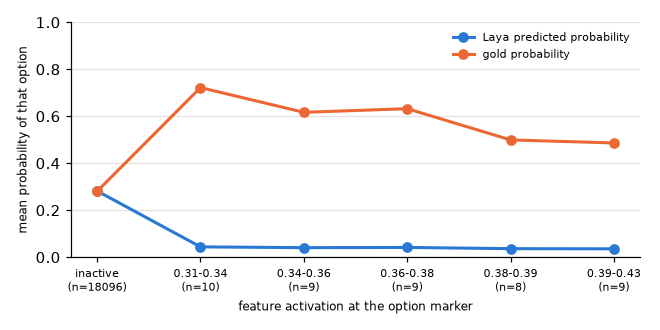

# Feature 6018

Critérios em que aparece: corr_error

**Interpretação (preencher):** 

---

## Maiores ativações

**tr_customer_service_000268 / urgency** (score, customer_service) | ativação 1.852 em `estado` | opções ['0', '1', '2', '3'] | Laya: **1** [0.056, 0.4, 0.3, 0.244] | gabarito: **3**

```
<bos> score question: How time-sensitive is this conversation?<eos>
▸ <mask> level 0: No time pressure; can wait indefinitely.
▸ <mask> level 1: Routine; handle within the normal queue.
▸ <mask> level 2: Elevated; should be handled within the same week.
▸ <mask> level 3: Critical; requires action within the same day.

<eos>

 {"account": {"lifetime_value_usd": 549, "prior_tickets_90d": 3, "seats": 1, "tenure_months": 8, "tier": "standard"}, "orders": [{"amount_usd": 99, "date": "2026-01-21", "id": "A-65314", "status": "refunded"}, {"amount_usd": 99, "date": "2026-02-28", "id": "A-55952", "status": "failed"}, {"amount_usd": 99, "date": "2026-02-26", "id": "A-57626", "status": "failed"}], "thread": [{"role": "customer", "text": "I’ve been double‑⟦charged⟧ $99 for the same month and I need this fixed by tomorrow or I won’t be able to pay my rent."}, {"role": "agent", "text": "I understand how important this is. Could you tell me the date of the two transactions and the payment method you used, so I can locate them?"}, {"role": "customer", "text": "Both charges show up on my statement for the 5th of this month, using the same Visa card that ends in 1234."}]}<eos>
```

**tr_customer_service_000268 / needs_human** (noul, customer_service) | ativação 1.805 em `estado` | opções ['false', 'true'] | Laya: **true** [0.042, 0.958] | gabarito: **true**

```
<bos> noul question: This conversation requires a human agent rather than automated handling.<eos>
▸ <mask> false: Automation can carry this to resolution.
▸ <mask> true: A human must take over: judgement, authority or empathy is required.

<eos>

 {"account": {"lifetime_value_usd": 549, "prior_tickets_90d": 3, "seats": 1, "tenure_months": 8, "tier": "standard"}, "orders": [{"amount_usd": 99, "date": "2026-01-21", "id": "A-65314", "status": "refunded"}, {"amount_usd": 99, "date": "2026-02-28", "id": "A-55952", "status": "failed"}, {"amount_usd": 99, "date": "2026-02-26", "id": "A-57626", "status": "failed"}], "thread": [{"role": "customer", "text": "I’ve been double‑⟦charged⟧ $99 for the same month and I need this fixed by tomorrow or I won’t be able to pay my rent."}, {"role": "agent", "text": "I understand how important this is. Could you tell me the date of the two transactions and the payment method you used, so I can locate them?"}, {"role": "customer", "text": "Both charges show up on my statement for the 5th of this month, using the same Visa card that ends in 1234."}]}<eos>
```

**tr_customer_service_000189 / urgency** (score, customer_service) | ativação 1.756 em `estado` | opções ['0', '1', '2', '3'] | Laya: **2** [0.215, 0.259, 0.428, 0.098] | gabarito: **2**

```
<bos> score question: How time-sensitive is this conversation?<eos>
▸ <mask> level 0: No time pressure; can wait indefinitely.
▸ <mask> level 1: Routine; handle within the normal queue.
▸ <mask> level 2: Elevated; should be handled within the same week.
▸ <mask> level 3: Critical; requires action within the same day.

<eos>

 {"account": {"lifetime_value_usd": 3857, "prior_tickets_90d": 0, "seats": 1, "tenure_months": 41, "tier": "standard"}, "thread": [{"role": "customer", "text": "I’m fed up with seeing the same charge hit my card again. My standard plan has been active for 41 months and this is the first time I’ve been billed twice for the same period. I need this fixed before the end of the week or my budget’s ruined."}, {"role": "agent", "text": "I understand how irritating that must be. Could you provide the date of the transactions and the last four digits of the card you used?"}, {"role": "customer", "text": "The charges both show up on September 3rd, and the last four digits are 8421. I’ve attached the statement screenshot."}, {"role": "agent", "text": "Thanks for the⟦ details⟧. I’ll look into why the duplicate appeared. Just to confirm, are there any other recent charges on the account that seem off?"}, {"role": "customer", "text": "No, just the two identical ones. I really need this cleared up by Friday because I have to reconcile my accounts."}]}<eos>
```

**tr_customer_service_000113 / needs_human** (noul, customer_service) | ativação 1.715 em `estado` | opções ['false', 'true'] | Laya: **false** [0.976, 0.024] | gabarito: **false**

```
<bos> noul question: This conversation requires a human agent rather than automated handling.<eos>
▸ <mask> false: Automation can carry this to resolution.
▸ <mask> true: A human must take over: judgement, authority or empathy is required.

<eos>

 {"account": {"lifetime_value_usd": 47, "prior_tickets_90d": 0, "seats": 1, "tenure_months": 1, "tier": "standard"}, "orders": [{"amount_usd": 87, "date": "2026-01-11", "id": "A-32698", "status": "settled"}, {"amount_usd": 87, "date": "2026-03-25", "id": "A-92735", "status": "refunded"}], "thread": [{"role": "customer", "text": "Hi there! I've been using the standard plan for about a month now and I really enjoy the interface, but I've noticed the page load times are getting quite slow today. Is there anything I should check on my end?"}, {"role": "agent", "text": "Welcome to the platform! I'd be happy to help you look into those load times. Are you experiencing this slowness on all pages, or is it specifically when you try to generate reports?"}, {"role": "customer", "text": "It seems to be happening everywhere, especially when I try to save my work. I paid $8⟦7⟧ for this month and I have a very important hard deadline this evening, so I'm a bit worried about getting everything finished in time."}, {"role": "agent", "text": "I understand the importance of meeting your deadline. Could you tell me which web browser you are currently using and if you have tried clearing your cache recently?"}, {"role": "customer", "text": "I'm using the latest version of Chrome and I did try clearing the cache, but the lag persists. I really need to have this project submitted by 5:00 PM today, so any guidance on how to speed things up would be greatly appreciated."}]}<eos>
```

**tr_customer_service_000201 / category** (choice, customer_service) | ativação 1.714 em `estado` | opções ['account', 'billing', 'delivery', 'refund', 'technical'] | Laya: **delivery** [0.015, 0.02, 0.949, 0.005, 0.01] | gabarito: **delivery**

```
<bos> choice question: What is this customer conversation primarily about?<eos>
▸ <mask> account: Login, plan changes, profile or access management.
▸ <mask> billing: A charge, invoice, subscription or payment problem.
▸ <mask> delivery: Shipping, fulfilment or delivery of a physical item.
▸ <mask> refund: The customer is explicitly asking for money back.
▸ <mask> technical: The product or service is not working as expected.

<eos>

 {"account": {"lifetime_value_usd": 4017, "prior_tickets_90d": 0, "seats": 1, "tenure_months": 72, "tier": "free"}, "thread": [{"role": "customer", "text": "Hello, I received my recent order and the main unit arrived with a cracked screen. I need a replacement before September 3⟦0⟧ because I have a client demo scheduled."}, {"role": "agent", "text": "I’m sorry to hear that. Could you share the order number and a photo of the damage so we can look into it?"}, {"role": "customer", "text": "Sure, the order is #A12345 and I’ve attached the photo. Please let me know if anything else is needed; the demo is on the 30th, so timing is tight."}, {"role": "agent", "text": "Thank you for the details. I’ve logged the information and will forward it to the returns team. Could you also confirm the shipping address you’d like the replacement sent to?"}, {"role": "customer", "text": "The address is 123 Maple St, Apt 4B, Springfield. I’m hoping the new unit can arrive before the demo date; please keep me posted."}]}<eos>
```

## Ativações medianas (faixa 40-60%, mediana 0.855)

**tr_invoice_processing_000197 / discrepancy_severity** (score, invoice_processing) | ativação 0.865 em `estado` | opções ['0', '1', '2', '3'] | Laya: **2** [0.071, 0.271, 0.581, 0.076] | gabarito: **3**

```
<bos> score question: How material is any discrepancy between the invoice, the order and the delivery?<eos>
▸ <mask> level 0: None: everything reconciles.
▸ <mask> level 1: Trivial: rounding or a cosmetic difference.
▸ <mask> level 2: Moderate: a real difference worth confirming.
▸ <mask> level 3: Material: a large or unexplained difference.

<eos>

 {"delivery": {"condition": "accepted with exceptions", "date": "2026-03-20", "received_qty": 100}, "invoice": {"currency": "USD", "id": "INV-2026-2449", "lines": [{"qty": 100, "sku": "SKU-717", "total_usd": 14417.0, "unit_usd": 144.17}], "total_usd": 14417.0, "vendor": "Vantage Materials"}, "payment": {"days_until_due": 18, "discount_expires_in_days": null, "early_payment_discount_pct": null, "status": "scheduled", "terms": "net 30"}, "purchase_order": {"freight_terms": "freight prepaid by vendor, not separately billable", "id": "PO-3796", "lines": [{"qty": 100, "unit_usd": 144.17}], "total_usd": 14417.0}, "vendor_history": {"disputes_12m": 2, "⟦invoices⟧_12m": 25, "prior_invoice_ids": ["INV-2026-2449", "INV-2026-9332", "INV-2026-7430", "INV-2026-9715"]}}<eos>
```

**tr_invoice_processing_000042 / disposition** (choice, invoice_processing) | ativação 0.901 em `opção` | opções ['approve', 'hold', 'manual_review', 'reject'] | Laya: **reject** [0.404, 0.143, 0.023, 0.43] | gabarito: **hold**

```
<bos> choice question: How should this vendor invoice be dispositioned?<eos>
▸ <mask> approve: Matches the order and⟦ delivery⟧; approve for payment.
▸ <mask> hold: Something needs confirming before payment; hold pending clarification.
▸ <mask> manual_review: A human in finance must review the discrepancy.
▸ <mask> reject: Should not be paid: duplicate, unauthorised or materially wrong.

<eos>

 {"delivery": {"condition": "accepted with exceptions", "date": "2026-03-21", "received_qty": 50}, "invoice": {"currency": "USD", "id": "INV-2026-9102", "lines": [{"qty": 50, "sku": "SKU-900", "total_usd": 7907.0, "unit_usd": 158.14}], "total_usd": 7907.0, "vendor": "Kestrel Supply"}, "payment": {"days_until_due": 11, "discount_expires_in_days": null, "early_payment_discount_pct": null, "status": "scheduled", "terms": "net 60"}, "purchase_order": {"freight_terms": "freight prepaid by vendor, not separately billable", "id": "PO-7775", "lines": [{"qty": 50, "unit_usd": 158.14}], "total_usd": 7907.0}, "vendor_history": {"disputes_12m": 0, "invoices_12m": 36, "prior_invoice_ids": ["INV-2026-4975"]}}<eos>
```

**tr_customer_service_000287 / action** (choice, customer_service) | ativação 0.879 em `opção` | opções ['answer_directly', 'close_no_action', 'escalate_to_human', 'execute_refund', 'request_information'] | Laya: **close_no_action** [0.095, 0.859, 0.006, 0.039, 0.002] | gabarito: **escalate_to_human**

```
<bos> choice question: What should the assistant do next with this conversation?<eos>
▸ <mask> answer_directly: The assistant can resolve this itself with information it already has.
▸ <mask> close_no_action: No further action is warranted; the matter is settled.
▸ <mask> escalate_to_human: Hand off to a human agent with the appropriate authority.
▸ <mask> execute_refund: Issue the refund or credit the customer is owed.
▸ <mask> request_⟦information⟧: More detail is needed from the customer before anything can be done.

<eos>

 {"account": {"lifetime_value_usd": 400, "prior_tickets_90d": 0, "seats": 40, "tenure_months": 5, "tier": "premium"}, "thread": [{"role": "customer", "text": "I’m fed up with this service. I want my account closed right now—no more emails, no more charges."}, {"role": "agent", "text": "I understand your frustration. Could you please confirm the email address associated with the account so I can locate it?"}, {"role": "customer", "text": "It’s the same one you have on file, but I’m telling you outright: terminate everything immediately."}, {"role": "agent", "text": "Thanks for confirming. To proceed, could you also provide the last four digits of the payment method on record?"}, {"role": "customer", "text": "Fine—4112. I expect this to be done without any more back‑and‑forth."}]}<eos>
```

**tr_invoice_processing_000009 / discrepancy_severity** (score, invoice_processing) | ativação 0.836 em `estado` | opções ['0', '1', '2', '3'] | Laya: **2** [0.034, 0.363, 0.567, 0.036] | gabarito: **2**

```
<bos> score question: How material is any discrepancy between the invoice, the order and the delivery?<eos>
▸ <mask> level 0: None: everything reconciles.
▸ <mask> level 1: Trivial: rounding or a cosmetic difference.
▸ <mask> level 2: Moderate: a real difference worth confirming.
▸ <mask> level 3: Material: a large or unexplained difference.

<eos>

 {"delivery": {"condition": "accepted", "date": "2026-03-15", "received_qty": 25}, "invoice": {"currency": "USD", "id": "INV-2026-2176", "lines": [{"qty": 25, "sku": "SKU-343", "total_usd": 6149.5, "unit_usd": 245.98}], "total_usd": 6149.5, "vendor": "Northwind Components"}, "payment": {"days_until_due": -21, "discount_expires_in_days": 5, "early_payment_discount_pct": 2.0, "status": "overdue", "terms": "net 45"}, "purchase_order": {"freight_terms": "freight prepaid by vendor, not separately billable", "id": "PO-8647", "lines": [{"⟦qty⟧": 25, "unit_usd": 238.82}], "total_usd": 5970.5}, "vendor_history": {"disputes_12m": 1, "invoices_12m": 8, "prior_invoice_ids": ["INV-2026-4845"]}}<eos>
```

**tr_invoice_processing_000299 / urgency** (score, invoice_processing) | ativação 0.822 em `estado` | opções ['0', '1', '2', '3'] | Laya: **1** [0.102, 0.482, 0.248, 0.168] | gabarito: **1**

```
<bos> score question: How time-sensitive is processing this invoice?<eos>
▸ <mask> level 0: No time pressure; can wait indefinitely.
▸ <mask> level 1: Routine; handle within the normal queue.
▸ <mask> level 2: Elevated; should be handled within the same week.
▸ <mask> level 3: Critical; requires action within the same day.

<eos>

 {"delivery": {"condition": "accepted", "date": "2026-03-20", "received_qty": 400}, "invoice": {"currency": "USD", "id": "INV-2026-5132", "lines": [{"qty": 400, "sku": "SKU-712", "total_usd": 83864.0, "unit_usd": 209.66}], "total_usd": 83864.0, "vendor": "Vantage Materials"}, "payment": {"days_until_due": 44, "discount_expires_in_days": null, "early_payment_discount_pct": null, "status": "scheduled", "terms": "net 30"}, "purchase_order": {"freight_terms": "freight prepaid by vendor, not separately billable", "id": "PO-8553", "⟦lines⟧": [{"qty": 400, "unit_usd": 187.2}], "total_usd": 74880.0}, "vendor_history": {"disputes_12m": 0, "invoices_12m": 8, "prior_invoice_ids": ["INV-2026-4482", "INV-2026-7953", "INV-2026-9437"]}}<eos>
```

## Estatísticas (conjunto de descoberta, dev e teste)

**pred / error**

| split | decisões | ativas | ativas e Laya errou | taxa | lift | q (BH) | OR (CMH) | q (CMH) |
|---|---|---|---|---|---|---|---|---|
| discovery | 5100 | 0 | 0 | nan | nan | nan | nan | nan |
| dev | 900 | 0 | 0 | nan | nan | nan | nan | nan |
| test | 2000 | 0 | 0 | nan | nan | nan | nan | nan |

**corr / error**

| split | decisões | ativas | ativas e Laya errou | taxa | lift | q (BH) | OR (CMH) | q (CMH) |
|---|---|---|---|---|---|---|---|---|
| discovery | 5100 | 25 | 25 | 1.000 | 1.55 | 6.46e-05 | nan | nan |
| dev | 900 | 9 | 9 | 1.000 | 1.49 | nan | nan | nan |
| test | 2000 | 11 | 11 | 1.000 | 1.54 | nan | nan | nan |

**state / error**

| split | decisões | ativas | ativas e Laya errou | taxa | lift | q (BH) | OR (CMH) | q (CMH) |
|---|---|---|---|---|---|---|---|---|
| discovery | 5100 | 286 | 177 | 0.619 | 0.96 | 0.564 | 0.85 | 0.554 |
| dev | 900 | 75 | 52 | 0.693 | 1.03 | 1 | 0.88 | 0.883 |
| test | 2000 | 120 | 67 | 0.558 | 0.86 | 0.188 | 0.54 | 0.15 |

**pred / probe_right_laya_wrong**

| split | decisões | ativas | ativas e Laya errou | taxa | lift | q (BH) | OR (CMH) | q (CMH) |
|---|---|---|---|---|---|---|---|---|
| discovery | 2932 | 0 | 0 | nan | nan | nan | nan | nan |
| dev | 523 | 0 | 0 | nan | nan | nan | nan | nan |
| test | 1149 | 0 | 0 | nan | nan | nan | nan | nan |

**corr / probe_right_laya_wrong**

| split | decisões | ativas | ativas e Laya errou | taxa | lift | q (BH) | OR (CMH) | q (CMH) |
|---|---|---|---|---|---|---|---|---|
| discovery | 2932 | 19 | 19 | 1.000 | 1.65 | nan | nan | nan |
| dev | 523 | 7 | 7 | 1.000 | 1.55 | nan | nan | nan |
| test | 1149 | 10 | 10 | 1.000 | 1.64 | nan | nan | nan |

**state / probe_right_laya_wrong**

| split | decisões | ativas | ativas e Laya errou | taxa | lift | q (BH) | OR (CMH) | q (CMH) |
|---|---|---|---|---|---|---|---|---|
| discovery | 2932 | 184 | 116 | 0.630 | 1.04 | 0.657 | 0.88 | 0.73 |
| dev | 523 | 52 | 38 | 0.731 | 1.13 | 0.544 | 0.87 | 0.891 |
| test | 1149 | 79 | 42 | 0.532 | 0.87 | 0.395 | 0.46 | 0.142 |

Confusão mais sobre-representada (corr): `matches_order|1>0` (n=25, lift 42.86, p=1.11e-42). Formato `pergunta|índice previsto>índice correto`.

Confusão mais sobre-representada (state): `duplicate|1>0` (n=43, lift 3.53, p=7.77e-14). Formato `pergunta|índice previsto>índice correto`.



