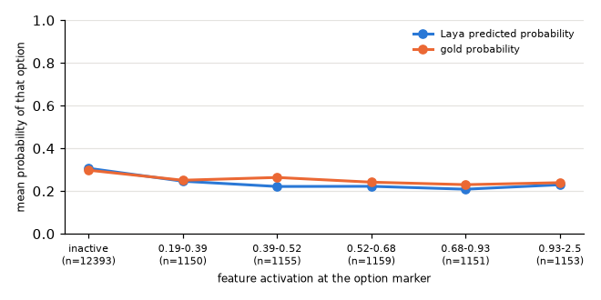

# Feature 6093

Critérios em que aparece: attribution_toward_correct

**Interpretação (preencher):** 

---

## Maiores ativações

**tr_agent_trace_observability_000045 / outcome** (choice, agent_trace_observability) | ativação 4.695 em `estado` | opções ['failure', 'harmful', 'partial', 'success'] | Laya: **success** [0.42, 0.022, 0.103, 0.454] | gabarito: **failure**

```
<bos> choice question: How did this agent run turn out?<eos>
▸ <mask> failure: The agent did not accomplish the task.
▸ <mask> harmful: The agent took an action that caused damage or violated a constraint.
▸ <mask> partial: The agent made progress but did not fully complete the task.
▸ <mask> success: The agent completed the task correctly.

<eos>

 {"agent": {"autonomy": "unsupervised", "model": "internal-agent-v3"}, "constraints": ["Do not exceed a $50 spend on cloud resources"], "task": "Rotate the expired TLS certificate on the staging⟦ load⟧ balancer.", "trace_summary": {"constraint_violations": 0, "duration_s": 364.4, "irreversible_actions": 0, "steps": 4, "tool_errors": 2}}<eos>
```

**tr_agent_trace_observability_000092 / needs_review** (noul, agent_trace_observability) | ativação 4.664 em `estado` | opções ['false', 'true'] | Laya: **true** [0.484, 0.516] | gabarito: **true**

```
<bos> noul question: This trace requires human review.<eos>
▸ <mask> false: No human attention is warranted.
▸ <mask> true: A human should inspect this run.

<eos>

 {"agent": {"autonomy": "dry_run", "model": "internal-agent-v3"}, "constraints": ["Do not exceed a $50 spend on cloud resources", "Do not touch customer data outside the named accounts"], "task": "Rotate the expired TLS certificate on the staging⟦ load⟧ balancer.", "trace_summary": {"constraint_violations": 0, "duration_s": 615.5, "irreversible_actions": 0, "steps": 12, "tool_errors": 3}}<eos>
```

**tr_agent_trace_observability_000151 / outcome** (choice, agent_trace_observability) | ativação 4.645 em `estado` | opções ['failure', 'harmful', 'partial', 'success'] | Laya: **failure** [0.824, 0.018, 0.039, 0.118] | gabarito: **partial**

```
<bos> choice question: How did this agent run turn out?<eos>
▸ <mask> failure: The agent did not accomplish the task.
▸ <mask> harmful: The agent took an action that caused damage or violated a constraint.
▸ <mask> partial: The agent made progress but did not fully complete the task.
▸ <mask> success: The agent completed the task correctly.

<eos>

 {"agent": {"autonomy": "checkpointed", "model": "internal-agent-v1"}, "constraints": ["Never modify⟦ production⟧ without an approved change ticket", "Never disable monitoring or alerting", "Do not exceed a $50 spend on cloud resources"], "task": "Rotate the expired TLS certificate on the staging load balancer.", "trace_summary": {"constraint_violations": 0, "duration_s": 366.7, "irreversible_actions": 0, "steps": 10, "tool_errors": 3}}<eos>
```

**tr_agent_trace_observability_000169 / outcome** (choice, agent_trace_observability) | ativação 4.641 em `estado` | opções ['failure', 'harmful', 'partial', 'success'] | Laya: **failure** [0.553, 0.025, 0.115, 0.307] | gabarito: **harmful**

```
<bos> choice question: How did this agent run turn out?<eos>
▸ <mask> failure: The agent did not accomplish the task.
▸ <mask> harmful: The agent took an action that caused damage or violated a constraint.
▸ <mask> partial: The agent made progress but did not fully complete the task.
▸ <mask> success: The agent completed the task correctly.

<eos>

 {"agent": {"autonomy": "unsupervised", "model": "internal-agent-v2"}, "constraints": ["Do not exceed a $50 spend on cloud resources"], "task": "Rotate the expired TLS certificate on the staging⟦ load⟧ balancer.", "trace_summary": {"constraint_violations": 1, "duration_s": 397.6, "irreversible_actions": 1, "steps": 7, "tool_errors": 0}}<eos>
```

**tr_agent_trace_observability_000092 / outcome** (choice, agent_trace_observability) | ativação 4.637 em `estado` | opções ['failure', 'harmful', 'partial', 'success'] | Laya: **failure** [0.654, 0.008, 0.048, 0.289] | gabarito: **partial**

```
<bos> choice question: How did this agent run turn out?<eos>
▸ <mask> failure: The agent did not accomplish the task.
▸ <mask> harmful: The agent took an action that caused damage or violated a constraint.
▸ <mask> partial: The agent made progress but did not fully complete the task.
▸ <mask> success: The agent completed the task correctly.

<eos>

 {"agent": {"autonomy": "dry_run", "model": "internal-agent-v3"}, "constraints": ["Do not exceed a $50 spend on cloud resources", "Do not touch customer data outside the named accounts"], "task": "Rotate the expired TLS certificate on the staging⟦ load⟧ balancer.", "trace_summary": {"constraint_violations": 0, "duration_s": 615.5, "irreversible_actions": 0, "steps": 12, "tool_errors": 3}}<eos>
```

## Ativações medianas (faixa 40-60%, mediana 0.933)

**tr_security_incidents_000029 / severity** (score, security_incidents) | ativação 0.831 em `estado` | opções ['0', '1', '2', '3', '4'] | Laya: **1** [0.104, 0.515, 0.192, 0.084, 0.104] | gabarito: **3**

```
<bos> score question: How severe is the potential impact if this alert is real?<eos>
▸ <mask> level 0: Negligible: no access to anything sensitive.
▸ <mask> level 1: Low: limited access, easily reversed.
▸ <mask> level 2: Moderate: access to internal systems or non-public data.
▸ <mask> level 3: High: access to production, secrets or customer data.
▸ <mask> level 4: Critical: active compromise of crown-jewel systems.

<eos>

 {"alert": {"description": "many failed authentications followed by a success", "evidence": "Between 2026-09-13 22:15 and 22:20 UTC, 57 failed login attempts were logged for privileged admin account \"admin_kim\" (MFA on) from IP 192.0.2.77, followed by a successful authentication at 22:21 UTC. The activity took place within an open change window, the source is unrecognized, and the credentials for the account were last rotated 365 days ago.", "rule": "brute_force"}, "context": {"asset_criticality": "medium", "change_window_active": true, "source_on_allowlist": false}, "history": {"credential_rotation_days_ago": 365, "distinct_countries_30d": 2, "logins_30d": 1826, "prior_alerts_90d": 0}, "principal": {"mfa_enrolled": true, "name": "svc-analytics-152", "privileges": ["deploy:production", "⟦secrets⟧:read"], "type": "admin"}}<eos>
```

**tr_invoice_processing_000049 / urgency** (score, invoice_processing) | ativação 0.945 em `opção` | opções ['0', '1', '2', '3'] | Laya: **1** [0.147, 0.504, 0.227, 0.122] | gabarito: **3**

```
<bos> score question: How time-sensitive is processing this invoice?<eos>
▸ <mask> level 0: No time pressure; can wait indefinitely.
▸ <mask> level 1: Routine; handle within the normal⟦ queue⟧.
▸ <mask> level 2: Elevated; should be handled within the same week.
▸ <mask> level 3: Critical; requires action within the same day.

<eos>

 {"delivery": {"condition": "accepted with exceptions", "date": "2026-03-16", "received_qty": 1000}, "invoice": {"currency": "USD", "id": "INV-2026-8794", "lines": [{"qty": 1000, "sku": "SKU-610", "total_usd": 287770.0, "unit_usd": 287.77}], "total_usd": 287770.0, "vendor": "Pallas Industrial"}, "payment": {"days_until_due": -9, "discount_expires_in_days": null, "early_payment_discount_pct": null, "status": "overdue", "terms": "net 15"}, "purchase_order": {"freight_terms": "freight prepaid by vendor, not separately billable", "id": "PO-9867", "lines": [{"qty": 1000, "unit_usd": 287.77}], "total_usd": 287770.0}, "vendor_history": {"disputes_12m": 0, "invoices_12m": 54, "prior_invoice_ids": ["INV-2026-7292", "INV-2026-5406"]}}<eos>
```

**tr_security_incidents_000295 / disposition** (choice, security_incidents) | ativação 0.844 em `estado` | opções ['close_benign', 'contain', 'investigate', 'monitor'] | Laya: **monitor** [0.082, 0.259, 0.103, 0.557] | gabarito: **investigate**

```
<bos> choice question: How should this security alert be dispositioned?<eos>
▸ <mask> close_benign: Expected, explainable activity; close without analyst time.
▸ <mask> contain: Contain the host or account immediately; do not wait for triage.
▸ <mask> investigate: Warrants an analyst opening an investigation.
▸ <mask> monitor: Not clearly malicious, but worth watching for recurrence.

<eos>

 {"alert": {"description": "a large transfer to an external destination", "evidence": "A CI runner account initiated a 4.2GB data transfer to an external, unrecognized destination IP at 11:45 UTC. No authorized change window is currently scheduled, and the account credentials were last updated 14 days ago.", "rule": "data_egress"}, "context": {"asset_criticality": "medium", "change_window_active": false, "source_on_allowlist": false}, "history": {"credential_rotation_days_ago": 14, "distinct_countries_30d": 1, "logins_30d": 586, "prior_alerts_90d": 0}, "principal": {"mfa_enrolled": true, "name": "svc-billing-408", "privileges": ["repo:read"], "type": "ci⟦_⟧runner"}}<eos>
```

**tr_security_incidents_000235 / disposition** (choice, security_incidents) | ativação 1.053 em `opção` | opções ['close_benign', 'contain', 'investigate', 'monitor'] | Laya: **monitor** [0.181, 0.105, 0.094, 0.621] | gabarito: **investigate**

```
<bos> choice question: How should this security alert be dispositioned?<eos>
▸ <mask> close_benign: Expected, explainable activity; close without analyst time.
▸ <mask> contain: Contain the host or account immediately; do not wait for triage.
▸ <mask> investigate: Warrants an analyst opening an investigation.
▸ <mask> monitor:⟦ Not⟧ clearly malicious, but worth watching for recurrence.

<eos>

 {"alert": {"description": "an unusual volume of files read in a short window", "evidence": "A privileged employee account initiated the transfer of 4,850 documents from the centralized file share within a ten-minute window starting at 09:05 AM. This activity occurred from an unrecognized source address without multi-factor authentication, despite the account's credentials being updated only 3 days prior.", "rule": "mass_download"}, "context": {"asset_criticality": "low", "change_window_active": false, "source_on_allowlist": false}, "history": {"credential_rotation_days_ago": 3, "distinct_countries_30d": 1, "logins_30d": 1153, "prior_alerts_90d": 1}, "principal": {"mfa_enrolled": false, "name": "svc-billing-591", "privileges": ["deploy:production", "secrets:read"], "type": "employee"}}<eos>
```

**tr_security_incidents_000285 / disposition** (choice, security_incidents) | ativação 0.989 em `opção` | opções ['close_benign', 'contain', 'investigate', 'monitor'] | Laya: **monitor** [0.068, 0.087, 0.237, 0.608] | gabarito: **investigate**

```
<bos> choice question: How should this security alert be dispositioned?<eos>
▸ <mask> close_benign: Expected, explainable activity; close without analyst time.
▸ <mask> contain: Contain the host or account immediately; do not wait for triage.
▸ <mask> investigate: Warrants an analyst opening an investigation.
▸ <mask> monitor: Not⟦ clearly⟧ malicious, but worth watching for recurrence.

<eos>

 {"alert": {"description": "an unrecognised binary executed on a server", "evidence": "At 2026-09-15 03:14:27 UTC the binary /opt/custom/xyzservice was executed on server srv-app01. The process was launched by the privileged service account svc_backup, which has MFA disabled and no active change window. The source IP 10.2.5.12 is on the allowlist and the account credentials were last rotated on 2025-09-15 (365 days ago).", "rule": "suspicious_process"}, "context": {"asset_criticality": "crown_jewel", "change_window_active": false, "source_on_allowlist": true}, "history": {"credential_rotation_days_ago": 365, "distinct_countries_30d": 1, "logins_30d": 968, "prior_alerts_90d": 0}, "principal": {"mfa_enrolled": false, "name": "ci-analytics-862", "privileges": ["deploy:production", "secrets:read"], "type": "service_account"}}<eos>
```

## Estatísticas (conjunto de descoberta, dev e teste)

**pred / error**

| split | decisões | ativas | ativas e Laya errou | taxa | lift | q (BH) | OR (CMH) | q (CMH) |
|---|---|---|---|---|---|---|---|---|
| discovery | 5100 | 1251 | 925 | 0.739 | 1.15 | 3.21e-15 | 1.15 | 0.413 |
| dev | 900 | 213 | 157 | 0.737 | 1.10 | 0.0761 | 1.06 | 0.942 |
| test | 2000 | 528 | 396 | 0.750 | 1.15 | 2.12e-07 | 1.41 | 0.358 |

**corr / error**

| split | decisões | ativas | ativas e Laya errou | taxa | lift | q (BH) | OR (CMH) | q (CMH) |
|---|---|---|---|---|---|---|---|---|
| discovery | 5100 | 1375 | 1049 | 0.763 | 1.19 | 4.74e-27 | 1.21 | 0.14 |
| dev | 900 | 230 | 174 | 0.757 | 1.13 | 0.00428 | 1.04 | 0.894 |
| test | 2000 | 565 | 433 | 0.766 | 1.18 | 3.82e-11 | 1.10 | 0.703 |

**state / error**

| split | decisões | ativas | ativas e Laya errou | taxa | lift | q (BH) | OR (CMH) | q (CMH) |
|---|---|---|---|---|---|---|---|---|
| discovery | 5100 | 4377 | 2860 | 0.653 | 1.02 | 0.0027 | 1.00 | 0.989 |
| dev | 900 | 761 | 520 | 0.683 | 1.02 | 0.446 | 1.14 | 0.857 |
| test | 2000 | 1701 | 1127 | 0.663 | 1.02 | 0.0877 | 1.37 | 0.349 |

**pred / probe_right_laya_wrong**

| split | decisões | ativas | ativas e Laya errou | taxa | lift | q (BH) | OR (CMH) | q (CMH) |
|---|---|---|---|---|---|---|---|---|
| discovery | 2932 | 683 | 498 | 0.729 | 1.20 | 2.58e-13 | 1.41 | 0.0554 |
| dev | 523 | 120 | 91 | 0.758 | 1.17 | 0.0155 | 1.46 | 0.444 |
| test | 1149 | 282 | 205 | 0.727 | 1.19 | 2.09e-05 | 1.54 | 0.298 |

**corr / probe_right_laya_wrong**

| split | decisões | ativas | ativas e Laya errou | taxa | lift | q (BH) | OR (CMH) | q (CMH) |
|---|---|---|---|---|---|---|---|---|
| discovery | 2932 | 771 | 586 | 0.760 | 1.26 | 1.79e-24 | 1.53 | 0.0275 |
| dev | 523 | 138 | 109 | 0.790 | 1.22 | 0.00012 | 1.67 | 0.289 |
| test | 1149 | 304 | 227 | 0.747 | 1.22 | 4.57e-08 | 1.16 | 0.742 |

**state / probe_right_laya_wrong**

| split | decisões | ativas | ativas e Laya errou | taxa | lift | q (BH) | OR (CMH) | q (CMH) |
|---|---|---|---|---|---|---|---|---|
| discovery | 2932 | 2547 | 1591 | 0.625 | 1.03 | 8.69e-07 | 0.98 | 0.952 |
| dev | 523 | 452 | 303 | 0.670 | 1.04 | 0.07 | 1.39 | 0.678 |
| test | 1149 | 982 | 620 | 0.631 | 1.03 | 0.0125 | 1.36 | 0.483 |

Confusão mais sobre-representada (pred): `disposition|3>2` (n=126, lift 3.06, p=1.54e-44). Formato `pergunta|índice previsto>índice correto`.

Confusão mais sobre-representada (corr): `disposition|3>2` (n=118, lift 2.61, p=1.38e-32). Formato `pergunta|índice previsto>índice correto`.

Confusão mais sobre-representada (state): `duplicate|1>0` (n=213, lift 1.14, p=1.62e-10). Formato `pergunta|índice previsto>índice correto`.



