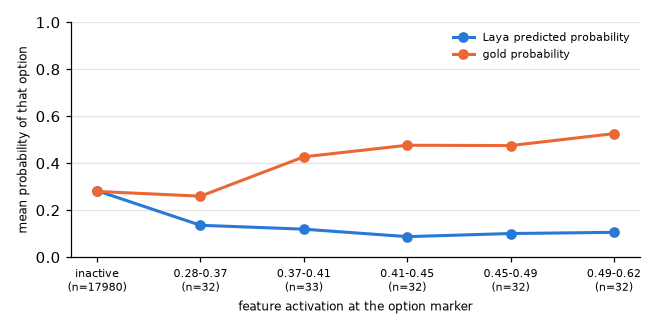

# Feature 6171

Critérios em que aparece: corr_probe_right_laya_wrong

**Interpretação (preencher):** 

---

## Maiores ativações

**tr_customer_service_000174 / urgency** (score, customer_service) | ativação 6.641 em `estado` | opções ['0', '1', '2', '3'] | Laya: **3** [0.234, 0.223, 0.24, 0.303] | gabarito: **3**

```
<bos> score question: How time-sensitive is this conversation?<eos>
▸ <mask> level 0: No time pressure; can wait indefinitely.
▸ <mask> level 1: Routine; handle within the normal queue.
▸ <mask> level 2: Elevated; should be handled within the same week.
▸ <mask> level 3: Critical; requires action within the same day.

<eos>

 {"account": {"lifetime_value_usd": 2540, "prior_tickets_90d": 0, "seats": 1, "tenure_months": 60, "tier": "premium"}, "thread": [{"role": "customer", "text": "I have been a premium member for five years and I am absolutely sick of your portal. I need a copy of my last invoice sent to my email immediately because the download link on the site is broken again."}, {"role": "agent",⟦ "⟧text": "I apologize for the trouble with the portal. I would be happy to assist you with that; could you please verify the email address currently associated with your account?"}, {"role": "customer", "text": "It is j.smith@provider.com, and I really shouldn't have to jump through these hoops just to get a basic document."}]}<eos>
```

**tr_customer_service_000136 / churn_risk** (score, customer_service) | ativação 6.457 em `estado` | opções ['0', '1', '2', '3'] | Laya: **2** [0.08, 0.414, 0.45, 0.056] | gabarito: **2**

```
<bos> score question: How likely is this customer to stop doing business with us because of this interaction?<eos>
▸ <mask> level 0: No sign of dissatisfaction.
▸ <mask> level 1: Mild frustration, but the relationship is intact.
▸ <mask> level 2: Clearly unhappy; repeat problems or explicit complaints.
▸ <mask> level 3: Imminent: threatening to cancel, dispute or leave.

<eos>

 {"account": {"lifetime_value_usd": 151, "prior_tickets_90d": 0, "seats": 1, "tenure_months": 2, "tier": "free"}, "orders": [{"amount_usd": 2997, "date": "2026-02-27", "id": "A-95428", "status": "refunded"}], "thread": [{"role": "customer", "text": "I just got my latest invoice and it shows a charge of $2,997—something I never signed up for. I've only been on the free plan for two months and this is urgent, please explain why this amount is appearing."}, {"role": "agent", "text": "I’m sorry to hear about the surprise charge. Could you share the invoice number or the date it was issued so I can look into the details?"}, {"role": "customer", "text": "The invoice is #INV-8392, dated August 5th. I didn’t receive any notice about upgrading, and I’m still under the free tier."}, {"role": "agent", "text": "Thank you for that information. I’ll verify the account activity around that date. Did you perhaps receive any promotional email that might have triggered an automatic upgrade?"}, {"role": "customer", "text": "No, I haven’t seen any promotion, and I never clicked any upgrade link. I need to know what happened before this gets billed again."}, {"role":⟦ "⟧agent", "text": "Understood. I’ll check the billing logs and see if there’s a misapplied charge. Meanwhile, could you confirm the primary email address on the account?"}, {"role": "customer", "text": "The email is jessica.rivera@example.com. Please let me know what you find as soon as possible."}]}<eos>
```

**tr_customer_service_000061 / churn_risk** (score, customer_service) | ativação 6.316 em `estado` | opções ['0', '1', '2', '3'] | Laya: **1** [0.113, 0.71, 0.125, 0.052] | gabarito: **2**

```
<bos> score question: How likely is this customer to stop doing business with us because of this interaction?<eos>
▸ <mask> level 0: No sign of dissatisfaction.
▸ <mask> level 1: Mild frustration, but the relationship is intact.
▸ <mask> level 2: Clearly unhappy; repeat problems or explicit complaints.
▸ <mask> level 3: Imminent: threatening to cancel, dispute or leave.

<eos>

 {"account": {"lifetime_value_usd": 1585, "prior_tickets_90d": 2, "seats": 1, "tenure_months": 41, "tier": "premium"}, "thread": [{"role": "customer", "text": "I'm trying to adjust my seat count again, but the dashboard is just giving me the same greyed-out error as last time."}, {"role": "agent", "text": "I apologize for the frustration; could you confirm if you are seeing this error on the billing page or the team management tab?"}, {"role": "customer", "text": "It's on the team management tab. Honestly, I'm used to this by now."}, {"role":⟦ "⟧agent", "text": "Thank you for clarifying. Are you currently logged in as the primary account administrator when accessing that specific tab?"}, {"role": "customer", "text": "Yes, I am the admin. Nothing ever seems to change with these permissions."}, {"role": "agent", "text": "I appreciate your patience while we look into this. Could you please send me a screenshot of the specific error message you see?"}, {"role": "customer", "text": "I'll try to get that over later, but I don't really expect it to make a difference."}]}<eos>
```

**tr_customer_service_000058 / urgency** (score, customer_service) | ativação 6.312 em `estado` | opções ['0', '1', '2', '3'] | Laya: **1** [0.212, 0.714, 0.046, 0.028] | gabarito: **0**

```
<bos> score question: How time-sensitive is this conversation?<eos>
▸ <mask> level 0: No time pressure; can wait indefinitely.
▸ <mask> level 1: Routine; handle within the normal queue.
▸ <mask> level 2: Elevated; should be handled within the same week.
▸ <mask> level 3: Critical; requires action within the same day.

<eos>

 {"account": {"lifetime_value_usd": 386, "prior_tickets_90d": 0, "seats": 3, "tenure_months": 5, "tier": "enterprise"}, "orders": [{"amount_usd": 49, "date": "2026-03-18", "id": "A-70177", "status": "refunded"}, {"amount_usd": 49, "date": "2026-01-12", "id": "A-80512", "status": "refunded"}, {"amount_usd": 49, "date": "2026-03-04", "id": "A-71911", "status": "failed"}], "thread": [{"role": "customer", "text": "I’d like to request a data export from our account; I’m not in a rush, just need to know the steps."}, {"role": "agent",⟦ "⟧text": "Sure thing. Which format would you prefer for the export?"}, {"role": "customer", "text": "CSV works for us. Also, could you tell me roughly how long the process takes?"}, {"role": "agent", "text": "I’ll check on the timing. Do you need the export for a specific date range?"}, {"role": "customer", "text": "Just the last month up to today, and I understand it may not be immediate."}, {"role": "agent", "text": "Thanks for confirming. I’ll queue the request and let you know when it’s ready. Anything else you’d like to add?"}, {"role": "customer", "text": "That’s all for now, thank you."}]}<eos>
```

**tr_customer_service_000209 / churn_risk** (score, customer_service) | ativação 6.305 em `estado` | opções ['0', '1', '2', '3'] | Laya: **2** [0.05, 0.185, 0.745, 0.02] | gabarito: **2**

```
<bos> score question: How likely is this customer to stop doing business with us because of this interaction?<eos>
▸ <mask> level 0: No sign of dissatisfaction.
▸ <mask> level 1: Mild frustration, but the relationship is intact.
▸ <mask> level 2: Clearly unhappy; repeat problems or explicit complaints.
▸ <mask> level 3: Imminent: threatening to cancel, dispute or leave.

<eos>

 {"account": {"lifetime_value_usd": 77, "prior_tickets_90d": 0, "seats": 3, "tenure_months": 2, "tier": "enterprise"}, "orders": [{"amount_usd": 1998, "date": "2026-02-09", "id": "A-87995", "status": "settled"}], "thread": [{"role": "customer", "text": "I ordered the premium hardware kit with my $1,998 Enterprise purchase, but the box I got contains the basic accessories instead. This is completely unacceptable."}, {"role": "agent", "text": "I understand how frustrating that must be. Let me pull up your order details—can you provide the order number you received in the confirmation email?"}, {"role": "customer", "text": "It’s 8457‑B2, and I’ve already opened a ticket about this, which was never resolved."}, {"role":⟦ "⟧agent", "text": "Thanks for the number. I see the mismatch now. Could you tell me if the packaging is still sealed, or if you’ve already inspected the contents?"}, {"role": "customer", "text": "The box is still sealed; I haven’t taken anything out because I need the correct items before I can even consider using them."}]}<eos>
```

## Ativações medianas (faixa 40-60%, mediana 1.231)

**tr_security_incidents_000239 / urgency** (score, security_incidents) | ativação 1.402 em `estado` | opções ['0', '1', '2', '3'] | Laya: **1** [0.085, 0.52, 0.191, 0.204] | gabarito: **1**

```
<bos> score question: How quickly must a responder act on this alert?<eos>
▸ <mask> level 0: No time pressure; can wait indefinitely.
▸ <mask> level 1: Routine; handle within the normal queue.
▸ <mask> level 2: Elevated; should be handled within the same week.
▸ <mask> level 3: Critical; requires action within the same day.

<eos>

 {"alert": {"description": "a first-ever sign-in from an unfamiliar country", "evidence": "An admin account performed a login from allowlisted IP 192.0.2.55 (Tokyo) at 2026-09-14T14:02:33Z, with MFA succeeding. This marks the first sign‑in from Japan for this admin identity, and the password was last changed on 2024-09-14 (700 days ago).", "rule": "new_country_login"}, "context": {"asset_criticality": "crown_jewel", "change_window_active": false, "source_on_allowlist": true}, "history": {"credential_rotation_days_ago": 700, "distinct_countries_30d": 2, "logins_30d": 1⟦0⟧33, "prior_alerts_90d": 1}, "principal": {"mfa_enrolled": true, "name": "svc-support-154", "privileges": ["repo:read"], "type": "admin"}}<eos>
```

**tr_security_incidents_000265 / urgency** (score, security_incidents) | ativação 1.579 em `estado` | opções ['0', '1', '2', '3'] | Laya: **2** [0.141, 0.256, 0.318, 0.285] | gabarito: **3**

```
<bos> score question: How quickly must a responder act on this alert?<eos>
▸ <mask> level 0: No time pressure; can wait indefinitely.
▸ <mask> level 1: Routine; handle within the normal queue.
▸ <mask> level 2: Elevated; should be handled within the same week.
▸ <mask> level 3: Critical; requires action within the same day.

<eos>

 {"alert": {"description": "an account granted itself or received elevated permissions", "evidence": "The account assigned to an unprivileged contractor was granted elevated permissions at 11:05 AM from an unrecognized source address. Although multi-factor authentication was enabled and credentials were last rotated 14 days ago, no scheduled change window was present for this administrative action.", "rule": "privilege_escalation"}, "context": {"asset_criticality": "medium", "change_window_active": false, "source_on_allowlist": false}, "history": {"credential_rotation_days_ago": 14, "distinct_countries_30d": 3, "logins_30d": 164, "prior_alerts_9⟦0⟧d": 1}, "principal": {"mfa_enrolled": true, "name": "usr-infra-439", "privileges": ["repo:read"], "type": "contractor"}}<eos>
```

**tr_customer_service_000065 / needs_human** (noul, customer_service) | ativação 1.110 em `estado` | opções ['false', 'true'] | Laya: **true** [0.317, 0.683] | gabarito: **false**

```
<bos> noul question: This conversation requires a human agent rather than automated handling.<eos>
▸ <mask> false: Automation can carry this to resolution.
▸ <mask> true: A human must take over: judgement, authority or empathy is required.

<eos>

 {"account": {"lifetime_value_usd": 586, "prior_tickets_90d": 0, "seats": 1, "tenure_months": 19, "tier": "standard"}, "orders": [{"amount_usd": 99, "date": "2026-02-21", "id": "A-35676", "status": "settled"}, {"amount_usd": 99, "date": "2026-02-28", "id": "A-65097", "status": "failed"}, {"amount_usd": 99, "date": "2026-03-26", "id": "A-82387", "status": "refunded"}], "thread": [{"role": "customer", "text": "I'm trying to export my data and I can't find any option to do it. This is confusing, and if I can't get it sorted by Friday, I'm going to have to look elsewhere."}, {"role":⟦ "⟧agent", "text": "Sorry for the trouble. Could you let me know which data set you're after and whether you need it in CSV or JSON format?"}, {"role": "customer", "text": "I need the full activity log for the past six months in CSV. It's critical for my reporting deadline this Friday."}]}<eos>
```

**tr_customer_service_000086 / category** (choice, customer_service) | ativação 1.502 em `estado` | opções ['account', 'billing', 'delivery', 'refund', 'technical'] | Laya: **billing** [0.0, 1.0, 0.0, 0.0, 0.0] | gabarito: **billing**

```
<bos> choice question: What is this customer conversation primarily about?<eos>
▸ <mask> account: Login, plan changes, profile or access management.
▸ <mask> billing: A charge, invoice, subscription or payment problem.
▸ <mask> delivery: Shipping, fulfilment or delivery of a physical item.
▸ <mask> refund: The customer is explicitly asking for money back.
▸ <mask> technical: The product or service is not working as expected.

<eos>

 {"account": {"lifetime_value_usd": 1⟦0⟧71, "prior_tickets_90d": 2, "seats": 1, "tenure_months": 19, "tier": "standard"}, "thread": [{"role": "customer", "text": "I just got a bill that’s higher than what I expected, and I don’t understand why the charge jumped. Can someone explain what’s going on? I need this cleared up by tomorrow."}, {"role": "agent", "text": "I’m sorry for the surprise. Could you tell me the date and amount shown on the statement so I can compare it to your plan details?"}, {"role": "customer", "text": "It’s the charge dated 9/14 and I need to know if this is a mistake or a new fee before the end of the day."}]}<eos>
```

**tr_customer_service_000034 / churn_risk** (score, customer_service) | ativação 1.317 em `estado` | opções ['0', '1', '2', '3'] | Laya: **1** [0.102, 0.442, 0.423, 0.032] | gabarito: **3**

```
<bos> score question: How likely is this customer to stop doing business with us because of this interaction?<eos>
▸ <mask> level 0: No sign of dissatisfaction.
▸ <mask> level 1: Mild frustration, but the relationship is intact.
▸ <mask> level 2: Clearly unhappy; repeat problems or explicit complaints.
▸ <mask> level 3: Imminent: threatening to cancel, dispute or leave.

<eos>

 {"account": {"lifetime_value_usd": 102, "prior_tickets_90d": 1, "seats": 1, "tenure_months": 2, "tier": "standard"}, "thread": [{"role": "customer", "text": "I just opened my delivery and the item is in pieces, but the shipping box looks totally fine? I don't understand how this happened. I have a hard deadline for a project this Friday and if this isn't resolved by then,⟦ I⟧'m closing my account and going to a competitor."}, {"role": "agent", "text": "I'm sorry to hear that your item arrived damaged. Could you please provide a few more details about the state of the internal protective packaging when you first opened it?"}, {"role": "customer", "text": "The bubble wrap was there but it clearly didn't do anything. I've only been with you for two months and my first ticket about the setup is still unresolved; I really can't afford to wait past Friday for a solution on this."}]}<eos>
```

## Estatísticas (conjunto de descoberta, dev e teste)

**pred / error**

| split | decisões | ativas | ativas e Laya errou | taxa | lift | q (BH) | OR (CMH) | q (CMH) |
|---|---|---|---|---|---|---|---|---|
| discovery | 5100 | 3 | 3 | 1.000 | 1.55 | nan | nan | nan |
| dev | 900 | 0 | 0 | nan | nan | nan | nan | nan |
| test | 2000 | 5 | 3 | 0.600 | 0.92 | nan | nan | nan |

**corr / error**

| split | decisões | ativas | ativas e Laya errou | taxa | lift | q (BH) | OR (CMH) | q (CMH) |
|---|---|---|---|---|---|---|---|---|
| discovery | 5100 | 94 | 94 | 1.000 | 1.55 | 7.95e-18 | inf | 0.0196 |
| dev | 900 | 19 | 19 | 1.000 | 1.49 | nan | nan | nan |
| test | 2000 | 39 | 37 | 0.949 | 1.46 | 5.49e-05 | 1.66 | 0.73 |

**state / error**

| split | decisões | ativas | ativas e Laya errou | taxa | lift | q (BH) | OR (CMH) | q (CMH) |
|---|---|---|---|---|---|---|---|---|
| discovery | 5100 | 5012 | 3231 | 0.645 | 1.00 | 0.513 | 1.67 | 0.203 |
| dev | 900 | 888 | 594 | 0.669 | 1.00 | 0.434 | 0.15 | 0.391 |
| test | 2000 | 1968 | 1277 | 0.649 | 1.00 | 0.612 | 0.86 | 0.909 |

**pred / probe_right_laya_wrong**

| split | decisões | ativas | ativas e Laya errou | taxa | lift | q (BH) | OR (CMH) | q (CMH) |
|---|---|---|---|---|---|---|---|---|
| discovery | 2932 | 3 | 3 | 1.000 | 1.65 | nan | nan | nan |
| dev | 523 | 0 | 0 | nan | nan | nan | nan | nan |
| test | 1149 | 2 | 0 | 0.000 | 0.00 | nan | nan | nan |

**corr / probe_right_laya_wrong**

| split | decisões | ativas | ativas e Laya errou | taxa | lift | q (BH) | OR (CMH) | q (CMH) |
|---|---|---|---|---|---|---|---|---|
| discovery | 2932 | 80 | 80 | 1.000 | 1.65 | 2.13e-17 | inf | 0.0161 |
| dev | 523 | 18 | 18 | 1.000 | 1.55 | nan | nan | nan |
| test | 1149 | 37 | 35 | 0.946 | 1.55 | 1.5e-05 | 2.14 | 0.626 |

**state / probe_right_laya_wrong**

| split | decisões | ativas | ativas e Laya errou | taxa | lift | q (BH) | OR (CMH) | q (CMH) |
|---|---|---|---|---|---|---|---|---|
| discovery | 2932 | 2895 | 1756 | 0.607 | 1.00 | 0.455 | 1.95 | 0.278 |
| dev | 523 | 517 | 333 | 0.644 | 1.00 | 0.881 | 0.23 | 0.53 |
| test | 1149 | 1134 | 691 | 0.609 | 1.00 | 0.731 | 1.15 | 0.926 |

Confusão mais sobre-representada (pred): `disposition|3>2` (n=3, lift 30.36, p=nan). Formato `pergunta|índice previsto>índice correto`.

Confusão mais sobre-representada (corr): `disposition|3>2` (n=70, lift 22.61, p=0). Formato `pergunta|índice previsto>índice correto`.

Confusão mais sobre-representada (state): `duplicate|1>0` (n=217, lift 1.02, p=0.0211). Formato `pergunta|índice previsto>índice correto`.



