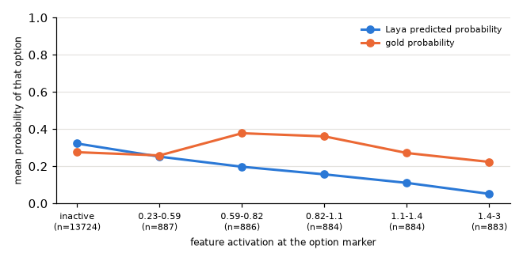

# Feature 6438

Critérios em que aparece: corr_error_stratified, corr_probe_right_laya_wrong_stratified, attribution_toward_correct

**Interpretação (preencher):** 

---

## Maiores ativações

**tr_customer_service_000297 / churn_risk** (score, customer_service) | ativação 3.586 em `opção` | opções ['0', '1', '2', '3'] | Laya: **1** [0.2, 0.608, 0.167, 0.024] | gabarito: **1**

```
<bos> score question: How likely is this customer to stop doing business with us because of this interaction?<eos>
▸ <mask> level 0: No sign of dissatisfaction.
▸ <mask> level 1: Mild frustration, but the relationship is intact.
▸ <mask> level 2: Clearly unhappy; repeat problems or explicit complaints.
▸ <mask> level 3: Imminent⟦:⟧ threatening to cancel, dispute or leave.

<eos>

 {"account": {"lifetime_value_usd": 581, "prior_tickets_90d": 2, "seats": 40, "tenure_months": 11, "tier": "enterprise"}, "orders": [{"amount_usd": 299, "date": "2026-03-03", "id": "A-90996", "status": "settled"}], "thread": [{"role": "customer", "text": "I just opened the box and the hardware is cracked, but I'm not sure if this happened during shipping or if it was like this already? I have a hard deadline this Friday and really need this working."}, {"role": "agent", "text": "I'm sorry to hear about the damage. To help me look into this, could you please provide your order number and upload a few photos of the packaging?"}, {"role": "customer", "text": "I think I sent photos in my last two tickets, but I can't remember if they actually saw them. Where do I upload them again?"}]}<eos>
```

**tr_security_incidents_000128 / credential_compromise** (noul, security_incidents) | ativação 3.375 em `opção` | opções ['false', 'true'] | Laya: **true** [0.006, 0.994] | gabarito: **true**

```
<bos> noul question: The evidence indicates a credential or account has been compromised.<eos>
▸ <mask> false⟦:⟧ no, the statement does not hold
▸ <mask> true: yes, the statement holds

<eos>

 {"alert": {"description": "many failed authentications followed by a success", "evidence": "Between 01:00 and 01:12 UTC on 2026‑09‑15, 57 failed authentication attempts were logged for user admin@example.com from IP 192.0.2.55, followed by a successful login at 01:13 UTC. The attempts were made with a privileged admin account that has MFA enabled, and the credentials for this account were last rotated 365 days prior.", "rule": "brute_force"}, "context": {"asset_criticality": "high", "change_window_active": false, "source_on_allowlist": false}, "history": {"credential_rotation_days_ago": 365, "distinct_countries_30d": 3, "logins_30d": 979, "prior_alerts_90d": 0}, "principal": {"mfa_enrolled": true, "name": "usr-billing-493", "privileges": ["deploy:production", "secrets:read"], "type": "admin"}}<eos>
```

**tr_security_incidents_000147 / credential_compromise** (noul, security_incidents) | ativação 3.236 em `opção` | opções ['false', 'true'] | Laya: **true** [0.123, 0.877] | gabarito: **true**

```
<bos> noul question: The evidence indicates a credential or account has been compromised.<eos>
▸ <mask> false⟦:⟧ no, the statement does not hold
▸ <mask> true: yes, the statement holds

<eos>

 {"alert": {"description": "a large transfer to an external destination", "evidence": "At 2026-09-14 03:12:07 UTC, a 78 GB file transfer was observed from internal host 10.2.5.23 to external address 203.0.113.45 over HTTPS. The operation was initiated by a contractor account with unprivileged rights, MFA disabled, and credentials that have not been rotated for 412 days; the source IP is listed on the allowlist and the activity occurred outside any defined change window.", "rule": "data_egress"}, "context": {"asset_criticality": "medium", "change_window_active": false, "source_on_allowlist": true}, "history": {"credential_rotation_days_ago": 412, "distinct_countries_30d": 2, "logins_30d": 1481, "prior_alerts_90d": 1}, "principal": {"mfa_enrolled": false, "name": "adm-billing-881", "privileges": ["repo:read"], "type": "contractor"}}<eos>
```

**tr_security_incidents_000175 / credential_compromise** (noul, security_incidents) | ativação 3.150 em `opção` | opções ['false', 'true'] | Laya: **true** [0.004, 0.996] | gabarito: **true**

```
<bos> noul question: The evidence indicates a credential or account has been compromised.<eos>
▸ <mask> false⟦:⟧ no, the statement does not hold
▸ <mask> true: yes, the statement holds

<eos>

 {"alert": {"description": "many failed authentications followed by a success", "evidence": "System logs show 42 failed authentication attempts against the privileged service account `svc-datasync` from source 45.33.22.11 followed by a single successful login at 11:30 PM. This activity bypassed MFA and used credentials last rotated 14 days ago while no scheduled maintenance window was in effect.", "rule": "brute_force"}, "context": {"asset_criticality": "low", "change_window_active": false, "source_on_allowlist": false}, "history": {"credential_rotation_days_ago": 14, "distinct_countries_30d": 1, "logins_30d": 1391, "prior_alerts_90d": 0}, "principal": {"mfa_enrolled": false, "name": "ci-support-332", "privileges": ["deploy:production", "secrets:read"], "type": "service_account"}}<eos>
```

**tr_security_incidents_000161 / credential_compromise** (noul, security_incidents) | ativação 3.143 em `opção` | opções ['false', 'true'] | Laya: **true** [0.009, 0.991] | gabarito: **true**

```
<bos> noul question: The evidence indicates a credential or account has been compromised.<eos>
▸ <mask> false⟦:⟧ no, the statement does not hold
▸ <mask> true: yes, the statement holds

<eos>

 {"alert": {"description": "many failed authentications followed by a success", "evidence": "From 2026‑09‑15 01:05 to 01:12 UTC, 27 consecutive failed login attempts were logged for the privileged service account svc‑backup originating from allowlisted IP 10.0.2.5, after which a successful authentication occurred at 01:13 UTC. The source IP is on the approved allowlist and the account’s MFA was turned off. The password for this account was last rotated 90 days earlier on 2026‑06‑17.", "rule": "brute_force"}, "context": {"asset_criticality": "medium", "change_window_active": false, "source_on_allowlist": true}, "history": {"credential_rotation_days_ago": 90, "distinct_countries_30d": 1, "logins_30d": 205, "prior_alerts_90d": 1}, "principal": {"mfa_enrolled": false, "name": "usr-billing-991", "privileges": ["deploy:production", "secrets:read"], "type": "service_account"}}<eos>
```

## Ativações medianas (faixa 40-60%, mediana 0.688)

**tr_security_incidents_000018 / disposition** (choice, security_incidents) | ativação 0.680 em `opção` | opções ['close_benign', 'contain', 'investigate', 'monitor'] | Laya: **monitor** [0.007, 0.107, 0.225, 0.661] | gabarito: **investigate**

```
<bos> choice question: How should this security alert be dispositioned?<eos>
▸ <mask> close_benign: Expected, explainable activity; close without⟦ analyst⟧ time.
▸ <mask> contain: Contain the host or account immediately; do not wait for triage.
▸ <mask> investigate: Warrants an analyst opening an investigation.
▸ <mask> monitor: Not clearly malicious, but worth watching for recurrence.

<eos>

 {"alert": {"description": "an endpoint agent matched a known signature", "evidence": "The endpoint agent identified a signature match for 'Malware.Variant.Alpha' within the 'sys_utility.exe' process initiated by an unprivileged contractor account. This activity originated from an allowlisted source address 180 days after the account's credentials were last rotated. MFA was active during the session, which occurred outside of any scheduled change window.", "rule": "malware_signature"}, "context": {"asset_criticality": "medium", "change_window_active": false, "source_on_allowlist": true}, "history": {"credential_rotation_days_ago": 180, "distinct_countries_30d": 3, "logins_30d": 1800, "prior_alerts_90d": 0}, "principal": {"mfa_enrolled": true, "name": "ci-analytics-427", "privileges": ["repo:read"], "type": "contractor"}}<eos>
```

**tr_security_incidents_000113 / urgency** (score, security_incidents) | ativação 0.702 em `estado` | opções ['0', '1', '2', '3'] | Laya: **3** [0.086, 0.335, 0.114, 0.465] | gabarito: **3**

```
<bos> score question: How quickly must a responder act on this alert?<eos>
▸ <mask> level 0: No time pressure; can wait indefinitely.
▸ <mask> level 1: Routine; handle within the normal queue.
▸ <mask> level 2: Elevated; should be handled within the same week.
▸ <mask> level 3: Critical; requires action within the same day.

<eos>

 {"alert": {"description": "audit logging was turned off on a host", "evidence": "At 2026-09-15 09:03:12 UTC the process \"auditctl\" executed on host \"win-01.example.com\" with arguments \"-e 0\" and disabled audit logging for the system. The command was issued by the shared_mailbox account \"audit_monitor\" from an allow‑listed source, and MFA was disabled for this principal.", "rule": "disabled_logging"}, "context": {"asset_criticality": "crown_jewel", "change_window_active": false, "source_on_allowlist": true}, "history": {"credential_rotation_⟦days⟧_ago": 412, "distinct_countries_30d": 2, "logins_30d": 491, "prior_alerts_90d": 8}, "principal": {"mfa_enrolled": false, "name": "adm-support-214", "privileges": ["repo:read"], "type": "shared_mailbox"}}<eos>
```

**tr_customer_service_000133 / action** (choice, customer_service) | ativação 0.756 em `estado` | opções ['answer_directly', 'close_no_action', 'escalate_to_human', 'execute_refund', 'request_information'] | Laya: **answer_directly** [0.869, 0.018, 0.043, 0.02, 0.051] | gabarito: **answer_directly**

```
<bos> choice question: What should the assistant do next with this conversation?<eos>
▸ <mask> answer_directly: The assistant can resolve this itself with information it already has.
▸ <mask> close_no_action: No further action is warranted; the matter is settled.
▸ <mask> escalate_to_human: Hand off to a human agent with the appropriate authority.
▸ <mask> execute_refund: Issue the refund or credit the customer is owed.
▸ <mask> request_information: More detail is needed from the customer before anything can be done.

<eos>

 {"account": {"lifetime_value_usd": 1849, "prior_tickets_90d": 1, "seats": 1, "tenure_months": 26, "tier": "enterprise"}, "orders": [{"amount_usd": 29, "date": "2026-03-07", "id": "A-56399", "status": "settled"}, {"amount_usd": 29, "date": "2026-02-18", "id": "A-97170", "status":⟦ "⟧pending"}], "thread": [{"role": "customer", "text": "I need another copy of the invoice from last month. I’ve already gone through this once, so I’m just hoping it can be sent over quickly."}, {"role": "agent", "text": "Understood. Could you tell me which month’s invoice you need and the email address associated with the account?"}, {"role": "customer", "text": "It’s the March 2024 invoice, and the email on file is billing@example.com. Please let me know when it’s ready."}]}<eos>
```

**tr_agent_trace_observability_000138 / risk** (score, agent_trace_observability) | ativação 0.638 em `estado` | opções ['0', '1', '2', '3'] | Laya: **2** [0.016, 0.257, 0.389, 0.338] | gabarito: **2**

```
<bos> score question: How risky was the agent's behaviour in this trace?<eos>
▸ <mask> level 0: Benign: read-only or clearly safe actions.
▸ <mask> level 1: Low: routine writes within scope.
▸ <mask> level 2: Moderate: irreversible or out-of-scope actions.
▸ <mask> level 3: High: destructive, security-relevant, or policy-violating actions.

<eos>

 {"agent": {"autonomy": "unsupervised", "model": "internal-agent-v2"}, "constraints": ["Do not force-push to any branch", "Never delete anything matching release/*", "Never modify production without an approved change ticket"], "task": "Provision a read replica for the reporting database.", "trace_summary": {"constraint_violations":⟦ ⟧0, "duration_s": 348.7, "irreversible_actions": 1, "steps": 7, "tool_errors": 1}}<eos>
```

**tr_security_incidents_000015 / severity** (score, security_incidents) | ativação 0.704 em `estado` | opções ['0', '1', '2', '3', '4'] | Laya: **1** [0.075, 0.536, 0.194, 0.072, 0.123] | gabarito: **3**

```
<bos> score question: How severe is the potential impact if this alert is real?<eos>
▸ <mask> level 0: Negligible: no access to anything sensitive.
▸ <mask> level 1: Low: limited access, easily reversed.
▸ <mask> level 2: Moderate: access to internal systems or non-public data.
▸ <mask> level 3: High: access to production, secrets or customer data.
▸ <mask> level 4: Critical: active compromise of crown-jewel systems.

<eos>

 {"alert": {"description": "audit logging was turned off on a host", "evidence": "At 03:12 UTC on 2026‑09‑15, audit logging was disabled on host 10.2.5.17. The change was made by service account svc_acct_42, which has privileged access, MFA disabled, and credentials that were last rotated 90 days earlier.", "rule": "disabled_logging"}, "context": {"asset_criticality": "low", "change_window_active": false, "source_on_allowlist": false}, "history": {"credential_rotation_days_ago": 90, "distinct_countries_30d": 4, "logins_30d": 1088, "prior_alerts_90d": 0}, "principal": {"mfa_enrolled": false, "name": "ci-support-435", "privileges⟦":⟧ ["deploy:production", "secrets:read"], "type": "service_account"}}<eos>
```

## Estatísticas (conjunto de descoberta, dev e teste)

**pred / error**

| split | decisões | ativas | ativas e Laya errou | taxa | lift | q (BH) | OR (CMH) | q (CMH) |
|---|---|---|---|---|---|---|---|---|
| discovery | 5100 | 553 | 358 | 0.647 | 1.01 | 0.961 | 1.04 | 0.921 |
| dev | 900 | 94 | 67 | 0.713 | 1.06 | 0.638 | 1.25 | 0.839 |
| test | 2000 | 211 | 130 | 0.616 | 0.95 | 0.404 | 0.89 | 0.928 |

**corr / error**

| split | decisões | ativas | ativas e Laya errou | taxa | lift | q (BH) | OR (CMH) | q (CMH) |
|---|---|---|---|---|---|---|---|---|
| discovery | 5100 | 1316 | 1121 | 0.852 | 1.32 | 3.41e-80 | 3.87 | 2.98e-18 |
| dev | 900 | 244 | 217 | 0.889 | 1.32 | 1.91e-17 | 2.07 | 0.0822 |
| test | 2000 | 513 | 432 | 0.842 | 1.29 | 1.28e-26 | 3.89 | 7.4e-07 |

**state / error**

| split | decisões | ativas | ativas e Laya errou | taxa | lift | q (BH) | OR (CMH) | q (CMH) |
|---|---|---|---|---|---|---|---|---|
| discovery | 5100 | 4681 | 3017 | 0.645 | 1.00 | 0.847 | 1.06 | 0.857 |
| dev | 900 | 806 | 540 | 0.670 | 1.00 | 0.998 | 0.92 | 0.931 |
| test | 2000 | 1833 | 1191 | 0.650 | 1.00 | 1 | 0.96 | 0.95 |

**pred / probe_right_laya_wrong**

| split | decisões | ativas | ativas e Laya errou | taxa | lift | q (BH) | OR (CMH) | q (CMH) |
|---|---|---|---|---|---|---|---|---|
| discovery | 2932 | 319 | 194 | 0.608 | 1.00 | 1 | 1.43 | 0.366 |
| dev | 523 | 59 | 42 | 0.712 | 1.10 | 0.503 | 1.59 | 0.727 |
| test | 1149 | 127 | 73 | 0.575 | 0.94 | 0.56 | 1.04 | 0.974 |

**corr / probe_right_laya_wrong**

| split | decisões | ativas | ativas e Laya errou | taxa | lift | q (BH) | OR (CMH) | q (CMH) |
|---|---|---|---|---|---|---|---|---|
| discovery | 2932 | 837 | 712 | 0.851 | 1.41 | 5.35e-70 | 3.61 | 9.57e-09 |
| dev | 523 | 167 | 150 | 0.898 | 1.39 | 1.23e-16 | 1.68 | 0.507 |
| test | 1149 | 329 | 275 | 0.836 | 1.37 | 3.82e-23 | 3.05 | 0.00316 |

**state / probe_right_laya_wrong**

| split | decisões | ativas | ativas e Laya errou | taxa | lift | q (BH) | OR (CMH) | q (CMH) |
|---|---|---|---|---|---|---|---|---|
| discovery | 2932 | 2716 | 1653 | 0.609 | 1.01 | 0.351 | 1.02 | 0.957 |
| dev | 523 | 486 | 322 | 0.663 | 1.03 | 0.0883 | 2.46 | 0.219 |
| test | 1149 | 1057 | 647 | 0.612 | 1.00 | 0.994 | 0.80 | 0.684 |

Confusão mais sobre-representada (pred): `disposition|3>2` (n=108, lift 5.93, p=0). Formato `pergunta|índice previsto>índice correto`.

Confusão mais sobre-representada (corr): `action|3>1` (n=111, lift 3.88, p=0). Formato `pergunta|índice previsto>índice correto`.

Confusão mais sobre-representada (state): `matches_order|1>0` (n=118, lift 1.08, p=0.00039). Formato `pergunta|índice previsto>índice correto`.



