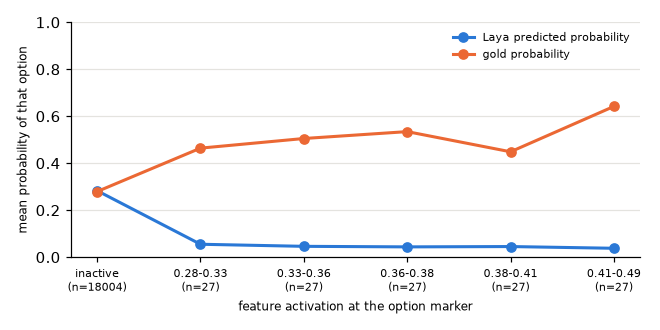

# Feature 6520

Critérios em que aparece: corr_error, corr_probe_right_laya_wrong

**Interpretação (preencher):** 

---

## Maiores ativações

**tr_security_incidents_000076 / urgency** (score, security_incidents) | ativação 4.191 em `estado` | opções ['0', '1', '2', '3'] | Laya: **1** [0.148, 0.366, 0.162, 0.323] | gabarito: **3**

```
<bos> score question: How quickly must a responder act on this alert?<eos>
▸ <mask> level 0: No time pressure; can wait indefinitely.
▸ <mask> level 1: Routine; handle within the normal queue.
▸ <mask> level 2: Elevated; should be handled within the same week.
▸ <mask> level 3: Critical; requires action within the same day.

<eos>

 {"alert": {"description": "an unusual volume of files read in a short window", "evidence": "Between 2026-09-15 02:00:00 and 02:05:12 UTC, the privileged admin account performed 3,842 file‑read operations on files under /var/www/html/ using the process \"wget\". The activity originated from an unrecognised source IP 192.0.2.77, the credentials for this account have not been rotated for 700 days, and no change window was⟦ defined⟧.", "rule": "mass_download"}, "context": {"asset_criticality": "medium", "change_window_active": false, "source_on_allowlist": false}, "history": {"credential_rotation_days_ago": 700, "distinct_countries_30d": 1, "logins_30d": 282, "prior_alerts_90d": 0}, "principal": {"mfa_enrolled": true, "name": "svc-support-350", "privileges": ["deploy:production", "secrets:read"], "type": "admin"}}<eos>
```

**tr_security_incidents_000274 / severity** (score, security_incidents) | ativação 4.133 em `estado` | opções ['0', '1', '2', '3', '4'] | Laya: **1** [0.079, 0.573, 0.201, 0.086, 0.061] | gabarito: **4**

```
<bos> score question: How severe is the potential impact if this alert is real?<eos>
▸ <mask> level 0: Negligible: no access to anything sensitive.
▸ <mask> level 1: Low: limited access, easily reversed.
▸ <mask> level 2: Moderate: access to internal systems or non-public data.
▸ <mask> level 3: High: access to production, secrets or customer data.
▸ <mask> level 4: Critical: active compromise of crown-jewel systems.

<eos>

 {"alert": {"description": "two successful logins from distant locations too close together", "evidence": "Successful logins were recorded for admin user 'jdoe' from IP 203.0.113.45 (New York, USA) at 2026-09-15 02:05:10 UTC and from IP 198.51.100.22 (Sydney, AU) at 2026-09-15 02:18:43 UTC, a 13‑minute interval. Both sessions used MFA and originated from an unrecognized source. The account’s credentials had not been refreshed for 180 days and no change window was⟦ defined⟧.", "rule": "impossible_travel"}, "context": {"asset_criticality": "crown_jewel", "change_window_active": false, "source_on_allowlist": false}, "history": {"credential_rotation_days_ago": 180, "distinct_countries_30d": 1, "logins_30d": 1701, "prior_alerts_90d": 1}, "principal": {"mfa_enrolled": true, "name": "adm-support-968", "privileges": ["deploy:production", "secrets:read"], "type": "admin"}}<eos>
```

**tr_security_incidents_000076 / severity** (score, security_incidents) | ativação 4.117 em `estado` | opções ['0', '1', '2', '3', '4'] | Laya: **1** [0.066, 0.409, 0.372, 0.11, 0.044] | gabarito: **3**

```
<bos> score question: How severe is the potential impact if this alert is real?<eos>
▸ <mask> level 0: Negligible: no access to anything sensitive.
▸ <mask> level 1: Low: limited access, easily reversed.
▸ <mask> level 2: Moderate: access to internal systems or non-public data.
▸ <mask> level 3: High: access to production, secrets or customer data.
▸ <mask> level 4: Critical: active compromise of crown-jewel systems.

<eos>

 {"alert": {"description": "an unusual volume of files read in a short window", "evidence": "Between 2026-09-15 02:00:00 and 02:05:12 UTC, the privileged admin account performed 3,842 file‑read operations on files under /var/www/html/ using the process \"wget\". The activity originated from an unrecognised source IP 192.0.2.77, the credentials for this account have not been rotated for 700 days, and no change window was⟦ defined⟧.", "rule": "mass_download"}, "context": {"asset_criticality": "medium", "change_window_active": false, "source_on_allowlist": false}, "history": {"credential_rotation_days_ago": 700, "distinct_countries_30d": 1, "logins_30d": 282, "prior_alerts_90d": 0}, "principal": {"mfa_enrolled": true, "name": "svc-support-350", "privileges": ["deploy:production", "secrets:read"], "type": "admin"}}<eos>
```

**tr_security_incidents_000076 / disposition** (choice, security_incidents) | ativação 4.117 em `estado` | opções ['close_benign', 'contain', 'investigate', 'monitor'] | Laya: **monitor** [0.42, 0.07, 0.064, 0.446] | gabarito: **investigate**

```
<bos> choice question: How should this security alert be dispositioned?<eos>
▸ <mask> close_benign: Expected, explainable activity; close without analyst time.
▸ <mask> contain: Contain the host or account immediately; do not wait for triage.
▸ <mask> investigate: Warrants an analyst opening an investigation.
▸ <mask> monitor: Not clearly malicious, but worth watching for recurrence.

<eos>

 {"alert": {"description": "an unusual volume of files read in a short window", "evidence": "Between 2026-09-15 02:00:00 and 02:05:12 UTC, the privileged admin account performed 3,842 file‑read operations on files under /var/www/html/ using the process \"wget\". The activity originated from an unrecognised source IP 192.0.2.77, the credentials for this account have not been rotated for 700 days, and no change window was⟦ defined⟧.", "rule": "mass_download"}, "context": {"asset_criticality": "medium", "change_window_active": false, "source_on_allowlist": false}, "history": {"credential_rotation_days_ago": 700, "distinct_countries_30d": 1, "logins_30d": 282, "prior_alerts_90d": 0}, "principal": {"mfa_enrolled": true, "name": "svc-support-350", "privileges": ["deploy:production", "secrets:read"], "type": "admin"}}<eos>
```

**tr_security_incidents_000257 / credential_compromise** (noul, security_incidents) | ativação 4.016 em `estado` | opções ['false', 'true'] | Laya: **true** [0.063, 0.937] | gabarito: **true**

```
<bos> noul question: The evidence indicates a credential or account has been compromised.<eos>
▸ <mask> false: no, the statement does not hold
▸ <mask> true: yes, the statement holds

<eos>

 {"alert": {"description": "a first-ever sign-in from an unfamiliar country", "evidence": "The 'svc-deploy-01' service account authenticated from a previously unseen country via an allowlisted endpoint. This login occurred without multi-factor authentication using credentials rotated 3 days ago, and no official change window was in⟦ effect⟧.", "rule": "new_country_login"}, "context": {"asset_criticality": "medium", "change_window_active": false, "source_on_allowlist": true}, "history": {"credential_rotation_days_ago": 3, "distinct_countries_30d": 1, "logins_30d": 1839, "prior_alerts_90d": 1}, "principal": {"mfa_enrolled": false, "name": "usr-support-915", "privileges": ["deploy:production", "secrets:read"], "type": "service_account"}}<eos>
```

## Ativações medianas (faixa 40-60%, mediana 1.023)

**tr_security_incidents_000227 / urgency** (score, security_incidents) | ativação 1.199 em `estado` | opções ['0', '1', '2', '3'] | Laya: **3** [0.157, 0.259, 0.267, 0.317] | gabarito: **3**

```
<bos> score question: How quickly must a responder act on this alert?<eos>
▸ <mask> level 0: No time pressure; can wait indefinitely.
▸ <mask> level 1: Routine; handle within the normal queue.
▸ <mask> level 2: Elevated; should be handled within the same week.
▸ <mask> level 3: Critical; requires action within the same day.

<eos>

 {"alert": {"description": "a large transfer to an external destination", "evidence": "A transfer of 4.2 GB of data⟦ was⟧ initiated to an unrecognized external IP address at 03:40 UTC. This activity was performed by a shared mailbox account that currently has MFA disabled.", "rule": "data_egress"}, "context": {"asset_criticality": "low", "change_window_active": false, "source_on_allowlist": false}, "history": {"credential_rotation_days_ago": 30, "distinct_countries_30d": 4, "logins_30d": 1619, "prior_alerts_90d": 1}, "principal": {"mfa_enrolled": false, "name": "svc-support-910", "privileges": ["repo:read"], "type": "shared_mailbox"}}<eos>
```

**tr_agent_trace_observability_000041 / needs_review** (noul, agent_trace_observability) | ativação 1.057 em `opção` | opções ['false', 'true'] | Laya: **false** [0.737, 0.263] | gabarito: **false**

```
<bos> noul question: This trace requires human review.<eos>
▸ <mask> false: No human attention is⟦ warranted⟧.
▸ <mask> true: A human should inspect this run.

<eos>

 {"agent": {"autonomy": "unsupervised", "model": "internal-agent-v3"}, "constraints": ["Do not touch customer data outside the named accounts", "Never modify production without an approved change ticket", "Do not exceed a $50 spend on cloud resources"], "task": "Delete personal data for the accounts in the erasure queue.", "trace_summary": {"constraint_violations": 0, "duration_s": 434.1, "irreversible_actions": 0, "steps": 7, "tool_errors": 2}}<eos>
```

**tr_security_incidents_000064 / credential_compromise** (noul, security_incidents) | ativação 1.039 em `estado` | opções ['false', 'true'] | Laya: **true** [0.225, 0.775] | gabarito: **true**

```
<bos> noul question: The evidence indicates a credential or account has been compromised.<eos>
▸ <mask> false: no, the statement does not hold
▸ <mask> true: yes, the statement holds

<eos>

 {"alert": {"description": "an account granted itself or received elevated permissions", "evidence": "On 2026-09-15 11:07:53 UTC, CI runner \"ci-runner-99\" issued an API call from IP 198.51.100.23 that added the \"admin\" role to its own service account. MFA was disabled for this principal, and the credentials have not been rotated for 700 days. No change window was active⟦ at⟧ the time of the role assignment.", "rule": "privilege_escalation"}, "context": {"asset_criticality": "medium", "change_window_active": false, "source_on_allowlist": false}, "history": {"credential_rotation_days_ago": 700, "distinct_countries_30d": 4, "logins_30d": 1185, "prior_alerts_90d": 3}, "principal": {"mfa_enrolled": false, "name": "ci-deploy-175", "privileges": ["repo:read"], "type": "ci_runner"}}<eos>
```

**tr_invoice_processing_000099 / duplicate** (noul, invoice_processing) | ativação 1.053 em `opção` | opções ['false', 'true'] | Laya: **true** [0.05, 0.95] | gabarito: **false**

```
<bos> noul question: This invoice appears to duplicate an invoice already submitted.<eos>
▸ <mask> false: no, the statement does not⟦ hold⟧
▸ <mask> true: yes, the statement holds

<eos>

 {"delivery": {"condition": "accepted with exceptions", "date": "2026-03-27", "received_qty": 100}, "invoice": {"currency": "USD", "id": "INV-2026-9286", "lines": [{"qty": 100, "sku": "SKU-290", "total_usd": 522.0, "unit_usd": 5.22}], "total_usd": 522.0, "vendor": "Vantage Materials"}, "payment": {"days_until_due": -3, "discount_expires_in_days": null, "early_payment_discount_pct": null, "status": "overdue", "terms": "net 30"}, "purchase_order": {"freight_terms": "freight prepaid by vendor, not separately billable", "id": "PO-3274", "lines": [{"qty": 100, "unit_usd": 5.22}], "total_usd": 522.0}, "vendor_history": {"disputes_12m": 0, "invoices_12m": 52, "prior_invoice_ids": ["INV-2026-4748", "INV-2026-3085"]}}<eos>
```

**tr_security_incidents_000008 / urgency** (score, security_incidents) | ativação 1.049 em `estado` | opções ['0', '1', '2', '3'] | Laya: **3** [0.169, 0.246, 0.217, 0.369] | gabarito: **3**

```
<bos> score question: How quickly must a responder act on this alert?<eos>
▸ <mask> level 0: No time pressure; can wait indefinitely.
▸ <mask> level 1: Routine; handle within the normal queue.
▸ <mask> level 2: Elevated; should be handled within the same week.
▸ <mask> level 3: Critical; requires action within the same day.

<eos>

 {"alert": {"description": "an unrecognised binary executed on a server", "evidence": "An unrecognized binary named 'svc_monitor.exe' was executed on server-04 at 14:22 UTC. The process was initiated by a standard employee account from an unknown IP address, and no maintenance or change window is currently active for this host.", "rule": "suspicious_process"}, "context": {"asset_criticality": "high", "change_window_⟦active⟧": false, "source_on_allowlist": false}, "history": {"credential_rotation_days_ago": 90, "distinct_countries_30d": 3, "logins_30d": 1921, "prior_alerts_90d": 0}, "principal": {"mfa_enrolled": true, "name": "svc-billing-525", "privileges": ["repo:read"], "type": "employee"}}<eos>
```

## Estatísticas (conjunto de descoberta, dev e teste)

**pred / error**

| split | decisões | ativas | ativas e Laya errou | taxa | lift | q (BH) | OR (CMH) | q (CMH) |
|---|---|---|---|---|---|---|---|---|
| discovery | 5100 | 0 | 0 | nan | nan | nan | nan | nan |
| dev | 900 | 0 | 0 | nan | nan | nan | nan | nan |
| test | 2000 | 0 | 0 | nan | nan | nan | nan | nan |

**corr / error**

| split | decisões | ativas | ativas e Laya errou | taxa | lift | q (BH) | OR (CMH) | q (CMH) |
|---|---|---|---|---|---|---|---|---|
| discovery | 5100 | 73 | 73 | 1.000 | 1.55 | 7.25e-14 | nan | nan |
| dev | 900 | 16 | 16 | 1.000 | 1.49 | nan | nan | nan |
| test | 2000 | 33 | 33 | 1.000 | 1.54 | 3.86e-06 | nan | nan |

**state / error**

| split | decisões | ativas | ativas e Laya errou | taxa | lift | q (BH) | OR (CMH) | q (CMH) |
|---|---|---|---|---|---|---|---|---|
| discovery | 5100 | 946 | 585 | 0.618 | 0.96 | 0.17 | 1.25 | 0.0917 |
| dev | 900 | 175 | 116 | 0.663 | 0.99 | 1 | 1.54 | 0.326 |
| test | 2000 | 455 | 279 | 0.613 | 0.94 | 0.253 | 1.07 | 0.862 |

**pred / probe_right_laya_wrong**

| split | decisões | ativas | ativas e Laya errou | taxa | lift | q (BH) | OR (CMH) | q (CMH) |
|---|---|---|---|---|---|---|---|---|
| discovery | 2932 | 0 | 0 | nan | nan | nan | nan | nan |
| dev | 523 | 0 | 0 | nan | nan | nan | nan | nan |
| test | 1149 | 0 | 0 | nan | nan | nan | nan | nan |

**corr / probe_right_laya_wrong**

| split | decisões | ativas | ativas e Laya errou | taxa | lift | q (BH) | OR (CMH) | q (CMH) |
|---|---|---|---|---|---|---|---|---|
| discovery | 2932 | 56 | 56 | 1.000 | 1.65 | 3.4e-12 | nan | nan |
| dev | 523 | 13 | 13 | 1.000 | 1.55 | nan | nan | nan |
| test | 1149 | 23 | 23 | 1.000 | 1.64 | 5.14e-05 | nan | nan |

**state / probe_right_laya_wrong**

| split | decisões | ativas | ativas e Laya errou | taxa | lift | q (BH) | OR (CMH) | q (CMH) |
|---|---|---|---|---|---|---|---|---|
| discovery | 2932 | 550 | 306 | 0.556 | 0.92 | 0.0281 | 1.36 | 0.0534 |
| dev | 523 | 106 | 69 | 0.651 | 1.01 | 1 | 2.13 | 0.086 |
| test | 1149 | 266 | 152 | 0.571 | 0.94 | 0.369 | 1.32 | 0.38 |

Confusão mais sobre-representada (corr): `matches_order|1>0` (n=73, lift 42.86, p=0). Formato `pergunta|índice previsto>índice correto`.

Confusão mais sobre-representada (state): `true_positive|1>0` (n=44, lift 3.39, p=2.12e-16). Formato `pergunta|índice previsto>índice correto`.



