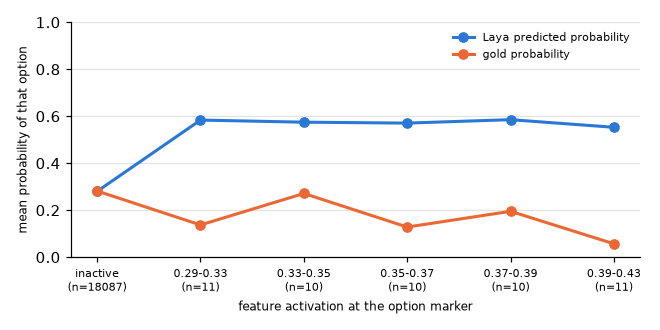

# Feature 6537

Critérios em que aparece: pred_probe_right_laya_wrong

**Interpretação (preencher):** 

---

## Maiores ativações

**tr_security_incidents_000023 / disposition** (choice, security_incidents) | ativação 12.773 em `opção` | opções ['close_benign', 'contain', 'investigate', 'monitor'] | Laya: **monitor** [0.076, 0.119, 0.04, 0.765] | gabarito: **investigate**

```
<bos> choice question: How should this security alert be dispositioned?<eos>
▸ <mask> close_benign: Expected, explainable activity; close without analyst time.
▸ <mask> contain: Contain the host or account immediately; do not wait for triage.
▸ <mask> investigate: Warrants an analyst opening an investigation.
▸ <mask> monitor: Not clearly malicious,⟦ but⟧ worth watching for recurrence.

<eos>

 {"alert": {"description": "a large transfer to an external destination", "evidence": "A 45GB data transfer was initiated by an unprivileged admin principal to an external destination address. This activity occurred from an allowlisted source using MFA-enabled credentials that were last rotated 700 days ago.", "rule": "data_egress"}, "context": {"asset_criticality": "medium", "change_window_active": false, "source_on_allowlist": true}, "history": {"credential_rotation_days_ago": 700, "distinct_countries_30d": 3, "logins_30d": 1407, "prior_alerts_90d": 0}, "principal": {"mfa_enrolled": true, "name": "svc-analytics-468", "privileges": ["repo:read"], "type": "admin"}}<eos>
```

**tr_security_incidents_000235 / disposition** (choice, security_incidents) | ativação 12.578 em `opção` | opções ['close_benign', 'contain', 'investigate', 'monitor'] | Laya: **monitor** [0.181, 0.105, 0.094, 0.621] | gabarito: **investigate**

```
<bos> choice question: How should this security alert be dispositioned?<eos>
▸ <mask> close_benign: Expected, explainable activity; close without analyst time.
▸ <mask> contain: Contain the host or account immediately; do not wait for triage.
▸ <mask> investigate: Warrants an analyst opening an investigation.
▸ <mask> monitor: Not clearly malicious,⟦ but⟧ worth watching for recurrence.

<eos>

 {"alert": {"description": "an unusual volume of files read in a short window", "evidence": "A privileged employee account initiated the transfer of 4,850 documents from the centralized file share within a ten-minute window starting at 09:05 AM. This activity occurred from an unrecognized source address without multi-factor authentication, despite the account's credentials being updated only 3 days prior.", "rule": "mass_download"}, "context": {"asset_criticality": "low", "change_window_active": false, "source_on_allowlist": false}, "history": {"credential_rotation_days_ago": 3, "distinct_countries_30d": 1, "logins_30d": 1153, "prior_alerts_90d": 1}, "principal": {"mfa_enrolled": false, "name": "svc-billing-591", "privileges": ["deploy:production", "secrets:read"], "type": "employee"}}<eos>
```

**tr_security_incidents_000251 / disposition** (choice, security_incidents) | ativação 12.492 em `opção` | opções ['close_benign', 'contain', 'investigate', 'monitor'] | Laya: **monitor** [0.235, 0.142, 0.177, 0.446] | gabarito: **investigate**

```
<bos> choice question: How should this security alert be dispositioned?<eos>
▸ <mask> close_benign: Expected, explainable activity; close without analyst time.
▸ <mask> contain: Contain the host or account immediately; do not wait for triage.
▸ <mask> investigate: Warrants an analyst opening an investigation.
▸ <mask> monitor: Not clearly malicious,⟦ but⟧ worth watching for recurrence.

<eos>

 {"alert": {"description": "an unusual volume of files read in a short window", "evidence": "A privileged service account read 4,500 files within a five-minute window starting at 14:00 UTC. The account lacks MFA and has not undergone a credential rotation in the past 365 days, although the activity originated from an allowlisted network range.", "rule": "mass_download"}, "context": {"asset_criticality": "low", "change_window_active": false, "source_on_allowlist": true}, "history": {"credential_rotation_days_ago": 365, "distinct_countries_30d": 3, "logins_30d": 1531, "prior_alerts_90d": 1}, "principal": {"mfa_enrolled": false, "name": "adm-billing-460", "privileges": ["deploy:production", "secrets:read"], "type": "service_account"}}<eos>
```

**tr_security_incidents_000107 / disposition** (choice, security_incidents) | ativação 12.492 em `opção` | opções ['close_benign', 'contain', 'investigate', 'monitor'] | Laya: **investigate** [0.008, 0.02, 0.635, 0.338] | gabarito: **investigate**

```
<bos> choice question: How should this security alert be dispositioned?<eos>
▸ <mask> close_benign: Expected, explainable activity; close without analyst time.
▸ <mask> contain: Contain the host or account immediately; do not wait for triage.
▸ <mask> investigate: Warrants an analyst opening an investigation.
▸ <mask> monitor: Not clearly malicious,⟦ but⟧ worth watching for recurrence.

<eos>

 {"alert": {"description": "an endpoint agent matched a known signature", "evidence": "The privileged service account 'svc-prod-sync' triggered a malware signature match on host SRV-DB-01 at 22:10 UTC. This detection occurred outside of any active change window while MFA was disabled for the principal. The source address is currently on the allowlist, and the account credentials were last rotated 14 days ago.", "rule": "malware_signature"}, "context": {"asset_criticality": "medium", "change_window_active": false, "source_on_allowlist": true}, "history": {"credential_rotation_days_ago": 14, "distinct_countries_30d": 1, "logins_30d": 778, "prior_alerts_90d": 0}, "principal": {"mfa_enrolled": false, "name": "usr-billing-280", "privileges": ["deploy:production", "secrets:read"], "type": "service_account"}}<eos>
```

**tr_security_incidents_000227 / disposition** (choice, security_incidents) | ativação 12.477 em `opção` | opções ['close_benign', 'contain', 'investigate', 'monitor'] | Laya: **monitor** [0.142, 0.109, 0.079, 0.67] | gabarito: **investigate**

```
<bos> choice question: How should this security alert be dispositioned?<eos>
▸ <mask> close_benign: Expected, explainable activity; close without analyst time.
▸ <mask> contain: Contain the host or account immediately; do not wait for triage.
▸ <mask> investigate: Warrants an analyst opening an investigation.
▸ <mask> monitor: Not clearly malicious,⟦ but⟧ worth watching for recurrence.

<eos>

 {"alert": {"description": "a large transfer to an external destination", "evidence": "A transfer of 4.2 GB of data was initiated to an unrecognized external IP address at 03:40 UTC. This activity was performed by a shared mailbox account that currently has MFA disabled.", "rule": "data_egress"}, "context": {"asset_criticality": "low", "change_window_active": false, "source_on_allowlist": false}, "history": {"credential_rotation_days_ago": 30, "distinct_countries_30d": 4, "logins_30d": 1619, "prior_alerts_90d": 1}, "principal": {"mfa_enrolled": false, "name": "svc-support-910", "privileges": ["repo:read"], "type": "shared_mailbox"}}<eos>
```

## Ativações medianas (faixa 40-60%, mediana 0.757)

**tr_agent_trace_observability_000138 / action** (choice, agent_trace_observability) | ativação 0.780 em `opção` | opções ['continue', 'human_review', 'observe', 'stop'] | Laya: **stop** [0.072, 0.004, 0.044, 0.88] | gabarito: **human_review**

```
<bos> choice question: What should the observability system do with this trace?<eos>
▸ <mask> continue: Let the agent proceed without interruption.
▸ <mask> human_review: Queue this trace for a human to review.
▸ <mask> observe: Keep running⟦,⟧ but flag the trace for later sampling.
▸ <mask> stop: Halt the agent now.

<eos>

 {"agent": {"autonomy": "unsupervised", "model": "internal-agent-v2"}, "constraints": ["Do not force-push to any branch", "Never delete anything matching release/*", "Never modify production without an approved change ticket"], "task": "Provision a read replica for the reporting database.", "trace_summary": {"constraint_violations": 0, "duration_s": 348.7, "irreversible_actions": 1, "steps": 7, "tool_errors": 1}}<eos>
```

**tr_security_incidents_000138 / disposition** (choice, security_incidents) | ativação 0.789 em `opção` | opções ['close_benign', 'contain', 'investigate', 'monitor'] | Laya: **contain** [0.063, 0.459, 0.051, 0.428] | gabarito: **contain**

```
<bos> choice question: How should this security alert be dispositioned?<eos>
▸ <mask> close_benign: Expected⟦,⟧ explainable activity; close without analyst time.
▸ <mask> contain: Contain the host or account immediately; do not wait for triage.
▸ <mask> investigate: Warrants an analyst opening an investigation.
▸ <mask> monitor: Not clearly malicious, but worth watching for recurrence.

<eos>

 {"alert": {"description": "an account granted itself or received elevated permissions", "evidence": "At 02:45:10 UTC on 2026-09-16, the unprivileged service account svc-data-ingest on host 172.16.45.12 executed a `sudo` command that added its own SID to the local sudoers file. The request originated from an unrecognised source IP 203.0.113.55, and the account's credentials were last rotated 3 days ago.", "rule": "privilege_escalation"}, "context": {"asset_criticality": "medium", "change_window_active": false, "source_on_allowlist": false}, "history": {"credential_rotation_days_ago": 3, "distinct_countries_30d": 3, "logins_30d": 818, "prior_alerts_90d": 8}, "principal": {"mfa_enrolled": true, "name": "usr-billing-689", "privileges": ["repo:read"], "type": "service_account"}}<eos>
```

**tr_agent_trace_observability_000129 / action** (choice, agent_trace_observability) | ativação 0.754 em `opção` | opções ['continue', 'human_review', 'observe', 'stop'] | Laya: **stop** [0.279, 0.012, 0.05, 0.659] | gabarito: **observe**

```
<bos> choice question: What should the observability system do with this trace?<eos>
▸ <mask> continue: Let the agent proceed without interruption.
▸ <mask> human_review: Queue this trace for a human to review.
▸ <mask> observe: Keep running⟦,⟧ but flag the trace for later sampling.
▸ <mask> stop: Halt the agent now.

<eos>

 {"agent": {"autonomy": "dry_run", "model": "internal-agent-v3"}, "constraints": ["Do not touch customer data outside the named accounts", "Never disable monitoring or alerting", "Never delete anything matching release/*"], "task": "Clean up stale feature branches merged more than 90 days ago.", "trace_summary": {"constraint_violations": 0, "duration_s": 236.7, "irreversible_actions": 0, "steps": 5, "tool_errors": 3}}<eos>
```

**tr_security_incidents_000123 / disposition** (choice, security_incidents) | ativação 0.840 em `opção` | opções ['close_benign', 'contain', 'investigate', 'monitor'] | Laya: **monitor** [0.049, 0.294, 0.031, 0.627] | gabarito: **investigate**

```
<bos> choice question: How should this security alert be dispositioned?<eos>
▸ <mask> close_benign: Expected⟦,⟧ explainable activity; close without analyst time.
▸ <mask> contain: Contain the host or account immediately; do not wait for triage.
▸ <mask> investigate: Warrants an analyst opening an investigation.
▸ <mask> monitor: Not clearly malicious, but worth watching for recurrence.

<eos>

 {"alert": {"description": "two successful logins from distant locations too close together", "evidence": "Successful authentications for the unprivileged service account 'svc_data_sync' were recorded from IP 192.168.4.12 in New York at 08:00 UTC and IP 10.0.5.88 in London at 08:14 UTC. These logins originated from unrecognized network sources using credentials that were last rotated 412 days ago.", "rule": "impossible_travel"}, "context": {"asset_criticality": "crown_jewel", "change_window_active": false, "source_on_allowlist": false}, "history": {"credential_rotation_days_ago": 412, "distinct_countries_30d": 3, "logins_30d": 1458, "prior_alerts_90d": 0}, "principal": {"mfa_enrolled": false, "name": "usr-deploy-577", "privileges": ["repo:read"], "type": "service_account"}}<eos>
```

**tr_security_incidents_000151 / disposition** (choice, security_incidents) | ativação 0.660 em `opção` | opções ['close_benign', 'contain', 'investigate', 'monitor'] | Laya: **monitor** [0.149, 0.146, 0.061, 0.644] | gabarito: **investigate**

```
<bos> choice question: How should this security alert be dispositioned?<eos>
▸ <mask> close_benign: Expected, explainable activity; close without analyst time.
▸ <mask> contain: Contain the host or account immediately; do not wait for triage.
▸ <mask> investigate: Warrants an analyst opening an investigation⟦.⟧
▸ <mask> monitor: Not clearly malicious, but worth watching for recurrence.

<eos>

 {"alert": {"description": "a long-unused account became active", "evidence": "At 2026-09-16 01:02 UTC, the privileged service account \"svc-data-export\" logged in from IP 203.0.113.45, a source not present on the allowlist, after having no successful logins since 2023‑09‑01. MFA was disabled for this session and the credential’s last rotation timestamp is 365 days old.", "rule": "dormant_account_use"}, "context": {"asset_criticality": "low", "change_window_active": false, "source_on_allowlist": false}, "history": {"credential_rotation_days_ago": 365, "distinct_countries_30d": 4, "logins_30d": 142, "prior_alerts_90d": 0}, "principal": {"mfa_enrolled": false, "name": "ci-infra-692", "privileges": ["deploy:production", "secrets:read"], "type": "service_account"}}<eos>
```

## Estatísticas (conjunto de descoberta, dev e teste)

**pred / error**

| split | decisões | ativas | ativas e Laya errou | taxa | lift | q (BH) | OR (CMH) | q (CMH) |
|---|---|---|---|---|---|---|---|---|
| discovery | 5100 | 49 | 42 | 0.857 | 1.33 | 0.00393 | 2.72 | 0.156 |
| dev | 900 | 10 | 8 | 0.800 | 1.19 | nan | nan | nan |
| test | 2000 | 22 | 22 | 1.000 | 1.54 | 0.000662 | inf | 0.358 |

**corr / error**

| split | decisões | ativas | ativas e Laya errou | taxa | lift | q (BH) | OR (CMH) | q (CMH) |
|---|---|---|---|---|---|---|---|---|
| discovery | 5100 | 8 | 1 | 0.125 | 0.19 | nan | nan | nan |
| dev | 900 | 2 | 0 | 0.000 | 0.00 | nan | nan | nan |
| test | 2000 | 0 | 0 | nan | nan | nan | nan | nan |

**state / error**

| split | decisões | ativas | ativas e Laya errou | taxa | lift | q (BH) | OR (CMH) | q (CMH) |
|---|---|---|---|---|---|---|---|---|
| discovery | 5100 | 91 | 64 | 0.703 | 1.09 | 0.435 | 1.39 | 0.494 |
| dev | 900 | 7 | 4 | 0.571 | 0.85 | nan | nan | nan |
| test | 2000 | 30 | 17 | 0.567 | 0.87 | 0.721 | 0.53 | 0.505 |

**pred / probe_right_laya_wrong**

| split | decisões | ativas | ativas e Laya errou | taxa | lift | q (BH) | OR (CMH) | q (CMH) |
|---|---|---|---|---|---|---|---|---|
| discovery | 2932 | 30 | 30 | 1.000 | 1.65 | 2.04e-06 | inf | 0.0802 |
| dev | 523 | 7 | 7 | 1.000 | 1.55 | nan | nan | nan |
| test | 1149 | 17 | 17 | 1.000 | 1.64 | nan | nan | nan |

**corr / probe_right_laya_wrong**

| split | decisões | ativas | ativas e Laya errou | taxa | lift | q (BH) | OR (CMH) | q (CMH) |
|---|---|---|---|---|---|---|---|---|
| discovery | 2932 | 0 | 0 | nan | nan | nan | nan | nan |
| dev | 523 | 0 | 0 | nan | nan | nan | nan | nan |
| test | 1149 | 0 | 0 | nan | nan | nan | nan | nan |

**state / probe_right_laya_wrong**

| split | decisões | ativas | ativas e Laya errou | taxa | lift | q (BH) | OR (CMH) | q (CMH) |
|---|---|---|---|---|---|---|---|---|
| discovery | 2932 | 42 | 27 | 0.643 | 1.06 | 0.843 | 1.29 | 0.723 |
| dev | 523 | 3 | 2 | 0.667 | 1.03 | nan | nan | nan |
| test | 1149 | 13 | 7 | 0.538 | 0.88 | nan | nan | nan |

Confusão mais sobre-representada (pred): `discrepancy_severity|2>0` (n=31, lift 29.88, p=1.03e-41). Formato `pergunta|índice previsto>índice correto`.

Confusão mais sobre-representada (corr): `discrepancy_severity|1>2` (n=1, lift 637.50, p=nan). Formato `pergunta|índice previsto>índice correto`.

Confusão mais sobre-representada (state): `churn_risk|1>0` (n=3, lift 12.01, p=0.00173). Formato `pergunta|índice previsto>índice correto`.



