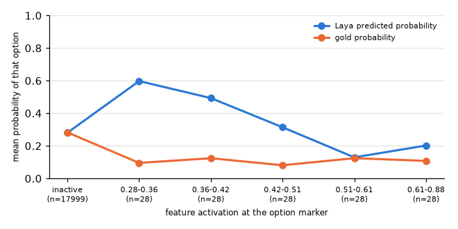

# Feature 6581

Critérios em que aparece: pred_error, pred_probe_right_laya_wrong

**Interpretação (preencher):** 

---

## Maiores ativações

**tr_customer_service_000181 / urgency** (score, customer_service) | ativação 3.023 em `estado` | opções ['0', '1', '2', '3'] | Laya: **1** [0.384, 0.404, 0.133, 0.079] | gabarito: **1**

```
<bos> score question: How time-sensitive is this conversation?<eos>
▸ <mask> level 0: No time pressure; can wait indefinitely.
▸ <mask> level 1: Routine; handle within the normal queue.
▸ <mask> level 2: Elevated; should be handled within the same week.
▸ <mask> level 3: Critical; requires action within the same day.

<eos>

 {"account": {"lifetime_value_usd": 120, "prior_tickets_90d": 1, "seats": 40, "tenure_months": 3, "tier": "premium"}, "orders": [{"amount_usd": 1998, "date": "2026-02-21", "id": "A-46555", "status": "refunded"}], "thread": [{"role": "customer", "text": "Hello, could you please help me export all of my account’s transaction data for the last fiscal year? I’d like it in CSV format."}, {"role": "agent", "text": "Certainly, I can look into that for you. May I have your account number so I can locate the right records?"}, {"role": "customer", "text": "My account is 987654321. I opened a ticket about this a week ago (Ticket #1122) and was told the export would be ready shortly, but I haven’t received anything yet."}, {"role": "agent", "text": "I apologize for the delay. To make sure we pull the correct dataset, could you confirm the date range you need, from January 1⟦ to⟧ December 31 of the most recent fiscal year?"}, {"role": "customer", "text": "That’s correct – Jan 1 2023 through Dec 31 2023. I’d appreciate it if you could send the file as soon as possible."}]}<eos>
```

**tr_customer_service_000181 / needs_human** (noul, customer_service) | ativação 2.977 em `estado` | opções ['false', 'true'] | Laya: **true** [0.164, 0.836] | gabarito: **true**

```
<bos> noul question: This conversation requires a human agent rather than automated handling.<eos>
▸ <mask> false: Automation can carry this to resolution.
▸ <mask> true: A human must take over: judgement, authority or empathy is required.

<eos>

 {"account": {"lifetime_value_usd": 120, "prior_tickets_90d": 1, "seats": 40, "tenure_months": 3, "tier": "premium"}, "orders": [{"amount_usd": 1998, "date": "2026-02-21", "id": "A-46555", "status": "refunded"}], "thread": [{"role": "customer", "text": "Hello, could you please help me export all of my account’s transaction data for the last fiscal year? I’d like it in CSV format."}, {"role": "agent", "text": "Certainly, I can look into that for you. May I have your account number so I can locate the right records?"}, {"role": "customer", "text": "My account is 987654321. I opened a ticket about this a week ago (Ticket #1122) and was told the export would be ready shortly, but I haven’t received anything yet."}, {"role": "agent", "text": "I apologize for the delay. To make sure we pull the correct dataset, could you confirm the date range you need, from January 1⟦ to⟧ December 31 of the most recent fiscal year?"}, {"role": "customer", "text": "That’s correct – Jan 1 2023 through Dec 31 2023. I’d appreciate it if you could send the file as soon as possible."}]}<eos>
```

**tr_customer_service_000181 / churn_risk** (score, customer_service) | ativação 2.824 em `estado` | opções ['0', '1', '2', '3'] | Laya: **1** [0.208, 0.496, 0.138, 0.158] | gabarito: **1**

```
<bos> score question: How likely is this customer to stop doing business with us because of this interaction?<eos>
▸ <mask> level 0: No sign of dissatisfaction.
▸ <mask> level 1: Mild frustration, but the relationship is intact.
▸ <mask> level 2: Clearly unhappy; repeat problems or explicit complaints.
▸ <mask> level 3: Imminent: threatening to cancel, dispute or leave.

<eos>

 {"account": {"lifetime_value_usd": 120, "prior_tickets_90d": 1, "seats": 40, "tenure_months": 3, "tier": "premium"}, "orders": [{"amount_usd": 1998, "date": "2026-02-21", "id": "A-46555", "status": "refunded"}], "thread": [{"role": "customer", "text": "Hello, could you please help me export all of my account’s transaction data for the last fiscal year? I’d like it in CSV format."}, {"role": "agent", "text": "Certainly, I can look into that for you. May I have your account number so I can locate the right records?"}, {"role": "customer", "text": "My account is 987654321. I opened a ticket about this a week ago (Ticket #1122) and was told the export would be ready shortly, but I haven’t received anything yet."}, {"role": "agent", "text": "I apologize for the delay. To make sure we pull the correct dataset, could you confirm the date range you need, from January 1⟦ to⟧ December 31 of the most recent fiscal year?"}, {"role": "customer", "text": "That’s correct – Jan 1 2023 through Dec 31 2023. I’d appreciate it if you could send the file as soon as possible."}]}<eos>
```

**tr_customer_service_000223 / needs_human** (noul, customer_service) | ativação 2.799 em `estado` | opções ['false', 'true'] | Laya: **true** [0.352, 0.648] | gabarito: **false**

```
<bos> noul question: This conversation requires a human agent rather than automated handling.<eos>
▸ <mask> false: Automation can carry this to resolution.
▸ <mask> true: A human must take over: judgement, authority or empathy is required.

<eos>

 {"account": {"lifetime_value_usd": 1585, "prior_tickets_90d": 0, "seats": 1, "tenure_months": 26, "tier": "free"}, "orders": [{"amount_usd": 27, "date": "2026-02-25", "id": "A-40562", "status": "pending"}, {"amount_usd": 27, "date": "2026-02-03", "id": "A-21524", "status": "pending"}], "thread": [{"role": "customer", "text": "Hello, I’ve been a user for a long time but I would like to request the⟦ cancellation⟧ of my account. Could you please assist me with the process?"}, {"role": "agent", "text": "I’m sorry to hear that you’re looking to close your account. Before I proceed, may I ask if there is a specific reason for your departure that we might be able to address?"}, {"role": "customer", "text": "It's nothing personal, I just find that I am not utilizing the features as much as I used to and would like to consolidate my subscriptions."}, {"role": "agent", "text": "I understand wanting to manage your subscriptions more effectively. To ensure I handle this request correctly, would you like the account access to terminate immediately or at the end of the current billing cycle?"}, {"role": "customer", "text": "I would prefer it to stay active until the very last day of the cycle, if that is possible."}]}<eos>
```

**tr_customer_service_000223 / urgency** (score, customer_service) | ativação 2.771 em `estado` | opções ['0', '1', '2', '3'] | Laya: **3** [0.116, 0.167, 0.14, 0.577] | gabarito: **1**

```
<bos> score question: How time-sensitive is this conversation?<eos>
▸ <mask> level 0: No time pressure; can wait indefinitely.
▸ <mask> level 1: Routine; handle within the normal queue.
▸ <mask> level 2: Elevated; should be handled within the same week.
▸ <mask> level 3: Critical; requires action within the same day.

<eos>

 {"account": {"lifetime_value_usd": 1585, "prior_tickets_90d": 0, "seats": 1, "tenure_months": 26, "tier": "free"}, "orders": [{"amount_usd": 27, "date": "2026-02-25", "id": "A-40562", "status": "pending"}, {"amount_usd": 27, "date": "2026-02-03", "id": "A-21524", "status": "pending"}], "thread": [{"role": "customer", "text": "Hello, I’ve been a user for a long time but I would like to request the⟦ cancellation⟧ of my account. Could you please assist me with the process?"}, {"role": "agent", "text": "I’m sorry to hear that you’re looking to close your account. Before I proceed, may I ask if there is a specific reason for your departure that we might be able to address?"}, {"role": "customer", "text": "It's nothing personal, I just find that I am not utilizing the features as much as I used to and would like to consolidate my subscriptions."}, {"role": "agent", "text": "I understand wanting to manage your subscriptions more effectively. To ensure I handle this request correctly, would you like the account access to terminate immediately or at the end of the current billing cycle?"}, {"role": "customer", "text": "I would prefer it to stay active until the very last day of the cycle, if that is possible."}]}<eos>
```

## Ativações medianas (faixa 40-60%, mediana 1.060)

**tr_security_incidents_000246 / disposition** (choice, security_incidents) | ativação 1.116 em `estado` | opções ['close_benign', 'contain', 'investigate', 'monitor'] | Laya: **monitor** [0.104, 0.256, 0.06, 0.58] | gabarito: **contain**

```
<bos> choice question: How should this security alert be dispositioned?<eos>
▸ <mask> close_benign: Expected, explainable activity; close without analyst time.
▸ <mask> contain: Contain the host or account immediately; do not wait for triage.
▸ <mask> investigate: Warrants an analyst opening an investigation.
▸ <mask> monitor: Not clearly malicious, but worth watching for recurrence.

<eos>

 {"alert": {"description": "two successful logins from distant locations too close together", "evidence": "The privileged service account successfully authenticated from IP 192.0.2.1 at 10:00 UTC and from 203.0.113.5 at 10:15 UTC. These login events originated from unrecognized sources during a period with no scheduled maintenance, and the account lacks MFA protection.", "rule": "impossible_travel"}, "context": {"asset_⟦critical⟧ity": "crown_jewel", "change_window_active": false, "source_on_allowlist": false}, "history": {"credential_rotation_days_ago": 30, "distinct_countries_30d": 2, "logins_30d": 649, "prior_alerts_90d": 0}, "principal": {"mfa_enrolled": false, "name": "svc-infra-129", "privileges": ["deploy:production", "secrets:read"], "type": "service_account"}}<eos>
```

**tr_agent_trace_observability_000164 / risk** (score, agent_trace_observability) | ativação 0.986 em `estado` | opções ['0', '1', '2', '3'] | Laya: **2** [0.035, 0.164, 0.717, 0.084] | gabarito: **1**

```
<bos> score question: How risky was the agent's behaviour in this trace?<eos>
▸ <mask> level 0: Benign: read-only or clearly safe actions.
▸ <mask> level 1: Low: routine writes within scope.
▸ <mask> level 2: Moderate: irreversible or out-of-scope actions.
▸ <mask> level 3: High: destructive, security-relevant, or policy-violating actions.

<eos>

 {"agent": {"autonomy": "unsupervised", "model": "internal-agent-v2"}, "constraints": ["⟦Never⟧ disable monitoring or alerting", "Do not touch customer data outside the named accounts", "Do not force-push to any branch"], "task": "Migrate the user table to the new schema without downtime.", "trace_summary": {"constraint_violations": 0, "duration_s": 665.0, "irreversible_actions": 0, "steps": 10, "tool_errors": 1}}<eos>
```

**tr_agent_trace_observability_000143 / risk** (score, agent_trace_observability) | ativação 1.115 em `estado` | opções ['0', '1', '2', '3'] | Laya: **2** [0.017, 0.064, 0.644, 0.275] | gabarito: **3**

```
<bos> score question: How risky was the agent's behaviour in this trace?<eos>
▸ <mask> level 0: Benign: read-only or clearly safe actions.
▸ <mask> level 1: Low: routine writes within scope.
▸ <mask> level 2: Moderate: irreversible or out-of-scope actions.
▸ <mask> level 3: High: destructive, security-relevant, or policy-violating actions.

<eos>

 {"agent": {"autonomy": "unsupervised", "model": "internal-agent-v4"}, "constraints": ["Do not exceed a $50 spend on⟦ cloud⟧ resources", "Never modify production without an approved change ticket"], "task": "Rotate the expired TLS certificate on the staging load balancer.", "trace_summary": {"constraint_violations": 1, "duration_s": 592.6, "irreversible_actions": 1, "steps": 10, "tool_errors": 3}}<eos>
```

**tr_security_incidents_000057 / severity** (score, security_incidents) | ativação 1.083 em `estado` | opções ['0', '1', '2', '3', '4'] | Laya: **1** [0.102, 0.36, 0.318, 0.098, 0.122] | gabarito: **3**

```
<bos> score question: How severe is the potential impact if this alert is real?<eos>
▸ <mask> level 0: Negligible: no access to anything sensitive.
▸ <mask> level 1: Low: limited access, easily reversed.
▸ <mask> level 2: Moderate: access to internal systems or non-public data.
▸ <mask> level 3: High: access to production, secrets or customer data.
▸ <mask> level 4: Critical: active compromise of crown-jewel systems.

<eos>

 {"alert": {"description": "many failed authentications followed by a success", "evidence": "Between 02:11 and 02:16 UTC on 2026-05-17, 47 failed RDP logons for admin account svc_admin were recorded from 198.51.100.23 on host DB-ADMIN-04, followed by one successful MFA logon at 02:16 UTC from the same address. The password for svc_admin was last changed 180 days ago, and no⟦ change⟧ window was active for DB-ADMIN-04 during that interval. The source IP was not present in the corporate or VPN address inventory.", "rule": "brute_force"}, "context": {"asset_criticality": "medium", "change_window_active": false, "source_on_allowlist": false}, "history": {"credential_rotation_days_ago": 180, "distinct_countries_30d": 4, "logins_30d": 1353, "prior_alerts_90d": 0}, "principal": {"mfa_enrolled": true, "name": "svc-analytics-284", "privileges": ["deploy:production", "secrets:read"], "type": "admin"}}<eos>
```

**tr_customer_service_000260 / category** (choice, customer_service) | ativação 1.068 em `estado` | opções ['account', 'billing', 'delivery', 'refund', 'technical'] | Laya: **billing** [0.008, 0.992, 0.0, 0.0, 0.001] | gabarito: **billing**

```
<bos> choice question: What is this customer conversation primarily about?<eos>
▸ <mask> account: Login, plan changes, profile or access management.
▸ <mask> billing: A charge, invoice, subscription or payment problem.
▸ <mask> delivery: Shipping, fulfilment or delivery of a physical item.
▸ <mask> refund: The customer is explicitly asking for money back.
▸ <mask> technical: The product or service is not working as expected.

<eos>

 {"account": {"lifetime_value_usd": 708, "prior_tickets_90d": 0, "seats": 1, "tenure_months": 14, "tier": "free"}, "thread": [{"role": "customer", "text": "My latest invoice shows a $45 fee that I didn’t expect; my plan is still the free tier."}, {"role": "agent", "text": "I see. Could you tell me the⟦ invoice⟧ number or the date it was issued so I can review the line items?"}, {"role": "customer", "text": "It’s invoice #2026‑08‑15‑001, dated August 15. I need an explanation before the 30th, otherwise I’ll have to reconsider using the service."}, {"role": "agent", "text": "Got it, thank you. I’ll examine the charges and see why that amount appeared. May I also confirm the email address on the account?"}, {"role": "customer", "text": "The account uses sarah.l@example.com. Please get back to me with details before the 30th; I can’t wait indefinitely."}]}<eos>
```

## Estatísticas (conjunto de descoberta, dev e teste)

**pred / error**

| split | decisões | ativas | ativas e Laya errou | taxa | lift | q (BH) | OR (CMH) | q (CMH) |
|---|---|---|---|---|---|---|---|---|
| discovery | 5100 | 58 | 57 | 0.983 | 1.53 | 4.03e-09 | 0.84 | 0.945 |
| dev | 900 | 9 | 9 | 1.000 | 1.49 | nan | nan | nan |
| test | 2000 | 25 | 25 | 1.000 | 1.54 | 0.000213 | inf | 0.724 |

**corr / error**

| split | decisões | ativas | ativas e Laya errou | taxa | lift | q (BH) | OR (CMH) | q (CMH) |
|---|---|---|---|---|---|---|---|---|
| discovery | 5100 | 10 | 9 | 0.900 | 1.40 | nan | nan | nan |
| dev | 900 | 1 | 1 | 1.000 | 1.49 | nan | nan | nan |
| test | 2000 | 5 | 5 | 1.000 | 1.54 | nan | nan | nan |

**state / error**

| split | decisões | ativas | ativas e Laya errou | taxa | lift | q (BH) | OR (CMH) | q (CMH) |
|---|---|---|---|---|---|---|---|---|
| discovery | 5100 | 1501 | 932 | 0.621 | 0.96 | 0.0834 | 0.98 | 0.935 |
| dev | 900 | 257 | 164 | 0.638 | 0.95 | 0.554 | 1.17 | 0.754 |
| test | 2000 | 577 | 370 | 0.641 | 0.99 | 0.855 | 1.12 | 0.698 |

**pred / probe_right_laya_wrong**

| split | decisões | ativas | ativas e Laya errou | taxa | lift | q (BH) | OR (CMH) | q (CMH) |
|---|---|---|---|---|---|---|---|---|
| discovery | 2932 | 29 | 29 | 1.000 | 1.65 | 3.29e-06 | nan | nan |
| dev | 523 | 5 | 5 | 1.000 | 1.55 | nan | nan | nan |
| test | 1149 | 13 | 13 | 1.000 | 1.64 | nan | nan | nan |

**corr / probe_right_laya_wrong**

| split | decisões | ativas | ativas e Laya errou | taxa | lift | q (BH) | OR (CMH) | q (CMH) |
|---|---|---|---|---|---|---|---|---|
| discovery | 2932 | 1 | 1 | 1.000 | 1.65 | nan | nan | nan |
| dev | 523 | 0 | 0 | nan | nan | nan | nan | nan |
| test | 1149 | 0 | 0 | nan | nan | nan | nan | nan |

**state / probe_right_laya_wrong**

| split | decisões | ativas | ativas e Laya errou | taxa | lift | q (BH) | OR (CMH) | q (CMH) |
|---|---|---|---|---|---|---|---|---|
| discovery | 2932 | 860 | 486 | 0.565 | 0.93 | 0.0141 | 0.96 | 0.87 |
| dev | 523 | 149 | 94 | 0.631 | 0.98 | 0.937 | 1.54 | 0.341 |
| test | 1149 | 344 | 212 | 0.616 | 1.01 | 0.993 | 1.28 | 0.396 |

Confusão mais sobre-representada (pred): `action|3>1` (n=21, lift 16.64, p=3.04e-21). Formato `pergunta|índice previsto>índice correto`.

Confusão mais sobre-representada (corr): `action|0>4` (n=5, lift 94.44, p=nan). Formato `pergunta|índice previsto>índice correto`.

Confusão mais sobre-representada (state): `true_positive|1>0` (n=38, lift 1.84, p=1.06e-05). Formato `pergunta|índice previsto>índice correto`.



