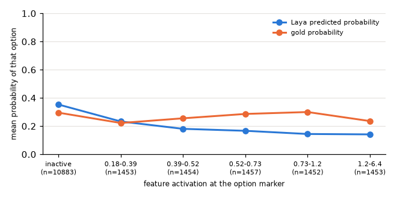

# Feature 6763

Critérios em que aparece: pred_error_stratified, corr_error_stratified, pred_probe_right_laya_wrong_stratified, corr_probe_right_laya_wrong_stratified, attribution_toward_correct

**Interpretação (preencher):** 

---

## Maiores ativações

**tr_customer_service_000124 / urgency** (score, customer_service) | ativação 8.930 em `opção` | opções ['0', '1', '2', '3'] | Laya: **1** [0.27, 0.364, 0.082, 0.284] | gabarito: **3**

```
<bos> score question: How time-sensitive is this conversation?<eos>
▸ <mask> level 0:⟦ No⟧ time pressure; can wait indefinitely.
▸ <mask> level 1: Routine; handle within the normal queue.
▸ <mask> level 2: Elevated; should be handled within the same week.
▸ <mask> level 3: Critical; requires action within the same day.

<eos>

 {"account": {"lifetime_value_usd": 214, "prior_tickets_90d": 3, "seats": 1, "tenure_months": 5, "tier": "standard"}, "orders": [{"amount_usd": 99, "date": "2026-03-22", "id": "A-56703", "status": "pending"}], "thread": [{"role": "customer", "text": "Hello, I’m writing because my order #A12345, which was supposed to arrive last week, still hasn’t shown up. I’ve been with you for five months on the standard plan, paying about $99, and I’ve already opened three tickets about this that were only partially addressed. I have a hard deadline to receive it by Friday, so I really need an update."}, {"role": "agent", "text": "I’m sorry to hear about the delay. Let me pull up the details for you—could you confirm the order number once more, and any reference numbers from the previous tickets?"}, {"role": "customer", "text": "Sure, it’s order #A12345. The prior tickets were 5678, 5690, and 5702. As I mentioned, I’ve been a customer for five months, paying $99 per month, and I can’t miss the Friday deadline."}, {"role": "agent", "text": "Thank you for confirming. I see the shipment is still in transit. Could you let me know the exact date you need the package by, so I can check if we can prioritize it?"}, {"role": "customer", "text": "I need it no later than Friday, September 20th. If there’s any way to expedite the delivery or arrange a local pickup, that would help a lot."}, {"role": "agent", "text": "Understood, Friday is critical. Do you have an alternate shipping address or a nearby facility where we could reroute the package if needed?"}, {"role": "customer", "text": "No, the address on file is correct. Please keep me posted on any movement—I'd appreciate an update as soon as you have one."}]}<eos>
```

**tr_customer_service_000061 / action** (choice, customer_service) | ativação 6.445 em `marcador` | opções ['answer_directly', 'close_no_action', 'escalate_to_human', 'execute_refund', 'request_information'] | Laya: **escalate_to_human** [0.041, 0.138, 0.817, 0.002, 0.001] | gabarito: **request_information**

```
<bos> choice question: What should the assistant do next with this conversation?<eos>
▸ <mask> answer_directly: The assistant can resolve this itself with information it already has.
▸ <mask> close_no_action: No further action is warranted; the matter is settled.
▸ <mask> escalate_to_human: Hand off to a human agent with the appropriate authority.
▸ <mask> execute_refund: Issue the refund or credit the customer is owed.
▸ ⟦<mask>⟧ request_information: More detail is needed from the customer before anything can be done.

<eos>

 {"account": {"lifetime_value_usd": 1585, "prior_tickets_90d": 2, "seats": 1, "tenure_months": 41, "tier": "premium"}, "thread": [{"role": "customer", "text": "I'm trying to adjust my seat count again, but the dashboard is just giving me the same greyed-out error as last time."}, {"role": "agent", "text": "I apologize for the frustration; could you confirm if you are seeing this error on the billing page or the team management tab?"}, {"role": "customer", "text": "It's on the team management tab. Honestly, I'm used to this by now."}, {"role": "agent", "text": "Thank you for clarifying. Are you currently logged in as the primary account administrator when accessing that specific tab?"}, {"role": "customer", "text": "Yes, I am the admin. Nothing ever seems to change with these permissions."}, {"role": "agent", "text": "I appreciate your patience while we look into this. Could you please send me a screenshot of the specific error message you see?"}, {"role": "customer", "text": "I'll try to get that over later, but I don't really expect it to make a difference."}]}<eos>
```

**tr_customer_service_000043 / churn_risk** (score, customer_service) | ativação 6.219 em `marcador` | opções ['0', '1', '2', '3'] | Laya: **1** [0.275, 0.645, 0.048, 0.031] | gabarito: **2**

```
<bos> score question: How likely is this customer to stop doing business with us because of this interaction?<eos>
▸ <mask> level 0: No sign of dissatisfaction.
▸ <mask> level 1: Mild frustration, but the relationship is intact.
▸ ⟦<mask>⟧ level 2: Clearly unhappy; repeat problems or explicit complaints.
▸ <mask> level 3: Imminent: threatening to cancel, dispute or leave.

<eos>

 {"account": {"lifetime_value_usd": 208, "prior_tickets_90d": 0, "seats": 1, "tenure_months": 3, "tier": "free"}, "orders": [{"amount_usd": 999, "date": "2026-03-09", "id": "A-17017", "status": "refunded"}, {"amount_usd": 999, "date": "2026-01-04", "id": "A-58989", "status": "failed"}], "thread": [{"role": "customer", "text": "I need to get my data out of the system, but I’m not holding my breath—it probably won’t happen any time soon."}, {"role": "agent", "text": "I hear you. Could you tell me which parts of your account you’d like included in the export?"}, {"role": "customer", "text": "Just the basic account information—profile details and settings. Nothing fancy."}, {"role": "agent", "text": "Understood. Do you have a preferred format for the file—CSV, JSON, or something else?"}, {"role": "customer", "text": "Whatever you can manage, I don’t mind waiting."}]}<eos>
```

**tr_customer_service_000238 / action** (choice, customer_service) | ativação 6.145 em `marcador` | opções ['answer_directly', 'close_no_action', 'escalate_to_human', 'execute_refund', 'request_information'] | Laya: **close_no_action** [0.042, 0.936, 0.009, 0.008, 0.004] | gabarito: **escalate_to_human**

```
<bos> choice question: What should the assistant do next with this conversation?<eos>
▸ <mask> answer_directly: The assistant can resolve this itself with information it already has.
▸ <mask> close_no_action: No further action is warranted; the matter is settled.
▸ <mask> escalate_to_human: Hand off to a human agent with the appropriate authority.
▸ <mask> execute_refund: Issue the refund or credit the customer is owed.
▸ ⟦<mask>⟧ request_information: More detail is needed from the customer before anything can be done.

<eos>

 {"account": {"lifetime_value_usd": 699, "prior_tickets_90d": 0, "seats": 12, "tenure_months": 19, "tier": "premium"}, "orders": [{"amount_usd": 49, "date": "2026-02-27", "id": "A-61611", "status": "failed"}, {"amount_usd": 49, "date": "2026-03-13", "id": "A-63348", "status": "settled"}], "thread": [{"role": "customer", "text": "The dashboard has been taking nearly two minutes to load every morning this week. I have a presentation at noon, but I suppose it’s just how things are now."}, {"role": "agent", "text": "I understand how frustrating that latency must be. To help me investigate, could you tell me if you are experiencing this slow-down on a specific browser or connection?"}, {"role": "customer", "text": "It’s the same on Chrome and Firefox, regardless of my network. I’ve been paying for the premium tier for a long time, but it doesn't seem to make much of a difference."}]}<eos>
```

**tr_customer_service_000069 / churn_risk** (score, customer_service) | ativação 5.793 em `opção` | opções ['0', '1', '2', '3'] | Laya: **1** [0.084, 0.648, 0.182, 0.086] | gabarito: **2**

```
<bos> score question: How likely is this customer to stop doing business with us because of this interaction?<eos>
▸ <mask> level 0: No sign of dissatisfaction.
▸ <mask> level 1: Mild frustration, but the relationship is intact.
▸ <mask> level ⟦2⟧: Clearly unhappy; repeat problems or explicit complaints.
▸ <mask> level 3: Imminent: threatening to cancel, dispute or leave.

<eos>

 {"account": {"lifetime_value_usd": 1693, "prior_tickets_90d": 0, "seats": 1, "tenure_months": 26, "tier": "free"}, "thread": [{"role": "customer", "text": "I'm trying to pull our team's records into a CSV for a client deliverable and the export just spins. We're on the free plan, this has been going on for days, and I need the file by Friday at 5 p.m. It's our 26th month on the platform, so it's surprising how broken basic export is."}, {"role": "agent", "text": "Thanks for letting me know where you're at. Could you tell me whether the export fails during the initial request, after selecting the date range, or when the download file is supposed to start?"}, {"role": "customer", "text": "It fails right after I click generate. No error, just the spinner. I've tried Chrome and Safari, and I've even cleared cookies. The client deadline doesn't move, so I need someone to actually look at this before Friday."}, {"role": "agent", "text": "I understand the timing is tight. To help narrow it down, can you share the approximate number of records you're trying to export and whether you're exporting all projects or a subset?"}, {"role": "customer", "text": "It's roughly the whole workspace, but I can't get past the spinner to confirm. If it's an account limit or a backend issue, I need that explained by tomorrow, because Friday is non-negotiable."}]}<eos>
```

## Ativações medianas (faixa 40-60%, mediana 0.808)

**tr_customer_service_000276 / needs_human** (noul, customer_service) | ativação 0.911 em `marcador` | opções ['false', 'true'] | Laya: **false** [0.511, 0.489] | gabarito: **false**

```
<bos> noul question: This conversation requires a human agent rather than automated handling.<eos>
▸ <mask> false: Automation can carry this to resolution.
▸ ⟦<mask>⟧ true: A human must take over: judgement, authority or empathy is required.

<eos>

 {"account": {"lifetime_value_usd": 2578, "prior_tickets_90d": 2, "seats": 1, "tenure_months": 33, "tier": "free"}, "orders": [{"amount_usd": 19, "date": "2026-02-10", "id": "A-44819", "status": "pending"}, {"amount_usd": 19, "date": "2026-02-04", "id": "A-86947", "status": "refunded"}, {"amount_usd": 19, "date": "2026-03-02", "id": "A-96218", "status": "refunded"}], "thread": [{"role": "customer", "text": "Hi there. I’m checking in on the $19 refund I requested a while back. I’ve been with you for 33 months on the free plan, and since I have a hard deadline for my accounting this Friday, I was hoping for an update."}, {"role": "agent", "text": "Hello. I appreciate your long-standing loyalty over the last few years. I can certainly look into the status of that refund request for you; could you please provide the reference number from your previous inquiries?"}, {"role": "customer", "text": "I’ve opened two tickets already, but they seem to have stalled. I’m trying to keep my records clean before my deadline at the end of the week, so any movement on this would be greatly appreciated."}, {"role": "agent", "text": "Thank you for that clarification. I am currently reviewing your account history and the previous tickets mentioned to see where the hold-up might be occurring."}, {"role": "customer", "text": "I understand. I’m just really concerned about hitting that Friday cutoff, so please let me know as soon as you find anything out."}]}<eos>
```

**tr_customer_service_000108 / action** (choice, customer_service) | ativação 0.803 em `opção` | opções ['answer_directly', 'close_no_action', 'escalate_to_human', 'execute_refund', 'request_information'] | Laya: **answer_directly** [0.522, 0.327, 0.047, 0.082, 0.022] | gabarito: **answer_directly**

```
<bos> choice question: What should the assistant do next with this conversation?<eos>
▸ <mask> answer_directly: The assistant can resolve this itself with information it already has.
▸ <mask> close_no_action: No further action is warranted; the matter is settled.
▸ <mask> escalate_to_human: Hand off to a human agent with the appropriate authority.
▸ <mask> execute_refund: Issue the refund or credit the customer is owed.
▸ <mask> request_⟦information⟧: More detail is needed from the customer before anything can be done.

<eos>

 {"account": {"lifetime_value_usd": 212, "prior_tickets_90d": 0, "seats": 1, "tenure_months": 5, "tier": "standard"}, "orders": [{"amount_usd": 198, "date": "2026-01-14", "id": "A-21848", "status": "refunded"}], "thread": [{"role": "customer", "text": "I've been trying to log in for a while now, but the page just keeps bringing me back to the sign‑in screen. I guess there's not much I can do."}]}<eos>
```

**tr_customer_service_000239 / churn_risk** (score, customer_service) | ativação 0.878 em `opção` | opções ['0', '1', '2', '3'] | Laya: **2** [0.038, 0.294, 0.619, 0.049] | gabarito: **3**

```
<bos> score question: How likely is this customer to stop doing business with us because of this interaction?<eos>
▸ <mask> level 0: No sign of dissatisfaction.
▸ <mask> level 1: Mild frustration, but the relationship is intact.
▸ <mask> level 2: Clearly unhappy; repeat problems or explicit complaints.
▸ <mask>⟦ level⟧ 3: Imminent: threatening to cancel, dispute or leave.

<eos>

 {"account": {"lifetime_value_usd": 672, "prior_tickets_90d": 5, "seats": 40, "tenure_months": 11, "tier": "enterprise"}, "orders": [{"amount_usd": 19, "date": "2026-03-14", "id": "A-50305", "status": "settled"}, {"amount_usd": 19, "date": "2026-02-11", "id": "A-78147", "status": "failed"}, {"amount_usd": 19, "date": "2026-02-26", "id": "A-68714", "status": "settled"}], "thread": [{"role": "customer", "text": "I’ve decided to downgrade my plan. I’ve reached out five times before about these billing issues, and at this point, I’m just tired of dealing with it."}, {"role": "agent", "text": "I am sorry to hear you've had such a difficult experience with us. Before I process that change, could you clarify which tier you would like to move to?"}, {"role": "customer", "text": "Just the basic tier. I’ve been here for eleven months, but I don’t think the enterprise features are worth the ongoing headache."}]}<eos>
```

**tr_customer_service_000211 / churn_risk** (score, customer_service) | ativação 0.863 em `estado` | opções ['0', '1', '2', '3'] | Laya: **1** [0.073, 0.449, 0.404, 0.075] | gabarito: **1**

```
<bos> score question: How likely is this customer to stop doing business with us because of this interaction?<eos>
▸ <mask> level 0: No sign of dissatisfaction.
▸ <mask> level 1: Mild frustration, but the relationship is intact.
▸ <mask> level 2: Clearly unhappy; repeat problems or explicit complaints.
▸ <mask> level 3: Imminent: threatening to cancel, dispute or leave.

<eos>

 {"account": {"lifetime_value_usd": 1059, "prior_tickets_90d": 0, "seats": 1, "tenure_months": 41, "tier": "standard"}, "thread": [{"⟦role⟧": "customer", "text": "I’m confused—my new feature that was supposed to sync contacts stopped working after the last update. I’ve been on the Standard plan for almost four years, and this is the first major glitch."}, {"role": "agent", "text": "I’m sorry you’re experiencing that. Can you tell me when you first noticed the sync failure and if any error messages appeared?"}, {"role": "customer", "text": "It started this morning; the UI shows ‘Sync failed’ but no error code, and nothing updates even after I restart the app."}, {"role": "agent", "text": "Understood. Could you let me know which devices you’re using and whether the issue occurs on all of them or just a specific one?"}, {"role": "customer", "text": "Both my laptop (Windows 10) and my phone (iOS 16) show the same problem, and I need this fixed before my meeting tomorrow."}]}<eos>
```

**tr_agent_trace_observability_000221 / urgency** (score, agent_trace_observability) | ativação 0.796 em `estado` | opções ['0', '1', '2', '3'] | Laya: **2** [0.203, 0.248, 0.286, 0.262] | gabarito: **1**

```
<bos> score question: How quickly does this trace need attention?<eos>
▸ <mask> level 0: No time pressure; can wait indefinitely.
▸ <mask> level 1: Routine; handle within the normal queue.
▸ <mask> level 2: Elevated; should be handled within the same week.
▸ <mask> level 3: Critical; requires action within the same day.

<eos>

 {"agent": {"autonomy": "unsupervised", "model": "internal-agent-v2"}, "constraints": ["Never delete anything matching release/*", "Do⟦ not⟧ force-push to any branch", "Do not exceed a $50 spend on cloud resources"], "task": "Delete personal data for the accounts in the erasure queue.", "trace_summary": {"constraint_violations": 0, "duration_s": 348.9, "irreversible_actions": 0, "steps": 12, "tool_errors": 2}}<eos>
```

## Estatísticas (conjunto de descoberta, dev e teste)

**pred / error**

| split | decisões | ativas | ativas e Laya errou | taxa | lift | q (BH) | OR (CMH) | q (CMH) |
|---|---|---|---|---|---|---|---|---|
| discovery | 5100 | 860 | 510 | 0.593 | 0.92 | 0.00231 | 1.50 | 0.0054 |
| dev | 900 | 142 | 81 | 0.570 | 0.85 | 0.0292 | 0.95 | 0.997 |
| test | 2000 | 324 | 185 | 0.571 | 0.88 | 0.0046 | 1.04 | 0.948 |

**corr / error**

| split | decisões | ativas | ativas e Laya errou | taxa | lift | q (BH) | OR (CMH) | q (CMH) |
|---|---|---|---|---|---|---|---|---|
| discovery | 5100 | 1861 | 1511 | 0.812 | 1.26 | 1.03e-82 | 4.06 | 1.8e-37 |
| dev | 900 | 344 | 283 | 0.823 | 1.22 | 2.87e-13 | 3.58 | 6e-05 |
| test | 2000 | 718 | 579 | 0.806 | 1.24 | 1.77e-27 | 3.13 | 7.05e-09 |

**state / error**

| split | decisões | ativas | ativas e Laya errou | taxa | lift | q (BH) | OR (CMH) | q (CMH) |
|---|---|---|---|---|---|---|---|---|
| discovery | 5100 | 3462 | 2199 | 0.635 | 0.99 | 0.154 | 1.04 | 0.837 |
| dev | 900 | 574 | 379 | 0.660 | 0.98 | 0.721 | 1.02 | 0.974 |
| test | 2000 | 1363 | 885 | 0.649 | 1.00 | 1 | 1.16 | 0.551 |

**pred / probe_right_laya_wrong**

| split | decisões | ativas | ativas e Laya errou | taxa | lift | q (BH) | OR (CMH) | q (CMH) |
|---|---|---|---|---|---|---|---|---|
| discovery | 2932 | 489 | 281 | 0.575 | 0.95 | 0.191 | 2.12 | 1.34e-05 |
| dev | 523 | 83 | 44 | 0.530 | 0.82 | 0.0597 | 1.07 | 0.924 |
| test | 1149 | 173 | 87 | 0.503 | 0.82 | 0.00574 | 1.50 | 0.444 |

**corr / probe_right_laya_wrong**

| split | decisões | ativas | ativas e Laya errou | taxa | lift | q (BH) | OR (CMH) | q (CMH) |
|---|---|---|---|---|---|---|---|---|
| discovery | 2932 | 971 | 763 | 0.786 | 1.30 | 2.12e-45 | 3.46 | 6.31e-16 |
| dev | 523 | 197 | 158 | 0.802 | 1.24 | 3.98e-08 | 2.90 | 0.0229 |
| test | 1149 | 381 | 295 | 0.774 | 1.27 | 4.63e-15 | 2.94 | 0.000484 |

**state / probe_right_laya_wrong**

| split | decisões | ativas | ativas e Laya errou | taxa | lift | q (BH) | OR (CMH) | q (CMH) |
|---|---|---|---|---|---|---|---|---|
| discovery | 2932 | 1984 | 1166 | 0.588 | 0.97 | 0.0149 | 1.08 | 0.653 |
| dev | 523 | 328 | 210 | 0.640 | 0.99 | 0.981 | 1.25 | 0.618 |
| test | 1149 | 787 | 465 | 0.591 | 0.97 | 0.169 | 0.93 | 0.825 |

Confusão mais sobre-representada (pred): `true_positive|1>0` (n=56, lift 4.74, p=1.97e-31). Formato `pergunta|índice previsto>índice correto`.

Confusão mais sobre-representada (corr): `action|3>1` (n=111, lift 2.74, p=0). Formato `pergunta|índice previsto>índice correto`.

Confusão mais sobre-representada (state): `credential_compromise|0>1` (n=22, lift 1.47, p=0.000195). Formato `pergunta|índice previsto>índice correto`.



