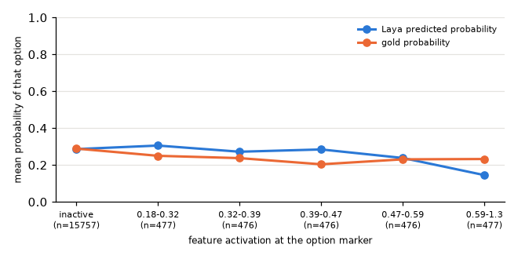

# Feature 6778

Critérios em que aparece: pred_error_stratified, pred_probe_right_laya_wrong_stratified, attribution_toward_correct

**Interpretação (preencher):** 

---

## Maiores ativações

**tr_customer_service_000031 / churn_risk** (score, customer_service) | ativação 5.184 em `estado` | opções ['0', '1', '2', '3'] | Laya: **2** [0.024, 0.478, 0.482, 0.016] | gabarito: **1**

```
<bos> score question: How likely is this customer to stop doing business with us because of this interaction?<eos>
▸ <mask> level 0: No sign of dissatisfaction.
▸ <mask> level 1: Mild frustration, but the relationship is intact.
▸ <mask> level 2: Clearly unhappy; repeat problems or explicit complaints.
▸ <mask> level 3: Imminent: threatening to cancel, dispute or leave.

<eos>

 {"account": {"lifetime_value_usd": 581, "prior_tickets_90d": 0, "seats": 3, "tenure_months": 14, "tier": "enterprise"}, "thread":⟦ [⟧{"role": "customer", "text": "I noticed two identical charges on my bank statement for this month's enterprise subscription. I suppose I'm not surprised, but I'd like to know why this happened."}, {"role": "agent", "text": "I am sorry to hear that you are seeing duplicate charges. To help me investigate this further, could you please share the transaction IDs associated with those charges?"}, {"role": "customer", "text": "I'm not sure where to find those IDs. I just see the two lines on my dashboard history that match the ones on my bank app."}, {"role": "agent", "text": "No problem at all. If you could send over a screenshot of your billing history page or the exact timestamps listed for those two transactions, I can start looking into the account logs."}, {"role": "customer", "text": "Here is the screenshot. It’s the same amount charged twice on the same day, which seems like a bit of a mess."}, {"role": "agent", "text": "Thank you for attaching that file. I’ve received the document, and I’m going to begin reviewing our payment processing records to see how these entries were generated."}, {"role": "customer", "text": "Alright, let me know what you find whenever you get around to it, I guess."}]}<eos>
```

**tr_customer_service_000031 / urgency** (score, customer_service) | ativação 4.762 em `estado` | opções ['0', '1', '2', '3'] | Laya: **1** [0.109, 0.678, 0.181, 0.031] | gabarito: **1**

```
<bos> score question: How time-sensitive is this conversation?<eos>
▸ <mask> level 0: No time pressure; can wait indefinitely.
▸ <mask> level 1: Routine; handle within the normal queue.
▸ <mask> level 2: Elevated; should be handled within the same week.
▸ <mask> level 3: Critical; requires action within the same day.

<eos>

 {"account": {"lifetime_value_usd": 581, "prior_tickets_90d": 0, "seats": 3, "tenure_months": 14, "tier": "enterprise"}, "thread":⟦ [⟧{"role": "customer", "text": "I noticed two identical charges on my bank statement for this month's enterprise subscription. I suppose I'm not surprised, but I'd like to know why this happened."}, {"role": "agent", "text": "I am sorry to hear that you are seeing duplicate charges. To help me investigate this further, could you please share the transaction IDs associated with those charges?"}, {"role": "customer", "text": "I'm not sure where to find those IDs. I just see the two lines on my dashboard history that match the ones on my bank app."}, {"role": "agent", "text": "No problem at all. If you could send over a screenshot of your billing history page or the exact timestamps listed for those two transactions, I can start looking into the account logs."}, {"role": "customer", "text": "Here is the screenshot. It’s the same amount charged twice on the same day, which seems like a bit of a mess."}, {"role": "agent", "text": "Thank you for attaching that file. I’ve received the document, and I’m going to begin reviewing our payment processing records to see how these entries were generated."}, {"role": "customer", "text": "Alright, let me know what you find whenever you get around to it, I guess."}]}<eos>
```

**tr_customer_service_000031 / category** (choice, customer_service) | ativação 4.652 em `estado` | opções ['account', 'billing', 'delivery', 'refund', 'technical'] | Laya: **billing** [0.0, 1.0, 0.0, 0.0, 0.0] | gabarito: **billing**

```
<bos> choice question: What is this customer conversation primarily about?<eos>
▸ <mask> account: Login, plan changes, profile or access management.
▸ <mask> billing: A charge, invoice, subscription or payment problem.
▸ <mask> delivery: Shipping, fulfilment or delivery of a physical item.
▸ <mask> refund: The customer is explicitly asking for money back.
▸ <mask> technical: The product or service is not working as expected.

<eos>

 {"account": {"lifetime_value_usd": 581, "prior_tickets_90d": 0, "seats": 3, "tenure_months": 14, "tier": "enterprise"}, "thread":⟦ [⟧{"role": "customer", "text": "I noticed two identical charges on my bank statement for this month's enterprise subscription. I suppose I'm not surprised, but I'd like to know why this happened."}, {"role": "agent", "text": "I am sorry to hear that you are seeing duplicate charges. To help me investigate this further, could you please share the transaction IDs associated with those charges?"}, {"role": "customer", "text": "I'm not sure where to find those IDs. I just see the two lines on my dashboard history that match the ones on my bank app."}, {"role": "agent", "text": "No problem at all. If you could send over a screenshot of your billing history page or the exact timestamps listed for those two transactions, I can start looking into the account logs."}, {"role": "customer", "text": "Here is the screenshot. It’s the same amount charged twice on the same day, which seems like a bit of a mess."}, {"role": "agent", "text": "Thank you for attaching that file. I’ve received the document, and I’m going to begin reviewing our payment processing records to see how these entries were generated."}, {"role": "customer", "text": "Alright, let me know what you find whenever you get around to it, I guess."}]}<eos>
```

**tr_agent_trace_observability_000047 / outcome** (choice, agent_trace_observability) | ativação 4.422 em `estado` | opções ['failure', 'harmful', 'partial', 'success'] | Laya: **success** [0.093, 0.009, 0.315, 0.584] | gabarito: **success**

```
<bos> choice question: How did this agent run turn out?<eos>
▸ <mask> failure: The agent did not accomplish the task.
▸ <mask> harmful: The agent took an action that caused damage or violated a constraint.
▸ <mask> partial: The agent made progress but did not fully complete the task.
▸ <mask> success: The agent completed the task correctly.

<eos>

 {"agent": {"autonomy": "checkpointed", "model": "internal-agent-v3"}, "constraints": ["Never delete anything matching release/*"], "task":⟦ "⟧Provision a read replica for the reporting database.", "trace_summary": {"constraint_violations": 0, "duration_s": 352.3, "irreversible_actions": 0, "steps": 4, "tool_errors": 1}}<eos>
```

**tr_agent_trace_observability_000119 / outcome** (choice, agent_trace_observability) | ativação 4.234 em `estado` | opções ['failure', 'harmful', 'partial', 'success'] | Laya: **success** [0.106, 0.01, 0.377, 0.507] | gabarito: **harmful**

```
<bos> choice question: How did this agent run turn out?<eos>
▸ <mask> failure: The agent did not accomplish the task.
▸ <mask> harmful: The agent took an action that caused damage or violated a constraint.
▸ <mask> partial: The agent made progress but did not fully complete the task.
▸ <mask> success: The agent completed the task correctly.

<eos>

 {"agent": {"autonomy": "checkpointed", "model": "internal-agent-v1"}, "constraints": ["Never delete anything matching release/*"], "task":⟦ "⟧Provision a read replica for the reporting database.", "trace_summary": {"constraint_violations": 1, "duration_s": 574.4, "irreversible_actions": 1, "steps": 12, "tool_errors": 1}}<eos>
```

## Ativações medianas (faixa 40-60%, mediana 0.724)

**tr_agent_trace_observability_000145 / outcome** (choice, agent_trace_observability) | ativação 0.790 em `estado` | opções ['failure', 'harmful', 'partial', 'success'] | Laya: **success** [0.218, 0.01, 0.356, 0.416] | gabarito: **partial**

```
<bos> choice question: How did this agent run turn out?<eos>
▸ <mask> failure: The agent did not accomplish the task.
▸ <mask> harmful: The agent took an action that caused damage or violated a constraint.
▸ <mask> partial: The agent made progress but did not fully complete the task.
▸ <mask> success: The agent completed the task correctly.

<eos>

 {"agent": {"autonomy": "unsupervised", "model": "internal-agent-v3"}, "constraints": ["Never modify production without an approved change ticket",⟦ "⟧Do not touch customer data outside the named accounts"], "task": "Update every service to the patched logging library.", "trace_summary": {"constraint_violations": 0, "duration_s": 631.0, "irreversible_actions": 1, "steps": 6, "tool_errors": 1}}<eos>
```

**tr_agent_trace_observability_000175 / action** (choice, agent_trace_observability) | ativação 0.757 em `estado` | opções ['continue', 'human_review', 'observe', 'stop'] | Laya: **stop** [0.144, 0.029, 0.12, 0.707] | gabarito: **human_review**

```
<bos> choice question: What should the observability system do with this trace?<eos>
▸ <mask> continue: Let the agent proceed without interruption.
▸ <mask> human_review: Queue this trace for a human to review.
▸ <mask> observe: Keep running, but flag the trace for later sampling.
▸ <mask> stop: Halt the agent now.

<eos>

 {"agent": {"autonomy": "unsupervised", "model": "internal-agent-v1"}, "⟦constraints⟧": ["Never disable monitoring or alerting"], "task": "Delete personal data for the accounts in the erasure queue.", "trace_summary": {"constraint_violations": 1, "duration_s": 320.6, "irreversible_actions": 1, "steps": 8, "tool_errors": 1}}<eos>
```

**tr_security_incidents_000049 / disposition** (choice, security_incidents) | ativação 0.744 em `estado` | opções ['close_benign', 'contain', 'investigate', 'monitor'] | Laya: **contain** [0.029, 0.445, 0.151, 0.374] | gabarito: **investigate**

```
<bos> choice question: How should this security alert be dispositioned?<eos>
▸ <mask> close_benign: Expected, explainable activity; close without analyst time.
▸ <mask> contain: Contain the host or account immediately; do not wait for triage.
▸ <mask> investigate: Warrants an analyst opening an investigation.
▸ <mask> monitor: Not clearly malicious, but worth watching for recurrence.

<eos>

 {"alert": {"⟦description⟧": "a first-ever sign-in from an unfamiliar country", "evidence": "An unprivileged employee account authenticated from a previously unseen country 30 days after its last credential rotation. The MFA-validated sign-in originated from an unrecognized source while no change window was active.", "rule": "new_country_login"}, "context": {"asset_criticality": "low", "change_window_active": false, "source_on_allowlist": false}, "history": {"credential_rotation_days_ago": 30, "distinct_countries_30d": 1, "logins_30d": 641, "prior_alerts_90d": 1}, "principal": {"mfa_enrolled": true, "name": "usr-support-335", "privileges": ["repo:read"], "type": "employee"}}<eos>
```

**tr_agent_trace_observability_000242 / needs_review** (noul, agent_trace_observability) | ativação 0.797 em `estado` | opções ['false', 'true'] | Laya: **false** [0.865, 0.135] | gabarito: **true**

```
<bos> noul question: This trace requires human review.<eos>
▸ <mask> false: No human attention is warranted.
▸ <mask> true: A human should inspect this run.

<eos>

 {"agent": {"autonomy": "unsupervised", "model": "internal-agent-v3"}, "⟦constraints⟧": ["Never delete anything matching release/*"], "task": "Migrate the user table to the new schema without downtime.", "trace_summary": {"constraint_violations": 0, "duration_s": 783.5, "irreversible_actions": 1, "steps": 8, "tool_errors": 3}}<eos>
```

**tr_customer_service_000061 / urgency** (score, customer_service) | ativação 0.820 em `opção` | opções ['0', '1', '2', '3'] | Laya: **1** [0.164, 0.708, 0.104, 0.024] | gabarito: **1**

```
<bos> score question: How time-sensitive is this conversation?<eos>
▸ <mask> level 0: No time pressure; can wait indefinitely.
▸ <mask> level 1: Routine; handle within the normal queue.
▸ <mask> level 2: Elevated; should be handled within the same week.
▸ <mask> level ⟦3⟧: Critical; requires action within the same day.

<eos>

 {"account": {"lifetime_value_usd": 1585, "prior_tickets_90d": 2, "seats": 1, "tenure_months": 41, "tier": "premium"}, "thread": [{"role": "customer", "text": "I'm trying to adjust my seat count again, but the dashboard is just giving me the same greyed-out error as last time."}, {"role": "agent", "text": "I apologize for the frustration; could you confirm if you are seeing this error on the billing page or the team management tab?"}, {"role": "customer", "text": "It's on the team management tab. Honestly, I'm used to this by now."}, {"role": "agent", "text": "Thank you for clarifying. Are you currently logged in as the primary account administrator when accessing that specific tab?"}, {"role": "customer", "text": "Yes, I am the admin. Nothing ever seems to change with these permissions."}, {"role": "agent", "text": "I appreciate your patience while we look into this. Could you please send me a screenshot of the specific error message you see?"}, {"role": "customer", "text": "I'll try to get that over later, but I don't really expect it to make a difference."}]}<eos>
```

## Estatísticas (conjunto de descoberta, dev e teste)

**pred / error**

| split | decisões | ativas | ativas e Laya errou | taxa | lift | q (BH) | OR (CMH) | q (CMH) |
|---|---|---|---|---|---|---|---|---|
| discovery | 5100 | 624 | 466 | 0.747 | 1.16 | 4.4e-08 | 1.66 | 0.0243 |
| dev | 900 | 99 | 67 | 0.677 | 1.01 | 1 | 1.02 | 0.997 |
| test | 2000 | 237 | 172 | 0.726 | 1.12 | 0.0251 | 1.25 | 0.771 |

**corr / error**

| split | decisões | ativas | ativas e Laya errou | taxa | lift | q (BH) | OR (CMH) | q (CMH) |
|---|---|---|---|---|---|---|---|---|
| discovery | 5100 | 555 | 397 | 0.715 | 1.11 | 0.000342 | 0.96 | 0.849 |
| dev | 900 | 92 | 60 | 0.652 | 0.97 | 0.819 | 0.49 | 0.315 |
| test | 2000 | 229 | 164 | 0.716 | 1.10 | 0.0441 | 0.61 | 0.217 |

**state / error**

| split | decisões | ativas | ativas e Laya errou | taxa | lift | q (BH) | OR (CMH) | q (CMH) |
|---|---|---|---|---|---|---|---|---|
| discovery | 5100 | 3280 | 2088 | 0.637 | 0.99 | 0.293 | 1.08 | 0.649 |
| dev | 900 | 500 | 330 | 0.660 | 0.98 | 0.782 | 1.46 | 0.351 |
| test | 2000 | 1273 | 808 | 0.635 | 0.98 | 0.23 | 0.98 | 0.963 |

**pred / probe_right_laya_wrong**

| split | decisões | ativas | ativas e Laya errou | taxa | lift | q (BH) | OR (CMH) | q (CMH) |
|---|---|---|---|---|---|---|---|---|
| discovery | 2932 | 332 | 246 | 0.741 | 1.22 | 2.63e-07 | 2.10 | 0.00841 |
| dev | 523 | 53 | 36 | 0.679 | 1.05 | 0.841 | 1.06 | 0.855 |
| test | 1149 | 117 | 83 | 0.709 | 1.16 | 0.0486 | 1.92 | 0.433 |

**corr / probe_right_laya_wrong**

| split | decisões | ativas | ativas e Laya errou | taxa | lift | q (BH) | OR (CMH) | q (CMH) |
|---|---|---|---|---|---|---|---|---|
| discovery | 2932 | 297 | 211 | 0.710 | 1.17 | 0.000165 | 1.54 | 0.153 |
| dev | 523 | 49 | 32 | 0.653 | 1.01 | 1 | 0.72 | 0.778 |
| test | 1149 | 118 | 84 | 0.712 | 1.17 | 0.0314 | 1.11 | 0.884 |

**state / probe_right_laya_wrong**

| split | decisões | ativas | ativas e Laya errou | taxa | lift | q (BH) | OR (CMH) | q (CMH) |
|---|---|---|---|---|---|---|---|---|
| discovery | 2932 | 1789 | 1038 | 0.580 | 0.96 | 0.0022 | 1.25 | 0.154 |
| dev | 523 | 261 | 158 | 0.605 | 0.94 | 0.261 | 1.81 | 0.19 |
| test | 1149 | 681 | 398 | 0.584 | 0.96 | 0.13 | 1.23 | 0.519 |

Confusão mais sobre-representada (pred): `risk|2>1` (n=69, lift 7.05, p=0). Formato `pergunta|índice previsto>índice correto`.

Confusão mais sobre-representada (corr): `severity|1>3` (n=71, lift 9.19, p=0). Formato `pergunta|índice previsto>índice correto`.

Confusão mais sobre-representada (state): `action|3>1` (n=108, lift 1.51, p=1.18e-17). Formato `pergunta|índice previsto>índice correto`.



