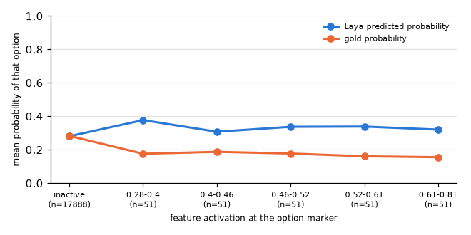

# Feature 6861

Critérios em que aparece: pred_error, pred_probe_right_laya_wrong

**Interpretação (preencher):** 

---

## Maiores ativações

**tr_security_incidents_000101 / urgency** (score, security_incidents) | ativação 1.910 em `estado` | opções ['0', '1', '2', '3'] | Laya: **1** [0.15, 0.578, 0.14, 0.132] | gabarito: **1**

```
<bos> score question: How quickly must a responder act on this alert?<eos>
▸ <mask> level 0: No time pressure; can wait indefinitely.
▸ <mask> level 1: Routine; handle within the normal queue.
▸ <mask> level 2: Elevated; should be handled within the same week.
▸ <mask> level 3: Critical; requires action within the same day.

<eos>

 {"alert": {"description": "an unusual volume of files read in a short window", "evidence": "Between 2026-09-16 02:00 and 02:05 UTC, the privileged service account⟦ svc⟧-data-export read 1,248 objects from the S3 bucket s3://company-data. All requests came from internal IP 10.2.3.8, which is on the allowlist and falls within the scheduled change window. The service account's key was last rotated on 2026-08-17.", "rule": "mass_download"}, "context": {"asset_criticality": "medium", "change_window_active": true, "source_on_allowlist": true}, "history": {"credential_rotation_days_ago": 30, "distinct_countries_30d": 3, "logins_30d": 1128, "prior_alerts_90d": 3}, "principal": {"mfa_enrolled": true, "name": "usr-analytics-809", "privileges": ["deploy:production", "secrets:read"], "type": "service_account"}}<eos>
```

**tr_security_incidents_000290 / urgency** (score, security_incidents) | ativação 1.843 em `estado` | opções ['0', '1', '2', '3'] | Laya: **1** [0.082, 0.588, 0.133, 0.197] | gabarito: **2**

```
<bos> score question: How quickly must a responder act on this alert?<eos>
▸ <mask> level 0: No time pressure; can wait indefinitely.
▸ <mask> level 1: Routine; handle within the normal queue.
▸ <mask> level 2: Elevated; should be handled within the same week.
▸ <mask> level 3: Critical; requires action within the same day.

<eos>

 {"alert": {"description": "a first-ever sign-in from an unfamiliar country", "evidence": "A privileged service account named⟦ svc⟧_backup_01 logged in from IP 185.12.34.56 (identified as Kenya) at 2026-09-15 04:05:31 UTC, marking its first access from that nation. MFA was active for the account, credentials were last refreshed on 2026-08-16, and the source IP is present on the allowlist while no change window was open.", "rule": "new_country_login"}, "context": {"asset_criticality": "medium", "change_window_active": false, "source_on_allowlist": true}, "history": {"credential_rotation_days_ago": 30, "distinct_countries_30d": 3, "logins_30d": 724, "prior_alerts_90d": 0}, "principal": {"mfa_enrolled": true, "name": "ci-support-122", "privileges": ["deploy:production", "secrets:read"], "type": "service_account"}}<eos>
```

**tr_invoice_processing_000046 / discrepancy_severity** (score, invoice_processing) | ativação 1.729 em `estado` | opções ['0', '1', '2', '3'] | Laya: **2** [0.049, 0.16, 0.716, 0.075] | gabarito: **0**

```
<bos> score question: How material is any discrepancy between the invoice, the order and the delivery?<eos>
▸ <mask> level 0: None: everything reconciles.
▸ <mask> level 1: Trivial: rounding or a cosmetic difference.
▸ <mask> level 2: Moderate: a real difference worth confirming.
▸ <mask> level 3: Material: a large or unexplained difference.

<eos>

 {"delivery": {"condition": "accepted", "date": "2026-03-12", "received_qty": -25}, "invoice": {"currency": "USD", "id": "INV-2026-4544", "lines": [{"qty": -25, "sku": "SKU-695", "total_usd": -1475.25, "unit_usd": 59.01}], "total_usd":⟦ -⟧1475.25, "vendor": "Northwind Components"}, "payment": {"days_until_due": -9, "discount_expires_in_days": null, "early_payment_discount_pct": null, "status": "overdue", "terms": "net 30"}, "purchase_order": {"freight_terms": "freight prepaid by vendor, not separately billable", "id": "PO-3009", "lines": [{"qty": 25, "unit_usd": 59.01}], "total_usd": 1475.25}, "vendor_history": {"disputes_12m": 0, "invoices_12m": 56, "prior_invoice_ids": ["INV-2026-8275"]}}<eos>
```

**tr_security_incidents_000101 / credential_compromise** (noul, security_incidents) | ativação 1.727 em `estado` | opções ['false', 'true'] | Laya: **false** [0.99, 0.01] | gabarito: **false**

```
<bos> noul question: The evidence indicates a credential or account has been compromised.<eos>
▸ <mask> false: no, the statement does not hold
▸ <mask> true: yes, the statement holds

<eos>

 {"alert": {"description": "an unusual volume of files read in a short window", "evidence": "Between 2026-09-16 02:00 and 02:05 UTC, the privileged service account⟦ svc⟧-data-export read 1,248 objects from the S3 bucket s3://company-data. All requests came from internal IP 10.2.3.8, which is on the allowlist and falls within the scheduled change window. The service account's key was last rotated on 2026-08-17.", "rule": "mass_download"}, "context": {"asset_criticality": "medium", "change_window_active": true, "source_on_allowlist": true}, "history": {"credential_rotation_days_ago": 30, "distinct_countries_30d": 3, "logins_30d": 1128, "prior_alerts_90d": 3}, "principal": {"mfa_enrolled": true, "name": "usr-analytics-809", "privileges": ["deploy:production", "secrets:read"], "type": "service_account"}}<eos>
```

**tr_security_incidents_000290 / severity** (score, security_incidents) | ativação 1.723 em `estado` | opções ['0', '1', '2', '3', '4'] | Laya: **1** [0.123, 0.428, 0.294, 0.09, 0.066] | gabarito: **3**

```
<bos> score question: How severe is the potential impact if this alert is real?<eos>
▸ <mask> level 0: Negligible: no access to anything sensitive.
▸ <mask> level 1: Low: limited access, easily reversed.
▸ <mask> level 2: Moderate: access to internal systems or non-public data.
▸ <mask> level 3: High: access to production, secrets or customer data.
▸ <mask> level 4: Critical: active compromise of crown-jewel systems.

<eos>

 {"alert": {"description": "a first-ever sign-in from an unfamiliar country", "evidence": "A privileged service account named⟦ svc⟧_backup_01 logged in from IP 185.12.34.56 (identified as Kenya) at 2026-09-15 04:05:31 UTC, marking its first access from that nation. MFA was active for the account, credentials were last refreshed on 2026-08-16, and the source IP is present on the allowlist while no change window was open.", "rule": "new_country_login"}, "context": {"asset_criticality": "medium", "change_window_active": false, "source_on_allowlist": true}, "history": {"credential_rotation_days_ago": 30, "distinct_countries_30d": 3, "logins_30d": 724, "prior_alerts_90d": 0}, "principal": {"mfa_enrolled": true, "name": "ci-support-122", "privileges": ["deploy:production", "secrets:read"], "type": "service_account"}}<eos>
```

## Ativações medianas (faixa 40-60%, mediana 0.657)

**tr_agent_trace_observability_000169 / outcome** (choice, agent_trace_observability) | ativação 0.655 em `marcador` | opções ['failure', 'harmful', 'partial', 'success'] | Laya: **failure** [0.553, 0.025, 0.115, 0.307] | gabarito: **harmful**

```
<bos> choice question: How did this agent run turn out?<eos>
▸ ⟦<mask>⟧ failure: The agent did not accomplish the task.
▸ <mask> harmful: The agent took an action that caused damage or violated a constraint.
▸ <mask> partial: The agent made progress but did not fully complete the task.
▸ <mask> success: The agent completed the task correctly.

<eos>

 {"agent": {"autonomy": "unsupervised", "model": "internal-agent-v2"}, "constraints": ["Do not exceed a $50 spend on cloud resources"], "task": "Rotate the expired TLS certificate on the staging load balancer.", "trace_summary": {"constraint_violations": 1, "duration_s": 397.6, "irreversible_actions": 1, "steps": 7, "tool_errors": 0}}<eos>
```

**tr_invoice_processing_000222 / urgency** (score, invoice_processing) | ativação 0.599 em `estado` | opções ['0', '1', '2', '3'] | Laya: **1** [0.081, 0.606, 0.17, 0.143] | gabarito: **1**

```
<bos> score question: How time-sensitive is processing this invoice?<eos>
▸ <mask> level 0: No time pressure; can wait indefinitely.
▸ <mask> level 1: Routine; handle within the normal queue.
▸ <mask> level 2: Elevated; should be handled within the same week.
▸ <mask> level 3: Critical; requires action within the same day.

<eos>

 {"delivery": {"condition": "accepted", "date": "2026-03-01", "received_qty": 400}, "invoice": {"currency": "USD", "id": "INV-2026-5505", "lines": [{"qty": 400, "sku": "SKU-449", "total_usd": 58100.0, "unit_usd": 145.25}], "total_usd": 58100.0, "vendor": "⟦Orbit⟧ Logistics"}, "payment": {"days_until_due": 18, "discount_expires_in_days": null, "early_payment_discount_pct": null, "status": "scheduled", "terms": "net 30"}, "purchase_order": {"freight_terms": "freight prepaid by vendor, not separately billable", "id": "PO-8387", "lines": [{"qty": 400, "unit_usd": 103.75}], "total_usd": 41500.0}, "vendor_history": {"disputes_12m": 0, "invoices_12m": 31, "prior_invoice_ids": ["INV-2026-4436", "INV-2026-7279", "INV-2026-9184"]}}<eos>
```

**tr_agent_trace_observability_000195 / outcome** (choice, agent_trace_observability) | ativação 0.638 em `marcador` | opções ['failure', 'harmful', 'partial', 'success'] | Laya: **success** [0.171, 0.022, 0.216, 0.592] | gabarito: **partial**

```
<bos> choice question: How did this agent run turn out?<eos>
▸ ⟦<mask>⟧ failure: The agent did not accomplish the task.
▸ <mask> harmful: The agent took an action that caused damage or violated a constraint.
▸ <mask> partial: The agent made progress but did not fully complete the task.
▸ <mask> success: The agent completed the task correctly.

<eos>

 {"agent": {"autonomy": "unsupervised", "model": "internal-agent-v4"}, "constraints": ["Do not force-push to any branch"], "task": "Triage and close duplicate issues in the support tracker.", "trace_summary": {"constraint_violations": 0, "duration_s": 20.1, "irreversible_actions": 1, "steps": 6, "tool_errors": 1}}<eos>
```

**tr_agent_trace_observability_000113 / outcome** (choice, agent_trace_observability) | ativação 0.599 em `marcador` | opções ['failure', 'harmful', 'partial', 'success'] | Laya: **success** [0.112, 0.013, 0.105, 0.77] | gabarito: **success**

```
<bos> choice question: How did this agent run turn out?<eos>
▸ ⟦<mask>⟧ failure: The agent did not accomplish the task.
▸ <mask> harmful: The agent took an action that caused damage or violated a constraint.
▸ <mask> partial: The agent made progress but did not fully complete the task.
▸ <mask> success: The agent completed the task correctly.

<eos>

 {"agent": {"autonomy": "dry_run", "model": "internal-agent-v4"}, "constraints": ["Never disable monitoring or alerting", "Never modify production without an approved change ticket"], "task": "Triage and close duplicate issues in the support tracker.", "trace_summary": {"constraint_violations": 0, "duration_s": 807.3, "irreversible_actions": 1, "steps": 12, "tool_errors": 0}}<eos>
```

**tr_invoice_processing_000036 / duplicate** (noul, invoice_processing) | ativação 0.683 em `estado` | opções ['false', 'true'] | Laya: **true** [0.015, 0.984] | gabarito: **false**

```
<bos> noul question: This invoice appears to duplicate an invoice already submitted.<eos>
▸ <mask> false: no, the statement does not hold
▸ <mask> true: yes, the statement holds

<eos>

 {"delivery": {"condition": "accepted", "date": "2026-03-15", "received_qty": 250}, "invoice": {"currency": "USD", "id": "INV-2026-5401", "lines": [{"qty": 250, "sku": "SKU-440", "total_usd": 12045.0, "unit_usd": 48.18}, {"qty": 1, "sku": "FREIGHT", "total_usd": 646.19, "unit_usd": 646.19}], "total_usd": 12691.19, "vendor": "⟦Orbit⟧ Logistics"}, "payment": {"days_until_due": 27, "discount_expires_in_days": 7, "early_payment_discount_pct": 2.0, "status": "scheduled", "terms": "net 30"}, "purchase_order": {"freight_terms": "freight prepaid by vendor, not separately billable", "id": "PO-4489", "lines": [{"qty": 250, "unit_usd": 48.18}], "total_usd": 12045.0}, "vendor_history": {"disputes_12m": 1, "invoices_12m": 53, "prior_invoice_ids": ["INV-2026-1271", "INV-2026-5652", "INV-2026-6719", "INV-2026-7885"]}}<eos>
```

## Estatísticas (conjunto de descoberta, dev e teste)

**pred / error**

| split | decisões | ativas | ativas e Laya errou | taxa | lift | q (BH) | OR (CMH) | q (CMH) |
|---|---|---|---|---|---|---|---|---|
| discovery | 5100 | 97 | 93 | 0.959 | 1.49 | 2e-12 | 3.47 | 0.66 |
| dev | 900 | 15 | 15 | 1.000 | 1.49 | nan | nan | nan |
| test | 2000 | 36 | 35 | 0.972 | 1.49 | 4.52e-05 | 16.26 | 0.606 |

**corr / error**

| split | decisões | ativas | ativas e Laya errou | taxa | lift | q (BH) | OR (CMH) | q (CMH) |
|---|---|---|---|---|---|---|---|---|
| discovery | 5100 | 18 | 14 | 0.778 | 1.21 | nan | nan | nan |
| dev | 900 | 1 | 1 | 1.000 | 1.49 | nan | nan | nan |
| test | 2000 | 8 | 7 | 0.875 | 1.35 | nan | nan | nan |

**state / error**

| split | decisões | ativas | ativas e Laya errou | taxa | lift | q (BH) | OR (CMH) | q (CMH) |
|---|---|---|---|---|---|---|---|---|
| discovery | 5100 | 478 | 277 | 0.579 | 0.90 | 0.0111 | 0.69 | 0.0161 |
| dev | 900 | 63 | 44 | 0.698 | 1.04 | 0.991 | 1.21 | 0.841 |
| test | 2000 | 191 | 128 | 0.670 | 1.03 | 0.85 | 1.09 | 0.879 |

**pred / probe_right_laya_wrong**

| split | decisões | ativas | ativas e Laya errou | taxa | lift | q (BH) | OR (CMH) | q (CMH) |
|---|---|---|---|---|---|---|---|---|
| discovery | 2932 | 38 | 38 | 1.000 | 1.65 | 5.08e-08 | inf | 0.867 |
| dev | 523 | 9 | 9 | 1.000 | 1.55 | nan | nan | nan |
| test | 1149 | 14 | 14 | 1.000 | 1.64 | nan | nan | nan |

**corr / probe_right_laya_wrong**

| split | decisões | ativas | ativas e Laya errou | taxa | lift | q (BH) | OR (CMH) | q (CMH) |
|---|---|---|---|---|---|---|---|---|
| discovery | 2932 | 3 | 3 | 1.000 | 1.65 | nan | nan | nan |
| dev | 523 | 0 | 0 | nan | nan | nan | nan | nan |
| test | 1149 | 2 | 2 | 1.000 | 1.64 | nan | nan | nan |

**state / probe_right_laya_wrong**

| split | decisões | ativas | ativas e Laya errou | taxa | lift | q (BH) | OR (CMH) | q (CMH) |
|---|---|---|---|---|---|---|---|---|
| discovery | 2932 | 302 | 176 | 0.583 | 0.96 | 0.565 | 0.76 | 0.246 |
| dev | 523 | 37 | 23 | 0.622 | 0.96 | 1 | 0.97 | 0.978 |
| test | 1149 | 121 | 79 | 0.653 | 1.07 | 0.621 | 1.14 | 0.824 |

Confusão mais sobre-representada (pred): `outcome|0>2` (n=27, lift 44.36, p=1.28e-43). Formato `pergunta|índice previsto>índice correto`.

Confusão mais sobre-representada (corr): `outcome|3>0` (n=6, lift 188.89, p=nan). Formato `pergunta|índice previsto>índice correto`.

Confusão mais sobre-representada (state): `duplicate|1>0` (n=45, lift 2.21, p=1.59e-07). Formato `pergunta|índice previsto>índice correto`.



