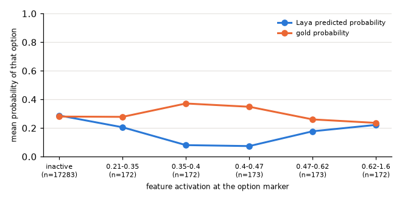

# Feature 6993

Critérios em que aparece: corr_error_stratified

**Interpretação (preencher):** 

---

## Maiores ativações

**tr_customer_service_000137 / needs_human** (noul, customer_service) | ativação 4.152 em `estado` | opções ['false', 'true'] | Laya: **true** [0.486, 0.514] | gabarito: **true**

```
<bos> noul question: This conversation requires a human agent rather than automated handling.<eos>
▸ <mask> false: Automation can carry this to resolution.
▸ <mask> true: A human must take over: judgement, authority or empathy is required.

<eos>

 {"account": {"lifetime_value_usd": 742, "prior_tickets_90d": 0, "seats": 1, "tenure_months": 8, "tier": "standard"}, "orders": [{"amount_usd": 299, "date": "2026-01-16", "id": "A-97848", "status": "settled"}], "thread": [{"role": "customer", "text": "Hello, I’m following up on my refund request for the $299 charge on my standard plan⟦.⟧ I’ve been a customer for eight months and would appreciate an update."}, {"role": "agent", "text": "Thank you for reaching out. I can check the status for you—could you provide the ticket number or the date you submitted the request?"}, {"role": "customer", "text": "Sure, the request was submitted on September 2nd under ticket #4521. Any information you have would be helpful."}]}<eos>
```

**tr_customer_service_000137 / urgency** (score, customer_service) | ativação 4.055 em `estado` | opções ['0', '1', '2', '3'] | Laya: **1** [0.108, 0.468, 0.225, 0.199] | gabarito: **2**

```
<bos> score question: How time-sensitive is this conversation?<eos>
▸ <mask> level 0: No time pressure; can wait indefinitely.
▸ <mask> level 1: Routine; handle within the normal queue.
▸ <mask> level 2: Elevated; should be handled within the same week.
▸ <mask> level 3: Critical; requires action within the same day.

<eos>

 {"account": {"lifetime_value_usd": 742, "prior_tickets_90d": 0, "seats": 1, "tenure_months": 8, "tier": "standard"}, "orders": [{"amount_usd": 299, "date": "2026-01-16", "id": "A-97848", "status": "settled"}], "thread": [{"role": "customer", "text": "Hello, I’m following up on my refund request for the $299 charge on my standard plan⟦.⟧ I’ve been a customer for eight months and would appreciate an update."}, {"role": "agent", "text": "Thank you for reaching out. I can check the status for you—could you provide the ticket number or the date you submitted the request?"}, {"role": "customer", "text": "Sure, the request was submitted on September 2nd under ticket #4521. Any information you have would be helpful."}]}<eos>
```

**tr_customer_service_000137 / category** (choice, customer_service) | ativação 4.051 em `estado` | opções ['account', 'billing', 'delivery', 'refund', 'technical'] | Laya: **refund** [0.0, 0.0, 0.0, 1.0, 0.0] | gabarito: **refund**

```
<bos> choice question: What is this customer conversation primarily about?<eos>
▸ <mask> account: Login, plan changes, profile or access management.
▸ <mask> billing: A charge, invoice, subscription or payment problem.
▸ <mask> delivery: Shipping, fulfilment or delivery of a physical item.
▸ <mask> refund: The customer is explicitly asking for money back.
▸ <mask> technical: The product or service is not working as expected.

<eos>

 {"account": {"lifetime_value_usd": 742, "prior_tickets_90d": 0, "seats": 1, "tenure_months": 8, "tier": "standard"}, "orders": [{"amount_usd": 299, "date": "2026-01-16", "id": "A-97848", "status": "settled"}], "thread": [{"role": "customer", "text": "Hello, I’m following up on my refund request for the $299 charge on my standard plan⟦.⟧ I’ve been a customer for eight months and would appreciate an update."}, {"role": "agent", "text": "Thank you for reaching out. I can check the status for you—could you provide the ticket number or the date you submitted the request?"}, {"role": "customer", "text": "Sure, the request was submitted on September 2nd under ticket #4521. Any information you have would be helpful."}]}<eos>
```

**tr_customer_service_000296 / needs_human** (noul, customer_service) | ativação 3.951 em `estado` | opções ['false', 'true'] | Laya: **true** [0.056, 0.944] | gabarito: **true**

```
<bos> noul question: This conversation requires a human agent rather than automated handling.<eos>
▸ <mask> false: Automation can carry this to resolution.
▸ <mask> true: A human must take over: judgement, authority or empathy is required.

<eos>

 {"account": {"lifetime_value_usd": 154, "prior_tickets_90d": 0, "seats": 1, "tenure_months": 2, "tier": "free"}, "thread": [{"role": "customer", "text": "We have a launch in two hours and need to reassign seats on our free plan—add three new users and remove two that left. This has to happen now."},⟦ {"⟧role": "agent", "text": "I understand the timing is tight. Could you give me the email addresses of the users you’d like to add and the ones you want removed?"}, {"role": "customer", "text": "Add: alice@example.com, bob@example.com, carol@example.com. Remove: dave@example.com and eve@example.com. I need the changes reflected instantly."}, {"role": "agent", "text": "Thanks for the list. I’ll process those seat changes right away. Would you like a confirmation email once the updates are applied?"}, {"role": "customer", "text": "Yes, send the confirmation now and make sure the seats are active before our launch; we can’t afford any delay."}]}<eos>
```

**tr_customer_service_000137 / churn_risk** (score, customer_service) | ativação 3.938 em `estado` | opções ['0', '1', '2', '3'] | Laya: **1** [0.15, 0.593, 0.137, 0.12] | gabarito: **1**

```
<bos> score question: How likely is this customer to stop doing business with us because of this interaction?<eos>
▸ <mask> level 0: No sign of dissatisfaction.
▸ <mask> level 1: Mild frustration, but the relationship is intact.
▸ <mask> level 2: Clearly unhappy; repeat problems or explicit complaints.
▸ <mask> level 3: Imminent: threatening to cancel, dispute or leave.

<eos>

 {"account": {"lifetime_value_usd": 742, "prior_tickets_90d": 0, "seats": 1, "tenure_months": 8, "tier": "standard"}, "orders": [{"amount_usd": 299, "date": "2026-01-16", "id": "A-97848", "status": "settled"}], "thread": [{"role": "customer", "text": "Hello, I’m following up on my refund request for the $299 charge on my standard plan⟦.⟧ I’ve been a customer for eight months and would appreciate an update."}, {"role": "agent", "text": "Thank you for reaching out. I can check the status for you—could you provide the ticket number or the date you submitted the request?"}, {"role": "customer", "text": "Sure, the request was submitted on September 2nd under ticket #4521. Any information you have would be helpful."}]}<eos>
```

## Ativações medianas (faixa 40-60%, mediana 0.768)

**tr_security_incidents_000206 / disposition** (choice, security_incidents) | ativação 0.697 em `estado` | opções ['close_benign', 'contain', 'investigate', 'monitor'] | Laya: **monitor** [0.192, 0.274, 0.075, 0.459] | gabarito: **monitor**

```
<bos> choice question: How should this security alert be dispositioned?<eos>
▸ <mask> close_benign: Expected, explainable activity; close without analyst time.
▸ <mask> contain: Contain the host or account immediately; do not wait for triage.
▸ <mask> investigate: Warrants an analyst opening an investigation.
▸ <mask> monitor: Not clearly malicious, but worth watching for recurrence.

<eos>

 {"alert": {"description": "a large transfer to an external destination", "evidence": "A data transfer of 4.8 TB was observed at 2026-09-16 08:15:02 UTC from the internal server DB‑APP-01 to external IP 52.23.45.67, which is on the allow‑list for outbound connections. The operation was initiated by an admin account (privileged) that successfully completed MFA and whose password was rotated on 2026-09-13. No change window was specified for this activity.", "rule": "data_egress"}, "context": {"asset_criticality": "low", "change_window_active": false, "source_on_allowlist": true}, "history": {"credential_rotation_days_ago": 3, "distinct_countries_30d": 1, "logins_30d": 722, "prior_alerts_90d": 0},⟦ "⟧principal": {"mfa_enrolled": true, "name": "svc-support-965", "privileges": ["deploy:production", "secrets:read"], "type": "admin"}}<eos>
```

**tr_customer_service_000155 / needs_human** (noul, customer_service) | ativação 0.706 em `estado` | opções ['false', 'true'] | Laya: **true** [0.244, 0.756] | gabarito: **true**

```
<bos> noul question: This conversation requires a human agent rather than automated handling.<eos>
▸ <mask> false: Automation can carry this to resolution.
▸ <mask> true: A human must take over: judgement, authority or empathy is required.

<eos>

 {"account": {"lifetime_value_usd": 351, "prior_tickets_90d": 1, "seats": 1, "tenure_months": 8, "tier": "standard"}, "thread": [{"role": "customer", "text": "I need the CSV export of last month's transaction data right now; the system is still processing and it's holding up my audit."},⟦ {"⟧role": "agent", "text": "I understand the urgency. Could you tell me which account ID you’re exporting from?"}, {"role": "customer", "text": "It's account 45219; please expedite the export."}]}<eos>
```

**tr_customer_service_000122 / churn_risk** (score, customer_service) | ativação 0.875 em `estado` | opções ['0', '1', '2', '3'] | Laya: **2** [0.023, 0.32, 0.569, 0.089] | gabarito: **2**

```
<bos> score question: How likely is this customer to stop doing business with us because of this interaction?<eos>
▸ <mask> level 0: No sign of dissatisfaction.
▸ <mask> level 1: Mild frustration, but the relationship is intact.
▸ <mask> level 2: Clearly unhappy; repeat problems or explicit complaints.
▸ <mask> level 3: Imminent: threatening to cancel, dispute or leave.

<eos>

 {"account": {"lifetime_value_usd": 5572, "prior_tickets_90d": 0, "seats": 5, "tenure_months": 60, "tier": "enterprise"}, "orders": [{"amount_usd": 29, "date": "2026-01-18", "id": "A-22153", "status": "failed"}, {"amount_usd": 29, "date": "2026-03-14", "id": "A-61350", "status": "settled"}, {"amount_usd": 29, "date": "2026-03-23", "id": "A-25594", "status": "settled"}], "thread": [{"role": "customer", "text": "I've been using this service for 60 months without much trouble, but I've been trying to export our legacy data for a compliance audit due tomorrow morning and the tool just keeps failing. I'm honestly just exhausted from trying to get this to work on my own."}, {"role": "agent", "text": "I'm sorry to hear you're running into issues with the export tool after so many years with us⟦.⟧ Could you tell me if you're attempting a full account export or just a specific date range, and what format you've selected?"}, {"role": "customer", "text": "It's a full export of all records. It gets to about 12% and then the browser just times out or the file says it's corrupted. I really need this data for the auditors by tomorrow and I just don't have the energy to keep troubleshooting the same button."}]}<eos>
```

**tr_security_incidents_000258 / credential_compromise** (noul, security_incidents) | ativação 0.801 em `estado` | opções ['false', 'true'] | Laya: **false** [0.564, 0.436] | gabarito: **true**

```
<bos> noul question: The evidence indicates a credential or account has been compromised.<eos>
▸ <mask> false: no, the statement does not hold
▸ <mask> true: yes, the statement holds

<eos>

 {"alert": {"description": "audit logging was turned off on a host", "evidence": "Audit logging on host 172.16.8.33 stopped generating entries at 2026-09-15T03:12:07Z, with the last recorded event being a successful login for service account svc_sync⟦.⟧ The service account is unprivileged, has MFA disabled, and its credentials were last rotated 365 days ago; the change originated from an unrecognised source.", "rule": "disabled_logging"}, "context": {"asset_criticality": "medium", "change_window_active": false, "source_on_allowlist": false}, "history": {"credential_rotation_days_ago": 365, "distinct_countries_30d": 4, "logins_30d": 728, "prior_alerts_90d": 0}, "principal": {"mfa_enrolled": false, "name": "svc-support-562", "privileges": ["repo:read"], "type": "service_account"}}<eos>
```

**tr_invoice_processing_000123 / matches_order** (noul, invoice_processing) | ativação 0.670 em `estado` | opções ['false', 'true'] | Laya: **true** [0.078, 0.922] | gabarito: **false**

```
<bos> noul question: The invoice reconciles with the purchase order and the recorded delivery.<eos>
▸ <mask> false: There is a discrepancy against the order or the delivery.
▸ <mask> true: Line items, quantities and amounts reconcile.

<eos>

 {"delivery": {"condition": "accepted with exceptions", "date": "2026-03-08", "received_qty": 50}, "invoice": {"currency": "USD", "id": "INV-2026-5267", "lines": [{"qty": 50, "sku": "SKU-916", "total_usd": 22219.0, "unit_usd": 444.38}, {"qty": 1, "sku": "FREIGHT", "total_usd": 1147.63, "unit_usd": 1147.63}], "total_usd": 23366.63, "vendor": "Acme Fabrication"}, "payment": {"days_until_due": 18, "discount_expires_in_days": 2, "early_payment_discount_pct": 2.0, "status": "scheduled", "terms": "net 30"},⟦ "⟧purchase_order": {"freight_terms": "freight prepaid by vendor, not separately billable", "id": "PO-2802", "lines": [{"qty": 50, "unit_usd": 444.38}], "total_usd": 22219.0}, "vendor_history": {"disputes_12m": 0, "invoices_12m": 22, "prior_invoice_ids": ["INV-2026-3885", "INV-2026-7284"]}}<eos>
```

## Estatísticas (conjunto de descoberta, dev e teste)

**pred / error**

| split | decisões | ativas | ativas e Laya errou | taxa | lift | q (BH) | OR (CMH) | q (CMH) |
|---|---|---|---|---|---|---|---|---|
| discovery | 5100 | 76 | 42 | 0.553 | 0.86 | 0.193 | 1.40 | 0.532 |
| dev | 900 | 10 | 8 | 0.800 | 1.19 | nan | nan | nan |
| test | 2000 | 34 | 19 | 0.559 | 0.86 | 0.449 | 1.12 | 0.971 |

**corr / error**

| split | decisões | ativas | ativas e Laya errou | taxa | lift | q (BH) | OR (CMH) | q (CMH) |
|---|---|---|---|---|---|---|---|---|
| discovery | 5100 | 266 | 232 | 0.872 | 1.35 | 7.38e-17 | 4.18 | 9.7e-07 |
| dev | 900 | 50 | 48 | 0.960 | 1.43 | 4.9e-06 | 3.42 | 0.524 |
| test | 2000 | 97 | 82 | 0.845 | 1.30 | 5.44e-05 | 1.62 | 0.428 |

**state / error**

| split | decisões | ativas | ativas e Laya errou | taxa | lift | q (BH) | OR (CMH) | q (CMH) |
|---|---|---|---|---|---|---|---|---|
| discovery | 5100 | 4611 | 2963 | 0.643 | 1.00 | 0.778 | 0.94 | 0.852 |
| dev | 900 | 825 | 553 | 0.670 | 1.00 | 1 | 0.83 | 0.821 |
| test | 2000 | 1825 | 1179 | 0.646 | 0.99 | 0.477 | 0.81 | 0.643 |

**pred / probe_right_laya_wrong**

| split | decisões | ativas | ativas e Laya errou | taxa | lift | q (BH) | OR (CMH) | q (CMH) |
|---|---|---|---|---|---|---|---|---|
| discovery | 2932 | 38 | 17 | 0.447 | 0.74 | 0.103 | 1.75 | 0.387 |
| dev | 523 | 5 | 3 | 0.600 | 0.93 | nan | nan | nan |
| test | 1149 | 17 | 7 | 0.412 | 0.67 | nan | nan | nan |

**corr / probe_right_laya_wrong**

| split | decisões | ativas | ativas e Laya errou | taxa | lift | q (BH) | OR (CMH) | q (CMH) |
|---|---|---|---|---|---|---|---|---|
| discovery | 2932 | 146 | 125 | 0.856 | 1.41 | 7.77e-11 | 2.84 | 0.0254 |
| dev | 523 | 31 | 29 | 0.935 | 1.45 | 0.000679 | 4.74 | 0.509 |
| test | 1149 | 45 | 35 | 0.778 | 1.27 | 0.0365 | 1.23 | 0.847 |

**state / probe_right_laya_wrong**

| split | decisões | ativas | ativas e Laya errou | taxa | lift | q (BH) | OR (CMH) | q (CMH) |
|---|---|---|---|---|---|---|---|---|
| discovery | 2932 | 2667 | 1612 | 0.604 | 1.00 | 0.881 | 0.83 | 0.475 |
| dev | 523 | 492 | 321 | 0.652 | 1.01 | 0.651 | 1.06 | 0.957 |
| test | 1149 | 1060 | 644 | 0.608 | 0.99 | 0.731 | 0.78 | 0.66 |

Confusão mais sobre-representada (pred): `needs_human|1>0` (n=17, lift 18.70, p=4.31e-18). Formato `pergunta|índice previsto>índice correto`.

Confusão mais sobre-representada (corr): `disposition|0>2` (n=37, lift 12.23, p=3.71e-34). Formato `pergunta|índice previsto>índice correto`.

Confusão mais sobre-representada (state): `duplicate|1>0` (n=217, lift 1.11, p=1.92e-10). Formato `pergunta|índice previsto>índice correto`.



