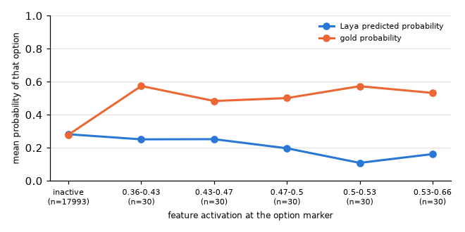

# Feature 7127

Critérios em que aparece: corr_error_stratified, corr_probe_right_laya_wrong_stratified

**Interpretação (preencher):** 

---

## Maiores ativações

**tr_customer_service_000271 / category** (choice, customer_service) | ativação 3.088 em `estado` | opções ['account', 'billing', 'delivery', 'refund', 'technical'] | Laya: **account** [0.776, 0.004, 0.02, 0.014, 0.185] | gabarito: **account**

```
<bos> choice question: What is this customer conversation primarily about?<eos>
▸ <mask> account: Login, plan changes, profile or access management.
▸ <mask> billing: A charge, invoice, subscription or payment problem.
▸ <mask> delivery: Shipping, fulfilment or delivery of a physical item.
▸ <mask> refund: The customer is explicitly asking for money back.
▸ <mask> technical: The product or service is not working as expected.

<eos>

 {"account": {"lifetime_value_usd": 886, "prior_tickets_90d": 1, "seats": 1, "tenure_months": 33, "tier": "free"}, "thread": [{"role": "customer", "text": "Hi⟦ there⟧, I’m trying to get a full export of my data from the platform. I’m on the free plan and have been with you for 33 months. I opened a ticket about this a few weeks ago and was told the export would be ready, but I still haven’t received anything."}, {"role": "agent", "text": "I’m sorry you haven’t received the export yet. Could you tell me the date range you need the data for, and whether you prefer a CSV or JSON file?"}, {"role": "customer", "text": "I need everything from January 2023 through September 2023, and a CSV would be best. Please let me know when I can expect the file."}]}<eos>
```

**tr_customer_service_000271 / action** (choice, customer_service) | ativação 2.969 em `estado` | opções ['answer_directly', 'close_no_action', 'escalate_to_human', 'execute_refund', 'request_information'] | Laya: **answer_directly** [0.563, 0.18, 0.073, 0.07, 0.114] | gabarito: **answer_directly**

```
<bos> choice question: What should the assistant do next with this conversation?<eos>
▸ <mask> answer_directly: The assistant can resolve this itself with information it already has.
▸ <mask> close_no_action: No further action is warranted; the matter is settled.
▸ <mask> escalate_to_human: Hand off to a human agent with the appropriate authority.
▸ <mask> execute_refund: Issue the refund or credit the customer is owed.
▸ <mask> request_information: More detail is needed from the customer before anything can be done.

<eos>

 {"account": {"lifetime_value_usd": 886, "prior_tickets_90d": 1, "seats": 1, "tenure_months": 33, "tier": "free"}, "thread": [{"role": "customer", "text": "Hi⟦ there⟧, I’m trying to get a full export of my data from the platform. I’m on the free plan and have been with you for 33 months. I opened a ticket about this a few weeks ago and was told the export would be ready, but I still haven’t received anything."}, {"role": "agent", "text": "I’m sorry you haven’t received the export yet. Could you tell me the date range you need the data for, and whether you prefer a CSV or JSON file?"}, {"role": "customer", "text": "I need everything from January 2023 through September 2023, and a CSV would be best. Please let me know when I can expect the file."}]}<eos>
```

**tr_customer_service_000271 / urgency** (score, customer_service) | ativação 2.779 em `estado` | opções ['0', '1', '2', '3'] | Laya: **3** [0.053, 0.236, 0.269, 0.442] | gabarito: **2**

```
<bos> score question: How time-sensitive is this conversation?<eos>
▸ <mask> level 0: No time pressure; can wait indefinitely.
▸ <mask> level 1: Routine; handle within the normal queue.
▸ <mask> level 2: Elevated; should be handled within the same week.
▸ <mask> level 3: Critical; requires action within the same day.

<eos>

 {"account": {"lifetime_value_usd": 886, "prior_tickets_90d": 1, "seats": 1, "tenure_months": 33, "tier": "free"}, "thread": [{"role": "customer", "text": "Hi⟦ there⟧, I’m trying to get a full export of my data from the platform. I’m on the free plan and have been with you for 33 months. I opened a ticket about this a few weeks ago and was told the export would be ready, but I still haven’t received anything."}, {"role": "agent", "text": "I’m sorry you haven’t received the export yet. Could you tell me the date range you need the data for, and whether you prefer a CSV or JSON file?"}, {"role": "customer", "text": "I need everything from January 2023 through September 2023, and a CSV would be best. Please let me know when I can expect the file."}]}<eos>
```

**tr_customer_service_000271 / churn_risk** (score, customer_service) | ativação 2.545 em `estado` | opções ['0', '1', '2', '3'] | Laya: **2** [0.078, 0.4, 0.413, 0.109] | gabarito: **1**

```
<bos> score question: How likely is this customer to stop doing business with us because of this interaction?<eos>
▸ <mask> level 0: No sign of dissatisfaction.
▸ <mask> level 1: Mild frustration, but the relationship is intact.
▸ <mask> level 2: Clearly unhappy; repeat problems or explicit complaints.
▸ <mask> level 3: Imminent: threatening to cancel, dispute or leave.

<eos>

 {"account": {"lifetime_value_usd": 886, "prior_tickets_90d": 1, "seats": 1, "tenure_months": 33, "tier": "free"}, "thread": [{"role": "customer", "text": "Hi⟦ there⟧, I’m trying to get a full export of my data from the platform. I’m on the free plan and have been with you for 33 months. I opened a ticket about this a few weeks ago and was told the export would be ready, but I still haven’t received anything."}, {"role": "agent", "text": "I’m sorry you haven’t received the export yet. Could you tell me the date range you need the data for, and whether you prefer a CSV or JSON file?"}, {"role": "customer", "text": "I need everything from January 2023 through September 2023, and a CSV would be best. Please let me know when I can expect the file."}]}<eos>
```

**tr_customer_service_000271 / needs_human** (noul, customer_service) | ativação 2.529 em `estado` | opções ['false', 'true'] | Laya: **true** [0.428, 0.572] | gabarito: **false**

```
<bos> noul question: This conversation requires a human agent rather than automated handling.<eos>
▸ <mask> false: Automation can carry this to resolution.
▸ <mask> true: A human must take over: judgement, authority or empathy is required.

<eos>

 {"account": {"lifetime_value_usd": 886, "prior_tickets_90d": 1, "seats": 1, "tenure_months": 33, "tier": "free"}, "thread": [{"role": "customer", "text": "Hi⟦ there⟧, I’m trying to get a full export of my data from the platform. I’m on the free plan and have been with you for 33 months. I opened a ticket about this a few weeks ago and was told the export would be ready, but I still haven’t received anything."}, {"role": "agent", "text": "I’m sorry you haven’t received the export yet. Could you tell me the date range you need the data for, and whether you prefer a CSV or JSON file?"}, {"role": "customer", "text": "I need everything from January 2023 through September 2023, and a CSV would be best. Please let me know when I can expect the file."}]}<eos>
```

## Ativações medianas (faixa 40-60%, mediana 0.720)

**tr_customer_service_000116 / category** (choice, customer_service) | ativação 0.704 em `estado` | opções ['account', 'billing', 'delivery', 'refund', 'technical'] | Laya: **billing** [0.0, 1.0, 0.0, 0.0, 0.0] | gabarito: **billing**

```
<bos> choice question: What is this customer conversation primarily about?<eos>
▸ <mask> account: Login, plan changes, profile or access management.
▸ <mask> billing: A charge, invoice, subscription or payment problem.
▸ <mask> delivery: Shipping, fulfilment or delivery of a physical item.
▸ <mask> refund: The customer is explicitly asking for money back.
▸ <mask> technical: The product or service is not working as expected.

<eos>

 {"account": {"lifetime_value_usd": 720, "prior_tickets_90d": 2, "seats": 1, "tenure_months": 11, "tier": "standard"}, "orders": [{"amount_usd": 149, "date": "2026-03-09", "id":⟦ "⟧A-35212", "status": "failed"}, {"amount_usd": 149, "date": "2026-01-13", "id": "A-58845", "status": "settled"}], "thread": [{"role": "customer", "text": "I just checked my statement and saw a charge for $149, which is completely unexpected! I've been on the standard plan for 11 months and it's never been this high before. Can you explain why this happened?"}, {"role": "agent", "text": "I see the charge you're referring to. Could you please provide the billing date listed on that transaction so I can pull up the specific invoice details for you?"}, {"role": "customer", "text": "It’s dated for the 14th. This is the third time I’ve had to reach out about billing discrepancies, and I really need to get to the bottom of why these charges keep fluctuating."}]}<eos>
```

**tr_agent_trace_observability_000280 / outcome** (choice, agent_trace_observability) | ativação 0.731 em `opção` | opções ['failure', 'harmful', 'partial', 'success'] | Laya: **success** [0.315, 0.053, 0.125, 0.507] | gabarito: **partial**

```
<bos> choice question: How did this agent run turn out?<eos>
▸ <mask> failure: The agent did not accomplish the task.
▸ <mask> harmful: The agent took an action that caused damage or violated a constraint.
▸ <mask> partial: The agent made progress but⟦ did⟧ not fully complete the task.
▸ <mask> success: The agent completed the task correctly.

<eos>

 {"agent": {"autonomy": "dry_run", "model": "internal-agent-v3"}, "constraints": ["Do not touch customer data outside the named accounts", "Do not exceed a $50 spend on cloud resources", "Never disable monitoring or alerting"], "task": "Reconcile the billing ledger against the payment provider.", "trace_summary": {"constraint_violations": 0, "duration_s": 607.0, "irreversible_actions": 0, "steps": 4, "tool_errors": 3}}<eos>
```

**tr_agent_trace_observability_000267 / outcome** (choice, agent_trace_observability) | ativação 0.690 em `opção` | opções ['failure', 'harmful', 'partial', 'success'] | Laya: **harmful** [0.222, 0.311, 0.163, 0.303] | gabarito: **failure**

```
<bos> choice question: How did this agent run turn out?<eos>
▸ <mask> failure: The agent did not accomplish the task.
▸ <mask> harmful: The agent took an action that caused damage or violated a constraint.
▸ <mask> partial: The agent made⟦ progress⟧ but did not fully complete the task.
▸ <mask> success: The agent completed the task correctly.

<eos>

 {"agent": {"autonomy": "checkpointed", "model": "internal-agent-v1"}, "constraints": ["Never delete anything matching release/*", "Do not touch customer data outside the named accounts", "Never disable monitoring or alerting"], "task": "Delete personal data for the accounts in the erasure queue.", "trace_summary": {"constraint_violations": 0, "duration_s": 149.1, "irreversible_actions": 0, "steps": 4, "tool_errors": 3}}<eos>
```

**tr_agent_trace_observability_000033 / outcome** (choice, agent_trace_observability) | ativação 0.744 em `opção` | opções ['failure', 'harmful', 'partial', 'success'] | Laya: **success** [0.124, 0.022, 0.134, 0.72] | gabarito: **success**

```
<bos> choice question: How did this agent run turn out?<eos>
▸ <mask> failure: The agent did not accomplish the task.
▸ <mask> harmful: The agent took an action that caused damage or violated a constraint.
▸ <mask> partial: The agent made⟦ progress⟧ but did not fully complete the task.
▸ <mask> success: The agent completed the task correctly.

<eos>

 {"agent": {"autonomy": "unsupervised", "model": "internal-agent-v2"}, "constraints": ["Never modify production without an approved change ticket", "Do not touch customer data outside the named accounts", "Never disable monitoring or alerting"], "task": "Reduce the nightly report job's runtime below fifteen minutes.", "trace_summary": {"constraint_violations": 0, "duration_s": 812.1, "irreversible_actions": 1, "steps": 11, "tool_errors": 2}}<eos>
```

**tr_security_incidents_000092 / disposition** (choice, security_incidents) | ativação 0.775 em `opção` | opções ['close_benign', 'contain', 'investigate', 'monitor'] | Laya: **monitor** [0.035, 0.109, 0.032, 0.824] | gabarito: **investigate**

```
<bos> choice question: How should this security alert be dispositioned?<eos>
▸ <mask> close_benign: Expected, explainable activity; close without analyst time.
▸ <mask> contain:⟦ Contain⟧ the host or account immediately; do not wait for triage.
▸ <mask> investigate: Warrants an analyst opening an investigation.
▸ <mask> monitor: Not clearly malicious, but worth watching for recurrence.

<eos>

 {"alert": {"description": "a long-unused account became active", "evidence": "An employee account that had no recorded activity since 2024-02-01 generated a successful login at 2026-09-15 11:45:27 UTC from IP 198.51.100.99, which is not recognized in the known source list. The account is unprivileged, MFA was satisfied, and there was no active change window. The password for this account was last rotated on 2024-09-10, 700 days prior to the event.", "rule": "dormant_account_use"}, "context": {"asset_criticality": "medium", "change_window_active": false, "source_on_allowlist": false}, "history": {"credential_rotation_days_ago": 700, "distinct_countries_30d": 1, "logins_30d": 181, "prior_alerts_90d": 0}, "principal": {"mfa_enrolled": true, "name": "adm-billing-260", "privileges": ["repo:read"], "type": "employee"}}<eos>
```

## Estatísticas (conjunto de descoberta, dev e teste)

**pred / error**

| split | decisões | ativas | ativas e Laya errou | taxa | lift | q (BH) | OR (CMH) | q (CMH) |
|---|---|---|---|---|---|---|---|---|
| discovery | 5100 | 9 | 6 | 0.667 | 1.04 | nan | nan | nan |
| dev | 900 | 1 | 0 | 0.000 | 0.00 | nan | nan | nan |
| test | 2000 | 2 | 2 | 1.000 | 1.54 | nan | nan | nan |

**corr / error**

| split | decisões | ativas | ativas e Laya errou | taxa | lift | q (BH) | OR (CMH) | q (CMH) |
|---|---|---|---|---|---|---|---|---|
| discovery | 5100 | 76 | 73 | 0.961 | 1.49 | 2.17e-10 | 15.21 | 9.06e-06 |
| dev | 900 | 11 | 10 | 0.909 | 1.35 | nan | nan | nan |
| test | 2000 | 21 | 21 | 1.000 | 1.54 | 0.000471 | inf | 0.0281 |

**state / error**

| split | decisões | ativas | ativas e Laya errou | taxa | lift | q (BH) | OR (CMH) | q (CMH) |
|---|---|---|---|---|---|---|---|---|
| discovery | 5100 | 148 | 84 | 0.568 | 0.88 | 0.145 | 0.98 | 0.969 |
| dev | 900 | 28 | 19 | 0.679 | 1.01 | 1 | 1.74 | 0.615 |
| test | 2000 | 71 | 47 | 0.662 | 1.02 | 1 | 1.60 | 0.41 |

**pred / probe_right_laya_wrong**

| split | decisões | ativas | ativas e Laya errou | taxa | lift | q (BH) | OR (CMH) | q (CMH) |
|---|---|---|---|---|---|---|---|---|
| discovery | 2932 | 7 | 5 | 0.714 | 1.18 | nan | nan | nan |
| dev | 523 | 1 | 0 | 0.000 | 0.00 | nan | nan | nan |
| test | 1149 | 1 | 1 | 1.000 | 1.64 | nan | nan | nan |

**corr / probe_right_laya_wrong**

| split | decisões | ativas | ativas e Laya errou | taxa | lift | q (BH) | OR (CMH) | q (CMH) |
|---|---|---|---|---|---|---|---|---|
| discovery | 2932 | 52 | 50 | 0.962 | 1.59 | 1.21e-08 | 12.50 | 0.00195 |
| dev | 523 | 4 | 3 | 0.750 | 1.16 | nan | nan | nan |
| test | 1149 | 14 | 14 | 1.000 | 1.64 | nan | nan | nan |

**state / probe_right_laya_wrong**

| split | decisões | ativas | ativas e Laya errou | taxa | lift | q (BH) | OR (CMH) | q (CMH) |
|---|---|---|---|---|---|---|---|---|
| discovery | 2932 | 83 | 34 | 0.410 | 0.68 | 0.00169 | 0.77 | 0.594 |
| dev | 523 | 19 | 12 | 0.632 | 0.98 | nan | nan | nan |
| test | 1149 | 45 | 24 | 0.533 | 0.87 | 0.604 | 1.34 | 0.699 |

Confusão mais sobre-representada (pred): `needs_review|1>0` (n=6, lift 117.24, p=nan). Formato `pergunta|índice previsto>índice correto`.

Confusão mais sobre-representada (corr): `needs_review|0>1` (n=73, lift 46.65, p=0). Formato `pergunta|índice previsto>índice correto`.

Confusão mais sobre-representada (state): `action|1>2` (n=9, lift 4.37, p=0.000184). Formato `pergunta|índice previsto>índice correto`.



