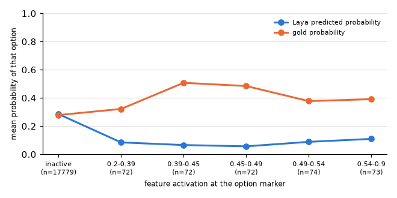

# Feature 7225

Critérios em que aparece: corr_error_stratified, corr_probe_right_laya_wrong_stratified

**Interpretação (preencher):** 

---

## Maiores ativações

**tr_customer_service_000097 / churn_risk** (score, customer_service) | ativação 2.463 em `estado` | opções ['0', '1', '2', '3'] | Laya: **1** [0.053, 0.695, 0.151, 0.101] | gabarito: **1**

```
<bos> score question: How likely is this customer to stop doing business with us because of this interaction?<eos>
▸ <mask> level 0: No sign of dissatisfaction.
▸ <mask> level 1: Mild frustration, but the relationship is intact.
▸ <mask> level 2: Clearly unhappy; repeat problems or explicit complaints.
▸ <mask> level 3: Imminent: threatening to cancel, dispute or leave.

<eos>

 {"account": {"lifetime_value_usd": 3319, "prior_tickets_90d": 0, "seats": 1, "tenure_months": 41, "tier": "free"}, "thread": [{"role": "customer", "text": "Hi, I was told a refund was coming my way a while ago, but I don't see anything in my account. I've been using this free plan for years and I'm just not sure where to look for this credit."}, {"role": "agent", "text": "Hello. I would be happy to look into the status of your refund. Could you please provide the reference number for the original refund request you were given?"}, {"role": "customer", "text": "I’m sorry, I don't actually have a reference number. I just had a chat with someone a few weeks back and they said it was processed."}, {"role": "agent", "text": "Thank you for clarifying that. Since I cannot locate the request without a reference number, could you please tell me the approximate date of that previous interaction?"}, {"role": "customer", "text": "It would⟦ have⟧ been sometime in mid-October, I believe. I'm just confused because I thought it would show up automatically."}, {"role": "agent", "text": "I see. To help me locate that specific conversation, could you confirm the email address associated with your account?"}, {"role": "customer", "text": "It's the same one I'm messaging from now. I just want to know if it's still coming or if I need to do something else."}]}<eos>
```

**tr_customer_service_000209 / action** (choice, customer_service) | ativação 2.416 em `estado` | opções ['answer_directly', 'close_no_action', 'escalate_to_human', 'execute_refund', 'request_information'] | Laya: **close_no_action** [0.054, 0.911, 0.011, 0.023, 0.001] | gabarito: **escalate_to_human**

```
<bos> choice question: What should the assistant do next with this conversation?<eos>
▸ <mask> answer_directly: The assistant can resolve this itself with information it already has.
▸ <mask> close_no_action: No further action is warranted; the matter is settled.
▸ <mask> escalate_to_human: Hand off to a human agent with the appropriate authority.
▸ <mask> execute_refund: Issue the refund or credit the customer is owed.
▸ <mask> request_information: More detail is needed from the customer before anything can be done.

<eos>

 {"account": {"lifetime_value_usd": 77, "prior_tickets_90d": 0, "seats": 3, "tenure_months": 2, "tier": "enterprise"}, "orders": [{"amount_usd": 1998, "date": "2026-02-09", "id": "A-87995", "status": "settled"}], "thread": [{"role": "customer", "text": "I ordered the premium hardware kit with my $1,998 Enterprise purchase, but the box I got contains the basic accessories instead. This is completely unacceptable."}, {"role": "agent", "text": "I understand how frustrating that must be. Let me pull up your order details—can you provide the order number you received in the confirmation email?"}, {"role": "customer", "text": "It’s 8457‑B2, and I’ve already opened a ticket about this, which was never resolved."}, {"role": "agent", "text": "Thanks for the number. I see the mismatch now. Could you tell me if the packaging is still sealed, or if you’ve already inspected the contents?"}, {"role": "customer", "text": "The box is still sealed; I⟦ haven⟧’t taken anything out because I need the correct items before I can even consider using them."}]}<eos>
```

**tr_customer_service_000209 / churn_risk** (score, customer_service) | ativação 2.324 em `estado` | opções ['0', '1', '2', '3'] | Laya: **2** [0.05, 0.185, 0.745, 0.02] | gabarito: **2**

```
<bos> score question: How likely is this customer to stop doing business with us because of this interaction?<eos>
▸ <mask> level 0: No sign of dissatisfaction.
▸ <mask> level 1: Mild frustration, but the relationship is intact.
▸ <mask> level 2: Clearly unhappy; repeat problems or explicit complaints.
▸ <mask> level 3: Imminent: threatening to cancel, dispute or leave.

<eos>

 {"account": {"lifetime_value_usd": 77, "prior_tickets_90d": 0, "seats": 3, "tenure_months": 2, "tier": "enterprise"}, "orders": [{"amount_usd": 1998, "date": "2026-02-09", "id": "A-87995", "status": "settled"}], "thread": [{"role": "customer", "text": "I ordered the premium hardware kit with my $1,998 Enterprise purchase, but the box I got contains the basic accessories instead. This is completely unacceptable."}, {"role": "agent", "text": "I understand how frustrating that must be. Let me pull up your order details—can you provide the order number you received in the confirmation email?"}, {"role": "customer", "text": "It’s 8457‑B2, and I’ve already opened a ticket about this, which was never resolved."}, {"role": "agent", "text": "Thanks for the number. I see the mismatch now. Could you tell me if the packaging is still sealed, or if you’ve already inspected the contents?"}, {"role": "customer", "text": "The box is still sealed; I⟦ haven⟧’t taken anything out because I need the correct items before I can even consider using them."}]}<eos>
```

**tr_customer_service_000097 / urgency** (score, customer_service) | ativação 2.320 em `estado` | opções ['0', '1', '2', '3'] | Laya: **3** [0.04, 0.379, 0.186, 0.394] | gabarito: **1**

```
<bos> score question: How time-sensitive is this conversation?<eos>
▸ <mask> level 0: No time pressure; can wait indefinitely.
▸ <mask> level 1: Routine; handle within the normal queue.
▸ <mask> level 2: Elevated; should be handled within the same week.
▸ <mask> level 3: Critical; requires action within the same day.

<eos>

 {"account": {"lifetime_value_usd": 3319, "prior_tickets_90d": 0, "seats": 1, "tenure_months": 41, "tier": "free"}, "thread": [{"role": "customer", "text": "Hi, I was told a refund was coming my way a while ago, but I don't see anything in my account. I've been using this free plan for years and I'm just not sure where to look for this credit."}, {"role": "agent", "text": "Hello. I would be happy to look into the status of your refund. Could you please provide the reference number for the original refund request you were given?"}, {"role": "customer", "text": "I’m sorry, I don't actually have a reference number. I just had a chat with someone a few weeks back and they said it was processed."}, {"role": "agent", "text": "Thank you for clarifying that. Since I cannot locate the request without a reference number, could you please tell me the approximate date of that previous interaction?"}, {"role": "customer", "text": "It would⟦ have⟧ been sometime in mid-October, I believe. I'm just confused because I thought it would show up automatically."}, {"role": "agent", "text": "I see. To help me locate that specific conversation, could you confirm the email address associated with your account?"}, {"role": "customer", "text": "It's the same one I'm messaging from now. I just want to know if it's still coming or if I need to do something else."}]}<eos>
```

**tr_customer_service_000097 / category** (choice, customer_service) | ativação 2.264 em `estado` | opções ['account', 'billing', 'delivery', 'refund', 'technical'] | Laya: **account** [0.85, 0.009, 0.001, 0.003, 0.137] | gabarito: **refund**

```
<bos> choice question: What is this customer conversation primarily about?<eos>
▸ <mask> account: Login, plan changes, profile or access management.
▸ <mask> billing: A charge, invoice, subscription or payment problem.
▸ <mask> delivery: Shipping, fulfilment or delivery of a physical item.
▸ <mask> refund: The customer is explicitly asking for money back.
▸ <mask> technical: The product or service is not working as expected.

<eos>

 {"account": {"lifetime_value_usd": 3319, "prior_tickets_90d": 0, "seats": 1, "tenure_months": 41, "tier": "free"}, "thread": [{"role": "customer", "text": "Hi, I was told a refund was coming my way a while ago, but I don't see anything in my account. I've been using this free plan for years and I'm just not sure where to look for this credit."}, {"role": "agent", "text": "Hello. I would be happy to look into the status of your refund. Could you please provide the reference number for the original refund request you were given?"}, {"role": "customer", "text": "I’m sorry, I don't actually have a reference number. I just had a chat with someone a few weeks back and they said it was processed."}, {"role": "agent", "text": "Thank you for clarifying that. Since I cannot locate the request without a reference number, could you please tell me the approximate date of that previous interaction?"}, {"role": "customer", "text": "It would⟦ have⟧ been sometime in mid-October, I believe. I'm just confused because I thought it would show up automatically."}, {"role": "agent", "text": "I see. To help me locate that specific conversation, could you confirm the email address associated with your account?"}, {"role": "customer", "text": "It's the same one I'm messaging from now. I just want to know if it's still coming or if I need to do something else."}]}<eos>
```

## Ativações medianas (faixa 40-60%, mediana 0.555)

**tr_invoice_processing_000123 / urgency** (score, invoice_processing) | ativação 0.521 em `estado` | opções ['0', '1', '2', '3'] | Laya: **1** [0.096, 0.493, 0.287, 0.124] | gabarito: **2**

```
<bos> score question: How time-sensitive is processing this invoice?<eos>
▸ <mask> level 0: No time pressure; can wait indefinitely.
▸ <mask> level 1: Routine; handle within the normal queue.
▸ <mask> level 2: Elevated; should be handled within the same week.
▸ <mask> level 3: Critical; requires action within the same day.

<eos>

 {"delivery": {"condition": "accepted with exceptions", "date": "2026-03-08", "received_qty": 50}, "invoice": {"currency": "USD", "id": "INV-2026-5267", "lines": [{"qty": 50, "sku": "SKU-916", "total_usd": 22219.0, "unit_usd": 444.38}, {"qty": 1, "sku": "FREIGHT", "total_usd": 1147.63, "unit_usd": 1147.63}], "total_usd": 23366.63, "vendor": "Acme Fabrication"}, "payment": {"days_until_due": 18, "discount_expires_in_days": 2, "early_payment_discount_pct": 2.0, "status": "scheduled", "⟦terms⟧": "net 30"}, "purchase_order": {"freight_terms": "freight prepaid by vendor, not separately billable", "id": "PO-2802", "lines": [{"qty": 50, "unit_usd": 444.38}], "total_usd": 22219.0}, "vendor_history": {"disputes_12m": 0, "invoices_12m": 22, "prior_invoice_ids": ["INV-2026-3885", "INV-2026-7284"]}}<eos>
```

**tr_security_incidents_000124 / true_positive** (noul, security_incidents) | ativação 0.586 em `estado` | opções ['false', 'true'] | Laya: **true** [0.076, 0.924] | gabarito: **true**

```
<bos> noul question: This alert reflects genuinely malicious or unauthorised activity.<eos>
▸ <mask> false: Benign activity, a misconfiguration, or a known false positive.
▸ <mask> true: The underlying behaviour is malicious or unauthorised.

<eos>

 {"alert": {"description": "an account granted itself or received elevated permissions", "evidence": "At 14:22 UTC, the administrative user 'admin_root_01' modified its own permission set to include 'AdministratorAccess' via an unrecognized source address. This action occurred outside of any scheduled change window using MFA-authenticated credentials rotated 30 days ago.", "rule": "privilege_escalation"}, "context": {"⟦asset⟧_criticality": "medium", "change_window_active": false, "source_on_allowlist": false}, "history": {"credential_rotation_days_ago": 30, "distinct_countries_30d": 2, "logins_30d": 1308, "prior_alerts_90d": 1}, "principal": {"mfa_enrolled": true, "name": "svc-deploy-762", "privileges": ["deploy:production", "secrets:read"], "type": "admin"}}<eos>
```

**tr_customer_service_000224 / needs_human** (noul, customer_service) | ativação 0.529 em `estado` | opções ['false', 'true'] | Laya: **true** [0.294, 0.706] | gabarito: **true**

```
<bos> noul question: This conversation requires a human agent rather than automated handling.<eos>
▸ <mask> false: Automation can carry this to resolution.
▸ <mask> true: A human must take over: judgement, authority or empathy is required.

<eos>

 {"account": {"lifetime_value⟦_⟧usd": 3096, "prior_tickets_90d": 1, "seats": 1, "tenure_months": 60, "tier": "standard"}, "thread": [{"role": "customer", "text": "I’ve been on the standard plan for five years, but the bulk export feature has stopped working since the last update."}, {"role": "agent", "text": "I am sorry to hear you're experiencing trouble with the export tool. Could you please confirm if you're receiving a specific error code when you attempt the download?"}, {"role": "customer", "text": "There isn't an error code; the progress bar just freezes at 20% and stays there until the page times out."}, {"role": "agent", "text": "Thank you for that clarification. Have you attempted clearing your browser cache or trying a different browser to see if the export completes?"}, {"role": "customer", "text": "I tried both of those after our last ticket, but the result was the same."}]}<eos>
```

**tr_security_incidents_000261 / urgency** (score, security_incidents) | ativação 0.547 em `estado` | opções ['0', '1', '2', '3'] | Laya: **3** [0.091, 0.384, 0.117, 0.408] | gabarito: **2**

```
<bos> score question: How quickly must a responder act on this alert?<eos>
▸ <mask> level 0: No time pressure; can wait indefinitely.
▸ <mask> level 1: Routine; handle within the normal queue.
▸ <mask> level 2: Elevated; should be handled within the same week.
▸ <mask> level 3: Critical; requires action within the same day.

<eos>

 {"alert": {"description": "an unrecognised binary executed on a server", "evidence": "At 02:14 UTC on 2026-09-15, a process named \"c:\\temp\\svchost.exe\" was launched on server APP01 by contractor user jdoe (ID C12345). The binary’s SHA‑256 hash (a1b2c3d4e5…) does not appear in the approved software inventory. MFA authentication succeeded and no maintenance window was active.", "rule": "suspicious_process"}, "context": {"asset_criticality": "medium", "change_window_active": false, "source_on_allowlist": true}, "history": {"credential_rotation_days_ago": 700, "distinct_countries_30d": 1, "logins_30d": 1197, "prior_alerts_90d": 0}, "principal": {"mfa_enrolled": true, "name": "svc-billing-358", "privileges": ["repo:read"],⟦ "⟧type": "contractor"}}<eos>
```

**tr_security_incidents_000256 / credential_compromise** (noul, security_incidents) | ativação 0.536 em `estado` | opções ['false', 'true'] | Laya: **false** [0.668, 0.332] | gabarito: **false**

```
<bos> noul question: The evidence indicates a credential or account has been compromised.<eos>
▸ <mask> false: no, the statement does not hold
▸ <mask> true: yes, the statement holds

<eos>

 {"alert": {"description": "a security group was opened to the public internet", "evidence": "A privileged contractor account modified security group 'sg-0a1b2c3d' to allow inbound traffic from 0.0.0.0/0 during an active maintenance window. The configuration change originated from an allowlisted source address using credentials that were last updated 90 days ago.", "rule": "config_drift"}, "context": {"asset_criticality": "medium", "change_window_active": true, "source_on_allowlist": true}, "history": {"credential_rotation_days_ago": 90, "distinct_countries_30d": 2, "logins_30d": 972, "prior_alerts_90d": 1},⟦ "⟧principal": {"mfa_enrolled": true, "name": "svc-deploy-743", "privileges": ["deploy:production", "secrets:read"], "type": "contractor"}}<eos>
```

## Estatísticas (conjunto de descoberta, dev e teste)

**pred / error**

| split | decisões | ativas | ativas e Laya errou | taxa | lift | q (BH) | OR (CMH) | q (CMH) |
|---|---|---|---|---|---|---|---|---|
| discovery | 5100 | 11 | 3 | 0.273 | 0.42 | nan | nan | nan |
| dev | 900 | 3 | 2 | 0.667 | 0.99 | nan | nan | nan |
| test | 2000 | 5 | 2 | 0.400 | 0.61 | nan | nan | nan |

**corr / error**

| split | decisões | ativas | ativas e Laya errou | taxa | lift | q (BH) | OR (CMH) | q (CMH) |
|---|---|---|---|---|---|---|---|---|
| discovery | 5100 | 154 | 146 | 0.948 | 1.47 | 1.16e-18 | 25.37 | 1.48e-44 |
| dev | 900 | 39 | 38 | 0.974 | 1.45 | 2.39e-05 | 50.01 | 6.21e-12 |
| test | 2000 | 56 | 53 | 0.946 | 1.45 | 8.58e-07 | 23.88 | 1.06e-18 |

**state / error**

| split | decisões | ativas | ativas e Laya errou | taxa | lift | q (BH) | OR (CMH) | q (CMH) |
|---|---|---|---|---|---|---|---|---|
| discovery | 5100 | 2570 | 1557 | 0.606 | 0.94 | 3.43e-07 | 0.90 | 0.585 |
| dev | 900 | 446 | 278 | 0.623 | 0.93 | 0.119 | 0.67 | 0.402 |
| test | 2000 | 1064 | 658 | 0.618 | 0.95 | 0.0284 | 0.87 | 0.713 |

**pred / probe_right_laya_wrong**

| split | decisões | ativas | ativas e Laya errou | taxa | lift | q (BH) | OR (CMH) | q (CMH) |
|---|---|---|---|---|---|---|---|---|
| discovery | 2932 | 7 | 2 | 0.286 | 0.47 | nan | nan | nan |
| dev | 523 | 1 | 1 | 1.000 | 1.55 | nan | nan | nan |
| test | 1149 | 3 | 0 | 0.000 | 0.00 | nan | nan | nan |

**corr / probe_right_laya_wrong**

| split | decisões | ativas | ativas e Laya errou | taxa | lift | q (BH) | OR (CMH) | q (CMH) |
|---|---|---|---|---|---|---|---|---|
| discovery | 2932 | 104 | 99 | 0.952 | 1.57 | 1.01e-15 | 41.63 | 6.23e-39 |
| dev | 523 | 29 | 29 | 1.000 | 1.55 | 1.65e-05 | inf | 2.99e-11 |
| test | 1149 | 38 | 35 | 0.921 | 1.51 | 6.88e-05 | 37.48 | 7.49e-17 |

**state / probe_right_laya_wrong**

| split | decisões | ativas | ativas e Laya errou | taxa | lift | q (BH) | OR (CMH) | q (CMH) |
|---|---|---|---|---|---|---|---|---|
| discovery | 2932 | 1579 | 901 | 0.571 | 0.94 | 0.000206 | 0.98 | 0.952 |
| dev | 523 | 282 | 170 | 0.603 | 0.93 | 0.175 | 0.66 | 0.522 |
| test | 1149 | 670 | 384 | 0.573 | 0.94 | 0.0238 | 0.65 | 0.237 |

Confusão mais sobre-representada (pred): `needs_human|1>0` (n=3, lift 22.80, p=nan). Formato `pergunta|índice previsto>índice correto`.

Confusão mais sobre-representada (corr): `matches_order|1>0` (n=119, lift 33.12, p=0). Formato `pergunta|índice previsto>índice correto`.

Confusão mais sobre-representada (state): `duplicate|1>0` (n=177, lift 1.62, p=2.1e-22). Formato `pergunta|índice previsto>índice correto`.



