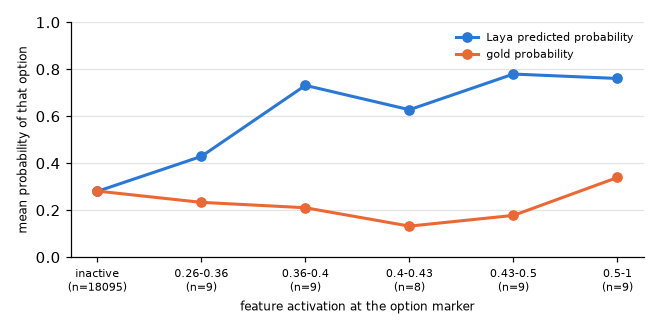

# Feature 7280

Critérios em que aparece: pred_error

**Interpretação (preencher):** 

---

## Maiores ativações

**tr_customer_service_000144 / needs_human** (noul, customer_service) | ativação 8.438 em `opção` | opções ['false', 'true'] | Laya: **false** [0.791, 0.209] | gabarito: **true**

```
<bos> noul question: This conversation requires a human agent rather than automated handling.<eos>
▸ <mask> false: Automation can carry this to resolution.
▸ <mask> true: A human must take over: judgement, authority or⟦ empathy⟧ is required.

<eos>

 {"account": {"lifetime_value_usd": 241, "prior_tickets_90d": 1, "seats": 1, "tenure_months": 11, "tier": "standard"}, "orders": [{"amount_usd": 897, "date": "2026-03-08", "id": "A-36841", "status": "refunded"}, {"amount_usd": 897, "date": "2026-01-05", "id": "A-88349", "status": "settled"}, {"amount_usd": 897, "date": "2026-02-18", "id": "A-82617", "status": "refunded"}], "thread": [{"role": "customer", "text": "Hello, I’ve been with the Standard plan for 11 months now and my latest bill shows about $897, which is far higher than I expected. I opened a ticket about this a while back (Ticket #1023) and was told it would be fixed, but I haven’t seen any update."}, {"role": "agent", "text": "I’m sorry to hear the charge looks incorrect. I see the reference to Ticket #1023. Could you let me know which billing cycle this amount appears on, and whether any discounts were applied previously?"}, {"role": "customer", "text": "It’s the invoice dated June 2026. I didn’t have any promotional discount applied this time, but I was expecting the usual rate of around $75 per month."}]}<eos>
```

**tr_customer_service_000137 / needs_human** (noul, customer_service) | ativação 8.422 em `opção` | opções ['false', 'true'] | Laya: **true** [0.486, 0.514] | gabarito: **true**

```
<bos> noul question: This conversation requires a human agent rather than automated handling.<eos>
▸ <mask> false: Automation can carry this to resolution.
▸ <mask> true: A human must take over: judgement, authority or⟦ empathy⟧ is required.

<eos>

 {"account": {"lifetime_value_usd": 742, "prior_tickets_90d": 0, "seats": 1, "tenure_months": 8, "tier": "standard"}, "orders": [{"amount_usd": 299, "date": "2026-01-16", "id": "A-97848", "status": "settled"}], "thread": [{"role": "customer", "text": "Hello, I’m following up on my refund request for the $299 charge on my standard plan. I’ve been a customer for eight months and would appreciate an update."}, {"role": "agent", "text": "Thank you for reaching out. I can check the status for you—could you provide the ticket number or the date you submitted the request?"}, {"role": "customer", "text": "Sure, the request was submitted on September 2nd under ticket #4521. Any information you have would be helpful."}]}<eos>
```

**tr_customer_service_000008 / needs_human** (noul, customer_service) | ativação 8.383 em `opção` | opções ['false', 'true'] | Laya: **false** [0.525, 0.475] | gabarito: **true**

```
<bos> noul question: This conversation requires a human agent rather than automated handling.<eos>
▸ <mask> false: Automation can carry this to resolution.
▸ <mask> true: A human must take over: judgement, authority or⟦ empathy⟧ is required.

<eos>

 {"account": {"lifetime_value_usd": 72, "prior_tickets_90d": 3, "seats": 1, "tenure_months": 3, "tier": "standard"}, "orders": [{"amount_usd": 87, "date": "2026-03-21", "id": "A-17904", "status": "settled"}, {"amount_usd": 87, "date": "2026-01-08", "id": "A-81775", "status": "settled"}, {"amount_usd": 87, "date": "2026-02-15", "id": "A-95492", "status": "failed"}], "thread": [{"role": "customer", "text": "Looking at my account, I need to add five more seats to the team before tomorrow’s rollout. This is my third ticket on the same issue, and I’m still on the $87 standard plan after three months."}, {"role": "agent", "text": "Got it, I see the previous tickets. Could you confirm the email addresses you’d like the new seats assigned to?"}, {"role": "customer", "text": "The emails are alice@example.com, bob@example.com, carol@example.com, dave@example.com, and eve@example.com. I need all five active by end of day tomorrow."}, {"role": "agent", "text": "Thanks for the list. Are any of the current seats being de‑provisioned, or should we simply expand the total count?"}, {"role": "customer", "text": "No removals, just add the five on top of the current three seats."}, {"role": "agent", "text": "Understood. I’ll look into why the previous attempts didn’t stick. What verification method would you prefer for the new seats—email link or admin console?"}, {"role": "customer", "text": "Send the email links; I’ll forward them right away. Please make sure the seats are live before the 5 PM deadline."}]}<eos>
```

**tr_customer_service_000288 / needs_human** (noul, customer_service) | ativação 7.793 em `opção` | opções ['false', 'true'] | Laya: **true** [0.419, 0.581] | gabarito: **true**

```
<bos> noul question: This conversation requires a human agent rather than automated handling.<eos>
▸ <mask> false: Automation can carry this to resolution.
▸ <mask> true: A human must take over: judgement, authority or⟦ empathy⟧ is required.

<eos>

 {"account": {"lifetime_value_usd": 34, "prior_tickets_90d": 0, "seats": 1, "tenure_months": 2, "tier": "standard"}, "orders": [{"amount_usd": 999, "date": "2026-01-10", "id": "A-86378", "status": "settled"}], "thread": [{"role": "customer", "text": "I’m looking at my recent bank statement and there's a charge for $999, but I'm really confused because I thought I already requested a refund on my standard plan last week, so I'm not sure if I did it correctly or if it's just taking a while to show up?"}]}<eos>
```

**tr_customer_service_000162 / needs_human** (noul, customer_service) | ativação 7.371 em `opção` | opções ['false', 'true'] | Laya: **true** [0.431, 0.569] | gabarito: **true**

```
<bos> noul question: This conversation requires a human agent rather than automated handling.<eos>
▸ <mask> false: Automation can carry this to resolution.
▸ <mask> true: A human must take over: judgement, authority or⟦ empathy⟧ is required.

<eos>

 {"account": {"lifetime_value_usd": 155, "prior_tickets_90d": 2, "seats": 1, "tenure_months": 2, "tier": "standard"}, "orders": [{"amount_usd": 897, "date": "2026-03-22", "id": "A-96291", "status": "settled"}, {"amount_usd": 897, "date": "2026-03-09", "id": "A-39764", "status": "pending"}], "thread": [{"role": "customer", "text": "Good afternoon, could you please update me on the status of my $897 refund? I’ve opened two tickets already and haven’t heard back."}, {"role": "agent", "text": "Thank you for reaching out; may I have the ticket numbers so I can review what’s been done so far?"}, {"role": "customer", "text": "Sure, they’re 11234 and 11257. If this isn’t resolved soon I’ll have to think about moving to another provider."}]}<eos>
```

## Ativações medianas (faixa 40-60%, mediana 1.222)

**tr_customer_service_000248 / category** (choice, customer_service) | ativação 1.353 em `estado` | opções ['account', 'billing', 'delivery', 'refund', 'technical'] | Laya: **technical** [0.013, 0.011, 0.024, 0.001, 0.951] | gabarito: **delivery**

```
<bos> choice question: What is this customer conversation primarily about?<eos>
▸ <mask> account: Login, plan changes, profile or access management.
▸ <mask> billing: A charge, invoice, subscription or payment problem.
▸ <mask> delivery: Shipping, fulfilment or delivery of a physical item.
▸ <mask> refund: The customer is explicitly asking for money back.
▸ <mask> technical: The product or service is not working as expected.

<eos>

 {"account": {"⟦lifetime⟧_value_usd": 5956, "prior_tickets_90d": 0, "seats": 1, "tenure_months": 72, "tier": "standard"}, "orders": [{"amount_usd": 19, "date": "2026-02-20", "id": "A-97410", "status": "pending"}], "thread": [{"role": "customer", "text": "I just opened my package and I'm quite puzzled, I ordered the matte black frame but the one in the box is a very bright glossy silver."}, {"role": "agent", "text": "I appreciate you reaching out about this discrepancy. Could you let me know if the SKU number printed on the external packaging matches your order confirmation?"}, {"role": "customer", "text": "Let's see... the box says SKU-992, but I'm looking at the email I got when I ordered it and that says I should have received SKU-995."}, {"role": "agent", "text": "Thank you for checking that. Besides the color being incorrect, does the frame appear to be the correct size that you requested, or is that different as well?"}, {"role": "customer", "text": "The size seems to be the 11x14 I wanted, it's just the finish that's totally wrong and won't work for where I wanted to hang it."}, {"role": "agent", "text": "I understand. To help me document this correctly for our warehouse team, could you describe any other labels or markings you see on the inner protective wrapping?"}, {"role": "customer", "text": "There aren't really any other labels on the inside, just the clear plastic sleeve, so I'm still trying to figure out how I ended up with silver instead of black."}]}<eos>
```

**tr_agent_trace_observability_000269 / needs_review** (noul, agent_trace_observability) | ativação 1.190 em `estado` | opções ['false', 'true'] | Laya: **false** [0.718, 0.282] | gabarito: **false**

```
<bos> noul question: This trace requires human review.<eos>
▸ <mask> false: No human attention is warranted.
▸ <mask> true: A human should inspect this run.

<eos>

 {"agent": {"autonomy": "unsupervised", "model": "internal-agent-v1"}, "constraints": ["Do not force-push to any⟦ branch⟧"], "task": "Triage and close duplicate issues in the support tracker.", "trace_summary": {"constraint_violations": 0, "duration_s": 516.9, "irreversible_actions": 0, "steps": 6, "tool_errors": 1}}<eos>
```

**tr_security_incidents_000292 / true_positive** (noul, security_incidents) | ativação 1.253 em `estado` | opções ['false', 'true'] | Laya: **true** [0.402, 0.598] | gabarito: **true**

```
<bos> noul question: This alert reflects genuinely malicious or unauthorised activity.<eos>
▸ <mask> false: Benign activity, a misconfiguration, or a known false positive.
▸ <mask> true: The underlying behaviour is malicious or unauthorised.

<eos>

 {"alert": {"description": "audit logging was turned off on a host", "evidence": "Audit logging was disabled on the host at 14:22 UTC by an account with administrative privileges. This action occurred outside of a scheduled change window, and the account currently has MFA disabled.", "rule": "disabled_logging"}, "context": {"asset_criticality": "low", "change_window_active": false, "source_on_allowlist": true}, "history": {"credential_rotation_days_ago": 14, "distinct_⟦countries⟧_30d": 2, "logins_30d": 1755, "prior_alerts_90d": 8}, "principal": {"mfa_enrolled": false, "name": "adm-deploy-818", "privileges": ["deploy:production", "secrets:read"], "type": "admin"}}<eos>
```

**tr_customer_service_000082 / churn_risk** (score, customer_service) | ativação 1.339 em `estado` | opções ['0', '1', '2', '3'] | Laya: **3** [0.01, 0.026, 0.037, 0.926] | gabarito: **2**

```
<bos> score question: How likely is this customer to stop doing business with us because of this interaction?<eos>
▸ <mask> level 0: No sign of dissatisfaction.
▸ <mask> level 1: Mild frustration, but the relationship is intact.
▸ <mask> level 2: Clearly unhappy; repeat problems or explicit complaints.
▸ <mask> level 3: Imminent: threatening to cancel, dispute or leave.

<eos>

 {"account": {"⟦lifetime⟧_value_usd": 2703, "prior_tickets_90d": 2, "seats": 40, "tenure_months": 49, "tier": "premium"}, "thread": [{"role": "customer", "text": "I need an update on my refund now! You promised it after my last ticket and it’s been weeks—this is urgent."}, {"role": "agent", "text": "I’m sorry for the delay. Could you provide the transaction date or reference number so I can locate the refund request?"}, {"role": "customer", "text": "The purchase was on February 14th, reference #A1B2C3. I’ve been waiting far too long and need the money back immediately."}, {"role": "agent", "text": "Thank you for the details. I’ll check the status right away and get back to you as soon as I have more information."}, {"role": "customer", "text": "Please expedite this – I expect a resolution today."}]}<eos>
```

**tr_security_incidents_000078 / severity** (score, security_incidents) | ativação 1.429 em `estado` | opções ['0', '1', '2', '3', '4'] | Laya: **1** [0.218, 0.316, 0.224, 0.159, 0.082] | gabarito: **3**

```
<bos> score question: How severe is the potential impact if this alert is real?<eos>
▸ <mask> level 0: Negligible: no access to anything sensitive.
▸ <mask> level 1: Low: limited access, easily reversed.
▸ <mask> level 2: Moderate: access to internal systems or non-public data.
▸ <mask> level 3: High: access to production, secrets or customer data.
▸ <mask> level 4: Critical: active compromise of crown-jewel systems.

<eos>

 {"alert": {"description": "an account granted itself or received elevated permissions", "evidence": "At 2026-09-15T03:12:44Z the service account \"svc-backup\" on host 10.2.5.7 was granted the Owner role. The request originated from IP 203.0.113.45, which is not listed in the known inventory, and the account's MFA setting is disabled. Credential metadata shows the password was last rotated 700 days ago.", "rule": "privilege_escalation"}, "context": {"asset_criticality": "medium", "change_window_active": false, "source_on_allowlist": false}, "history": {"credential_rotation_days_ago": 700, "distinct_⟦countries⟧_30d": 1, "logins_30d": 861, "prior_alerts_90d": 3}, "principal": {"mfa_enrolled": false, "name": "usr-billing-797", "privileges": ["deploy:production", "secrets:read"], "type": "service_account"}}<eos>
```

## Estatísticas (conjunto de descoberta, dev e teste)

**pred / error**

| split | decisões | ativas | ativas e Laya errou | taxa | lift | q (BH) | OR (CMH) | q (CMH) |
|---|---|---|---|---|---|---|---|---|
| discovery | 5100 | 32 | 30 | 0.938 | 1.46 | 0.000759 | 2.85 | 0.67 |
| dev | 900 | 5 | 5 | 1.000 | 1.49 | nan | nan | nan |
| test | 2000 | 11 | 9 | 0.818 | 1.26 | nan | nan | nan |

**corr / error**

| split | decisões | ativas | ativas e Laya errou | taxa | lift | q (BH) | OR (CMH) | q (CMH) |
|---|---|---|---|---|---|---|---|---|
| discovery | 5100 | 5 | 3 | 0.600 | 0.93 | nan | nan | nan |
| dev | 900 | 0 | 0 | nan | nan | nan | nan | nan |
| test | 2000 | 3 | 1 | 0.333 | 0.51 | nan | nan | nan |

**state / error**

| split | decisões | ativas | ativas e Laya errou | taxa | lift | q (BH) | OR (CMH) | q (CMH) |
|---|---|---|---|---|---|---|---|---|
| discovery | 5100 | 3734 | 2416 | 0.647 | 1.01 | 0.598 | 0.96 | 0.827 |
| dev | 900 | 643 | 426 | 0.663 | 0.99 | 0.738 | 0.68 | 0.27 |
| test | 2000 | 1515 | 979 | 0.646 | 0.99 | 0.777 | 0.91 | 0.765 |

**pred / probe_right_laya_wrong**

| split | decisões | ativas | ativas e Laya errou | taxa | lift | q (BH) | OR (CMH) | q (CMH) |
|---|---|---|---|---|---|---|---|---|
| discovery | 2932 | 16 | 14 | 0.875 | 1.45 | nan | nan | nan |
| dev | 523 | 2 | 2 | 1.000 | 1.55 | nan | nan | nan |
| test | 1149 | 4 | 4 | 1.000 | 1.64 | nan | nan | nan |

**corr / probe_right_laya_wrong**

| split | decisões | ativas | ativas e Laya errou | taxa | lift | q (BH) | OR (CMH) | q (CMH) |
|---|---|---|---|---|---|---|---|---|
| discovery | 2932 | 3 | 1 | 0.333 | 0.55 | nan | nan | nan |
| dev | 523 | 0 | 0 | nan | nan | nan | nan | nan |
| test | 1149 | 0 | 0 | nan | nan | nan | nan | nan |

**state / probe_right_laya_wrong**

| split | decisões | ativas | ativas e Laya errou | taxa | lift | q (BH) | OR (CMH) | q (CMH) |
|---|---|---|---|---|---|---|---|---|
| discovery | 2932 | 2172 | 1323 | 0.609 | 1.01 | 0.646 | 0.86 | 0.358 |
| dev | 523 | 381 | 249 | 0.654 | 1.01 | 0.895 | 0.84 | 0.736 |
| test | 1149 | 882 | 539 | 0.611 | 1.00 | 1 | 0.84 | 0.625 |

Confusão mais sobre-representada (pred): `action|3>1` (n=16, lift 22.97, p=3.77e-19). Formato `pergunta|índice previsto>índice correto`.

Confusão mais sobre-representada (corr): `urgency|1>2` (n=2, lift 9.76, p=nan). Formato `pergunta|índice previsto>índice correto`.

Confusão mais sobre-representada (state): `duplicate|1>0` (n=203, lift 1.28, p=5.49e-15). Formato `pergunta|índice previsto>índice correto`.



