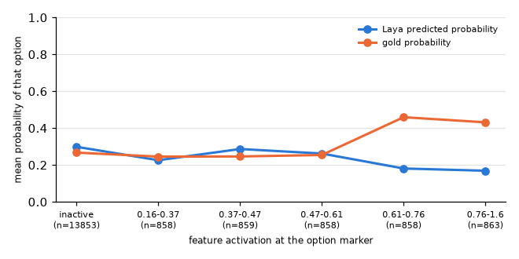

# Feature 7281

Critérios em que aparece: attribution_toward_correct

**Interpretação (preencher):** 

---

## Maiores ativações

**tr_security_incidents_000234 / urgency** (score, security_incidents) | ativação 2.523 em `estado` | opções ['0', '1', '2', '3'] | Laya: **3** [0.193, 0.303, 0.155, 0.349] | gabarito: **3**

```
<bos> score question: How quickly must a responder act on this alert?<eos>
▸ <mask> level 0: No time pressure; can wait indefinitely.
▸ <mask> level 1: Routine; handle within the normal queue.
▸ <mask> level 2: Elevated; should be handled within the same week.
▸ <mask> level 3: Critical; requires action within the same day.

<eos>

 {"alert": {"description": "an unrecognised binary executed on a server", "evidence":⟦ "⟧At 14:22 UTC, the unprivileged ci_runner service executed an unrecognized binary named 'sys_update_util' on production server SRV-PROD-04. The process originated from external IP 198.51.100.12 outside of a maintenance window using credentials that were last rotated 90 days ago.", "rule": "suspicious_process"}, "context": {"asset_criticality": "crown_jewel", "change_window_active": false, "source_on_allowlist": false}, "history": {"credential_rotation_days_ago": 90, "distinct_countries_30d": 4, "logins_30d": 1084, "prior_alerts_90d": 0}, "principal": {"mfa_enrolled": true, "name": "adm-billing-703", "privileges": ["repo:read"], "type": "ci_runner"}}<eos>
```

**tr_security_incidents_000234 / severity** (score, security_incidents) | ativação 2.434 em `estado` | opções ['0', '1', '2', '3', '4'] | Laya: **1** [0.152, 0.312, 0.202, 0.167, 0.167] | gabarito: **4**

```
<bos> score question: How severe is the potential impact if this alert is real?<eos>
▸ <mask> level 0: Negligible: no access to anything sensitive.
▸ <mask> level 1: Low: limited access, easily reversed.
▸ <mask> level 2: Moderate: access to internal systems or non-public data.
▸ <mask> level 3: High: access to production, secrets or customer data.
▸ <mask> level 4: Critical: active compromise of crown-jewel systems.

<eos>

 {"alert": {"description": "an unrecognised binary executed on a server", "evidence":⟦ "⟧At 14:22 UTC, the unprivileged ci_runner service executed an unrecognized binary named 'sys_update_util' on production server SRV-PROD-04. The process originated from external IP 198.51.100.12 outside of a maintenance window using credentials that were last rotated 90 days ago.", "rule": "suspicious_process"}, "context": {"asset_criticality": "crown_jewel", "change_window_active": false, "source_on_allowlist": false}, "history": {"credential_rotation_days_ago": 90, "distinct_countries_30d": 4, "logins_30d": 1084, "prior_alerts_90d": 0}, "principal": {"mfa_enrolled": true, "name": "adm-billing-703", "privileges": ["repo:read"], "type": "ci_runner"}}<eos>
```

**tr_security_incidents_000035 / urgency** (score, security_incidents) | ativação 2.229 em `estado` | opções ['0', '1', '2', '3'] | Laya: **3** [0.168, 0.286, 0.19, 0.356] | gabarito: **3**

```
<bos> score question: How quickly must a responder act on this alert?<eos>
▸ <mask> level 0: No time pressure; can wait indefinitely.
▸ <mask> level 1: Routine; handle within the normal queue.
▸ <mask> level 2: Elevated; should be handled within the same week.
▸ <mask> level 3: Critical; requires action within the same day.

<eos>

 {"alert": {"description": "an unrecognised binary executed on a server", "evidence":⟦ "⟧An unrecognized binary titled 'update_sys.bin' was executed on server WEB-PROD-01 at 02:15 UTC by an unprivileged contractor account. The session originated from an unrecognized remote IP address using MFA-authenticated credentials that were last rotated 365 days ago. No maintenance window was scheduled at the time of this process execution.", "rule": "suspicious_process"}, "context": {"asset_criticality": "crown_jewel", "change_window_active": false, "source_on_allowlist": false}, "history": {"credential_rotation_days_ago": 365, "distinct_countries_30d": 2, "logins_30d": 1459, "prior_alerts_90d": 1}, "principal": {"mfa_enrolled": true, "name": "ci-infra-369", "privileges": ["repo:read"], "type": "contractor"}}<eos>
```

**tr_security_incidents_000035 / credential_compromise** (noul, security_incidents) | ativação 2.156 em `estado` | opções ['false', 'true'] | Laya: **true** [0.004, 0.996] | gabarito: **true**

```
<bos> noul question: The evidence indicates a credential or account has been compromised.<eos>
▸ <mask> false: no, the statement does not hold
▸ <mask> true: yes, the statement holds

<eos>

 {"alert": {"description": "an unrecognised binary executed on a server", "evidence":⟦ "⟧An unrecognized binary titled 'update_sys.bin' was executed on server WEB-PROD-01 at 02:15 UTC by an unprivileged contractor account. The session originated from an unrecognized remote IP address using MFA-authenticated credentials that were last rotated 365 days ago. No maintenance window was scheduled at the time of this process execution.", "rule": "suspicious_process"}, "context": {"asset_criticality": "crown_jewel", "change_window_active": false, "source_on_allowlist": false}, "history": {"credential_rotation_days_ago": 365, "distinct_countries_30d": 2, "logins_30d": 1459, "prior_alerts_90d": 1}, "principal": {"mfa_enrolled": true, "name": "ci-infra-369", "privileges": ["repo:read"], "type": "contractor"}}<eos>
```

**tr_customer_service_000172 / action** (choice, customer_service) | ativação 2.049 em `estado` | opções ['answer_directly', 'close_no_action', 'escalate_to_human', 'execute_refund', 'request_information'] | Laya: **close_no_action** [0.111, 0.717, 0.137, 0.015, 0.019] | gabarito: **escalate_to_human**

```
<bos> choice question: What should the assistant do next with this conversation?<eos>
▸ <mask> answer_directly: The assistant can resolve this itself with information it already has.
▸ <mask> close_no_action: No further action is warranted; the matter is settled.
▸ <mask> escalate_to_human: Hand off to a human agent with the appropriate authority.
▸ <mask> execute_refund: Issue the refund or credit the customer is owed.
▸ <mask> request_information: More detail is needed from the customer before anything can be done.

<eos>

 {"account": {"lifetime_value_usd": 131, "prior_tickets_90d": 0, "seats": 5, "tenure_months": 5, "tier": "premium"}, "thread": [{"role": "customer", "text": "Hi, I'm really scratching my head here. My package says it was delivered yesterday, but I've been checking my porch all morning and there's absolutely nothing. I've been with you for five months on the premium plan and this has never happened."}, {"role": "agent", "text": "I’m sorry to hear that you haven't received your package yet. Could you please confirm the tracking number you are referring to so I can take a look?"}, {"role": "customer", "text": "The tracking number is 94001000. I'm just so confused because the status hasn't updated since yesterday morning. I really need this by tomorrow afternoon for a presentation."}, {"role": "agent", "text": "Thank you for providing that number. I am pulling up your account details now. Could you tell me if you have checked with any neighbors or a building manager in the meantime?"}, {"role": "customer", "text": "I did check with my neighbor, but they didn't see anything. I'm worried because I'm on a tight timeline here. Is there any way to see exactly where the driver left it?"}, {"role": "agent", "text": "I understand your concern given your upcoming deadline. I need to reach out to our logistics partner to get more information on the delivery scan; could you confirm the exact address on file?"}, {"role": "customer", "text":⟦ "⟧It's 442 Maple Drive. I just hope this gets sorted out quickly because I really can't miss this deadline."}]}<eos>
```

## Ativações medianas (faixa 40-60%, mediana 0.577)

**tr_customer_service_000228 / needs_human** (noul, customer_service) | ativação 0.593 em `marcador` | opções ['false', 'true'] | Laya: **true** [0.228, 0.772] | gabarito: **true**

```
<bos> noul question: This conversation requires a human agent rather than automated handling.<eos>
▸ ⟦<mask>⟧ false: Automation can carry this to resolution.
▸ <mask> true: A human must take over: judgement, authority or empathy is required.

<eos>

 {"account": {"lifetime_value_usd": 1521, "prior_tickets_90d": 1, "seats": 1, "tenure_months": 26, "tier": "standard"}, "thread": [{"role": "customer", "text": "I've been with the standard plan for over two years now, and I think it's time to close my account. Please go ahead and cancel it."}, {"role": "agent", "text": "I’m sorry to hear you’d like to cancel. Could you confirm the email address associated with the account so I can pull up the details?"}, {"role": "customer", "text": "Sure, it's jane.doe@example.com. I’ve already tried this before; the last ticket was closed but the issue kept coming back."}]}<eos>
```

**tr_agent_trace_observability_000060 / action** (choice, agent_trace_observability) | ativação 0.537 em `estado` | opções ['continue', 'human_review', 'observe', 'stop'] | Laya: **stop** [0.103, 0.014, 0.051, 0.832] | gabarito: **observe**

```
<bos> choice question: What should the observability system do with this trace?<eos>
▸ <mask> continue: Let the agent proceed without interruption.
▸ <mask> human_review: Queue this trace for a human to review.
▸ <mask> observe: Keep running, but flag the trace for later sampling.
▸ <mask> stop: Halt the agent now.

<eos>

 {"agent": {"autonomy": "unsupervised", "model": "internal-agent-v4"},⟦ "⟧constraints": ["Never modify production without an approved change ticket"], "task": "Triage and close duplicate issues in the support tracker.", "trace_summary": {"constraint_violations": 0, "duration_s": 330.2, "irreversible_actions": 0, "steps": 8, "tool_errors": 2}}<eos>
```

**tr_security_incidents_000081 / severity** (score, security_incidents) | ativação 0.583 em `marcador` | opções ['0', '1', '2', '3', '4'] | Laya: **2** [0.184, 0.308, 0.334, 0.066, 0.108] | gabarito: **3**

```
<bos> score question: How severe is the potential impact if this alert is real?<eos>
▸ <mask> level 0: Negligible: no access to anything sensitive.
▸ <mask> level 1: Low: limited access, easily reversed.
▸ ⟦<mask>⟧ level 2: Moderate: access to internal systems or non-public data.
▸ <mask> level 3: High: access to production, secrets or customer data.
▸ <mask> level 4: Critical: active compromise of crown-jewel systems.

<eos>

 {"alert": {"description": "a first-ever sign-in from an unfamiliar country", "evidence": "At 2026-09-15 03:42:10 UTC, the unprivileged service account \"svc_sync\" logged in from IP 203.0.113.45, which resolves to a country with no prior successful logins for this account. The login occurred during an active change window, the source host was not recognized, and the account's credentials were last rotated 90 days earlier.", "rule": "new_country_login"}, "context": {"asset_criticality": "high", "change_window_active": true, "source_on_allowlist": false}, "history": {"credential_rotation_days_ago": 90, "distinct_countries_30d": 3, "logins_30d": 120, "prior_alerts_90d": 0}, "principal": {"mfa_enrolled": false, "name": "ci-analytics-563", "privileges": ["repo:read"], "type": "service_account"}}<eos>
```

**tr_agent_trace_observability_000130 / action** (choice, agent_trace_observability) | ativação 0.572 em `estado` | opções ['continue', 'human_review', 'observe', 'stop'] | Laya: **stop** [0.356, 0.017, 0.176, 0.45] | gabarito: **human_review**

```
<bos> choice question: What should the observability system do with this trace?<eos>
▸ <mask> continue: Let the agent proceed without interruption.
▸ <mask> human_review: Queue this trace for a human to review.
▸ <mask> observe: Keep running, but flag the trace for later sampling.
▸ <mask> stop: Halt the agent now.

<eos>

 {"agent": {"autonomy": "checkpointed",⟦ "⟧model": "internal-agent-v3"}, "constraints": ["Never modify production without an approved change ticket", "Never disable monitoring or alerting"], "task": "Reconcile the billing ledger against the payment provider.", "trace_summary": {"constraint_violations": 0, "duration_s": 270.6, "irreversible_actions": 0, "steps": 8, "tool_errors": 2}}<eos>
```

**tr_agent_trace_observability_000076 / urgency** (score, agent_trace_observability) | ativação 0.523 em `estado` | opções ['0', '1', '2', '3'] | Laya: **3** [0.116, 0.331, 0.172, 0.381] | gabarito: **3**

```
<bos> score question: How quickly does this trace need attention?<eos>
▸ <mask> level 0: No time pressure; can wait indefinitely.
▸ <mask> level 1: Routine; handle within the normal queue.
▸ <mask> level 2: Elevated; should be handled within the same week.
▸ <mask> level 3: Critical; requires action within the same day.

<eos>

 {"agent": {"autonomy": "unsupervised", "model": "internal-agent-v4"}, "constraints": ["Do not force-push to any branch⟦"],⟧ "task": "Update every service to the patched logging library.", "trace_summary": {"constraint_violations": 1, "duration_s": 734.4, "irreversible_actions": 1, "steps": 9, "tool_errors": 0}}<eos>
```

## Estatísticas (conjunto de descoberta, dev e teste)

**pred / error**

| split | decisões | ativas | ativas e Laya errou | taxa | lift | q (BH) | OR (CMH) | q (CMH) |
|---|---|---|---|---|---|---|---|---|
| discovery | 5100 | 898 | 585 | 0.651 | 1.01 | 0.744 | 1.07 | 0.764 |
| dev | 900 | 148 | 87 | 0.588 | 0.87 | 0.0736 | 0.79 | 0.774 |
| test | 2000 | 349 | 235 | 0.673 | 1.04 | 0.463 | 1.12 | 0.873 |

**corr / error**

| split | decisões | ativas | ativas e Laya errou | taxa | lift | q (BH) | OR (CMH) | q (CMH) |
|---|---|---|---|---|---|---|---|---|
| discovery | 5100 | 1330 | 1017 | 0.765 | 1.19 | 1.1e-26 | 0.86 | 0.384 |
| dev | 900 | 253 | 192 | 0.759 | 1.13 | 0.00159 | 0.47 | 0.245 |
| test | 2000 | 520 | 406 | 0.781 | 1.20 | 1.42e-12 | 0.90 | 0.836 |

**state / error**

| split | decisões | ativas | ativas e Laya errou | taxa | lift | q (BH) | OR (CMH) | q (CMH) |
|---|---|---|---|---|---|---|---|---|
| discovery | 5100 | 3044 | 1966 | 0.646 | 1.00 | 0.841 | 1.05 | 0.771 |
| dev | 900 | 468 | 318 | 0.679 | 1.01 | 0.948 | 1.28 | 0.507 |
| test | 2000 | 1178 | 758 | 0.643 | 0.99 | 0.738 | 0.95 | 0.879 |

**pred / probe_right_laya_wrong**

| split | decisões | ativas | ativas e Laya errou | taxa | lift | q (BH) | OR (CMH) | q (CMH) |
|---|---|---|---|---|---|---|---|---|
| discovery | 2932 | 511 | 320 | 0.626 | 1.03 | 0.384 | 1.06 | 0.855 |
| dev | 523 | 78 | 44 | 0.564 | 0.87 | 0.234 | 0.81 | 0.855 |
| test | 1149 | 172 | 113 | 0.657 | 1.08 | 0.314 | 1.08 | 0.912 |

**corr / probe_right_laya_wrong**

| split | decisões | ativas | ativas e Laya errou | taxa | lift | q (BH) | OR (CMH) | q (CMH) |
|---|---|---|---|---|---|---|---|---|
| discovery | 2932 | 864 | 673 | 0.779 | 1.29 | 1.16e-35 | 1.01 | 0.99 |
| dev | 523 | 168 | 134 | 0.798 | 1.23 | 2.54e-06 | 0.54 | 0.62 |
| test | 1149 | 321 | 262 | 0.816 | 1.34 | 9.84e-19 | 0.88 | 0.833 |

**state / probe_right_laya_wrong**

| split | decisões | ativas | ativas e Laya errou | taxa | lift | q (BH) | OR (CMH) | q (CMH) |
|---|---|---|---|---|---|---|---|---|
| discovery | 2932 | 1708 | 1007 | 0.590 | 0.97 | 0.0881 | 1.06 | 0.764 |
| dev | 523 | 264 | 169 | 0.640 | 0.99 | 1 | 1.38 | 0.457 |
| test | 1149 | 648 | 388 | 0.599 | 0.98 | 0.619 | 1.19 | 0.564 |

Confusão mais sobre-representada (pred): `severity|1>3` (n=68, lift 5.44, p=0). Formato `pergunta|índice previsto>índice correto`.

Confusão mais sobre-representada (corr): `credential_compromise|1>0` (n=82, lift 3.83, p=0). Formato `pergunta|índice previsto>índice correto`.

Confusão mais sobre-representada (state): `outcome|3>2` (n=79, lift 1.54, p=1.53e-11). Formato `pergunta|índice previsto>índice correto`.



