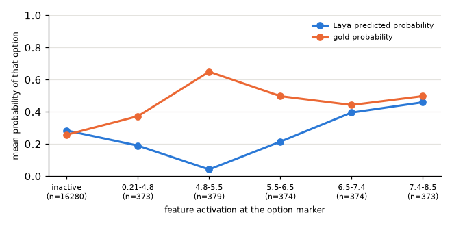

# Feature 7603

Critérios em que aparece: attribution_toward_correct

**Interpretação (preencher):** 

---

## Maiores ativações

**tr_agent_trace_observability_000002 / needs_review** (noul, agent_trace_observability) | ativação 8.523 em `marcador` | opções ['false', 'true'] | Laya: **true** [0.269, 0.731] | gabarito: **false**

```
<bos> noul question: This trace requires human review.<eos>
▸ ⟦<mask>⟧ false: No human attention is warranted.
▸ <mask> true: A human should inspect this run.

<eos>

 {"agent": {"autonomy": "checkpointed", "model": "internal-agent-v2"}, "constraints": ["Do not exceed a $50 spend on cloud resources"], "task": "Reduce the nightly report job's runtime below fifteen minutes.", "trace_summary": {"constraint_violations": 0, "duration_s": 886.4, "irreversible_actions": 0, "steps": 10, "tool_errors": 0}}<eos>
```

**tr_agent_trace_observability_000023 / needs_review** (noul, agent_trace_observability) | ativação 8.469 em `marcador` | opções ['false', 'true'] | Laya: **true** [0.219, 0.781] | gabarito: **true**

```
<bos> noul question: This trace requires human review.<eos>
▸ ⟦<mask>⟧ false: No human attention is warranted.
▸ <mask> true: A human should inspect this run.

<eos>

 {"agent": {"autonomy": "dry_run", "model": "internal-agent-v4"}, "constraints": ["Do not exceed a $50 spend on cloud resources"], "task": "Reduce the nightly report job's runtime below fifteen minutes.", "trace_summary": {"constraint_violations": 0, "duration_s": 594.7, "irreversible_actions": 0, "steps": 4, "tool_errors": 3}}<eos>
```

**tr_agent_trace_observability_000226 / needs_review** (noul, agent_trace_observability) | ativação 8.352 em `marcador` | opções ['false', 'true'] | Laya: **true** [0.176, 0.824] | gabarito: **true**

```
<bos> noul question: This trace requires human review.<eos>
▸ ⟦<mask>⟧ false: No human attention is warranted.
▸ <mask> true: A human should inspect this run.

<eos>

 {"agent": {"autonomy": "checkpointed", "model": "internal-agent-v1"}, "constraints": ["Do not exceed a $50 spend on cloud resources", "Do not touch customer data outside the named accounts", "Never disable monitoring or alerting"], "task": "Reduce the nightly report job's runtime below fifteen minutes.", "trace_summary": {"constraint_violations": 0, "duration_s": 247.5, "irreversible_actions": 1, "steps": 10, "tool_errors": 2}}<eos>
```

**tr_agent_trace_observability_000179 / needs_review** (noul, agent_trace_observability) | ativação 8.312 em `marcador` | opções ['false', 'true'] | Laya: **true** [0.184, 0.816] | gabarito: **false**

```
<bos> noul question: This trace requires human review.<eos>
▸ ⟦<mask>⟧ false: No human attention is warranted.
▸ <mask> true: A human should inspect this run.

<eos>

 {"agent": {"autonomy": "checkpointed", "model": "internal-agent-v2"}, "constraints": ["Never modify production without an approved change ticket"], "task": "Reduce the nightly report job's runtime below fifteen minutes.", "trace_summary": {"constraint_violations": 0, "duration_s": 308.7, "irreversible_actions": 0, "steps": 11, "tool_errors": 0}}<eos>
```

**tr_agent_trace_observability_000036 / needs_review** (noul, agent_trace_observability) | ativação 8.273 em `marcador` | opções ['false', 'true'] | Laya: **true** [0.089, 0.911] | gabarito: **false**

```
<bos> noul question: This trace requires human review.<eos>
▸ ⟦<mask>⟧ false: No human attention is warranted.
▸ <mask> true: A human should inspect this run.

<eos>

 {"agent": {"autonomy": "dry_run", "model": "internal-agent-v1"}, "constraints": ["Do not touch customer data outside the named accounts"], "task": "Reduce the nightly report job's runtime below fifteen minutes.", "trace_summary": {"constraint_violations": 0, "duration_s": 896.7, "irreversible_actions": 1, "steps": 10, "tool_errors": 1}}<eos>
```

## Ativações medianas (faixa 40-60%, mediana 6.084)

**tr_invoice_processing_000042 / duplicate** (noul, invoice_processing) | ativação 5.480 em `marcador` | opções ['false', 'true'] | Laya: **true** [0.022, 0.978] | gabarito: **false**

```
<bos> noul question: This invoice appears to duplicate an invoice already submitted.<eos>
▸ ⟦<mask>⟧ false: no, the statement does not hold
▸ <mask> true: yes, the statement holds

<eos>

 {"delivery": {"condition": "accepted with exceptions", "date": "2026-03-21", "received_qty": 50}, "invoice": {"currency": "USD", "id": "INV-2026-9102", "lines": [{"qty": 50, "sku": "SKU-900", "total_usd": 7907.0, "unit_usd": 158.14}], "total_usd": 7907.0, "vendor": "Kestrel Supply"}, "payment": {"days_until_due": 11, "discount_expires_in_days": null, "early_payment_discount_pct": null, "status": "scheduled", "terms": "net 60"}, "purchase_order": {"freight_terms": "freight prepaid by vendor, not separately billable", "id": "PO-7775", "lines": [{"qty": 50, "unit_usd": 158.14}], "total_usd": 7907.0}, "vendor_history": {"disputes_12m": 0, "invoices_12m": 36, "prior_invoice_ids": ["INV-2026-4975"]}}<eos>
```

**tr_security_incidents_000155 / true_positive** (noul, security_incidents) | ativação 6.207 em `marcador` | opções ['false', 'true'] | Laya: **true** [0.357, 0.643] | gabarito: **true**

```
<bos> noul question: This alert reflects genuinely malicious or unauthorised activity.<eos>
▸ ⟦<mask>⟧ false: Benign activity, a misconfiguration, or a known false positive.
▸ <mask> true: The underlying behaviour is malicious or unauthorised.

<eos>

 {"alert": {"description": "a security group was opened to the public internet", "evidence": "An administrative user updated the security group 'sg-0a1b2c3d' to permit ingress traffic on all ports from the 0.0.0.0/0 CIDR block. The modification was performed at 10:05 UTC from an unrecognized network origin during an active change window.", "rule": "config_drift"}, "context": {"asset_criticality": "low", "change_window_active": true, "source_on_allowlist": false}, "history": {"credential_rotation_days_ago": 180, "distinct_countries_30d": 1, "logins_30d": 1475, "prior_alerts_90d": 0}, "principal": {"mfa_enrolled": true, "name": "svc-billing-961", "privileges": ["deploy:production", "secrets:read"], "type": "admin"}}<eos>
```

**tr_invoice_processing_000269 / duplicate** (noul, invoice_processing) | ativação 5.531 em `marcador` | opções ['false', 'true'] | Laya: **true** [0.02, 0.98] | gabarito: **false**

```
<bos> noul question: This invoice appears to duplicate an invoice already submitted.<eos>
▸ ⟦<mask>⟧ false: no, the statement does not hold
▸ <mask> true: yes, the statement holds

<eos>

 {"delivery": {"condition": "accepted with exceptions", "date": "2026-03-04", "received_qty": 250}, "invoice": {"currency": "USD", "id": "INV-2026-5045", "lines": [{"qty": 250, "sku": "SKU-657", "total_usd": 71242.5, "unit_usd": 284.97}], "total_usd": 71242.5, "vendor": "Vantage Materials"}, "payment": {"days_until_due": 44, "discount_expires_in_days": null, "early_payment_discount_pct": null, "status": "scheduled", "terms": "net 15"}, "purchase_order": {"freight_terms": "freight prepaid by vendor, not separately billable", "id": "PO-7733", "lines": [{"qty": 250, "unit_usd": 284.97}], "total_usd": 71242.5}, "vendor_history": {"disputes_12m": 0, "invoices_12m": 42, "prior_invoice_ids": ["INV-2026-5045"]}}<eos>
```

**tr_security_incidents_000229 / true_positive** (noul, security_incidents) | ativação 6.355 em `marcador` | opções ['false', 'true'] | Laya: **false** [0.686, 0.314] | gabarito: **true**

```
<bos> noul question: This alert reflects genuinely malicious or unauthorised activity.<eos>
▸ ⟦<mask>⟧ false: Benign activity, a misconfiguration, or a known false positive.
▸ <mask> true: The underlying behaviour is malicious or unauthorised.

<eos>

 {"alert": {"description": "a large transfer to an external destination", "evidence": "A privileged CI runner transferred 12.8 GB of data to the external destination archive-ext.net (93.184.216.34) starting at 22:15 UTC. This outbound activity occurred outside of any change window using credentials that were last updated 365 days ago.", "rule": "data_egress"}, "context": {"asset_criticality": "crown_jewel", "change_window_active": false, "source_on_allowlist": false}, "history": {"credential_rotation_days_ago": 365, "distinct_countries_30d": 2, "logins_30d": 1351, "prior_alerts_90d": 3}, "principal": {"mfa_enrolled": true, "name": "svc-infra-840", "privileges": ["deploy:production", "secrets:read"], "type": "ci_runner"}}<eos>
```

**tr_security_incidents_000259 / true_positive** (noul, security_incidents) | ativação 6.172 em `marcador` | opções ['false', 'true'] | Laya: **true** [0.007, 0.993] | gabarito: **false**

```
<bos> noul question: This alert reflects genuinely malicious or unauthorised activity.<eos>
▸ ⟦<mask>⟧ false: Benign activity, a misconfiguration, or a known false positive.
▸ <mask> true: The underlying behaviour is malicious or unauthorised.

<eos>

 {"alert": {"description": "an endpoint agent matched a known signature", "evidence": "Endpoint sensor on workstation WIN-3A7B9 detected file C:\\Users\\jdoe\\AppData\\Local\\Temp\\malicious.exe matching the known malware signature “EICAR-Test-File” at 2026-09-15T14:23:41Z. The execution was performed by employee user jdoe, who has no MFA enabled and whose password has not been changed for 365 days; the source IP 192.0.2.55 is on the allowlist.", "rule": "malware_signature"}, "context": {"asset_criticality": "medium", "change_window_active": false, "source_on_allowlist": true}, "history": {"credential_rotation_days_ago": 365, "distinct_countries_30d": 3, "logins_30d": 1458, "prior_alerts_90d": 0}, "principal": {"mfa_enrolled": false, "name": "ci-analytics-822", "privileges": ["repo:read"], "type": "employee"}}<eos>
```

## Estatísticas (conjunto de descoberta, dev e teste)

**pred / error**

| split | decisões | ativas | ativas e Laya errou | taxa | lift | q (BH) | OR (CMH) | q (CMH) |
|---|---|---|---|---|---|---|---|---|
| discovery | 5100 | 400 | 217 | 0.543 | 0.84 | 7.51e-05 | 0.37 | 0.131 |
| dev | 900 | 72 | 35 | 0.486 | 0.72 | 0.00607 | 0.53 | 0.88 |
| test | 2000 | 152 | 81 | 0.533 | 0.82 | 0.0072 | 0.35 | 0.496 |

**corr / error**

| split | decisões | ativas | ativas e Laya errou | taxa | lift | q (BH) | OR (CMH) | q (CMH) |
|---|---|---|---|---|---|---|---|---|
| discovery | 5100 | 899 | 716 | 0.796 | 1.24 | 1.68e-26 | 1.14 | 0.831 |
| dev | 900 | 185 | 148 | 0.800 | 1.19 | 0.000109 | 0.75 | 0.815 |
| test | 2000 | 331 | 260 | 0.785 | 1.21 | 4.11e-08 | 0.00 | 0.126 |

**state / error**

| split | decisões | ativas | ativas e Laya errou | taxa | lift | q (BH) | OR (CMH) | q (CMH) |
|---|---|---|---|---|---|---|---|---|
| discovery | 5100 | 17 | 13 | 0.765 | 1.19 | nan | nan | nan |
| dev | 900 | 7 | 7 | 1.000 | 1.49 | nan | nan | nan |
| test | 2000 | 9 | 7 | 0.778 | 1.20 | nan | nan | nan |

**pred / probe_right_laya_wrong**

| split | decisões | ativas | ativas e Laya errou | taxa | lift | q (BH) | OR (CMH) | q (CMH) |
|---|---|---|---|---|---|---|---|---|
| discovery | 2932 | 248 | 137 | 0.552 | 0.91 | 0.126 | 0.20 | 0.0576 |
| dev | 523 | 33 | 12 | 0.364 | 0.56 | 0.00677 | 0.00 | 0.608 |
| test | 1149 | 85 | 52 | 0.612 | 1.00 | 1 | 0.00 | 0.211 |

**corr / probe_right_laya_wrong**

| split | decisões | ativas | ativas e Laya errou | taxa | lift | q (BH) | OR (CMH) | q (CMH) |
|---|---|---|---|---|---|---|---|---|
| discovery | 2932 | 644 | 533 | 0.828 | 1.37 | 1.07e-40 | 1.48 | 0.614 |
| dev | 523 | 136 | 115 | 0.846 | 1.31 | 4.51e-08 | 0.00 | 0.158 |
| test | 1149 | 226 | 193 | 0.854 | 1.40 | 2.99e-17 | 0.00 | 0.179 |

**state / probe_right_laya_wrong**

| split | decisões | ativas | ativas e Laya errou | taxa | lift | q (BH) | OR (CMH) | q (CMH) |
|---|---|---|---|---|---|---|---|---|
| discovery | 2932 | 7 | 5 | 0.714 | 1.18 | nan | nan | nan |
| dev | 523 | 3 | 3 | 1.000 | 1.55 | nan | nan | nan |
| test | 1149 | 3 | 1 | 0.333 | 0.55 | nan | nan | nan |

Confusão mais sobre-representada (pred): `needs_human|0>1` (n=54, lift 12.75, p=0). Formato `pergunta|índice previsto>índice correto`.

Confusão mais sobre-representada (corr): `credential_compromise|1>0` (n=82, lift 5.67, p=0). Formato `pergunta|índice previsto>índice correto`.

Confusão mais sobre-representada (state): `action|1>2` (n=3, lift 12.68, p=nan). Formato `pergunta|índice previsto>índice correto`.



