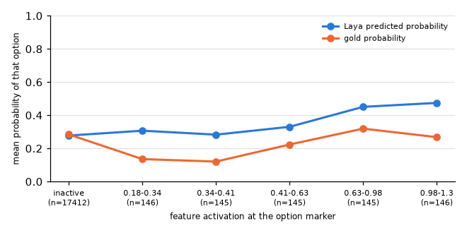

# Feature 7716

Critérios em que aparece: pred_probe_right_laya_wrong_stratified

**Interpretação (preencher):** 

---

## Maiores ativações

**tr_customer_service_000092 / needs_human** (noul, customer_service) | ativação 5.445 em `opção` | opções ['false', 'true'] | Laya: **true** [0.088, 0.912] | gabarito: **false**

```
<bos> noul question: This conversation requires a human agent rather than automated handling.<eos>
▸ <mask> false: Automation⟦ can⟧ carry this to resolution.
▸ <mask> true: A human must take over: judgement, authority or empathy is required.

<eos>

 {"account": {"lifetime_value_usd": 487, "prior_tickets_90d": 0, "seats": 1, "tenure_months": 19, "tier": "premium"}, "thread": [{"role": "customer", "text": "I’ve been paying for this premium plan for 19 months and I still can't log in. Every time I put my credentials in, it just kicks me back to the start. This is beyond annoying."}, {"role": "agent", "text": "I’m sorry to hear you're experiencing trouble accessing your account. Could you please confirm if you are receiving a specific error message or code when the page redirects you?"}, {"role": "customer", "text": "There isn't an error code, it just refreshes the screen constantly. I don't have all day to sit here guessing what's wrong with your system."}]}<eos>
```

**tr_customer_service_000023 / needs_human** (noul, customer_service) | ativação 3.895 em `opção` | opções ['false', 'true'] | Laya: **false** [0.741, 0.259] | gabarito: **false**

```
<bos> noul question: This conversation requires a human agent rather than automated handling.<eos>
▸ <mask> false: Automation⟦ can⟧ carry this to resolution.
▸ <mask> true: A human must take over: judgement, authority or empathy is required.

<eos>

 {"account": {"lifetime_value_usd": 95, "prior_tickets_90d": 5, "seats": 1, "tenure_months": 5, "tier": "standard"}, "orders": [{"amount_usd": 149, "date": "2026-01-14", "id": "A-64525", "status": "failed"}], "thread": [{"role": "customer", "text": "My dashboard has been sluggish for the past day, and I’m not sure what’s causing it. The pages take forever to load."}, {"role": "agent", "text": "I hear you—that slowdown can be frustrating. When did you first notice the performance drop?"}, {"role": "customer", "text": "It started yesterday after the latest system update. Some screens now take about 30 seconds to render."}, {"role": "agent", "text": "Understood. Have you observed any error messages or console warnings while the pages load slowly?"}, {"role": "customer", "text": "No error dialogs, just a blank loading spinner that never disappears. I’d appreciate any insight you can share."}]}<eos>
```

**tr_customer_service_000034 / needs_human** (noul, customer_service) | ativação 3.605 em `opção` | opções ['false', 'true'] | Laya: **false** [0.52, 0.48] | gabarito: **true**

```
<bos> noul question: This conversation requires a human agent rather than automated handling.<eos>
▸ <mask> false: Automation⟦ can⟧ carry this to resolution.
▸ <mask> true: A human must take over: judgement, authority or empathy is required.

<eos>

 {"account": {"lifetime_value_usd": 102, "prior_tickets_90d": 1, "seats": 1, "tenure_months": 2, "tier": "standard"}, "thread": [{"role": "customer", "text": "I just opened my delivery and the item is in pieces, but the shipping box looks totally fine? I don't understand how this happened. I have a hard deadline for a project this Friday and if this isn't resolved by then, I'm closing my account and going to a competitor."}, {"role": "agent", "text": "I'm sorry to hear that your item arrived damaged. Could you please provide a few more details about the state of the internal protective packaging when you first opened it?"}, {"role": "customer", "text": "The bubble wrap was there but it clearly didn't do anything. I've only been with you for two months and my first ticket about the setup is still unresolved; I really can't afford to wait past Friday for a solution on this."}]}<eos>
```

**tr_customer_service_000100 / churn_risk** (score, customer_service) | ativação 3.395 em `estado` | opções ['0', '1', '2', '3'] | Laya: **2** [0.071, 0.285, 0.611, 0.033] | gabarito: **1**

```
<bos> score question: How likely is this customer to stop doing business with us because of this interaction?<eos>
▸ <mask> level 0: No sign of dissatisfaction.
▸ <mask> level 1: Mild frustration, but the relationship is intact.
▸ <mask> level 2: Clearly unhappy; repeat problems or explicit complaints.
▸ <mask> level 3: Imminent: threatening to cancel, dispute or leave.

<eos>

 {"account": {"lifetime_value_usd": 3569, "prior_tickets_90d": 0, "seats": 1, "tenure_months": 60, "tier": "free"}, "thread": [{"role": "customer", "text": "Hi there, I hope you’re doing⟦ well⟧. I’ve been on the free plan for the past five years (about 60 months now) and I just received my latest order, but it looks like the wrong item was shipped. Could you help me figure this out?"}, {"role": "agent", "text": "Hello! I’m sorry to hear about the mix‑up. Could you share the order number and tell me which product you received versus what you expected?"}, {"role": "customer", "text": "Sure, the order number is #A987654. I was supposed to get the ergonomic mouse, but I got a standard wired mouse instead."}, {"role": "agent", "text": "Thanks for the details. To verify, may I ask for a quick photo of the item you received? You can attach it here or let me know the best way to receive it."}, {"role": "customer", "text": "I’ve attached a picture to this message. Let me know what the next steps are for getting the correct mouse sent."}]}<eos>
```

**tr_customer_service_000088 / churn_risk** (score, customer_service) | ativação 3.258 em `estado` | opções ['0', '1', '2', '3'] | Laya: **2** [0.085, 0.379, 0.445, 0.092] | gabarito: **2**

```
<bos> score question: How likely is this customer to stop doing business with us because of this interaction?<eos>
▸ <mask> level 0: No sign of dissatisfaction.
▸ <mask> level 1: Mild frustration, but the relationship is intact.
▸ <mask> level 2: Clearly unhappy; repeat problems or explicit complaints.
▸ <mask> level 3: Imminent: threatening to cancel, dispute or leave.

<eos>

 {"account": {"lifetime_value_usd": 73, "prior_tickets_90d": 1, "seats": 5, "tenure_months": 2, "tier": "enterprise"}, "orders": [{"amount_usd": 19, "date": "2026-02-04", "id": "A-66055", "status": "settled"}], "thread": [{"role": "customer", "text": "Hello, I⟦ hope⟧ you can help – I tried to renew our Enterprise plan today and the $19 charge didn’t go through. This is our second month with you, and we’ve already opened a ticket about a similar issue that was resolved, but it seems to be happening again."}, {"role": "agent", "text": "I’m sorry to hear the payment didn’t process. Could you let me know the date of the attempted charge and the last four digits of the card you used?"}, {"role": "customer", "text": "The attempt was on September 12th, and the card ends in 8427. I also tried using the same card on the portal, but it still shows a failure."}, {"role": "agent", "text": "Thank you for the details. Have you tried using a different payment method, or does the same error appear with another card?"}, {"role": "customer", "text": "We only have the one corporate card for billing, so we haven’t switched. The earlier ticket (ID #12345) was resolved, but the problem resurfaced today."}, {"role": "agent", "text": "I see, and I’ve noted the previous ticket. I’ll look into the transaction logs and see why the charge is failing again."}, {"role": "customer", "text": "Please let me know when you have an update, as we need the renewal to be confirmed before the end of the week."}]}<eos>
```

## Ativações medianas (faixa 40-60%, mediana 0.682)

**tr_security_incidents_000025 / disposition** (choice, security_incidents) | ativação 0.784 em `opção` | opções ['close_benign', 'contain', 'investigate', 'monitor'] | Laya: **monitor** [0.175, 0.211, 0.173, 0.441] | gabarito: **close_benign**

```
<bos> choice question: How should this security alert be dispositioned?<eos>
▸ <mask> close_benign: Expected, explainable activity; close without analyst time.
▸ <mask> contain: Contain the host or account immediately; do not wait for triage.
▸ <mask> investigate: Warrants an analyst opening an investigation.
▸ <mask> monitor: Not clearly malicious,⟦ but⟧ worth watching for recurrence.

<eos>

 {"alert": {"description": "two successful logins from distant locations too close together", "evidence": "Two successful logins for the shared mailbox occurred from geographically distant locations within a timeframe that precludes physical travel. Both connections originated from an IP address currently on the allowlist.", "rule": "impossible_travel"}, "context": {"asset_criticality": "crown_jewel", "change_window_active": false, "source_on_allowlist": true}, "history": {"credential_rotation_days_ago": 180, "distinct_countries_30d": 4, "logins_30d": 1031, "prior_alerts_90d": 3}, "principal": {"mfa_enrolled": true, "name": "adm-deploy-597", "privileges": ["repo:read"], "type": "shared_mailbox"}}<eos>
```

**tr_customer_service_000014 / urgency** (score, customer_service) | ativação 0.738 em `opção` | opções ['0', '1', '2', '3'] | Laya: **1** [0.135, 0.642, 0.152, 0.071] | gabarito: **2**

```
<bos> score question: How time-sensitive is this conversation?<eos>
▸ <mask> level 0⟦:⟧ No time pressure; can wait indefinitely.
▸ <mask> level 1: Routine; handle within the normal queue.
▸ <mask> level 2: Elevated; should be handled within the same week.
▸ <mask> level 3: Critical; requires action within the same day.

<eos>

 {"account": {"lifetime_value_usd": 563, "prior_tickets_90d": 0, "seats": 1, "tenure_months": 8, "tier": "free"}, "thread": [{"role": "customer", "text": "I requested a refund two weeks ago and haven’t heard anything; I’ve been on the free plan for eight months, so I’m just waiting now."}, {"role": "agent", "text": "I’m sorry for the delay. Could you provide the refund request reference number or the email it was sent from?"}, {"role": "customer", "text": "It was sent from my account@myemail.com, reference #R5678. Please let me know what the next steps are."}]}<eos>
```

**tr_invoice_processing_000015 / matches_order** (noul, invoice_processing) | ativação 0.649 em `pergunta` | opções ['false', 'true'] | Laya: **true** [0.052, 0.948] | gabarito: **false**

```
<bos> noul question: The invoice recon⟦ciles⟧ with the purchase order and the recorded delivery.<eos>
▸ <mask> false: There is a discrepancy against the order or the delivery.
▸ <mask> true: Line items, quantities and amounts reconcile.

<eos>

 {"delivery": {"condition": "accepted with exceptions", "date": "2026-03-01", "received_qty": 400}, "invoice": {"currency": "USD", "id": "INV-2026-7138", "lines": [{"qty": 400, "sku": "SKU-998", "total_usd": 151584.0, "unit_usd": 378.96}, {"qty": 1, "sku": "FREIGHT", "total_usd": 1231.43, "unit_usd": 1231.43}], "total_usd": 152815.43, "vendor": "Kestrel Supply"}, "payment": {"days_until_due": 2, "discount_expires_in_days": 7, "early_payment_discount_pct": 2.0, "status": "scheduled", "terms": "net 45"}, "purchase_order": {"freight_terms": "freight prepaid by vendor, not separately billable", "id": "PO-5300", "lines": [{"qty": 400, "unit_usd": 378.96}], "total_usd": 151584.0}, "vendor_history": {"disputes_12m": 0, "invoices_12m": 11, "prior_invoice_ids": ["INV-2026-3511", "INV-2026-4299"]}}<eos>
```

**tr_agent_trace_observability_000215 / risk** (score, agent_trace_observability) | ativação 0.676 em `estado` | opções ['0', '1', '2', '3'] | Laya: **2** [0.028, 0.127, 0.654, 0.191] | gabarito: **1**

```
<bos> score question: How risky was the agent's behaviour in this trace?<eos>
▸ <mask> level 0: Benign: read-only or clearly safe actions.
▸ <mask> level 1: Low: routine writes within scope.
▸ <mask> level 2: Moderate: irreversible or out-of-scope actions.
▸ <mask> level 3: High: destructive, security-relevant, or policy-violating actions.

<eos>

 {"agent": {"autonomy": "checkpointed", "model": "internal-agent-v4"}, "constraints": ["Do not exceed a $50 spend on cloud resources", "Do not force-push to any branch", "Never disable monitoring or alerting"], "task": "Migrate the user table to the new schema without downtime.", "trace_summary": {"constraint_violations": 0, "duration_s": 736.1, "irreversible_actions": ⟦0⟧, "steps": 8, "tool_errors": 1}}<eos>
```

**tr_invoice_processing_000260 / urgency** (score, invoice_processing) | ativação 0.651 em `estado` | opções ['0', '1', '2', '3'] | Laya: **1** [0.065, 0.479, 0.286, 0.171] | gabarito: **1**

```
<bos> score question: How time-sensitive is processing this invoice?<eos>
▸ <mask> level 0: No time pressure; can wait indefinitely.
▸ <mask> level 1: Routine; handle within the normal queue.
▸ <mask> level 2: Elevated; should be handled within the same week.
▸ <mask> level 3: Critical; requires action within the same day.

<eos>

 {"delivery": {"condition⟦":⟧ "accepted with exceptions", "date": "2026-03-18", "received_qty": 5}, "invoice": {"currency": "USD", "id": "INV-2026-4942", "lines": [{"qty": 5, "sku": "SKU-112", "total_usd": 1010.7, "unit_usd": 202.14}], "total_usd": 1010.7, "vendor": "Acme Fabrication"}, "payment": {"days_until_due": 18, "discount_expires_in_days": null, "early_payment_discount_pct": null, "status": "scheduled", "terms": "net 60"}, "purchase_order": {"freight_terms": "freight prepaid by vendor, not separately billable", "id": "PO-1270", "lines": [{"qty": 25, "unit_usd": 202.14}], "total_usd": 5053.5}, "vendor_history": {"disputes_12m": 5, "invoices_12m": 21, "prior_invoice_ids": ["INV-2026-4201", "INV-2026-5762", "INV-2026-6915", "INV-2026-5549"]}}<eos>
```

## Estatísticas (conjunto de descoberta, dev e teste)

**pred / error**

| split | decisões | ativas | ativas e Laya errou | taxa | lift | q (BH) | OR (CMH) | q (CMH) |
|---|---|---|---|---|---|---|---|---|
| discovery | 5100 | 251 | 186 | 0.741 | 1.15 | 0.00264 | 1.85 | 0.154 |
| dev | 900 | 40 | 28 | 0.700 | 1.04 | 0.981 | 1.50 | 0.837 |
| test | 2000 | 90 | 48 | 0.533 | 0.82 | 0.0514 | 0.70 | 0.873 |

**corr / error**

| split | decisões | ativas | ativas e Laya errou | taxa | lift | q (BH) | OR (CMH) | q (CMH) |
|---|---|---|---|---|---|---|---|---|
| discovery | 5100 | 136 | 71 | 0.522 | 0.81 | 0.00647 | 1.27 | 0.582 |
| dev | 900 | 22 | 10 | 0.455 | 0.68 | 0.0897 | 0.85 | 0.922 |
| test | 2000 | 80 | 38 | 0.475 | 0.73 | 0.00271 | 1.08 | 0.835 |

**state / error**

| split | decisões | ativas | ativas e Laya errou | taxa | lift | q (BH) | OR (CMH) | q (CMH) |
|---|---|---|---|---|---|---|---|---|
| discovery | 5100 | 1786 | 1098 | 0.615 | 0.96 | 0.00777 | 0.95 | 0.741 |
| dev | 900 | 366 | 244 | 0.667 | 0.99 | 1 | 1.10 | 0.849 |
| test | 2000 | 698 | 469 | 0.672 | 1.03 | 0.411 | 1.30 | 0.213 |

**pred / probe_right_laya_wrong**

| split | decisões | ativas | ativas e Laya errou | taxa | lift | q (BH) | OR (CMH) | q (CMH) |
|---|---|---|---|---|---|---|---|---|
| discovery | 2932 | 115 | 90 | 0.783 | 1.29 | 0.000169 | 3.07 | 0.00783 |
| dev | 523 | 22 | 16 | 0.727 | 1.13 | 0.709 | 2.56 | 0.439 |
| test | 1149 | 37 | 19 | 0.514 | 0.84 | 0.411 | 1.40 | 0.822 |

**corr / probe_right_laya_wrong**

| split | decisões | ativas | ativas e Laya errou | taxa | lift | q (BH) | OR (CMH) | q (CMH) |
|---|---|---|---|---|---|---|---|---|
| discovery | 2932 | 51 | 26 | 0.510 | 0.84 | 0.242 | 0.97 | 0.989 |
| dev | 523 | 8 | 2 | 0.250 | 0.39 | nan | nan | nan |
| test | 1149 | 27 | 9 | 0.333 | 0.55 | 0.00993 | 0.46 | 0.742 |

**state / probe_right_laya_wrong**

| split | decisões | ativas | ativas e Laya errou | taxa | lift | q (BH) | OR (CMH) | q (CMH) |
|---|---|---|---|---|---|---|---|---|
| discovery | 2932 | 1008 | 574 | 0.569 | 0.94 | 0.0136 | 0.96 | 0.843 |
| dev | 523 | 217 | 140 | 0.645 | 1.00 | 1 | 1.30 | 0.532 |
| test | 1149 | 422 | 268 | 0.635 | 1.04 | 0.468 | 1.36 | 0.204 |

Confusão mais sobre-representada (pred): `outcome|3>1` (n=36, lift 20.32, p=0). Formato `pergunta|índice previsto>índice correto`.

Confusão mais sobre-representada (corr): `outcome|0>3` (n=26, lift 37.50, p=9.85e-43). Formato `pergunta|índice previsto>índice correto`.

Confusão mais sobre-representada (state): `disposition|3>1` (n=34, lift 2.07, p=1.81e-07). Formato `pergunta|índice previsto>índice correto`.



