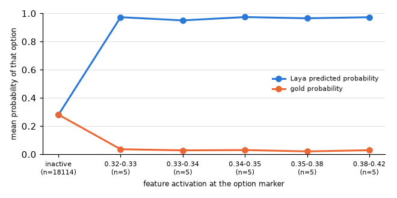

# Feature 7730

Critérios em que aparece: pred_error, pred_probe_right_laya_wrong

**Interpretação (preencher):** 

---

## Maiores ativações

**tr_security_incidents_000078 / urgency** (score, security_incidents) | ativação 2.430 em `estado` | opções ['0', '1', '2', '3'] | Laya: **2** [0.116, 0.21, 0.352, 0.321] | gabarito: **3**

```
<bos> score question: How quickly must a responder act on this alert?<eos>
▸ <mask> level 0: No time pressure; can wait indefinitely.
▸ <mask> level 1: Routine; handle within the normal queue.
▸ <mask> level 2: Elevated; should be handled within the same week.
▸ <mask> level 3: Critical; requires action within the same day.

<eos>

 {"alert": {"description": "an account granted itself or received elevated permissions", "evidence": "At 2026-09-15T03:12:44Z the service account \"svc-backup\" on host 10.2.5.7 was granted the⟦ Owner⟧ role. The request originated from IP 203.0.113.45, which is not listed in the known inventory, and the account's MFA setting is disabled. Credential metadata shows the password was last rotated 700 days ago.", "rule": "privilege_escalation"}, "context": {"asset_criticality": "medium", "change_window_active": false, "source_on_allowlist": false}, "history": {"credential_rotation_days_ago": 700, "distinct_countries_30d": 1, "logins_30d": 861, "prior_alerts_90d": 3}, "principal": {"mfa_enrolled": false, "name": "usr-billing-797", "privileges": ["deploy:production", "secrets:read"], "type": "service_account"}}<eos>
```

**tr_security_incidents_000078 / severity** (score, security_incidents) | ativação 2.316 em `estado` | opções ['0', '1', '2', '3', '4'] | Laya: **1** [0.218, 0.316, 0.224, 0.159, 0.082] | gabarito: **3**

```
<bos> score question: How severe is the potential impact if this alert is real?<eos>
▸ <mask> level 0: Negligible: no access to anything sensitive.
▸ <mask> level 1: Low: limited access, easily reversed.
▸ <mask> level 2: Moderate: access to internal systems or non-public data.
▸ <mask> level 3: High: access to production, secrets or customer data.
▸ <mask> level 4: Critical: active compromise of crown-jewel systems.

<eos>

 {"alert": {"description": "an account granted itself or received elevated permissions", "evidence": "At 2026-09-15T03:12:44Z the service account \"svc-backup\" on host 10.2.5.7 was granted the⟦ Owner⟧ role. The request originated from IP 203.0.113.45, which is not listed in the known inventory, and the account's MFA setting is disabled. Credential metadata shows the password was last rotated 700 days ago.", "rule": "privilege_escalation"}, "context": {"asset_criticality": "medium", "change_window_active": false, "source_on_allowlist": false}, "history": {"credential_rotation_days_ago": 700, "distinct_countries_30d": 1, "logins_30d": 861, "prior_alerts_90d": 3}, "principal": {"mfa_enrolled": false, "name": "usr-billing-797", "privileges": ["deploy:production", "secrets:read"], "type": "service_account"}}<eos>
```

**tr_security_incidents_000078 / credential_compromise** (noul, security_incidents) | ativação 2.266 em `estado` | opções ['false', 'true'] | Laya: **true** [0.288, 0.712] | gabarito: **true**

```
<bos> noul question: The evidence indicates a credential or account has been compromised.<eos>
▸ <mask> false: no, the statement does not hold
▸ <mask> true: yes, the statement holds

<eos>

 {"alert": {"description": "an account granted itself or received elevated permissions", "evidence": "At 2026-09-15T03:12:44Z the service account \"svc-backup\" on host 10.2.5.7 was granted the⟦ Owner⟧ role. The request originated from IP 203.0.113.45, which is not listed in the known inventory, and the account's MFA setting is disabled. Credential metadata shows the password was last rotated 700 days ago.", "rule": "privilege_escalation"}, "context": {"asset_criticality": "medium", "change_window_active": false, "source_on_allowlist": false}, "history": {"credential_rotation_days_ago": 700, "distinct_countries_30d": 1, "logins_30d": 861, "prior_alerts_90d": 3}, "principal": {"mfa_enrolled": false, "name": "usr-billing-797", "privileges": ["deploy:production", "secrets:read"], "type": "service_account"}}<eos>
```

**tr_security_incidents_000078 / disposition** (choice, security_incidents) | ativação 2.258 em `estado` | opções ['close_benign', 'contain', 'investigate', 'monitor'] | Laya: **contain** [0.072, 0.557, 0.063, 0.308] | gabarito: **contain**

```
<bos> choice question: How should this security alert be dispositioned?<eos>
▸ <mask> close_benign: Expected, explainable activity; close without analyst time.
▸ <mask> contain: Contain the host or account immediately; do not wait for triage.
▸ <mask> investigate: Warrants an analyst opening an investigation.
▸ <mask> monitor: Not clearly malicious, but worth watching for recurrence.

<eos>

 {"alert": {"description": "an account granted itself or received elevated permissions", "evidence": "At 2026-09-15T03:12:44Z the service account \"svc-backup\" on host 10.2.5.7 was granted the⟦ Owner⟧ role. The request originated from IP 203.0.113.45, which is not listed in the known inventory, and the account's MFA setting is disabled. Credential metadata shows the password was last rotated 700 days ago.", "rule": "privilege_escalation"}, "context": {"asset_criticality": "medium", "change_window_active": false, "source_on_allowlist": false}, "history": {"credential_rotation_days_ago": 700, "distinct_countries_30d": 1, "logins_30d": 861, "prior_alerts_90d": 3}, "principal": {"mfa_enrolled": false, "name": "usr-billing-797", "privileges": ["deploy:production", "secrets:read"], "type": "service_account"}}<eos>
```

**tr_security_incidents_000078 / true_positive** (noul, security_incidents) | ativação 2.225 em `estado` | opções ['false', 'true'] | Laya: **true** [0.187, 0.813] | gabarito: **true**

```
<bos> noul question: This alert reflects genuinely malicious or unauthorised activity.<eos>
▸ <mask> false: Benign activity, a misconfiguration, or a known false positive.
▸ <mask> true: The underlying behaviour is malicious or unauthorised.

<eos>

 {"alert": {"description": "an account granted itself or received elevated permissions", "evidence": "At 2026-09-15T03:12:44Z the service account \"svc-backup\" on host 10.2.5.7 was granted the⟦ Owner⟧ role. The request originated from IP 203.0.113.45, which is not listed in the known inventory, and the account's MFA setting is disabled. Credential metadata shows the password was last rotated 700 days ago.", "rule": "privilege_escalation"}, "context": {"asset_criticality": "medium", "change_window_active": false, "source_on_allowlist": false}, "history": {"credential_rotation_days_ago": 700, "distinct_countries_30d": 1, "logins_30d": 861, "prior_alerts_90d": 3}, "principal": {"mfa_enrolled": false, "name": "usr-billing-797", "privileges": ["deploy:production", "secrets:read"], "type": "service_account"}}<eos>
```

## Ativações medianas (faixa 40-60%, mediana 0.920)

**tr_invoice_processing_000189 / urgency** (score, invoice_processing) | ativação 0.896 em `estado` | opções ['0', '1', '2', '3'] | Laya: **1** [0.123, 0.436, 0.314, 0.127] | gabarito: **2**

```
<bos> score question: How time-sensitive is processing this invoice?<eos>
▸ <mask> level 0: No time pressure; can wait indefinitely.
▸ <mask> level 1: Routine; handle within the normal queue.
▸ <mask> level 2: Elevated; should be handled within the same week.
▸ <mask> level 3: Critical; requires action within the same day.

<eos>

 {"delivery": {"condition": "accepted with exceptions", "date": "2026-03-19", "received_qty": 50}, "invoice": {"currency": "USD", "id": "INV-2026-7935", "lines": [{"qty": 50, "sku": "SKU-933", "total_usd": 4283.0, "unit_usd": 85.66}, {"qty": 1, "sku": "FREIGHT", "total_usd": 2062.5, "unit_usd": 2062.5}], "total_usd": 6345.5, "vendor": "Acme Fabrication"}, "payment": {"days_until_due": -3, "discount_expires_in_days": 6, "early_payment_discount_pct": 2.0, "status": "overdue", "terms": "net 15"}, "purchase_order": {"freight_terms": "freight prepaid by vendor, not separately billable", "id": "PO-4956", "lines": [{"qty": 50, "unit_usd": 85.66}], "total_usd": 4283.0}, "vendor_history": {"disputes_12m": 5, "invoices_12m": 4, "prior_invoice_ids": ["INV-2026-22⟦3⟧3"]}}<eos>
```

**tr_security_incidents_000175 / disposition** (choice, security_incidents) | ativação 0.918 em `estado` | opções ['close_benign', 'contain', 'investigate', 'monitor'] | Laya: **investigate** [0.012, 0.053, 0.713, 0.221] | gabarito: **contain**

```
<bos> choice question: How should this security alert be dispositioned?<eos>
▸ <mask> close_benign: Expected, explainable activity; close without analyst time.
▸ <mask> contain: Contain the host or account immediately; do not wait for triage.
▸ <mask> investigate: Warrants an analyst opening an investigation.
▸ <mask> monitor: Not clearly malicious, but worth watching for recurrence.

<eos>

 {"alert": {"description": "many failed authentications followed by a success", "evidence": "System logs show 42 failed authentication attempts against the privileged service account `svc-dat⟦async⟧` from source 45.33.22.11 followed by a single successful login at 11:30 PM. This activity bypassed MFA and used credentials last rotated 14 days ago while no scheduled maintenance window was in effect.", "rule": "brute_force"}, "context": {"asset_criticality": "low", "change_window_active": false, "source_on_allowlist": false}, "history": {"credential_rotation_days_ago": 14, "distinct_countries_30d": 1, "logins_30d": 1391, "prior_alerts_90d": 0}, "principal": {"mfa_enrolled": false, "name": "ci-support-332", "privileges": ["deploy:production", "secrets:read"], "type": "service_account"}}<eos>
```

**tr_security_incidents_000218 / credential_compromise** (noul, security_incidents) | ativação 0.977 em `estado` | opções ['false', 'true'] | Laya: **true** [0.013, 0.987] | gabarito: **true**

```
<bos> noul question: The evidence indicates a credential or account has been compromised.<eos>
▸ <mask> false: no, the statement does not hold
▸ <mask> true: yes, the statement holds

<eos>

 {"alert": {"description": "two successful logins from distant locations too close together", "evidence": "Contractor account `ext_dev_04` successfully logged in from London at 09:00 UTC and again from Singapore at 11:15 UTC. Both⟦ MFA⟧-validated sessions originated from allowlisted access points during a period with no active change window.", "rule": "impossible_travel"}, "context": {"asset_criticality": "low", "change_window_active": false, "source_on_allowlist": true}, "history": {"credential_rotation_days_ago": 90, "distinct_countries_30d": 1, "logins_30d": 1029, "prior_alerts_90d": 3}, "principal": {"mfa_enrolled": true, "name": "usr-billing-374", "privileges": ["repo:read"], "type": "contractor"}}<eos>
```

**tr_security_incidents_000271 / true_positive** (noul, security_incidents) | ativação 1.102 em `estado` | opções ['false', 'true'] | Laya: **true** [0.048, 0.952] | gabarito: **true**

```
<bos> noul question: This alert reflects genuinely malicious or unauthorised activity.<eos>
▸ <mask> false: Benign activity, a misconfiguration, or a known false positive.
▸ <mask> true: The underlying behaviour is malicious or unauthorised.

<eos>

 {"alert": {"description": "a large transfer to an external destination", "evidence": "⟦At⟧ 2026-09-16 02:15:44 UTC, a data transfer of 2.3 GB was observed from the internal server srv-data01 to external IP 203.0.113.45 over TCP port 443. The transfer was initiated by a service_account lacking MFA, whose password was refreshed 14 days earlier.", "rule": "data_egress"}, "context": {"asset_criticality": "low", "change_window_active": false, "source_on_allowlist": false}, "history": {"credential_rotation_days_ago": 14, "distinct_countries_30d": 2, "logins_30d": 1659, "prior_alerts_90d": 1}, "principal": {"mfa_enrolled": false, "name": "usr-billing-416", "privileges": ["repo:read"], "type": "service_account"}}<eos>
```

**tr_customer_service_000099 / churn_risk** (score, customer_service) | ativação 0.853 em `estado` | opções ['0', '1', '2', '3'] | Laya: **3** [0.116, 0.302, 0.266, 0.316] | gabarito: **2**

```
<bos> score question: How likely is this customer to stop doing business with us because of this interaction?<eos>
▸ <mask> level 0: No sign of dissatisfaction.
▸ <mask> level 1: Mild frustration, but the relationship is intact.
▸ <mask> level 2: Clearly unhappy; repeat problems or explicit complaints.
▸ <mask> level 3: Imminent: threatening to cancel, dispute or leave.

<eos>

 {"account": {"lifetime_value_usd": 210, "prior_tickets_90d": 0, "seats": 1, "tenure_months": 5, "tier": "standard"}, "thread": [{"role": "customer", "text": "I need to downgrade my account immediately. My budget is finalized at the end of the day today, so this needs to be handled right now."}, {"role": "agent", "text": "I understand that you have a time-sensitive deadline. To ensure I'm looking at the correct account, could you please verify the full name on the billing profile?"}, {"role": "customer", "text": "The name is Marcus Thorne. Please, I really don't have time to go back and forth on this today."}, {"role": "agent", "text": "Thank you, Marcus. I have your account pulled up. Could you please clarify if you are looking to move to the base tier or if you'd like to remove specific add⟦-⟧ons?"}, {"role": "customer", "text": "I just want the base tier, and I need this confirmed before the business day closes. Can you tell me if that's going to happen?"}]}<eos>
```

## Estatísticas (conjunto de descoberta, dev e teste)

**pred / error**

| split | decisões | ativas | ativas e Laya errou | taxa | lift | q (BH) | OR (CMH) | q (CMH) |
|---|---|---|---|---|---|---|---|---|
| discovery | 5100 | 25 | 25 | 1.000 | 1.55 | 0.000123 | inf | 0.297 |
| dev | 900 | 8 | 7 | 0.875 | 1.30 | nan | nan | nan |
| test | 2000 | 13 | 13 | 1.000 | 1.54 | nan | nan | nan |

**corr / error**

| split | decisões | ativas | ativas e Laya errou | taxa | lift | q (BH) | OR (CMH) | q (CMH) |
|---|---|---|---|---|---|---|---|---|
| discovery | 5100 | 0 | 0 | nan | nan | nan | nan | nan |
| dev | 900 | 1 | 0 | 0.000 | 0.00 | nan | nan | nan |
| test | 2000 | 0 | 0 | nan | nan | nan | nan | nan |

**state / error**

| split | decisões | ativas | ativas e Laya errou | taxa | lift | q (BH) | OR (CMH) | q (CMH) |
|---|---|---|---|---|---|---|---|---|
| discovery | 5100 | 156 | 92 | 0.590 | 0.92 | 0.317 | 1.07 | 0.899 |
| dev | 900 | 19 | 12 | 0.632 | 0.94 | nan | nan | nan |
| test | 2000 | 60 | 28 | 0.467 | 0.72 | 0.0566 | 0.61 | 0.42 |

**pred / probe_right_laya_wrong**

| split | decisões | ativas | ativas e Laya errou | taxa | lift | q (BH) | OR (CMH) | q (CMH) |
|---|---|---|---|---|---|---|---|---|
| discovery | 2932 | 25 | 25 | 1.000 | 1.65 | 2.24e-05 | nan | nan |
| dev | 523 | 7 | 7 | 1.000 | 1.55 | nan | nan | nan |
| test | 1149 | 13 | 13 | 1.000 | 1.64 | nan | nan | nan |

**corr / probe_right_laya_wrong**

| split | decisões | ativas | ativas e Laya errou | taxa | lift | q (BH) | OR (CMH) | q (CMH) |
|---|---|---|---|---|---|---|---|---|
| discovery | 2932 | 0 | 0 | nan | nan | nan | nan | nan |
| dev | 523 | 0 | 0 | nan | nan | nan | nan | nan |
| test | 1149 | 0 | 0 | nan | nan | nan | nan | nan |

**state / probe_right_laya_wrong**

| split | decisões | ativas | ativas e Laya errou | taxa | lift | q (BH) | OR (CMH) | q (CMH) |
|---|---|---|---|---|---|---|---|---|
| discovery | 2932 | 96 | 54 | 0.562 | 0.93 | 0.576 | 1.40 | 0.399 |
| dev | 523 | 9 | 4 | 0.444 | 0.69 | nan | nan | nan |
| test | 1149 | 41 | 17 | 0.415 | 0.68 | 0.082 | 0.56 | 0.384 |

Confusão mais sobre-representada (pred): `duplicate|1>0` (n=25, lift 23.50, p=1.33e-35). Formato `pergunta|índice previsto>índice correto`.

Confusão mais sobre-representada (state): `credential_compromise|0>1` (n=4, lift 5.94, p=0.00401). Formato `pergunta|índice previsto>índice correto`.



