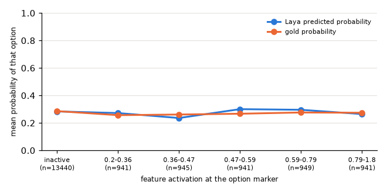

# Feature 7733

Critérios em que aparece: corr_error_stratified, corr_probe_right_laya_wrong_stratified, attribution_toward_wrong

**Interpretação (preencher):** 

---

## Maiores ativações

**tr_customer_service_000019 / action** (choice, customer_service) | ativação 3.244 em `estado` | opções ['answer_directly', 'close_no_action', 'escalate_to_human', 'execute_refund', 'request_information'] | Laya: **answer_directly** [0.708, 0.174, 0.036, 0.066, 0.015] | gabarito: **answer_directly**

```
<bos> choice question: What should the assistant do next with this conversation?<eos>
▸ <mask> answer_directly: The assistant can resolve this itself with information it already has.
▸ <mask> close_no_action: No further action is warranted; the matter is settled.
▸ <mask> escalate_to_human: Hand off to a human agent with the appropriate authority.
▸ <mask> execute_refund: Issue the refund or credit the customer is owed.
▸ <mask> request_information: More detail is needed from the customer before anything can be done.

<eos>

 {"account": {"lifetime_value_usd": 510, "prior_tickets_90d": 0, "seats": 1, "tenure_months": 19, "tier": "standard"}, "thread": [{"role": "customer", "text": "Looks like my payment didn’t go through again. I’ve been on the standard plan for 19 months, and I’m just kind of fed up with this happening."}, {"role": "agent", "text": "I’m sorry you’re experiencing this. Could you tell me the email address linked to your account or the transaction ID you saw?"}, {"role": "customer", "text": "The account email is user@example.com. I tried a couple of different cards, but each attempt ends with an error."}, {"role": "agent", "text": "Thanks for the details. Would you like me to walk you through updating the payment method, or is there another way you’d prefer to proceed?"}, {"role": "customer", "text": "Yes, please. I need guidance on how to add a new card or fix the current one⟦.⟧ Thanks."}]}<eos>
```

**tr_customer_service_000019 / needs_human** (noul, customer_service) | ativação 3.182 em `estado` | opções ['false', 'true'] | Laya: **true** [0.083, 0.917] | gabarito: **false**

```
<bos> noul question: This conversation requires a human agent rather than automated handling.<eos>
▸ <mask> false: Automation can carry this to resolution.
▸ <mask> true: A human must take over: judgement, authority or empathy is required.

<eos>

 {"account": {"lifetime_value_usd": 510, "prior_tickets_90d": 0, "seats": 1, "tenure_months": 19, "tier": "standard"}, "thread": [{"role": "customer", "text": "Looks like my payment didn’t go through again. I’ve been on the standard plan for 19 months, and I’m just kind of fed up with this happening."}, {"role": "agent", "text": "I’m sorry you’re experiencing this. Could you tell me the email address linked to your account or the transaction ID you saw?"}, {"role": "customer", "text": "The account email is user@example.com. I tried a couple of different cards, but each attempt ends with an error."}, {"role": "agent", "text": "Thanks for the details. Would you like me to walk you through updating the payment method, or is there another way you’d prefer to proceed?"}, {"role": "customer", "text": "Yes, please. I need guidance on how to add a new card or fix the current one⟦.⟧ Thanks."}]}<eos>
```

**tr_customer_service_000019 / category** (choice, customer_service) | ativação 3.104 em `estado` | opções ['account', 'billing', 'delivery', 'refund', 'technical'] | Laya: **account** [0.843, 0.011, 0.001, 0.001, 0.144] | gabarito: **billing**

```
<bos> choice question: What is this customer conversation primarily about?<eos>
▸ <mask> account: Login, plan changes, profile or access management.
▸ <mask> billing: A charge, invoice, subscription or payment problem.
▸ <mask> delivery: Shipping, fulfilment or delivery of a physical item.
▸ <mask> refund: The customer is explicitly asking for money back.
▸ <mask> technical: The product or service is not working as expected.

<eos>

 {"account": {"lifetime_value_usd": 510, "prior_tickets_90d": 0, "seats": 1, "tenure_months": 19, "tier": "standard"}, "thread": [{"role": "customer", "text": "Looks like my payment didn’t go through again. I’ve been on the standard plan for 19 months, and I’m just kind of fed up with this happening."}, {"role": "agent", "text": "I’m sorry you’re experiencing this. Could you tell me the email address linked to your account or the transaction ID you saw?"}, {"role": "customer", "text": "The account email is user@example.com. I tried a couple of different cards, but each attempt ends with an error."}, {"role": "agent", "text": "Thanks for the details. Would you like me to walk you through updating the payment method, or is there another way you’d prefer to proceed?"}, {"role": "customer", "text": "Yes, please. I need guidance on how to add a new card or fix the current one⟦.⟧ Thanks."}]}<eos>
```

**tr_customer_service_000283 / urgency** (score, customer_service) | ativação 2.893 em `estado` | opções ['0', '1', '2', '3'] | Laya: **1** [0.078, 0.596, 0.168, 0.158] | gabarito: **3**

```
<bos> score question: How time-sensitive is this conversation?<eos>
▸ <mask> level 0: No time pressure; can wait indefinitely.
▸ <mask> level 1: Routine; handle within the normal queue.
▸ <mask> level 2: Elevated; should be handled within the same week.
▸ <mask> level 3: Critical; requires action within the same day.

<eos>

 {"account": {"lifetime_value_usd": 4664, "prior_tickets_90d": 3, "seats": 1, "tenure_months": 60, "tier": "enterprise"}, "orders": [{"amount_usd": 299, "date": "2026-01-17", "id": "A-34538", "status": "settled"}, {"amount_usd": 299, "date": "2026-03-02", "id": "A-34919", "status": "settled"}, {"amount_usd": 299, "date": "2026-02-25", "id": "A-33586", "status": "settled"}], "thread": [{"role": "customer", "text": "We're trying to pull our data for the quarterly audit, but the export tool is hanging at 15% again, just like the last three times I've contacted support about this over the years."}, {"role": "agent", "text": "I'm sorry to hear the export tool is stalling during your audit preparation. Could you specify which data modules you are currently attempting to include in this specific batch?"}, {"role": "customer", "text": "It's the full user activity log for the enterprise tier. Honestly, after five years and paying nearly $300 a month, I'm tired of fighting with this interface; if we can't get our data out, we'll have to find a provider that actually works."}, {"role": "agent", "text": "I hear your frustration regarding the recurring nature of this issue. Are you seeing any specific error codes on the screen, or does the progress bar simply stop moving?"}, {"role": "customer", "text": "No codes, just a spinning wheel that goes nowhere⟦.⟧ I've had partial fixes before, but I'm just about done with the excuses at this point."}]}<eos>
```

**tr_customer_service_000019 / churn_risk** (score, customer_service) | ativação 2.879 em `estado` | opções ['0', '1', '2', '3'] | Laya: **2** [0.017, 0.319, 0.614, 0.05] | gabarito: **2**

```
<bos> score question: How likely is this customer to stop doing business with us because of this interaction?<eos>
▸ <mask> level 0: No sign of dissatisfaction.
▸ <mask> level 1: Mild frustration, but the relationship is intact.
▸ <mask> level 2: Clearly unhappy; repeat problems or explicit complaints.
▸ <mask> level 3: Imminent: threatening to cancel, dispute or leave.

<eos>

 {"account": {"lifetime_value_usd": 510, "prior_tickets_90d": 0, "seats": 1, "tenure_months": 19, "tier": "standard"}, "thread": [{"role": "customer", "text": "Looks like my payment didn’t go through again. I’ve been on the standard plan for 19 months, and I’m just kind of fed up with this happening."}, {"role": "agent", "text": "I’m sorry you’re experiencing this. Could you tell me the email address linked to your account or the transaction ID you saw?"}, {"role": "customer", "text": "The account email is user@example.com. I tried a couple of different cards, but each attempt ends with an error."}, {"role": "agent", "text": "Thanks for the details. Would you like me to walk you through updating the payment method, or is there another way you’d prefer to proceed?"}, {"role": "customer", "text": "Yes, please. I need guidance on how to add a new card or fix the current one⟦.⟧ Thanks."}]}<eos>
```

## Ativações medianas (faixa 40-60%, mediana 0.667)

**tr_agent_trace_observability_000216 / urgency** (score, agent_trace_observability) | ativação 0.662 em `estado` | opções ['0', '1', '2', '3'] | Laya: **1** [0.117, 0.39, 0.146, 0.347] | gabarito: **1**

```
<bos> score question: How quickly does this trace need attention?<eos>
▸ <mask> level 0: No time pressure; can wait indefinitely.
▸ <mask> level 1: Routine; handle within the normal queue.
▸ <mask> level 2: Elevated; should be handled within the same week.
▸ <mask> level 3: Critical; requires action within the same day.

<eos>

 {"agent": {"autonomy": "dry_run", "model": "internal-agent-v3"}, "constraints": ["Do not force-push to any branch", "Never delete anything matching release/*",⟦ "⟧Do not touch customer data outside the named accounts"], "task": "Delete personal data for the accounts in the erasure queue.", "trace_summary": {"constraint_violations": 0, "duration_s": 830.5, "irreversible_actions": 0, "steps": 3, "tool_errors": 1}}<eos>
```

**tr_customer_service_000045 / churn_risk** (score, customer_service) | ativação 0.735 em `estado` | opções ['0', '1', '2', '3'] | Laya: **1** [0.05, 0.622, 0.284, 0.044] | gabarito: **2**

```
<bos> score question: How likely is this customer to stop doing business with us because of this interaction?<eos>
▸ <mask> level 0: No sign of dissatisfaction.
▸ <mask> level 1: Mild frustration, but the relationship is intact.
▸ <mask> level 2: Clearly unhappy; repeat problems or explicit complaints.
▸ <mask> level 3: Imminent: threatening to cancel, dispute or leave.

<eos>

 {"account": {"lifetime_value_usd": 2525, "prior_tickets_90d": 0, "seats": 1, "tenure_months": 33, "tier": "free"}, "thread": [{"role": "customer", "text": "I've been on the free plan for almost three years and the latest charge just bounced—this is ridiculous."}, {"role": "agent", "text": "I’m sorry you’re seeing that. Could you let me know the date of the attempted payment and the last four digits of the card you used?"}, {"role": "customer", "text": "I tried it yesterday with the card ending in 8421, and it was declined again. I need this sorted out before I lose any more time⟦."⟧}]}<eos>
```

**tr_security_incidents_000167 / urgency** (score, security_incidents) | ativação 0.724 em `marcador` | opções ['0', '1', '2', '3'] | Laya: **1** [0.151, 0.374, 0.31, 0.166] | gabarito: **2**

```
<bos> score question: How quickly must a responder act on this alert?<eos>
▸ <mask> level 0: No time pressure; can wait indefinitely.
▸ <mask> level 1: Routine; handle within the normal queue.
▸ <mask> level 2: Elevated; should be handled within the same week.
▸ ⟦<mask>⟧ level 3: Critical; requires action within the same day.

<eos>

 {"alert": {"description": "a first-ever sign-in from an unfamiliar country", "evidence": "A VPN login for employee alice.smith was recorded at 2026-09-13 09:03 UTC from IP 45.90.28.11, located in Reykjavik, Iceland – the first sign‑in from that country for this user. The authentication succeeded with MFA. The employee’s password was last rotated 180 days prior.", "rule": "new_country_login"}, "context": {"asset_criticality": "crown_jewel", "change_window_active": false, "source_on_allowlist": true}, "history": {"credential_rotation_days_ago": 180, "distinct_countries_30d": 3, "logins_30d": 1877, "prior_alerts_90d": 1}, "principal": {"mfa_enrolled": true, "name": "ci-billing-107", "privileges": ["repo:read"], "type": "employee"}}<eos>
```

**tr_security_incidents_000226 / credential_compromise** (noul, security_incidents) | ativação 0.605 em `estado` | opções ['false', 'true'] | Laya: **false** [0.939, 0.061] | gabarito: **true**

```
<bos> noul question: The evidence indicates a credential or account has been compromised.<eos>
▸ <mask> false: no, the statement does not hold
▸ <mask> true: yes, the statement holds

<eos>

 {"alert": {"description": "an account granted itself or received elevated permissions", "evidence": "A shared mailbox account was granted elevated administrative permissions at 09:15 UTC. This modification occurred outside of a scheduled change window, despite the source IP address appearing on the organization's allowlist.", "rule": "privilege_escalation"}, "context": {"asset_criticality": "high", "change_window_active": false, "source_on_allowlist": true}, "history": {"credential_rotation_days_ago": 30, "distinct_countries_30d": 2, "logins_30d": 1912, "prior_alerts_90d":⟦ ⟧0}, "principal": {"mfa_enrolled": true, "name": "svc-analytics-827", "privileges": ["repo:read"], "type": "shared_mailbox"}}<eos>
```

**tr_agent_trace_observability_000275 / outcome** (choice, agent_trace_observability) | ativação 0.591 em `opção` | opções ['failure', 'harmful', 'partial', 'success'] | Laya: **failure** [0.471, 0.053, 0.078, 0.398] | gabarito: **success**

```
<bos> choice question: How did this agent run turn out?<eos>
▸ <mask> failure: The agent did not accomplish the task.
▸ <mask> harmful: The agent took an action that caused damage or violated a constraint⟦.⟧
▸ <mask> partial: The agent made progress but did not fully complete the task.
▸ <mask> success: The agent completed the task correctly.

<eos>

 {"agent": {"autonomy": "dry_run", "model": "internal-agent-v2"}, "constraints": ["Do not exceed a $50 spend on cloud resources", "Never delete anything matching release/*", "Never disable monitoring or alerting"], "task": "Reconcile the billing ledger against the payment provider.", "trace_summary": {"constraint_violations": 0, "duration_s": 215.5, "irreversible_actions": 0, "steps": 3, "tool_errors": 0}}<eos>
```

## Estatísticas (conjunto de descoberta, dev e teste)

**pred / error**

| split | decisões | ativas | ativas e Laya errou | taxa | lift | q (BH) | OR (CMH) | q (CMH) |
|---|---|---|---|---|---|---|---|---|
| discovery | 5100 | 1422 | 941 | 0.662 | 1.03 | 0.162 | 1.21 | 0.399 |
| dev | 900 | 248 | 169 | 0.681 | 1.01 | 0.92 | 0.90 | 0.908 |
| test | 2000 | 570 | 406 | 0.712 | 1.09 | 0.00113 | 1.20 | 0.763 |

**corr / error**

| split | decisões | ativas | ativas e Laya errou | taxa | lift | q (BH) | OR (CMH) | q (CMH) |
|---|---|---|---|---|---|---|---|---|
| discovery | 5100 | 1299 | 818 | 0.630 | 0.98 | 0.277 | 1.92 | 5.65e-05 |
| dev | 900 | 225 | 146 | 0.649 | 0.97 | 0.535 | 0.96 | 0.975 |
| test | 2000 | 486 | 322 | 0.663 | 1.02 | 0.614 | 1.43 | 0.35 |

**state / error**

| split | decisões | ativas | ativas e Laya errou | taxa | lift | q (BH) | OR (CMH) | q (CMH) |
|---|---|---|---|---|---|---|---|---|
| discovery | 5100 | 1823 | 1141 | 0.626 | 0.97 | 0.124 | 1.19 | 0.158 |
| dev | 900 | 325 | 213 | 0.655 | 0.97 | 0.811 | 1.16 | 0.779 |
| test | 2000 | 688 | 447 | 0.650 | 1.00 | 1 | 1.29 | 0.296 |

**pred / probe_right_laya_wrong**

| split | decisões | ativas | ativas e Laya errou | taxa | lift | q (BH) | OR (CMH) | q (CMH) |
|---|---|---|---|---|---|---|---|---|
| discovery | 2932 | 704 | 441 | 0.626 | 1.03 | 0.266 | 1.18 | 0.588 |
| dev | 523 | 122 | 83 | 0.680 | 1.05 | 0.606 | 0.95 | 0.946 |
| test | 1149 | 290 | 201 | 0.693 | 1.13 | 0.00292 | 1.64 | 0.415 |

**corr / probe_right_laya_wrong**

| split | decisões | ativas | ativas e Laya errou | taxa | lift | q (BH) | OR (CMH) | q (CMH) |
|---|---|---|---|---|---|---|---|---|
| discovery | 2932 | 617 | 354 | 0.574 | 0.95 | 0.0974 | 2.47 | 0.00019 |
| dev | 523 | 107 | 68 | 0.636 | 0.98 | 0.95 | 1.28 | 0.8 |
| test | 1149 | 230 | 141 | 0.613 | 1.00 | 1 | 2.18 | 0.222 |

**state / probe_right_laya_wrong**

| split | decisões | ativas | ativas e Laya errou | taxa | lift | q (BH) | OR (CMH) | q (CMH) |
|---|---|---|---|---|---|---|---|---|
| discovery | 2932 | 999 | 541 | 0.542 | 0.89 | 4.68e-06 | 1.12 | 0.55 |
| dev | 523 | 180 | 110 | 0.611 | 0.95 | 0.577 | 1.60 | 0.311 |
| test | 1149 | 391 | 226 | 0.578 | 0.95 | 0.31 | 1.57 | 0.108 |

Confusão mais sobre-representada (pred): `discrepancy_severity|2>0` (n=108, lift 3.59, p=0). Formato `pergunta|índice previsto>índice correto`.

Confusão mais sobre-representada (corr): `urgency|1>3` (n=142, lift 3.69, p=0). Formato `pergunta|índice previsto>índice correto`.

Confusão mais sobre-representada (state): `action|1>2` (n=68, lift 2.68, p=2.97e-27). Formato `pergunta|índice previsto>índice correto`.



