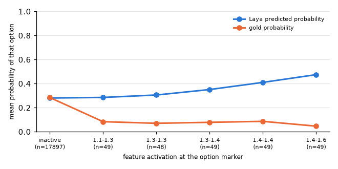

# Feature 7734

Critérios em que aparece: pred_error, pred_probe_right_laya_wrong

**Interpretação (preencher):** 

---

## Maiores ativações

**tr_invoice_processing_000194 / disposition** (choice, invoice_processing) | ativação 8.195 em `opção` | opções ['approve', 'hold', 'manual_review', 'reject'] | Laya: **approve** [0.412, 0.328, 0.024, 0.236] | gabarito: **approve**

```
<bos> choice question: How should this vendor invoice be dispositioned?<eos>
▸ <mask> approve: Matches the order and delivery; approve for payment.
▸ <mask> hold: Something needs confirming before payment; hold pending clarification.
▸ <mask> manual_review: A human in finance must review the discrepancy.
▸ <mask> reject:⟦ Should⟧ not be paid: duplicate, unauthorised or materially wrong.

<eos>

 {"delivery": {"condition": "accepted", "date": "2026-03-09", "received_qty": 1000}, "invoice": {"currency": "USD", "id": "INV-2026-6341", "lines": [{"qty": 1000, "sku": "SKU-622", "total_usd": 173280.0, "unit_usd": 173.28}], "total_usd": 173280.0, "vendor": "Acme Fabrication"}, "payment": {"days_until_due": -21, "discount_expires_in_days": null, "early_payment_discount_pct": null, "status": "overdue", "terms": "net 30"}, "purchase_order": {"freight_terms": "freight prepaid by vendor, not separately billable", "id": "PO-3528", "lines": [{"qty": 1000, "unit_usd": 173.28}], "total_usd": 173280.0}, "vendor_history": {"disputes_12m": 0, "invoices_12m": 11, "prior_invoice_ids": ["INV-2026-6341"]}}<eos>
```

**tr_invoice_processing_000243 / disposition** (choice, invoice_processing) | ativação 8.156 em `opção` | opções ['approve', 'hold', 'manual_review', 'reject'] | Laya: **reject** [0.416, 0.087, 0.021, 0.476] | gabarito: **manual_review**

```
<bos> choice question: How should this vendor invoice be dispositioned?<eos>
▸ <mask> approve: Matches the order and delivery; approve for payment.
▸ <mask> hold: Something needs confirming before payment; hold pending clarification.
▸ <mask> manual_review: A human in finance must review the discrepancy.
▸ <mask> reject:⟦ Should⟧ not be paid: duplicate, unauthorised or materially wrong.

<eos>

 {"delivery": {"condition": "accepted", "date": "2026-03-21", "received_qty": 1000}, "invoice": {"currency": "USD", "id": "INV-2026-2996", "lines": [{"qty": 1000, "sku": "SKU-704", "total_usd": 347130.0, "unit_usd": 347.13}, {"qty": 1, "sku": "FREIGHT", "total_usd": 328.32, "unit_usd": 328.32}], "total_usd": 347458.32, "vendor": "Orbit Logistics"}, "payment": {"days_until_due": 0, "discount_expires_in_days": null, "early_payment_discount_pct": null, "status": "scheduled", "terms": "net 30"}, "purchase_order": {"freight_terms": "freight prepaid by vendor, not separately billable", "id": "PO-9513", "lines": [{"qty": 1000, "unit_usd": 347.13}], "total_usd": 347130.0}, "vendor_history": {"disputes_12m": 2, "invoices_12m": 16, "prior_invoice_ids": ["INV-2026-2361", "INV-2026-8993", "INV-2026-3050"]}}<eos>
```

**tr_invoice_processing_000288 / disposition** (choice, invoice_processing) | ativação 8.156 em `opção` | opções ['approve', 'hold', 'manual_review', 'reject'] | Laya: **approve** [0.618, 0.157, 0.023, 0.202] | gabarito: **approve**

```
<bos> choice question: How should this vendor invoice be dispositioned?<eos>
▸ <mask> approve: Matches the order and delivery; approve for payment.
▸ <mask> hold: Something needs confirming before payment; hold pending clarification.
▸ <mask> manual_review: A human in finance must review the discrepancy.
▸ <mask> reject:⟦ Should⟧ not be paid: duplicate, unauthorised or materially wrong.

<eos>

 {"delivery": {"condition": "accepted", "date": "2026-03-18", "received_qty": 1000}, "invoice": {"currency": "USD", "id": "INV-2026-4845", "lines": [{"qty": 1000, "sku": "SKU-946", "total_usd": 365740.0, "unit_usd": 365.74}], "total_usd": 365740.0, "vendor": "Northwind Components"}, "payment": {"days_until_due": 18, "discount_expires_in_days": 1, "early_payment_discount_pct": 2.0, "status": "scheduled", "terms": "net 15"}, "purchase_order": {"freight_terms": "freight prepaid by vendor, not separately billable", "id": "PO-3908", "lines": [{"qty": 1000, "unit_usd": 365.74}], "total_usd": 365740.0}, "vendor_history": {"disputes_12m": 0, "invoices_12m": 45, "prior_invoice_ids": ["INV-2026-4845", "INV-2026-1550", "INV-2026-3604"]}}<eos>
```

**tr_invoice_processing_000146 / disposition** (choice, invoice_processing) | ativação 8.125 em `opção` | opções ['approve', 'hold', 'manual_review', 'reject'] | Laya: **approve** [0.44, 0.108, 0.019, 0.433] | gabarito: **manual_review**

```
<bos> choice question: How should this vendor invoice be dispositioned?<eos>
▸ <mask> approve: Matches the order and delivery; approve for payment.
▸ <mask> hold: Something needs confirming before payment; hold pending clarification.
▸ <mask> manual_review: A human in finance must review the discrepancy.
▸ <mask> reject:⟦ Should⟧ not be paid: duplicate, unauthorised or materially wrong.

<eos>

 {"delivery": {"condition": "accepted", "date": "2026-03-17", "received_qty": 395}, "invoice": {"currency": "USD", "id": "INV-2026-6069", "lines": [{"qty": 395, "sku": "SKU-242", "total_usd": 30533.5, "unit_usd": 77.3}], "total_usd": 30533.5, "vendor": "Vantage Materials"}, "payment": {"days_until_due": 44, "discount_expires_in_days": null, "early_payment_discount_pct": null, "status": "scheduled", "terms": "net 30"}, "purchase_order": {"freight_terms": "freight prepaid by vendor, not separately billable", "id": "PO-6112", "lines": [{"qty": 400, "unit_usd": 77.3}], "total_usd": 30920.0}, "vendor_history": {"disputes_12m": 5, "invoices_12m": 23, "prior_invoice_ids": ["INV-2026-2964", "INV-2026-3490", "INV-2026-7675"]}}<eos>
```

**tr_invoice_processing_000168 / disposition** (choice, invoice_processing) | ativação 8.117 em `opção` | opções ['approve', 'hold', 'manual_review', 'reject'] | Laya: **reject** [0.281, 0.045, 0.023, 0.65] | gabarito: **manual_review**

```
<bos> choice question: How should this vendor invoice be dispositioned?<eos>
▸ <mask> approve: Matches the order and delivery; approve for payment.
▸ <mask> hold: Something needs confirming before payment; hold pending clarification.
▸ <mask> manual_review: A human in finance must review the discrepancy.
▸ <mask> reject:⟦ Should⟧ not be paid: duplicate, unauthorised or materially wrong.

<eos>

 {"delivery": {"condition": "accepted with exceptions", "date": "2026-03-02", "received_qty": 100}, "invoice": {"currency": "USD", "id": "INV-2026-6227", "lines": [{"qty": 100, "sku": "SKU-366", "total_usd": 21767.0, "unit_usd": 217.67}, {"qty": 1, "sku": "FREIGHT", "total_usd": 1816.75, "unit_usd": 1816.75}], "total_usd": 23583.75, "vendor": "Orbit Logistics"}, "payment": {"days_until_due": 5, "discount_expires_in_days": null, "early_payment_discount_pct": null, "status": "scheduled", "terms": "net 45"}, "purchase_order": {"freight_terms": "freight prepaid by vendor, not separately billable", "id": "PO-9134", "lines": [{"qty": 100, "unit_usd": 217.67}], "total_usd": 21767.0}, "vendor_history": {"disputes_12m": 1, "invoices_12m": 40, "prior_invoice_ids": ["INV-2026-9709"]}}<eos>
```

## Ativações medianas (faixa 40-60%, mediana 1.406)

**tr_invoice_processing_000144 / urgency** (score, invoice_processing) | ativação 1.286 em `opção` | opções ['0', '1', '2', '3'] | Laya: **1** [0.121, 0.541, 0.202, 0.137] | gabarito: **2**

```
<bos> score question: How time-sensitive is processing this invoice?<eos>
▸ <mask> level 0: No time pressure; can wait indefinitely.
▸ <mask> level 1: Routine; handle within the normal queue.
▸ <mask> level 2: Elevated; should be handled within the same week.
▸ <mask> level 3⟦:⟧ Critical; requires action within the same day.

<eos>

 {"delivery": {"condition": "accepted", "date": "2026-03-03", "received_qty": 250}, "invoice": {"currency": "USD", "id": "INV-2026-4721", "lines": [{"qty": 250, "sku": "SKU-840", "total_usd": 80237.5, "unit_usd": 320.95}], "total_usd": 80237.5, "vendor": "Pallas Industrial"}, "payment": {"days_until_due": -9, "discount_expires_in_days": null, "early_payment_discount_pct": null, "status": "overdue", "terms": "net 60"}, "purchase_order": {"freight_terms": "freight prepaid by vendor, not separately billable", "id": null, "lines": [{"qty": 250, "unit_usd": 320.95}], "total_usd": 80237.5}, "vendor_history": {"disputes_12m": 1, "invoices_12m": 56, "prior_invoice_ids": ["INV-2026-5685", "INV-2026-2769"]}}<eos>
```

**tr_invoice_processing_000227 / urgency** (score, invoice_processing) | ativação 1.411 em `opção` | opções ['0', '1', '2', '3'] | Laya: **1** [0.112, 0.472, 0.273, 0.142] | gabarito: **2**

```
<bos> score question: How time-sensitive is processing this invoice?<eos>
▸ <mask> level 0⟦:⟧ No time pressure; can wait indefinitely.
▸ <mask> level 1: Routine; handle within the normal queue.
▸ <mask> level 2: Elevated; should be handled within the same week.
▸ <mask> level 3: Critical; requires action within the same day.

<eos>

 {"delivery": {"condition": "accepted with exceptions", "date": "2026-03-17", "received_qty": 1000}, "invoice": {"currency": "USD", "id": "INV-2026-8669", "lines": [{"qty": 1000, "sku": "SKU-950", "total_usd": 37210.0, "unit_usd": 37.21}], "total_usd": 37210.0, "vendor": "Orbit Logistics"}, "payment": {"days_until_due": -3, "discount_expires_in_days": null, "early_payment_discount_pct": null, "status": "overdue", "terms": "net 15"}, "purchase_order": {"freight_terms": "freight prepaid by vendor, not separately billable", "id": "PO-9424", "lines": [{"qty": 1000, "unit_usd": 37.21}], "total_usd": 37210.0}, "vendor_history": {"disputes_12m": 5, "invoices_12m": 27, "prior_invoice_ids": ["INV-2026-8669"]}}<eos>
```

**tr_invoice_processing_000212 / urgency** (score, invoice_processing) | ativação 1.517 em `opção` | opções ['0', '1', '2', '3'] | Laya: **1** [0.094, 0.478, 0.277, 0.15] | gabarito: **1**

```
<bos> score question: How time-sensitive is processing this invoice?<eos>
▸ <mask> level 0: No time pressure; can wait indefinitely.
▸ <mask> level 1: Routine; handle within the normal queue.
▸ <mask> level 2: Elevated; should be handled within the same week.
▸ <mask> level 3⟦:⟧ Critical; requires action within the same day.

<eos>

 {"delivery": {"condition": "accepted", "date": "2026-03-15", "received_qty": 50}, "invoice": {"currency": "USD", "id": "INV-2026-9746", "lines": [{"qty": 50, "sku": "SKU-109", "total_usd": 1888.0, "unit_usd": 37.76}], "total_usd": 1888.0, "vendor": "Kestrel Supply"}, "payment": {"days_until_due": 27, "discount_expires_in_days": null, "early_payment_discount_pct": null, "status": "scheduled", "terms": "net 60"}, "purchase_order": {"freight_terms": "freight prepaid by vendor, not separately billable", "id": "PO-9528", "lines": [{"qty": 50, "unit_usd": 26.97}], "total_usd": 1348.5}, "vendor_history": {"disputes_12m": 0, "invoices_12m": 31, "prior_invoice_ids": ["INV-2026-4023", "INV-2026-4752", "INV-2026-8633", "INV-2026-3220"]}}<eos>
```

**tr_agent_trace_observability_000133 / needs_review** (noul, agent_trace_observability) | ativação 1.362 em `opção` | opções ['false', 'true'] | Laya: **false** [0.852, 0.148] | gabarito: **false**

```
<bos> noul question: This trace requires human review.<eos>
▸ <mask> false⟦:⟧ No human attention is warranted.
▸ <mask> true: A human should inspect this run.

<eos>

 {"agent": {"autonomy": "dry_run", "model": "internal-agent-v3"}, "constraints": ["Do not force-push to any branch", "Never delete anything matching release/*"], "task": "Backfill missing analytics events for the last seven days.", "trace_summary": {"constraint_violations": 0, "duration_s": 155.3, "irreversible_actions": 0, "steps": 7, "tool_errors": 0}}<eos>
```

**tr_invoice_processing_000276 / disposition** (choice, invoice_processing) | ativação 1.343 em `opção` | opções ['approve', 'hold', 'manual_review', 'reject'] | Laya: **approve** [0.514, 0.19, 0.023, 0.273] | gabarito: **approve**

```
<bos> choice question: How should this vendor invoice be dispositioned?<eos>
▸ <mask> approve: Matches the order and delivery; approve for payment.
▸ <mask> hold: Something needs confirming before payment; hold pending clarification.
▸ <mask> manual_review: A human in finance must review the discrepancy.
▸ <mask> reject: Should⟦ not⟧ be paid: duplicate, unauthorised or materially wrong.

<eos>

 {"delivery": {"condition": "accepted", "date": "2026-03-02", "received_qty": 25}, "invoice": {"currency": "USD", "id": "INV-2026-4114", "lines": [{"qty": 25, "sku": "SKU-776", "total_usd": 6578.75, "unit_usd": 263.15}], "total_usd": 6578.75, "vendor": "Acme Fabrication"}, "payment": {"days_until_due": 0, "discount_expires_in_days": null, "early_payment_discount_pct": null, "status": "scheduled", "terms": "net 15"}, "purchase_order": {"freight_terms": "freight prepaid by vendor, not separately billable", "id": null, "lines": [{"qty": 25, "unit_usd": 263.15}], "total_usd": 6578.75}, "vendor_history": {"disputes_12m": 0, "invoices_12m": 8, "prior_invoice_ids": ["INV-2026-5447", "INV-2026-7281", "INV-2026-3201"]}}<eos>
```

## Estatísticas (conjunto de descoberta, dev e teste)

**pred / error**

| split | decisões | ativas | ativas e Laya errou | taxa | lift | q (BH) | OR (CMH) | q (CMH) |
|---|---|---|---|---|---|---|---|---|
| discovery | 5100 | 85 | 81 | 0.953 | 1.48 | 1.83e-10 | 2.03 | 0.517 |
| dev | 900 | 23 | 23 | 1.000 | 1.49 | 0.00159 | inf | 0.774 |
| test | 2000 | 31 | 29 | 0.935 | 1.44 | 0.00172 | 0.87 | 0.991 |

**corr / error**

| split | decisões | ativas | ativas e Laya errou | taxa | lift | q (BH) | OR (CMH) | q (CMH) |
|---|---|---|---|---|---|---|---|---|
| discovery | 5100 | 13 | 9 | 0.692 | 1.08 | nan | nan | nan |
| dev | 900 | 0 | 0 | nan | nan | nan | nan | nan |
| test | 2000 | 5 | 3 | 0.600 | 0.92 | nan | nan | nan |

**state / error**

| split | decisões | ativas | ativas e Laya errou | taxa | lift | q (BH) | OR (CMH) | q (CMH) |
|---|---|---|---|---|---|---|---|---|
| discovery | 5100 | 61 | 36 | 0.590 | 0.92 | 0.616 | 0.87 | 0.857 |
| dev | 900 | 16 | 10 | 0.625 | 0.93 | nan | nan | nan |
| test | 2000 | 23 | 13 | 0.565 | 0.87 | 0.777 | 0.74 | 0.833 |

**pred / probe_right_laya_wrong**

| split | decisões | ativas | ativas e Laya errou | taxa | lift | q (BH) | OR (CMH) | q (CMH) |
|---|---|---|---|---|---|---|---|---|
| discovery | 2932 | 39 | 39 | 1.000 | 1.65 | 3.09e-08 | inf | 0.631 |
| dev | 523 | 12 | 12 | 1.000 | 1.55 | nan | nan | nan |
| test | 1149 | 16 | 16 | 1.000 | 1.64 | nan | nan | nan |

**corr / probe_right_laya_wrong**

| split | decisões | ativas | ativas e Laya errou | taxa | lift | q (BH) | OR (CMH) | q (CMH) |
|---|---|---|---|---|---|---|---|---|
| discovery | 2932 | 0 | 0 | nan | nan | nan | nan | nan |
| dev | 523 | 0 | 0 | nan | nan | nan | nan | nan |
| test | 1149 | 0 | 0 | nan | nan | nan | nan | nan |

**state / probe_right_laya_wrong**

| split | decisões | ativas | ativas e Laya errou | taxa | lift | q (BH) | OR (CMH) | q (CMH) |
|---|---|---|---|---|---|---|---|---|
| discovery | 2932 | 41 | 27 | 0.659 | 1.09 | 0.718 | 1.31 | 0.663 |
| dev | 523 | 11 | 5 | 0.455 | 0.70 | nan | nan | nan |
| test | 1149 | 10 | 4 | 0.400 | 0.65 | nan | nan | nan |

Confusão mais sobre-representada (pred): `disposition|3>1` (n=27, lift 34.47, p=7.89e-38). Formato `pergunta|índice previsto>índice correto`.

Confusão mais sobre-representada (corr): `disposition|0>3` (n=8, lift 392.31, p=nan). Formato `pergunta|índice previsto>índice correto`.

Confusão mais sobre-representada (state): `disposition|0>2` (n=6, lift 8.65, p=5.69e-05). Formato `pergunta|índice previsto>índice correto`.



