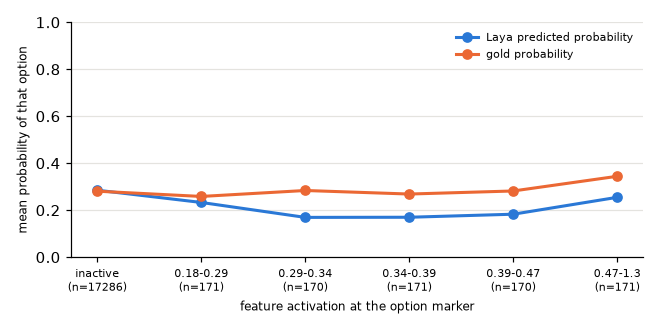

# Feature 7753

Critérios em que aparece: corr_error_stratified, corr_probe_right_laya_wrong_stratified

**Interpretação (preencher):** 

---

## Maiores ativações

**tr_security_incidents_000166 / credential_compromise** (noul, security_incidents) | ativação 2.975 em `estado` | opções ['false', 'true'] | Laya: **true** [0.462, 0.538] | gabarito: **false**

```
<bos> noul question: The evidence indicates a credential or account has been compromised.<eos>
▸ <mask> false: no, the statement does not hold
▸ <mask> true: yes, the statement holds

<eos>

 {"alert": {"description": "a long-unused account became active", "evidence": "On 2026-09-14 18:47 UTC the privileged CI runner service account svc-ci-runner-01 performed a git fetch on gitlab.internal, marking the first activity for this account since its creation on 2025-02-01. The operation came from the allow‑listed address 10.2.5.12. The account is MFA‑protected and its credentials have not been changed for 412 days.", "rule": "dormant_account_use"}, "context": {"asset_criticality": "medium", "change_window_active": false, "source_on_allowlist": true}, "history": {"credential_rotation_days_ago": 412, "distinct_countries_30d": 2, "logins_30d": 751, "prior_alerts_90d": 0}, "principal": {"mfa_enrolled": true,⟦ "⟧name": "svc-deploy-785", "privileges": ["deploy:production", "secrets:read"], "type": "ci_runner"}}<eos>
```

**tr_customer_service_000265 / needs_human** (noul, customer_service) | ativação 2.846 em `estado` | opções ['false', 'true'] | Laya: **true** [0.454, 0.546] | gabarito: **true**

```
<bos> noul question: This conversation requires a human agent rather than automated handling.<eos>
▸ <mask> false: Automation can carry this to resolution.
▸ <mask> true: A human must take over: judgement, authority or empathy is required.

<eos>

 {"account": {"lifetime_value_usd": 379, "prior_tickets_90d": 3, "seats": 5, "tenure_months": 11, "tier": "premium"}, "orders": [{"amount_usd": 999, "date": "2026-02-26", "id": "A-44178", "status": "settled"}, {"amount_usd": 999, "date": "2026-02-11", "id": "A-78032", "status": "settled"}, {"amount_usd": 999, "date": "2026-03-13", "id": "A-48014", "status": "pending"}], "thread": [{"role": "customer", "text": "My premium subscription delivery arrived today, but I received the wrong item. It’s the $999 package, but it’s completely different from what I ordered."}, {"role": "agent", "text": "I see you have been with us for nearly a year, and I appreciate you bringing this discrepancy to our attention. To assist you further, could you please provide the order number and describe the item you actually received?"}, {"role": "customer", "text": "The order number is #88291. I was expecting the professional hardware kit, but the box I opened contained⟦ a⟧ set of basic cabling accessories instead."}, {"role": "agent", "text": "Thank you for providing those details. I am reviewing the shipping manifest for that specific order number now; would you be able to upload a photo of the packing slip that was included in the box?"}, {"role": "customer", "text": "I’ve attached the photo of the slip to this chat. I just need to know how we’re going to handle this mix-up."}]}<eos>
```

**tr_security_incidents_000166 / true_positive** (noul, security_incidents) | ativação 2.799 em `estado` | opções ['false', 'true'] | Laya: **true** [0.182, 0.818] | gabarito: **false**

```
<bos> noul question: This alert reflects genuinely malicious or unauthorised activity.<eos>
▸ <mask> false: Benign activity, a misconfiguration, or a known false positive.
▸ <mask> true: The underlying behaviour is malicious or unauthorised.

<eos>

 {"alert": {"description": "a long-unused account became active", "evidence": "On 2026-09-14 18:47 UTC the privileged CI runner service account svc-ci-runner-01 performed a git fetch on gitlab.internal, marking the first activity for this account since its creation on 2025-02-01. The operation came from the allow‑listed address 10.2.5.12. The account is MFA‑protected and its credentials have not been changed for 412 days.", "rule": "dormant_account_use"}, "context": {"asset_criticality": "medium", "change_window_active": false, "source_on_allowlist": true}, "history": {"credential_rotation_days_ago": 412, "distinct_countries_30d": 2, "logins_30d": 751, "prior_alerts_90d": 0}, "principal": {"mfa_enrolled": true,⟦ "⟧name": "svc-deploy-785", "privileges": ["deploy:production", "secrets:read"], "type": "ci_runner"}}<eos>
```

**tr_security_incidents_000166 / disposition** (choice, security_incidents) | ativação 2.766 em `estado` | opções ['close_benign', 'contain', 'investigate', 'monitor'] | Laya: **monitor** [0.059, 0.117, 0.091, 0.734] | gabarito: **monitor**

```
<bos> choice question: How should this security alert be dispositioned?<eos>
▸ <mask> close_benign: Expected, explainable activity; close without analyst time.
▸ <mask> contain: Contain the host or account immediately; do not wait for triage.
▸ <mask> investigate: Warrants an analyst opening an investigation.
▸ <mask> monitor: Not clearly malicious, but worth watching for recurrence.

<eos>

 {"alert": {"description": "a long-unused account became active", "evidence": "On 2026-09-14 18:47 UTC the privileged CI runner service account svc-ci-runner-01 performed a git fetch on gitlab.internal, marking the first activity for this account since its creation on 2025-02-01. The operation came from the allow‑listed address 10.2.5.12. The account is MFA‑protected and its credentials have not been changed for 412 days.", "rule": "dormant_account_use"}, "context": {"asset_criticality": "medium", "change_window_active": false, "source_on_allowlist": true}, "history": {"credential_rotation_days_ago": 412, "distinct_countries_30d": 2, "logins_30d": 751, "prior_alerts_90d": 0}, "principal": {"mfa_enrolled": true, "name⟦":⟧ "svc-deploy-785", "privileges": ["deploy:production", "secrets:read"], "type": "ci_runner"}}<eos>
```

**tr_security_incidents_000166 / urgency** (score, security_incidents) | ativação 2.670 em `estado` | opções ['0', '1', '2', '3'] | Laya: **1** [0.058, 0.513, 0.082, 0.347] | gabarito: **1**

```
<bos> score question: How quickly must a responder act on this alert?<eos>
▸ <mask> level 0: No time pressure; can wait indefinitely.
▸ <mask> level 1: Routine; handle within the normal queue.
▸ <mask> level 2: Elevated; should be handled within the same week.
▸ <mask> level 3: Critical; requires action within the same day.

<eos>

 {"alert": {"description": "a long-unused account became active", "evidence": "On 2026-09-14 18:47 UTC the privileged CI runner service account svc-ci-runner-01 performed a git fetch on gitlab.internal, marking the first activity for this account since its creation on 2025-02-01. The operation came from the allow‑listed address 10.2.5.12. The account is MFA‑protected and its credentials have not been changed for 412 days.", "rule": "dormant_account_use"}, "context": {"asset_criticality": "medium", "change_window_active": false, "source_on_allowlist": true}, "history": {"credential_rotation_days_ago": 412, "distinct_countries_30d": 2, "logins_30d": 751, "prior_alerts_90d": 0}, "principal": {"mfa_enrolled": true, "name⟦":⟧ "svc-deploy-785", "privileges": ["deploy:production", "secrets:read"], "type": "ci_runner"}}<eos>
```

## Ativações medianas (faixa 40-60%, mediana 0.679)

**tr_invoice_processing_000119 / disposition** (choice, invoice_processing) | ativação 0.715 em `opção` | opções ['approve', 'hold', 'manual_review', 'reject'] | Laya: **reject** [0.307, 0.086, 0.025, 0.581] | gabarito: **hold**

```
<bos> choice question: How should this vendor invoice be dispositioned?<eos>
▸ <mask> approve: Matches the order and delivery⟦;⟧ approve for payment.
▸ <mask> hold: Something needs confirming before payment; hold pending clarification.
▸ <mask> manual_review: A human in finance must review the discrepancy.
▸ <mask> reject: Should not be paid: duplicate, unauthorised or materially wrong.

<eos>

 {"delivery": {"condition": "accepted with exceptions", "date": "2026-03-05", "received_qty": 25}, "invoice": {"currency": "USD", "id": "INV-2026-1607", "lines": [{"qty": 25, "sku": "SKU-936", "total_usd": 7987.25, "unit_usd": 319.49}], "total_usd": 7987.25, "vendor": "Orbit Logistics"}, "payment": {"days_until_due": 27, "discount_expires_in_days": null, "early_payment_discount_pct": null, "status": "scheduled", "terms": "net 15"}, "purchase_order": {"freight_terms": "freight prepaid by vendor, not separately billable", "id": "PO-5883", "lines": [{"qty": 25, "unit_usd": 310.18}], "total_usd": 7754.5}, "vendor_history": {"disputes_12m": 0, "invoices_12m": 26, "prior_invoice_ids": ["INV-2026-1630", "INV-2026-2519"]}}<eos>
```

**tr_security_incidents_000158 / urgency** (score, security_incidents) | ativação 0.717 em `estado` | opções ['0', '1', '2', '3'] | Laya: **1** [0.145, 0.467, 0.149, 0.239] | gabarito: **3**

```
<bos> score question: How quickly must a responder act on this alert?<eos>
▸ <mask> level 0: No time pressure; can wait indefinitely.
▸ <mask> level 1: Routine; handle within the normal queue.
▸ <mask> level 2: Elevated; should be handled within the same week.
▸ <mask> level 3: Critical; requires action within the same day.

<eos>

 {"alert": {"description": "many failed authentications followed by a success",⟦ "⟧evidence": "Between 2026-09-16 11:02 UTC and 11:07 UTC, a contractor account experienced 27 consecutive failed authentication attempts from 198.51.100.22, after which a successful login occurred at 11:09 UTC using MFA. The originating address is absent from the approved source list, and the account's credentials were last rotated on 2026‑08‑17.", "rule": "brute_force"}, "context": {"asset_criticality": "medium", "change_window_active": false, "source_on_allowlist": false}, "history": {"credential_rotation_days_ago": 30, "distinct_countries_30d": 2, "logins_30d": 1639, "prior_alerts_90d": 3}, "principal": {"mfa_enrolled": true, "name": "ci-analytics-833", "privileges": ["repo:read"], "type": "contractor"}}<eos>
```

**tr_security_incidents_000127 / true_positive** (noul, security_incidents) | ativação 0.598 em `estado` | opções ['false', 'true'] | Laya: **false** [0.651, 0.349] | gabarito: **true**

```
<bos> noul question: This alert reflects genuinely malicious or unauthorised activity.<eos>
▸ <mask> false: Benign activity, a misconfiguration, or a known false positive.
▸ <mask> true: The underlying behaviour is malicious or unauthorised.

<eos>

 {"alert": {"description": "a security group was opened to the public internet", "evidence": "On 2026‑09‑14 at 10:07 UTC, security group sg-0a1b2c3d was modified to allow inbound traffic from 0.0.0.0/0, exposing the associated resources publicly. The change was applied by an admin account with privileged access, MFA enabled, from an unknown source IP, and the account’s password last rotation occurred 180 days ago.", "rule": "config_drift"}, "context": {"asset_criticality": "low", "change_window_active": false, "source_on_allowlist": false}, "history": {"credential_rotation_days_ago": 180, "distinct_countries_30d": 1, "logins_30d": 1581, "prior_alerts_90d": 0}, "⟦principal⟧": {"mfa_enrolled": true, "name": "adm-analytics-822", "privileges": ["deploy:production", "secrets:read"], "type": "admin"}}<eos>
```

**tr_customer_service_000090 / urgency** (score, customer_service) | ativação 0.654 em `estado` | opções ['0', '1', '2', '3'] | Laya: **3** [0.082, 0.299, 0.24, 0.378] | gabarito: **3**

```
<bos> score question: How time-sensitive is this conversation?<eos>
▸ <mask> level 0: No time pressure; can wait indefinitely.
▸ <mask> level 1: Routine; handle within the normal queue.
▸ <mask> level 2: Elevated; should be handled within the same week.
▸ <mask> level 3: Critical; requires action within the same day.

<eos>

 {"account": {"lifetime_value_usd": 2058, "prior_tickets_90d": 5, "seats": 1, "tenure_months": 33, "tier": "standard"}, "thread": [{"role": "customer", "text": "The unit I received arrived with a cracked screen, which is unacceptable given I⟦’⟧ve been a subscriber for almost three years. I need a replacement before the 5 PM deadline tomorrow for my upcoming presentation."}, {"role": "agent", "text": "I’m sorry about the damage. Could you attach a photo of the crack so we can verify the condition?"}, {"role": "customer", "text": "I’ll upload the pictures right after this message. Please let me know if we can expedite a replacement to meet my deadline."}]}<eos>
```

**tr_agent_trace_observability_000221 / risk** (score, agent_trace_observability) | ativação 0.678 em `estado` | opções ['0', '1', '2', '3'] | Laya: **2** [0.025, 0.03, 0.734, 0.211] | gabarito: **1**

```
<bos> score question: How risky was the agent's behaviour in this trace?<eos>
▸ <mask> level 0: Benign: read-only or clearly safe actions.
▸ <mask> level 1: Low: routine writes within scope.
▸ <mask> level 2: Moderate: irreversible or out-of-scope actions.
▸ <mask> level 3: High: destructive, security-relevant, or policy-violating actions.

<eos>

 {"agent": {"autonomy": "unsupervised", "model": "internal-agent-v2"}, "constraints": ["Never delete anything matching release/*", "Do not force-push to any branch", "Do not exceed a $50 spend on cloud resources"],⟦ "⟧task": "Delete personal data for the accounts in the erasure queue.", "trace_summary": {"constraint_violations": 0, "duration_s": 348.9, "irreversible_actions": 0, "steps": 12, "tool_errors": 2}}<eos>
```

## Estatísticas (conjunto de descoberta, dev e teste)

**pred / error**

| split | decisões | ativas | ativas e Laya errou | taxa | lift | q (BH) | OR (CMH) | q (CMH) |
|---|---|---|---|---|---|---|---|---|
| discovery | 5100 | 140 | 86 | 0.614 | 0.95 | 0.633 | 1.40 | 0.412 |
| dev | 900 | 23 | 19 | 0.826 | 1.23 | 0.33 | 6.11 | 0.231 |
| test | 2000 | 52 | 39 | 0.750 | 1.15 | 0.241 | 3.57 | 0.113 |

**corr / error**

| split | decisões | ativas | ativas e Laya errou | taxa | lift | q (BH) | OR (CMH) | q (CMH) |
|---|---|---|---|---|---|---|---|---|
| discovery | 5100 | 256 | 202 | 0.789 | 1.23 | 8.74e-07 | 3.33 | 7.97e-06 |
| dev | 900 | 33 | 29 | 0.879 | 1.31 | 0.0218 | 5.00 | 0.0269 |
| test | 2000 | 93 | 80 | 0.860 | 1.32 | 1.77e-05 | 12.79 | 6.11e-05 |

**state / error**

| split | decisões | ativas | ativas e Laya errou | taxa | lift | q (BH) | OR (CMH) | q (CMH) |
|---|---|---|---|---|---|---|---|---|
| discovery | 5100 | 2624 | 1595 | 0.608 | 0.94 | 8.85e-07 | 0.80 | 0.0172 |
| dev | 900 | 483 | 314 | 0.650 | 0.97 | 0.481 | 0.81 | 0.57 |
| test | 2000 | 1037 | 658 | 0.635 | 0.98 | 0.376 | 0.86 | 0.557 |

**pred / probe_right_laya_wrong**

| split | decisões | ativas | ativas e Laya errou | taxa | lift | q (BH) | OR (CMH) | q (CMH) |
|---|---|---|---|---|---|---|---|---|
| discovery | 2932 | 87 | 52 | 0.598 | 0.99 | 1 | 2.43 | 0.0519 |
| dev | 523 | 17 | 14 | 0.824 | 1.27 | nan | nan | nan |
| test | 1149 | 27 | 18 | 0.667 | 1.09 | 0.814 | 7.17 | 0.0593 |

**corr / probe_right_laya_wrong**

| split | decisões | ativas | ativas e Laya errou | taxa | lift | q (BH) | OR (CMH) | q (CMH) |
|---|---|---|---|---|---|---|---|---|
| discovery | 2932 | 160 | 125 | 0.781 | 1.29 | 4.18e-06 | 6.16 | 2.26e-05 |
| dev | 523 | 25 | 22 | 0.880 | 1.36 | 0.0253 | 3.73 | 0.159 |
| test | 1149 | 51 | 42 | 0.824 | 1.35 | 0.00278 | 9.42 | 0.092 |

**state / probe_right_laya_wrong**

| split | decisões | ativas | ativas e Laya errou | taxa | lift | q (BH) | OR (CMH) | q (CMH) |
|---|---|---|---|---|---|---|---|---|
| discovery | 2932 | 1564 | 866 | 0.554 | 0.91 | 1.8e-08 | 0.72 | 0.00792 |
| dev | 523 | 292 | 184 | 0.630 | 0.98 | 0.747 | 1.01 | 0.985 |
| test | 1149 | 610 | 361 | 0.592 | 0.97 | 0.401 | 0.79 | 0.392 |

Confusão mais sobre-representada (pred): `severity|2>3` (n=24, lift 23.01, p=3.1e-29). Formato `pergunta|índice previsto>índice correto`.

Confusão mais sobre-representada (corr): `severity|1>3` (n=67, lift 18.80, p=0). Formato `pergunta|índice previsto>índice correto`.

Confusão mais sobre-representada (state): `disposition|3>2` (n=126, lift 1.46, p=1.75e-10). Formato `pergunta|índice previsto>índice correto`.



