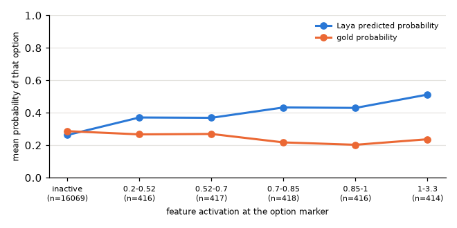

# Feature 7872

Critérios em que aparece: attribution_toward_wrong

**Interpretação (preencher):** 

---

## Maiores ativações

**tr_customer_service_000264 / churn_risk** (score, customer_service) | ativação 7.934 em `opção` | opções ['0', '1', '2', '3'] | Laya: **2** [0.151, 0.375, 0.412, 0.062] | gabarito: **2**

```
<bos> score question: How likely is this customer to stop doing business with us because of this interaction?<eos>
▸ <mask> level 0: No sign of dissatisfaction.
▸ <mask> level 1: Mild frustration,⟦ but⟧ the relationship is intact.
▸ <mask> level 2: Clearly unhappy; repeat problems or explicit complaints.
▸ <mask> level 3: Imminent: threatening to cancel, dispute or leave.

<eos>

 {"account": {"lifetime_value_usd": 166, "prior_tickets_90d": 2, "seats": 1, "tenure_months": 3, "tier": "standard"}, "thread": [{"role": "customer", "text": "I’m looking at my statement and see I’ve been hit with another duplicate charge for my standard plan. This is the third time now, and those last two tickets I opened resulted in absolutely nothing but empty promises from your team."}, {"role": "agent", "text": "I understand how frustrating it is to see recurring billing issues like this, and I apologize that your previous experience hasn't met expectations. Could you please provide the dates of those specific charges so I can pull up the transaction history?"}, {"role": "customer", "text": "It’s happened on the 15th of each of the last three months. I've already sent these dates in twice before, so I’m really not sure why you need them again."}, {"role": "agent", "text": "Thank you for clarifying that timeline. I am currently cross-referencing your billing records with the account activity; could you confirm if you have received any automated notification emails regarding these specific transaction dates?"}, {"role": "customer", "text": "I haven't seen a single email about these charges, which is exactly why this is so confusing. I’m just trying to get this sorted out once and for all."}]}<eos>
```

**tr_customer_service_000251 / churn_risk** (score, customer_service) | ativação 7.586 em `opção` | opções ['0', '1', '2', '3'] | Laya: **0** [0.739, 0.165, 0.089, 0.007] | gabarito: **1**

```
<bos> score question: How likely is this customer to stop doing business with us because of this interaction?<eos>
▸ <mask> level 0: No sign of dissatisfaction.
▸ <mask> level 1: Mild frustration,⟦ but⟧ the relationship is intact.
▸ <mask> level 2: Clearly unhappy; repeat problems or explicit complaints.
▸ <mask> level 3: Imminent: threatening to cancel, dispute or leave.

<eos>

 {"account": {"lifetime_value_usd": 173, "prior_tickets_90d": 0, "seats": 3, "tenure_months": 2, "tier": "enterprise"}, "orders": [{"amount_usd": 38, "date": "2026-02-05", "id": "A-71684", "status": "settled"}], "thread": [{"role": "customer", "text": "Our team’s been dealing with extremely slow load times on the dashboard for the past few days; everything feels laggy, and it’s hampering our workflow."}, {"role": "agent", "text": "I understand how frustrating that can be; can you tell me if the slowdown occurs on specific pages or across the entire platform?"}, {"role": "customer", "text": "It’s pretty much everywhere—reports, the analytics view, even the basic settings page takes ages to render."}, {"role": "agent", "text": "Got it. Have you noticed any pattern, like the issue worsening at certain times of day or after particular actions?"}, {"role": "customer", "text": "It seems constant, though it does feel a bit worse during our peak usage windows around 10 AM UTC."}, {"role": "agent", "text": "Thanks for that detail. Are you accessing the service via a VPN or any corporate proxy that might affect latency?"}, {"role": "customer", "text": "We use our standard corporate VPN, which we’ve used without problems before, so I’m not sure if that’s a factor."}]}<eos>
```

**tr_customer_service_000238 / churn_risk** (score, customer_service) | ativação 7.438 em `opção` | opções ['0', '1', '2', '3'] | Laya: **2** [0.153, 0.324, 0.474, 0.048] | gabarito: **2**

```
<bos> score question: How likely is this customer to stop doing business with us because of this interaction?<eos>
▸ <mask> level 0: No sign of dissatisfaction.
▸ <mask> level 1: Mild frustration,⟦ but⟧ the relationship is intact.
▸ <mask> level 2: Clearly unhappy; repeat problems or explicit complaints.
▸ <mask> level 3: Imminent: threatening to cancel, dispute or leave.

<eos>

 {"account": {"lifetime_value_usd": 699, "prior_tickets_90d": 0, "seats": 12, "tenure_months": 19, "tier": "premium"}, "orders": [{"amount_usd": 49, "date": "2026-02-27", "id": "A-61611", "status": "failed"}, {"amount_usd": 49, "date": "2026-03-13", "id": "A-63348", "status": "settled"}], "thread": [{"role": "customer", "text": "The dashboard has been taking nearly two minutes to load every morning this week. I have a presentation at noon, but I suppose it’s just how things are now."}, {"role": "agent", "text": "I understand how frustrating that latency must be. To help me investigate, could you tell me if you are experiencing this slow-down on a specific browser or connection?"}, {"role": "customer", "text": "It’s the same on Chrome and Firefox, regardless of my network. I’ve been paying for the premium tier for a long time, but it doesn't seem to make much of a difference."}]}<eos>
```

**tr_customer_service_000177 / churn_risk** (score, customer_service) | ativação 6.527 em `opção` | opções ['0', '1', '2', '3'] | Laya: **1** [0.099, 0.702, 0.147, 0.053] | gabarito: **2**

```
<bos> score question: How likely is this customer to stop doing business with us because of this interaction?<eos>
▸ <mask> level 0: No sign of dissatisfaction.
▸ <mask> level 1: Mild frustration,⟦ but⟧ the relationship is intact.
▸ <mask> level 2: Clearly unhappy; repeat problems or explicit complaints.
▸ <mask> level 3: Imminent: threatening to cancel, dispute or leave.

<eos>

 {"account": {"lifetime_value_usd": 1494, "prior_tickets_90d": 3, "seats": 1, "tenure_months": 26, "tier": "enterprise"}, "orders": [{"amount_usd": 49, "date": "2026-01-07", "id": "A-11099", "status": "failed"}, {"amount_usd": 49, "date": "2026-02-23", "id": "A-83844", "status": "refunded"}], "thread": [{"role": "customer", "text": "I'm furious that my data export still isn't ready. My deadline is tomorrow and I've been waiting for weeks!"}, {"role": "agent", "text": "I understand how frustrating this is. Could you provide your enterprise account ID and specify the exact export format you need?"}, {"role": "customer", "text": "My account is the enterprise one, 26 months with you, and I need the full CSV of all transactions, not this half‑baked JSON you sent before."}, {"role": "agent", "text": "Got it. Please confirm the date range for the export and the email address where you’d like us to send it."}, {"role": "customer", "text": "Send it to my corporate email now; I don't have time for more back‑and‑forth."}]}<eos>
```

**tr_customer_service_000215 / churn_risk** (score, customer_service) | ativação 6.395 em `opção` | opções ['0', '1', '2', '3'] | Laya: **0** [0.365, 0.209, 0.303, 0.122] | gabarito: **1**

```
<bos> score question: How likely is this customer to stop doing business with us because of this interaction?<eos>
▸ <mask> level 0: No sign of dissatisfaction.
▸ <mask> level 1: Mild frustration,⟦ but⟧ the relationship is intact.
▸ <mask> level 2: Clearly unhappy; repeat problems or explicit complaints.
▸ <mask> level 3: Imminent: threatening to cancel, dispute or leave.

<eos>

 {"account": {"lifetime_value_usd": 182, "prior_tickets_90d": 1, "seats": 1, "tenure_months": 8, "tier": "free"}, "thread": [{"role": "customer", "text": "Managing seats on the free tier is a nightmare—every time I try to add or remove a user, the UI freezes and I lose my changes."}, {"role": "agent", "text": "That definitely isn’t the experience we want you to have. Could you let me know exactly where in the seat management page the freeze occurs?"}, {"role": "customer", "text": "It happens when I hit ‘Add new seat’ and also when I click the trash can icon to delete a user. The screen just spins and never updates."}, {"role": "agent", "text": "Thanks for the specifics. Are you seeing any error messages in the browser console, or does it just stay on the loading spinner?"}, {"role": "customer", "text": "No error pop‑ups, just the endless spinner. I’ve been on the free plan for eight months and this is the only time I’ve run into such a problem."}]}<eos>
```

## Ativações medianas (faixa 40-60%, mediana 0.788)

**tr_invoice_processing_000184 / matches_order** (noul, invoice_processing) | ativação 0.891 em `estado` | opções ['false', 'true'] | Laya: **true** [0.036, 0.964] | gabarito: **true**

```
<bos> noul question: The invoice reconciles with the purchase order and the recorded delivery.<eos>
▸ <mask> false: There is a discrepancy against the order or the delivery.
▸ <mask> true: Line items, quantities and amounts reconcile.

<eos>

 {"delivery": {"condition": "accepted with exceptions", "date": "2026-03-25", "received_qty": 25}, "invoice": {"currency": "USD", "id": "INV-2026-6432", "lines": [{"qty": 25, "sku": "SKU-453", "total_usd": 826⟦0⟧.5, "unit_usd": 330.42}], "total_usd": 8260.5, "vendor": "Acme Fabrication"}, "payment": {"days_until_due": 27, "discount_expires_in_days": null, "early_payment_discount_pct": null, "status": "scheduled", "terms": "net 30"}, "purchase_order": {"freight_terms": "freight prepaid by vendor, not separately billable", "id": "PO-9538", "lines": [{"qty": 25, "unit_usd": 330.42}], "total_usd": 8260.5}, "vendor_history": {"disputes_12m": 0, "invoices_12m": 57, "prior_invoice_ids": ["INV-2026-8793"]}}<eos>
```

**tr_invoice_processing_000010 / urgency** (score, invoice_processing) | ativação 0.817 em `estado` | opções ['0', '1', '2', '3'] | Laya: **1** [0.099, 0.438, 0.301, 0.161] | gabarito: **1**

```
<bos> score question: How time-sensitive is processing this invoice?<eos>
▸ <mask> level 0: No time pressure; can wait indefinitely.
▸ <mask> level 1: Routine; handle within the normal queue.
▸ <mask> level 2: Elevated; should be handled within the same week.
▸ <mask> level 3: Critical; requires action within the same day.

<eos>

 {"delivery": {"condition": "accepted", "date": "2026-03-03", "received_qty": 25}, "invoice": {"currency": "USD", "id": "INV-2026-2741⟦",⟧ "lines": [{"qty": 25, "sku": "SKU-184", "total_usd": 8079.5, "unit_usd": 323.18}], "total_usd": 8079.5, "vendor": "Northwind Components"}, "payment": {"days_until_due": 11, "discount_expires_in_days": null, "early_payment_discount_pct": null, "status": "scheduled", "terms": "net 45"}, "purchase_order": {"freight_terms": "freight prepaid by vendor, not separately billable", "id": "PO-1829", "lines": [{"qty": 25, "unit_usd": 323.18}], "total_usd": 8079.5}, "vendor_history": {"disputes_12m": 2, "invoices_12m": 52, "prior_invoice_ids": ["INV-2026-7791", "INV-2026-6320", "INV-2026-2697"]}}<eos>
```

**tr_invoice_processing_000211 / duplicate** (noul, invoice_processing) | ativação 0.848 em `estado` | opções ['false', 'true'] | Laya: **true** [0.02, 0.98] | gabarito: **false**

```
<bos> noul question: This invoice appears to duplicate an invoice already submitted.<eos>
▸ <mask> false: no, the statement does not hold
▸ <mask> true: yes, the statement holds

<eos>

 {"delivery": {"condition": "accepted", "date": "2026-03-13",⟦ "⟧received_qty": 250}, "invoice": {"currency": "USD", "id": "INV-2026-3915", "lines": [{"qty": 250, "sku": "SKU-253", "total_usd": 8630.0, "unit_usd": 34.52}], "total_usd": 8630.0, "vendor": "Northwind Components"}, "payment": {"days_until_due": 18, "discount_expires_in_days": 8, "early_payment_discount_pct": 2.0, "status": "scheduled", "terms": "net 15"}, "purchase_order": {"freight_terms": "freight prepaid by vendor, not separately billable", "id": "PO-7813", "lines": [{"qty": 250, "unit_usd": 34.52}], "total_usd": 8630.0}, "vendor_history": {"disputes_12m": 0, "invoices_12m": 13, "prior_invoice_ids": ["INV-2026-9545", "INV-2026-2014", "INV-2026-4515", "INV-2026-1956"]}}<eos>
```

**tr_invoice_processing_000226 / discrepancy_severity** (score, invoice_processing) | ativação 0.812 em `estado` | opções ['0', '1', '2', '3'] | Laya: **2** [0.088, 0.311, 0.538, 0.063] | gabarito: **3**

```
<bos> score question: How material is any discrepancy between the invoice, the order and the delivery?<eos>
▸ <mask> level 0: None: everything reconciles.
▸ <mask> level 1: Trivial: rounding or a cosmetic difference.
▸ <mask> level 2: Moderate: a real difference worth confirming.
▸ <mask> level 3: Material: a large or unexplained difference.

<eos>

 {"delivery": {"condition": "accepted", "date": "2026-03-05", "received_qty": 400}, "invoice": {"currency": "USD", "id": "INV-2026-2809",⟦ "⟧lines": [{"qty": 400, "sku": "SKU-223", "total_usd": 7260.0, "unit_usd": 18.15}, {"qty": 1, "sku": "FREIGHT", "total_usd": 1723.25, "unit_usd": 1723.25}], "total_usd": 8983.25, "vendor": "Acme Fabrication"}, "payment": {"days_until_due": 11, "discount_expires_in_days": null, "early_payment_discount_pct": null, "status": "scheduled", "terms": "net 30"}, "purchase_order": {"freight_terms": "freight prepaid by vendor, not separately billable", "id": "PO-8525", "lines": [{"qty": 400, "unit_usd": 18.15}], "total_usd": 7260.0}, "vendor_history": {"disputes_12m": 0, "invoices_12m": 41, "prior_invoice_ids": ["INV-2026-1925", "INV-2026-5375"]}}<eos>
```

**tr_customer_service_000058 / needs_human** (noul, customer_service) | ativação 0.834 em `estado` | opções ['false', 'true'] | Laya: **false** [0.794, 0.206] | gabarito: **false**

```
<bos> noul question: This conversation requires a human agent rather than automated handling.<eos>
▸ <mask> false: Automation can carry this to resolution.
▸ <mask> true: A human must take over: judgement, authority or empathy is required.

<eos>

 {"account": {"lifetime_value_usd": 386, "prior_tickets_90d": 0, "seats": 3, "tenure_months": 5, "tier": "enterprise"}, "orders": [{"amount_usd": 49, "date": "2026-03-18", "id": "A-70177", "status": "refunded"}, {"amount_usd": 49, "date": "2026-01-12", "id": "A-80512", "status": "refunded"}, {"amount⟦_⟧usd": 49, "date": "2026-03-04", "id": "A-71911", "status": "failed"}], "thread": [{"role": "customer", "text": "I’d like to request a data export from our account; I’m not in a rush, just need to know the steps."}, {"role": "agent", "text": "Sure thing. Which format would you prefer for the export?"}, {"role": "customer", "text": "CSV works for us. Also, could you tell me roughly how long the process takes?"}, {"role": "agent", "text": "I’ll check on the timing. Do you need the export for a specific date range?"}, {"role": "customer", "text": "Just the last month up to today, and I understand it may not be immediate."}, {"role": "agent", "text": "Thanks for confirming. I’ll queue the request and let you know when it’s ready. Anything else you’d like to add?"}, {"role": "customer", "text": "That’s all for now, thank you."}]}<eos>
```

## Estatísticas (conjunto de descoberta, dev e teste)

**pred / error**

| split | decisões | ativas | ativas e Laya errou | taxa | lift | q (BH) | OR (CMH) | q (CMH) |
|---|---|---|---|---|---|---|---|---|
| discovery | 5100 | 1166 | 806 | 0.691 | 1.07 | 0.000389 | 0.81 | 0.458 |
| dev | 900 | 219 | 155 | 0.708 | 1.05 | 0.418 | 0.73 | 0.774 |
| test | 2000 | 469 | 336 | 0.716 | 1.10 | 0.00227 | 0.65 | 0.496 |

**corr / error**

| split | decisões | ativas | ativas e Laya errou | taxa | lift | q (BH) | OR (CMH) | q (CMH) |
|---|---|---|---|---|---|---|---|---|
| discovery | 5100 | 493 | 133 | 0.270 | 0.42 | 5.05e-69 | 0.15 | 2.13e-20 |
| dev | 900 | 85 | 21 | 0.247 | 0.37 | 1.85e-15 | 0.19 | 0.00967 |
| test | 2000 | 181 | 48 | 0.265 | 0.41 | 8.38e-27 | 0.11 | 1.01e-07 |

**state / error**

| split | decisões | ativas | ativas e Laya errou | taxa | lift | q (BH) | OR (CMH) | q (CMH) |
|---|---|---|---|---|---|---|---|---|
| discovery | 5100 | 2161 | 1387 | 0.642 | 1.00 | 0.924 | 0.92 | 0.59 |
| dev | 900 | 435 | 286 | 0.657 | 0.98 | 0.764 | 0.53 | 0.0953 |
| test | 2000 | 900 | 580 | 0.644 | 0.99 | 0.87 | 0.79 | 0.326 |

**pred / probe_right_laya_wrong**

| split | decisões | ativas | ativas e Laya errou | taxa | lift | q (BH) | OR (CMH) | q (CMH) |
|---|---|---|---|---|---|---|---|---|
| discovery | 2932 | 577 | 380 | 0.659 | 1.09 | 0.00742 | 0.66 | 0.247 |
| dev | 523 | 111 | 76 | 0.685 | 1.06 | 0.569 | 0.56 | 0.657 |
| test | 1149 | 228 | 161 | 0.706 | 1.16 | 0.00307 | 0.60 | 0.45 |

**corr / probe_right_laya_wrong**

| split | decisões | ativas | ativas e Laya errou | taxa | lift | q (BH) | OR (CMH) | q (CMH) |
|---|---|---|---|---|---|---|---|---|
| discovery | 2932 | 248 | 51 | 0.206 | 0.34 | 1.86e-39 | 0.12 | 5.06e-14 |
| dev | 523 | 42 | 7 | 0.167 | 0.26 | 6.88e-10 | 0.14 | 0.148 |
| test | 1149 | 80 | 13 | 0.162 | 0.27 | 3.93e-16 | 0.06 | 1.86e-05 |

**state / probe_right_laya_wrong**

| split | decisões | ativas | ativas e Laya errou | taxa | lift | q (BH) | OR (CMH) | q (CMH) |
|---|---|---|---|---|---|---|---|---|
| discovery | 2932 | 1332 | 819 | 0.615 | 1.02 | 0.489 | 0.83 | 0.216 |
| dev | 523 | 273 | 177 | 0.648 | 1.00 | 1 | 0.45 | 0.0486 |
| test | 1149 | 561 | 344 | 0.613 | 1.00 | 1 | 0.74 | 0.247 |

Confusão mais sobre-representada (pred): `discrepancy_severity|2>0` (n=108, lift 4.37, p=0). Formato `pergunta|índice previsto>índice correto`.

Confusão mais sobre-representada (corr): `outcome|0>3` (n=26, lift 10.34, p=2.26e-27). Formato `pergunta|índice previsto>índice correto`.

Confusão mais sobre-representada (state): `duplicate|1>0` (n=203, lift 2.21, p=0). Formato `pergunta|índice previsto>índice correto`.



