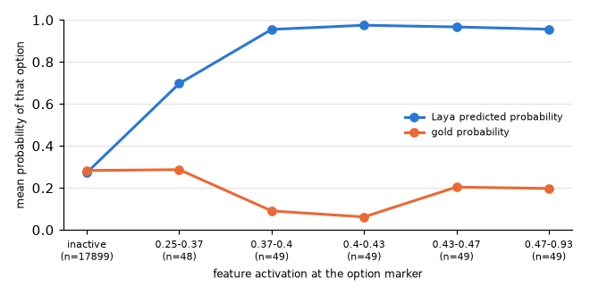

# Feature 8034

Critérios em que aparece: pred_probe_right_laya_wrong

**Interpretação (preencher):** 

---

## Maiores ativações

**tr_security_incidents_000120 / credential_compromise** (noul, security_incidents) | ativação 2.180 em `estado` | opções ['false', 'true'] | Laya: **true** [0.017, 0.983] | gabarito: **true**

```
<bos> noul question: The evidence indicates a credential or account has been compromised.<eos>
▸ <mask> false: no, the statement does not hold
▸ <mask> true: yes, the statement holds

<eos>

 {"alert": {"description": "an endpoint agent matched a known signature", "evidence": "The endpoint agent on CI runner host 'runner-7x2' identified a signature match for 'malware.linux⟦.⟧syslog' during an active session. This connection originated from an unrecognized IP address (203.0.113.88) using unprivileged credentials that were last rotated 90 days ago.", "rule": "malware_signature"}, "context": {"asset_criticality": "high", "change_window_active": false, "source_on_allowlist": false}, "history": {"credential_rotation_days_ago": 90, "distinct_countries_30d": 1, "logins_30d": 1882, "prior_alerts_90d": 8}, "principal": {"mfa_enrolled": true, "name": "usr-billing-642", "privileges": ["repo:read"], "type": "ci_runner"}}<eos>
```

**tr_security_incidents_000120 / urgency** (score, security_incidents) | ativação 2.070 em `estado` | opções ['0', '1', '2', '3'] | Laya: **3** [0.133, 0.315, 0.2, 0.351] | gabarito: **3**

```
<bos> score question: How quickly must a responder act on this alert?<eos>
▸ <mask> level 0: No time pressure; can wait indefinitely.
▸ <mask> level 1: Routine; handle within the normal queue.
▸ <mask> level 2: Elevated; should be handled within the same week.
▸ <mask> level 3: Critical; requires action within the same day.

<eos>

 {"alert": {"description": "an endpoint agent matched a known signature", "evidence": "The endpoint agent on CI runner host 'runner-7x2' identified a signature match for 'malware.linux⟦.⟧syslog' during an active session. This connection originated from an unrecognized IP address (203.0.113.88) using unprivileged credentials that were last rotated 90 days ago.", "rule": "malware_signature"}, "context": {"asset_criticality": "high", "change_window_active": false, "source_on_allowlist": false}, "history": {"credential_rotation_days_ago": 90, "distinct_countries_30d": 1, "logins_30d": 1882, "prior_alerts_90d": 8}, "principal": {"mfa_enrolled": true, "name": "usr-billing-642", "privileges": ["repo:read"], "type": "ci_runner"}}<eos>
```

**tr_security_incidents_000120 / true_positive** (noul, security_incidents) | ativação 2.039 em `estado` | opções ['false', 'true'] | Laya: **true** [0.065, 0.935] | gabarito: **true**

```
<bos> noul question: This alert reflects genuinely malicious or unauthorised activity.<eos>
▸ <mask> false: Benign activity, a misconfiguration, or a known false positive.
▸ <mask> true: The underlying behaviour is malicious or unauthorised.

<eos>

 {"alert": {"description": "an endpoint agent matched a known signature", "evidence": "The endpoint agent on CI runner host 'runner-7x2' identified a signature match for 'malware.linux⟦.⟧syslog' during an active session. This connection originated from an unrecognized IP address (203.0.113.88) using unprivileged credentials that were last rotated 90 days ago.", "rule": "malware_signature"}, "context": {"asset_criticality": "high", "change_window_active": false, "source_on_allowlist": false}, "history": {"credential_rotation_days_ago": 90, "distinct_countries_30d": 1, "logins_30d": 1882, "prior_alerts_90d": 8}, "principal": {"mfa_enrolled": true, "name": "usr-billing-642", "privileges": ["repo:read"], "type": "ci_runner"}}<eos>
```

**tr_customer_service_000100 / needs_human** (noul, customer_service) | ativação 2.000 em `estado` | opções ['false', 'true'] | Laya: **true** [0.156, 0.844] | gabarito: **true**

```
<bos> noul question: This conversation requires a human agent rather than automated handling.<eos>
▸ <mask> false: Automation can carry this to resolution.
▸ <mask> true: A human must take over: judgement, authority or empathy is required.

<eos>

 {"account": {"lifetime_value_usd": 3569, "prior_tickets_90d": 0, "seats": 1, "tenure_months": 60, "tier": "free"}, "thread": [{"role": "customer", "text": "Hi there, I hope you’re doing well. I’ve been on the free plan for the past five years (about 60 months now) and I just received my latest order, but it looks like the wrong item was shipped. Could you help me figure this out?"}, {"role": "agent", "text": "Hello! I’m sorry to hear about the mix‑up. Could you share the order number and tell me which product you received⟦ versus⟧ what you expected?"}, {"role": "customer", "text": "Sure, the order number is #A987654. I was supposed to get the ergonomic mouse, but I got a standard wired mouse instead."}, {"role": "agent", "text": "Thanks for the details. To verify, may I ask for a quick photo of the item you received? You can attach it here or let me know the best way to receive it."}, {"role": "customer", "text": "I’ve attached a picture to this message. Let me know what the next steps are for getting the correct mouse sent."}]}<eos>
```

**tr_customer_service_000100 / category** (choice, customer_service) | ativação 1.906 em `estado` | opções ['account', 'billing', 'delivery', 'refund', 'technical'] | Laya: **delivery** [0.0, 0.0, 0.996, 0.0, 0.003] | gabarito: **delivery**

```
<bos> choice question: What is this customer conversation primarily about?<eos>
▸ <mask> account: Login, plan changes, profile or access management.
▸ <mask> billing: A charge, invoice, subscription or payment problem.
▸ <mask> delivery: Shipping, fulfilment or delivery of a physical item.
▸ <mask> refund: The customer is explicitly asking for money back.
▸ <mask> technical: The product or service is not working as expected.

<eos>

 {"account": {"lifetime_value_usd": 3569, "prior_tickets_90d": 0, "seats": 1, "tenure_months": 60, "tier": "free"}, "thread": [{"role": "customer", "text": "Hi there, I hope you’re doing well. I’ve been on the free plan for the past five years (about 60 months now) and I just received my latest order, but it looks like the wrong item was shipped. Could you help me figure this out?"}, {"role": "agent", "text": "Hello! I’m sorry to hear about the mix‑up. Could you share the order number and tell me which product you received⟦ versus⟧ what you expected?"}, {"role": "customer", "text": "Sure, the order number is #A987654. I was supposed to get the ergonomic mouse, but I got a standard wired mouse instead."}, {"role": "agent", "text": "Thanks for the details. To verify, may I ask for a quick photo of the item you received? You can attach it here or let me know the best way to receive it."}, {"role": "customer", "text": "I’ve attached a picture to this message. Let me know what the next steps are for getting the correct mouse sent."}]}<eos>
```

## Ativações medianas (faixa 40-60%, mediana 0.457)

**tr_invoice_processing_000128 / duplicate** (noul, invoice_processing) | ativação 0.432 em `marcador` | opções ['false', 'true'] | Laya: **true** [0.028, 0.972] | gabarito: **false**

```
<bos> noul question: This invoice appears to duplicate an invoice already submitted.<eos>
▸ <mask> false: no, the statement does not hold
▸ ⟦<mask>⟧ true: yes, the statement holds

<eos>

 {"delivery": {"condition": "accepted", "date": "2026-03-03", "received_qty": 10}, "invoice": {"currency": "USD", "id": "INV-2026-1573", "lines": [{"qty": 10, "sku": "SKU-688", "total_usd": 4081.5, "unit_usd": 408.15}], "total_usd": 4081.5, "vendor": "Acme Fabrication"}, "payment": {"days_until_due": -9, "discount_expires_in_days": null, "early_payment_discount_pct": null, "status": "overdue", "terms": "net 45"}, "purchase_order": {"freight_terms": "freight prepaid by vendor, not separately billable", "id": "PO-6996", "lines": [{"qty": 10, "unit_usd": 408.15}], "total_usd": 4081.5}, "vendor_history": {"disputes_12m": 0, "invoices_12m": 27, "prior_invoice_ids": ["INV-2026-1107", "INV-2026-4586", "INV-2026-5918"]}}<eos>
```

**tr_invoice_processing_000142 / duplicate** (noul, invoice_processing) | ativação 0.494 em `marcador` | opções ['false', 'true'] | Laya: **true** [0.036, 0.964] | gabarito: **false**

```
<bos> noul question: This invoice appears to duplicate an invoice already submitted.<eos>
▸ <mask> false: no, the statement does not hold
▸ ⟦<mask>⟧ true: yes, the statement holds

<eos>

 {"delivery": {"condition": "accepted", "date": "2026-03-27", "received_qty": 10}, "invoice": {"currency": "USD", "id": "INV-2026-5434", "lines": [{"qty": 60, "sku": "SKU-316", "total_usd": 3445.2, "unit_usd": 57.42}], "total_usd": 3445.2, "vendor": "Northwind Components"}, "payment": {"days_until_due": -21, "discount_expires_in_days": null, "early_payment_discount_pct": null, "status": "overdue", "terms": "net 30"}, "purchase_order": {"freight_terms": "freight prepaid by vendor, not separately billable", "id": "PO-2682", "lines": [{"qty": 10, "unit_usd": 57.42}], "total_usd": 574.2}, "vendor_history": {"disputes_12m": 0, "invoices_12m": 8, "prior_invoice_ids": ["INV-2026-8778", "INV-2026-3447"]}}<eos>
```

**tr_invoice_processing_000036 / disposition** (choice, invoice_processing) | ativação 0.434 em `estado` | opções ['approve', 'hold', 'manual_review', 'reject'] | Laya: **approve** [0.703, 0.062, 0.018, 0.217] | gabarito: **manual_review**

```
<bos> choice question: How should this vendor invoice be dispositioned?<eos>
▸ <mask> approve: Matches the order and delivery; approve for payment.
▸ <mask> hold: Something needs confirming before payment; hold pending clarification.
▸ <mask> manual_review: A human in finance must review the discrepancy.
▸ <mask> reject: Should not be paid: duplicate, unauthorised or materially wrong.

<eos>

 {"delivery": {"condition": "accepted", "date": "2026-03-15", "received_qty": 250}, "invoice": {"currency": "USD", "id": "INV-2026-5401", "lines": [{"qty": 250, "sku": "SKU-440", "total_usd": 12045.0, "unit_usd": 48.18}, {"qty": 1, "sku": "FREIGHT", "total_usd": 646.19, "unit_usd": 646.19}], "total_usd": 12691.19, "vendor⟦":⟧ "Orbit Logistics"}, "payment": {"days_until_due": 27, "discount_expires_in_days": 7, "early_payment_discount_pct": 2.0, "status": "scheduled", "terms": "net 30"}, "purchase_order": {"freight_terms": "freight prepaid by vendor, not separately billable", "id": "PO-4489", "lines": [{"qty": 250, "unit_usd": 48.18}], "total_usd": 12045.0}, "vendor_history": {"disputes_12m": 1, "invoices_12m": 53, "prior_invoice_ids": ["INV-2026-1271", "INV-2026-5652", "INV-2026-6719", "INV-2026-7885"]}}<eos>
```

**tr_security_incidents_000070 / credential_compromise** (noul, security_incidents) | ativação 0.484 em `estado` | opções ['false', 'true'] | Laya: **true** [0.008, 0.992] | gabarito: **true**

```
<bos> noul question: The evidence indicates a credential or account has been compromised.<eos>
▸ <mask> false: no, the statement does not hold
▸ <mask> true: yes, the statement holds

<eos>

 {"alert": {"description": "an account granted itself or received elevated permissions", "evidence": "An unprivileged contractor account received a modification to its permission set, granting elevated access from an unrecognized source. This action occurred outside of a change window on an account where MFA is enabled and credentials were last rotated 90 days ago.", "rule": "privilege_escalation"}, "context": {"asset_criticality": "low", "change_window_active": false, "source_on_allowlist": false}, "history": {"credential_rotation_days_ago": 90, "distinct_countries_30d": 3, "logins_30d": 1448, "prior_alerts_90d": 0}, "principal": {"mfa_enrolled⟦":⟧ true, "name": "usr-deploy-759", "privileges": ["repo:read"], "type": "contractor"}}<eos>
```

**tr_invoice_processing_000078 / duplicate** (noul, invoice_processing) | ativação 0.459 em `marcador` | opções ['false', 'true'] | Laya: **true** [0.072, 0.928] | gabarito: **false**

```
<bos> noul question: This invoice appears to duplicate an invoice already submitted.<eos>
▸ <mask> false: no, the statement does not hold
▸ ⟦<mask>⟧ true: yes, the statement holds

<eos>

 {"delivery": {"condition": "accepted with exceptions", "date": "2026-03-15", "received_qty": 1000}, "invoice": {"currency": "USD", "id": "INV-2026-3395", "lines": [{"qty": 1000, "sku": "SKU-884", "total_usd": 398920.0, "unit_usd": 398.92}], "total_usd": 398920.0, "vendor": "Orbit Logistics"}, "payment": {"days_until_due": 44, "discount_expires_in_days": null, "early_payment_discount_pct": null, "status": "scheduled", "terms": "net 45"}, "purchase_order": {"freight_terms": "freight prepaid by vendor, not separately billable", "id": "PO-3523", "lines": [{"qty": 1000, "unit_usd": 398.92}], "total_usd": 398920.0}, "vendor_history": {"disputes_12m": 5, "invoices_12m": 34, "prior_invoice_ids": ["INV-2026-3395", "INV-2026-2854", "INV-2026-2328"]}}<eos>
```

## Estatísticas (conjunto de descoberta, dev e teste)

**pred / error**

| split | decisões | ativas | ativas e Laya errou | taxa | lift | q (BH) | OR (CMH) | q (CMH) |
|---|---|---|---|---|---|---|---|---|
| discovery | 5100 | 223 | 196 | 0.879 | 1.37 | 1.59e-14 | 0.33 | 0.471 |
| dev | 900 | 53 | 51 | 0.962 | 1.43 | 5.84e-06 | 6.38 | 0.625 |
| test | 2000 | 94 | 84 | 0.894 | 1.37 | 7.44e-07 | 2.60 | 0.71 |

**corr / error**

| split | decisões | ativas | ativas e Laya errou | taxa | lift | q (BH) | OR (CMH) | q (CMH) |
|---|---|---|---|---|---|---|---|---|
| discovery | 5100 | 39 | 12 | 0.308 | 0.48 | 7.52e-05 | 1.02 | 0.98 |
| dev | 900 | 5 | 3 | 0.600 | 0.89 | nan | nan | nan |
| test | 2000 | 12 | 2 | 0.167 | 0.26 | nan | nan | nan |

**state / error**

| split | decisões | ativas | ativas e Laya errou | taxa | lift | q (BH) | OR (CMH) | q (CMH) |
|---|---|---|---|---|---|---|---|---|
| discovery | 5100 | 417 | 259 | 0.621 | 0.96 | 0.503 | 0.90 | 0.685 |
| dev | 900 | 83 | 55 | 0.663 | 0.99 | 1 | 0.94 | 0.949 |
| test | 2000 | 141 | 89 | 0.631 | 0.97 | 0.898 | 0.87 | 0.804 |

**pred / probe_right_laya_wrong**

| split | decisões | ativas | ativas e Laya errou | taxa | lift | q (BH) | OR (CMH) | q (CMH) |
|---|---|---|---|---|---|---|---|---|
| discovery | 2932 | 198 | 195 | 0.985 | 1.63 | 1.73e-37 | 0.00 | 0.483 |
| dev | 523 | 51 | 51 | 1.000 | 1.55 | 8.45e-09 | nan | nan |
| test | 1149 | 83 | 83 | 1.000 | 1.64 | 9.66e-17 | nan | nan |

**corr / probe_right_laya_wrong**

| split | decisões | ativas | ativas e Laya errou | taxa | lift | q (BH) | OR (CMH) | q (CMH) |
|---|---|---|---|---|---|---|---|---|
| discovery | 2932 | 12 | 9 | 0.750 | 1.24 | nan | nan | nan |
| dev | 523 | 2 | 2 | 1.000 | 1.55 | nan | nan | nan |
| test | 1149 | 2 | 2 | 1.000 | 1.64 | nan | nan | nan |

**state / probe_right_laya_wrong**

| split | decisões | ativas | ativas e Laya errou | taxa | lift | q (BH) | OR (CMH) | q (CMH) |
|---|---|---|---|---|---|---|---|---|
| discovery | 2932 | 272 | 161 | 0.592 | 0.98 | 0.789 | 0.82 | 0.451 |
| dev | 523 | 57 | 42 | 0.737 | 1.14 | 0.453 | 1.54 | 0.532 |
| test | 1149 | 98 | 59 | 0.602 | 0.99 | 1 | 0.69 | 0.478 |

Confusão mais sobre-representada (pred): `duplicate|1>0` (n=195, lift 20.55, p=0). Formato `pergunta|índice previsto>índice correto`.

Confusão mais sobre-representada (corr): `duplicate|1>0` (n=9, lift 5.42, p=2.69e-05). Formato `pergunta|índice previsto>índice correto`.

Confusão mais sobre-representada (state): `disposition|3>2` (n=38, lift 2.77, p=3.48e-09). Formato `pergunta|índice previsto>índice correto`.



