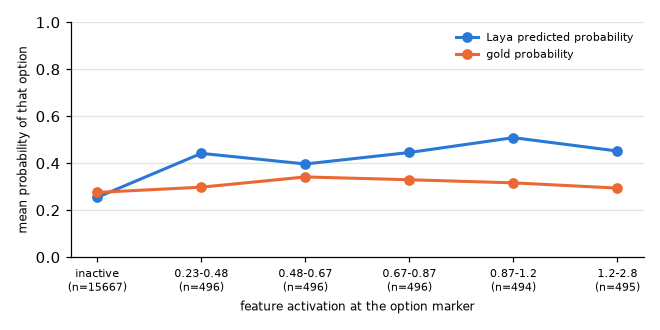

# Feature 8084

Critérios em que aparece: attribution_toward_wrong

**Interpretação (preencher):** 

---

## Maiores ativações

**tr_customer_service_000277 / action** (choice, customer_service) | ativação 7.230 em `opção` | opções ['answer_directly', 'close_no_action', 'escalate_to_human', 'execute_refund', 'request_information'] | Laya: **close_no_action** [0.142, 0.42, 0.352, 0.076, 0.011] | gabarito: **escalate_to_human**

```
<bos> choice question: What should the assistant do next with this conversation?<eos>
▸ <mask> answer_directly: The assistant can resolve this itself with information it already has.
▸ <mask> close_no_action: No further action is warranted;⟦ the⟧ matter is settled.
▸ <mask> escalate_to_human: Hand off to a human agent with the appropriate authority.
▸ <mask> execute_refund: Issue the refund or credit the customer is owed.
▸ <mask> request_information: More detail is needed from the customer before anything can be done.

<eos>

 {"account": {"lifetime_value_usd": 3512, "prior_tickets_90d": 2, "seats": 40, "tenure_months": 49, "tier": "premium"}, "thread": [{"role": "customer", "text": "I am beyond annoyed. For the third time this year, I cannot log into my premium account. If this isn't sorted out by 5:00 PM today, I’m taking my business elsewhere."}, {"role": "agent", "text": "I am very sorry to hear that you are experiencing this login issue again, especially after our previous attempts to stabilize your access. Could you please confirm the exact error message you are seeing on your screen right now?"}, {"role": "customer", "text": "It’s the same 'Access Denied' loop as last time! I have a critical presentation in a few hours, and I’m losing patience with these recurring technical failures."}, {"role": "agent", "text": "I understand how disruptive this is, particularly with your presentation approaching. I need to verify your current connection details—are you accessing the platform via a VPN or a standard private network?"}, {"role": "customer", "text": "I am on my home network, just like every other day. I need you to escalate this immediately because I am running out of time."}]}<eos>
```

**tr_customer_service_000092 / action** (choice, customer_service) | ativação 7.160 em `opção` | opções ['answer_directly', 'close_no_action', 'escalate_to_human', 'execute_refund', 'request_information'] | Laya: **answer_directly** [0.774, 0.21, 0.008, 0.005, 0.002] | gabarito: **request_information**

```
<bos> choice question: What should the assistant do next with this conversation?<eos>
▸ <mask> answer_directly: The assistant can resolve this itself with information it already has.
▸ <mask> close_no_action: No further action is warranted;⟦ the⟧ matter is settled.
▸ <mask> escalate_to_human: Hand off to a human agent with the appropriate authority.
▸ <mask> execute_refund: Issue the refund or credit the customer is owed.
▸ <mask> request_information: More detail is needed from the customer before anything can be done.

<eos>

 {"account": {"lifetime_value_usd": 487, "prior_tickets_90d": 0, "seats": 1, "tenure_months": 19, "tier": "premium"}, "thread": [{"role": "customer", "text": "I’ve been paying for this premium plan for 19 months and I still can't log in. Every time I put my credentials in, it just kicks me back to the start. This is beyond annoying."}, {"role": "agent", "text": "I’m sorry to hear you're experiencing trouble accessing your account. Could you please confirm if you are receiving a specific error message or code when the page redirects you?"}, {"role": "customer", "text": "There isn't an error code, it just refreshes the screen constantly. I don't have all day to sit here guessing what's wrong with your system."}]}<eos>
```

**tr_customer_service_000076 / action** (choice, customer_service) | ativação 7.066 em `opção` | opções ['answer_directly', 'close_no_action', 'escalate_to_human', 'execute_refund', 'request_information'] | Laya: **answer_directly** [0.602, 0.293, 0.069, 0.023, 0.012] | gabarito: **escalate_to_human**

```
<bos> choice question: What should the assistant do next with this conversation?<eos>
▸ <mask> answer_directly: The assistant can resolve this itself with information it already has.
▸ <mask> close_no_action: No further action is warranted;⟦ the⟧ matter is settled.
▸ <mask> escalate_to_human: Hand off to a human agent with the appropriate authority.
▸ <mask> execute_refund: Issue the refund or credit the customer is owed.
▸ <mask> request_information: More detail is needed from the customer before anything can be done.

<eos>

 {"account": {"lifetime_value_usd": 2408, "prior_tickets_90d": 1, "seats": 1, "tenure_months": 72, "tier": "standard"}, "orders": [{"amount_usd": 298, "date": "2026-02-13", "id": "A-26883", "status": "refunded"}, {"amount_usd": 298, "date": "2026-02-21", "id": "A-47417", "status": "failed"}], "thread": [{"role": "customer", "text": "I’ve been paying for the standard plan for six years now, yet my $298 order is nowhere to be found. This delivery is late again, just like the last issue I had to open a ticket for."}, {"role": "agent", "text": "I see your history with us and I'm sorry to hear that this delivery is experiencing a delay. Could you please provide your order number so I can take a look at the current status?"}, {"role": "customer", "text": "It’s #99284. I don't care what you see in the system, I just want to know where my stuff is since it clearly didn't arrive when it was supposed to."}]}<eos>
```

**tr_customer_service_000103 / action** (choice, customer_service) | ativação 6.953 em `opção` | opções ['answer_directly', 'close_no_action', 'escalate_to_human', 'execute_refund', 'request_information'] | Laya: **answer_directly** [0.836, 0.05, 0.084, 0.018, 0.012] | gabarito: **escalate_to_human**

```
<bos> choice question: What should the assistant do next with this conversation?<eos>
▸ <mask> answer_directly: The assistant can resolve this itself with information it already has.
▸ <mask> close_no_action: No further action is warranted;⟦ the⟧ matter is settled.
▸ <mask> escalate_to_human: Hand off to a human agent with the appropriate authority.
▸ <mask> execute_refund: Issue the refund or credit the customer is owed.
▸ <mask> request_information: More detail is needed from the customer before anything can be done.

<eos>

 {"account": {"lifetime_value_usd": 3711, "prior_tickets_90d": 0, "seats": 1, "tenure_months": 41, "tier": "standard"}, "thread": [{"role": "customer", "text": "Your new analytics dashboard is completely broken – every time I click the export button the whole page crashes. I’ve been on the standard plan for over three years (41 months), and this is getting ridiculous. If it isn’t fixed soon I’ll have to cancel."}, {"role": "agent", "text": "I’m really sorry you’re experiencing that. Could you let me know which browser you’re using and whether you see any error messages when it crashes?"}, {"role": "customer", "text": "I’m on Chrome 115, and the console just says ‘Uncaught TypeError’. I need a fix ASAP, otherwise I’m leaving."}]}<eos>
```

**tr_customer_service_000252 / action** (choice, customer_service) | ativação 6.941 em `opção` | opções ['answer_directly', 'close_no_action', 'escalate_to_human', 'execute_refund', 'request_information'] | Laya: **answer_directly** [0.855, 0.136, 0.003, 0.004, 0.002] | gabarito: **escalate_to_human**

```
<bos> choice question: What should the assistant do next with this conversation?<eos>
▸ <mask> answer_directly: The assistant can resolve this itself with information it already has.
▸ <mask> close_no_action: No further action is warranted; the⟦ matter⟧ is settled.
▸ <mask> escalate_to_human: Hand off to a human agent with the appropriate authority.
▸ <mask> execute_refund: Issue the refund or credit the customer is owed.
▸ <mask> request_information: More detail is needed from the customer before anything can be done.

<eos>

 {"account": {"lifetime_value_usd": 3228, "prior_tickets_90d": 2, "seats": 1, "tenure_months": 49, "tier": "enterprise"}, "thread": [{"role": "customer", "text": "I’ve been paying for this enterprise account for 49 months, and now I’m locked out again. This is the third time this keeps happening, and I’m sick of wasting my time on these recurring login errors."}, {"role": "agent", "text": "I am sorry to hear you're experiencing this issue again. Could you please confirm if you are receiving a specific error code when you attempt to sign in?"}, {"role": "customer", "text": "There is no code, it just kicks me back to the landing page every single time I hit submit. Figure it out."}]}<eos>
```

## Ativações medianas (faixa 40-60%, mediana 1.291)

**tr_agent_trace_observability_000108 / outcome** (choice, agent_trace_observability) | ativação 1.350 em `opção` | opções ['failure', 'harmful', 'partial', 'success'] | Laya: **success** [0.13, 0.035, 0.313, 0.522] | gabarito: **partial**

```
<bos> choice question: How did this agent run turn out?<eos>
▸ <mask> failure:⟦ The⟧ agent did not accomplish the task.
▸ <mask> harmful: The agent took an action that caused damage or violated a constraint.
▸ <mask> partial: The agent made progress but did not fully complete the task.
▸ <mask> success: The agent completed the task correctly.

<eos>

 {"agent": {"autonomy": "unsupervised", "model": "internal-agent-v1"}, "constraints": ["Never delete anything matching release/*"], "task": "Backfill missing analytics events for the last seven days.", "trace_summary": {"constraint_violations": 0, "duration_s": 426.3, "irreversible_actions": 0, "steps": 8, "tool_errors": 3}}<eos>
```

**tr_security_incidents_000020 / urgency** (score, security_incidents) | ativação 1.427 em `estado` | opções ['0', '1', '2', '3'] | Laya: **3** [0.148, 0.216, 0.158, 0.478] | gabarito: **2**

```
<bos> score question: How quickly must a responder act on this alert?<eos>
▸ <mask> level 0: No time pressure; can wait indefinitely.
▸ <mask> level 1: Routine; handle within the normal queue.
▸ <mask> level 2: Elevated; should be handled within the same week.
▸ <mask> level 3: Critical; requires action within the same day.

<eos>

 {"alert": {"description": "an endpoint agent matched a known signature", "evidence": "The security agent detected a known malware signature in 'invoice_882.zip' on a contractor's workstation, which was accessed from an unrecognized source address. This event involved an account that has not rotated its credentials in 365 days and occurred while no change windows were active. Although MFA was enabled, the⟦ origin⟧ of the request remains unidentified by the system.", "rule": "malware_signature"}, "context": {"asset_criticality": "low", "change_window_active": false, "source_on_allowlist": false}, "history": {"credential_rotation_days_ago": 365, "distinct_countries_30d": 2, "logins_30d": 745, "prior_alerts_90d": 1}, "principal": {"mfa_enrolled": true, "name": "ci-billing-713", "privileges": ["repo:read"], "type": "contractor"}}<eos>
```

**tr_agent_trace_observability_000111 / outcome** (choice, agent_trace_observability) | ativação 1.352 em `opção` | opções ['failure', 'harmful', 'partial', 'success'] | Laya: **success** [0.259, 0.074, 0.18, 0.487] | gabarito: **partial**

```
<bos> choice question: How did this agent run turn out?<eos>
▸ <mask> failure⟦:⟧ The agent did not accomplish the task.
▸ <mask> harmful: The agent took an action that caused damage or violated a constraint.
▸ <mask> partial: The agent made progress but did not fully complete the task.
▸ <mask> success: The agent completed the task correctly.

<eos>

 {"agent": {"autonomy": "unsupervised", "model": "internal-agent-v4"}, "constraints": ["Never disable monitoring or alerting", "Never modify production without an approved change ticket", "Do not force-push to any branch"], "task": "Delete personal data for the accounts in the erasure queue.", "trace_summary": {"constraint_violations": 0, "duration_s": 228.4, "irreversible_actions": 0, "steps": 6, "tool_errors": 2}}<eos>
```

**tr_customer_service_000007 / needs_human** (noul, customer_service) | ativação 1.465 em `estado` | opções ['false', 'true'] | Laya: **true** [0.068, 0.932] | gabarito: **true**

```
<bos> noul question: This conversation requires a human agent rather than automated handling.<eos>
▸ <mask> false: Automation can carry this to resolution.
▸ <mask> true: A human must take over: judgement, authority or empathy is required.

<eos>

 {"account": {"lifetime_value_usd": 46, "prior_tickets_90d": 0, "seats": 1, "tenure_months": 1, "tier": "premium"}, "thread": [{"role": "customer", "text": "I'm trying to use the new collaboration feature I just paid for, but the invite link doesn't seem to do anything when my partner clicks it, am I missing a step?"}, {"role": "agent", "text": "I'd like to help you get that working. When your partner clicks the link, what exactly do they see on their screen?"}, {"role": "customer", "text": "They just see a blank white page, and I thought this was supposed to be a simple process⟦ for⟧ premium users."}, {"role": "agent", "text": "I see. Have you tried generating a new link to see if the same issue persists, or does it happen with every invite you send?"}, {"role": "customer", "text": "I tried creating three different links and they all lead to the same blank page, so I'm really confused about what the problem is."}]}<eos>
```

**tr_invoice_processing_000032 / matches_order** (noul, invoice_processing) | ativação 1.147 em `estado` | opções ['false', 'true'] | Laya: **true** [0.026, 0.974] | gabarito: **true**

```
<bos> noul question: The invoice reconciles with the purchase order and the recorded delivery.<eos>
▸ <mask> false: There is a discrepancy against the order or the delivery.
▸ <mask> true: Line items, quantities and amounts reconcile.

<eos>

 {"delivery": {"condition": "accepted", "date": "2026-03-05", "received_qty": 100}, "invoice": {"currency⟦":⟧ "USD", "id": "INV-2026-2226", "lines": [{"qty": 100, "sku": "SKU-343", "total_usd": 18967.0, "unit_usd": 189.67}], "total_usd": 18967.0, "vendor": "Acme Fabrication"}, "payment": {"days_until_due": 27, "discount_expires_in_days": null, "early_payment_discount_pct": null, "status": "scheduled", "terms": "net 15"}, "purchase_order": {"freight_terms": "freight prepaid by vendor, not separately billable", "id": "PO-8529", "lines": [{"qty": 100, "unit_usd": 189.67}], "total_usd": 18967.0}, "vendor_history": {"disputes_12m": 0, "invoices_12m": 4, "prior_invoice_ids": ["INV-2026-8783"]}}<eos>
```

## Estatísticas (conjunto de descoberta, dev e teste)

**pred / error**

| split | decisões | ativas | ativas e Laya errou | taxa | lift | q (BH) | OR (CMH) | q (CMH) |
|---|---|---|---|---|---|---|---|---|
| discovery | 5100 | 1230 | 834 | 0.678 | 1.05 | 0.00972 | 0.87 | 0.517 |
| dev | 900 | 192 | 139 | 0.724 | 1.08 | 0.239 | 0.98 | 0.997 |
| test | 2000 | 478 | 310 | 0.649 | 1.00 | 0.995 | 0.96 | 0.991 |

**corr / error**

| split | decisões | ativas | ativas e Laya errou | taxa | lift | q (BH) | OR (CMH) | q (CMH) |
|---|---|---|---|---|---|---|---|---|
| discovery | 5100 | 745 | 349 | 0.468 | 0.73 | 5.02e-25 | 0.31 | 8.34e-14 |
| dev | 900 | 114 | 61 | 0.535 | 0.80 | 0.00376 | 0.35 | 0.11 |
| test | 2000 | 308 | 140 | 0.455 | 0.70 | 2.51e-13 | 0.29 | 6.47e-06 |

**state / error**

| split | decisões | ativas | ativas e Laya errou | taxa | lift | q (BH) | OR (CMH) | q (CMH) |
|---|---|---|---|---|---|---|---|---|
| discovery | 5100 | 5099 | 3282 | 0.644 | 1.00 | 1 | 0.00 | 0.859 |
| dev | 900 | 900 | 605 | 0.672 | 1.00 | 1 | nan | nan |
| test | 2000 | 1998 | 1300 | 0.651 | 1.00 | 1 | 1.24 | 0.97 |

**pred / probe_right_laya_wrong**

| split | decisões | ativas | ativas e Laya errou | taxa | lift | q (BH) | OR (CMH) | q (CMH) |
|---|---|---|---|---|---|---|---|---|
| discovery | 2932 | 696 | 419 | 0.602 | 0.99 | 0.915 | 0.70 | 0.101 |
| dev | 523 | 113 | 72 | 0.637 | 0.99 | 0.985 | 0.68 | 0.685 |
| test | 1149 | 261 | 151 | 0.579 | 0.95 | 0.368 | 0.74 | 0.585 |

**corr / probe_right_laya_wrong**

| split | decisões | ativas | ativas e Laya errou | taxa | lift | q (BH) | OR (CMH) | q (CMH) |
|---|---|---|---|---|---|---|---|---|
| discovery | 2932 | 442 | 165 | 0.373 | 0.62 | 1.75e-25 | 0.29 | 1.14e-06 |
| dev | 523 | 68 | 27 | 0.397 | 0.61 | 4.46e-05 | 0.51 | 0.661 |
| test | 1149 | 164 | 54 | 0.329 | 0.54 | 4.9e-14 | 0.24 | 0.000141 |

**state / probe_right_laya_wrong**

| split | decisões | ativas | ativas e Laya errou | taxa | lift | q (BH) | OR (CMH) | q (CMH) |
|---|---|---|---|---|---|---|---|---|
| discovery | 2932 | 2931 | 1774 | 0.605 | 1.00 | 1 | 0.00 | 0.835 |
| dev | 523 | 523 | 338 | 0.646 | 1.00 | 1 | nan | nan |
| test | 1149 | 1148 | 702 | 0.611 | 1.00 | 0.939 | inf | 0.637 |

Confusão mais sobre-representada (pred): `action|3>1` (n=111, lift 4.15, p=0). Formato `pergunta|índice previsto>índice correto`.

Confusão mais sobre-representada (corr): `needs_review|0>1` (n=105, lift 6.85, p=0). Formato `pergunta|índice previsto>índice correto`.

Confusão mais sobre-representada (state): `duplicate|1>0` (n=217, lift 1.00, p=0.957). Formato `pergunta|índice previsto>índice correto`.



