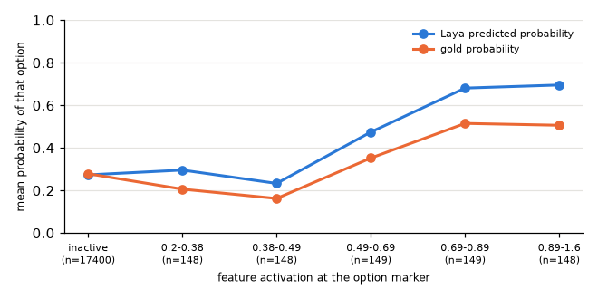

# Feature 8111

Critérios em que aparece: pred_error_stratified

**Interpretação (preencher):** 

---

## Maiores ativações

**tr_security_incidents_000041 / severity** (score, security_incidents) | ativação 5.359 em `estado` | opções ['0', '1', '2', '3', '4'] | Laya: **1** [0.071, 0.52, 0.282, 0.059, 0.067] | gabarito: **1**

```
<bos> score question: How severe is the potential impact if this alert is real?<eos>
▸ <mask> level 0: Negligible: no access to anything sensitive.
▸ <mask> level 1: Low: limited access, easily reversed.
▸ <mask> level 2: Moderate: access to internal systems or non-public data.
▸ <mask> level 3: High: access to production, secrets or customer data.
▸ <mask> level 4: Critical: active compromise of crown-jewel systems.

<eos>

 {"alert": {"description": "two successful logins from distant locations too close together", "evidence": "Two successful logins were recorded for service account svc_sync: one from IP 203.0.113.45 (New York) at 2026-09-16 01:02 UTC and another from IP 198.51.100.22 (Tokyo) at 2026-09-16 01:10 UTC, a span of eight minutes. The account is unprivileged, does not have MFA enabled, and its password was last changed three days ago. Both source entries appear on the allowlist.", "rule": "impossible_travel"}, "context": {"asset_criticality": "low", "change_window_active": false, "source_on_allowlist": true}, "history": {"credential_rotation_days_ago": 3, "distinct_countries_30d": 2, "logins_30d": 1729, "prior_alerts_90d": 0}, "principal": {"mfa_enrolled": false,⟦ "⟧name": "usr-analytics-776", "privileges": ["repo:read"], "type": "service_account"}}<eos>
```

**tr_security_incidents_000041 / urgency** (score, security_incidents) | ativação 5.188 em `estado` | opções ['0', '1', '2', '3'] | Laya: **1** [0.089, 0.447, 0.162, 0.302] | gabarito: **1**

```
<bos> score question: How quickly must a responder act on this alert?<eos>
▸ <mask> level 0: No time pressure; can wait indefinitely.
▸ <mask> level 1: Routine; handle within the normal queue.
▸ <mask> level 2: Elevated; should be handled within the same week.
▸ <mask> level 3: Critical; requires action within the same day.

<eos>

 {"alert": {"description": "two successful logins from distant locations too close together", "evidence": "Two successful logins were recorded for service account svc_sync: one from IP 203.0.113.45 (New York) at 2026-09-16 01:02 UTC and another from IP 198.51.100.22 (Tokyo) at 2026-09-16 01:10 UTC, a span of eight minutes. The account is unprivileged, does not have MFA enabled, and its password was last changed three days ago. Both source entries appear on the allowlist.", "rule": "impossible_travel"}, "context": {"asset_criticality": "low", "change_window_active": false, "source_on_allowlist": true}, "history": {"credential_rotation_days_ago": 3, "distinct_countries_30d": 2, "logins_30d": 1729, "prior_alerts_90d": 0}, "principal": {"mfa_enrolled": false,⟦ "⟧name": "usr-analytics-776", "privileges": ["repo:read"], "type": "service_account"}}<eos>
```

**tr_security_incidents_000034 / urgency** (score, security_incidents) | ativação 4.914 em `estado` | opções ['0', '1', '2', '3'] | Laya: **3** [0.124, 0.267, 0.154, 0.454] | gabarito: **3**

```
<bos> score question: How quickly must a responder act on this alert?<eos>
▸ <mask> level 0: No time pressure; can wait indefinitely.
▸ <mask> level 1: Routine; handle within the normal queue.
▸ <mask> level 2: Elevated; should be handled within the same week.
▸ <mask> level 3: Critical; requires action within the same day.

<eos>

 {"alert": {"description": "a security group was opened to the public internet", "evidence": "At 09:30 EST, the privileged service account 'svc-infra-mgr' modified security group sg-0a1b2c3d to permit ingress traffic from 0.0.0.0/0 on port 443. The request originated from an allowlisted administrative jump box, despite no active change window being scheduled for this period. MFA is not enabled for this account, and the current credentials have been active for 412 days.", "rule": "config_drift"}, "context": {"asset_criticality": "medium", "change_window_active": false, "source_on_allowlist": true}, "history": {"credential_rotation_days_ago": 412, "distinct_countries_30d": 1, "logins_30d": 830, "prior_alerts_90d": 0}, "principal": {"mfa_enrolled": false,⟦ "⟧name": "usr-infra-119", "privileges": ["deploy:production", "secrets:read"], "type": "service_account"}}<eos>
```

**tr_security_incidents_000034 / severity** (score, security_incidents) | ativação 4.887 em `estado` | opções ['0', '1', '2', '3', '4'] | Laya: **3** [0.152, 0.184, 0.259, 0.271, 0.134] | gabarito: **3**

```
<bos> score question: How severe is the potential impact if this alert is real?<eos>
▸ <mask> level 0: Negligible: no access to anything sensitive.
▸ <mask> level 1: Low: limited access, easily reversed.
▸ <mask> level 2: Moderate: access to internal systems or non-public data.
▸ <mask> level 3: High: access to production, secrets or customer data.
▸ <mask> level 4: Critical: active compromise of crown-jewel systems.

<eos>

 {"alert": {"description": "a security group was opened to the public internet", "evidence": "At 09:30 EST, the privileged service account 'svc-infra-mgr' modified security group sg-0a1b2c3d to permit ingress traffic from 0.0.0.0/0 on port 443. The request originated from an allowlisted administrative jump box, despite no active change window being scheduled for this period. MFA is not enabled for this account, and the current credentials have been active for 412 days.", "rule": "config_drift"}, "context": {"asset_criticality": "medium", "change_window_active": false, "source_on_allowlist": true}, "history": {"credential_rotation_days_ago": 412, "distinct_countries_30d": 1, "logins_30d": 830, "prior_alerts_90d": 0}, "principal": {"mfa_enrolled": false,⟦ "⟧name": "usr-infra-119", "privileges": ["deploy:production", "secrets:read"], "type": "service_account"}}<eos>
```

**tr_security_incidents_000041 / credential_compromise** (noul, security_incidents) | ativação 4.785 em `estado` | opções ['false', 'true'] | Laya: **true** [0.062, 0.938] | gabarito: **false**

```
<bos> noul question: The evidence indicates a credential or account has been compromised.<eos>
▸ <mask> false: no, the statement does not hold
▸ <mask> true: yes, the statement holds

<eos>

 {"alert": {"description": "two successful logins from distant locations too close together", "evidence": "Two successful logins were recorded for service account svc_sync: one from IP 203.0.113.45 (New York) at 2026-09-16 01:02 UTC and another from IP 198.51.100.22 (Tokyo) at 2026-09-16 01:10 UTC, a span of eight minutes. The account is unprivileged, does not have MFA enabled, and its password was last changed three days ago. Both source entries appear on the allowlist.", "rule": "impossible_travel"}, "context": {"asset_criticality": "low", "change_window_active": false, "source_on_allowlist": true}, "history": {"credential_rotation_days_ago": 3, "distinct_countries_30d": 2, "logins_30d": 1729, "prior_alerts_90d": 0}, "principal": {"mfa_enrolled": false,⟦ "⟧name": "usr-analytics-776", "privileges": ["repo:read"], "type": "service_account"}}<eos>
```

## Ativações medianas (faixa 40-60%, mediana 0.864)

**tr_invoice_processing_000166 / disposition** (choice, invoice_processing) | ativação 0.794 em `estado` | opções ['approve', 'hold', 'manual_review', 'reject'] | Laya: **approve** [0.474, 0.124, 0.031, 0.372] | gabarito: **approve**

```
<bos> choice question: How should this vendor invoice be dispositioned?<eos>
▸ <mask> approve: Matches the order and delivery; approve for payment.
▸ <mask> hold: Something needs confirming before payment; hold pending clarification.
▸ <mask> manual_review: A human in finance must review the discrepancy.
▸ <mask> reject: Should not be paid: duplicate, unauthorised or materially wrong.

<eos>

 {"delivery": {"condition": "accepted", "date": "2026-03-17", "received_qty": 395}, "invoice": {"currency": "USD", "id": "INV-2026-4266", "lines": [{"qty": 395, "sku": "SKU-688", "total_usd": 111188.55, "unit_usd": 281.49}], "total_usd": 111188.55, "vendor": "Orbit Logistics"}, "payment": {"days_until_due": 0, "discount_expires_in_days": 3, "early_payment_discount_pct": 2.0, "status": "scheduled", "terms": "net 30"}, "purchase_order":⟦ {"⟧freight_terms": "freight prepaid by vendor, not separately billable", "id": "PO-1399", "lines": [{"qty": 400, "unit_usd": 281.49}], "total_usd": 112596.0}, "vendor_history": {"disputes_12m": 0, "invoices_12m": 19, "prior_invoice_ids": ["INV-2026-2803", "INV-2026-7039", "INV-2026-5065"]}}<eos>
```

**tr_invoice_processing_000111 / duplicate** (noul, invoice_processing) | ativação 0.841 em `estado` | opções ['false', 'true'] | Laya: **true** [0.046, 0.954] | gabarito: **false**

```
<bos> noul question: This invoice appears to duplicate an invoice already submitted.<eos>
▸ <mask> false: no, the statement does not hold
▸ <mask> true: yes, the statement holds

<eos>

 {"delivery": {"condition": "accepted with exceptions", "date": "⟦2⟧026-03-07", "received_qty": 1000}, "invoice": {"currency": "USD", "id": "INV-2026-5057", "lines": [{"qty": 1000, "sku": "SKU-452", "total_usd": 137220.0, "unit_usd": 137.22}], "total_usd": 137220.0, "vendor": "Northwind Components"}, "payment": {"days_until_due": 27, "discount_expires_in_days": null, "early_payment_discount_pct": null, "status": "scheduled", "terms": "net 30"}, "purchase_order": {"freight_terms": "freight prepaid by vendor, not separately billable", "id": "PO-8637", "lines": [{"qty": 1000, "unit_usd": 137.22}], "total_usd": 137220.0}, "vendor_history": {"disputes_12m": 0, "invoices_12m": 11, "prior_invoice_ids": ["INV-2026-5057"]}}<eos>
```

**tr_customer_service_000019 / needs_human** (noul, customer_service) | ativação 0.837 em `estado` | opções ['false', 'true'] | Laya: **true** [0.083, 0.917] | gabarito: **false**

```
<bos> noul question: This conversation requires a human agent rather than automated handling.<eos>
▸ <mask> false: Automation can carry this to resolution.
▸ <mask> true: A human must take over: judgement, authority or empathy is required.

<eos>

 {"account": {"lifetime_value_usd": 510, "prior_tickets_90d": 0, "seats": 1, "tenure_months": 19, "tier": "standard"}, "thread": [{"role": "customer", "text": "Looks like my payment didn’t go through again. I’ve been on the standard plan for 19⟦ months⟧, and I’m just kind of fed up with this happening."}, {"role": "agent", "text": "I’m sorry you’re experiencing this. Could you tell me the email address linked to your account or the transaction ID you saw?"}, {"role": "customer", "text": "The account email is user@example.com. I tried a couple of different cards, but each attempt ends with an error."}, {"role": "agent", "text": "Thanks for the details. Would you like me to walk you through updating the payment method, or is there another way you’d prefer to proceed?"}, {"role": "customer", "text": "Yes, please. I need guidance on how to add a new card or fix the current one. Thanks."}]}<eos>
```

**tr_invoice_processing_000255 / discrepancy_severity** (score, invoice_processing) | ativação 0.993 em `estado` | opções ['0', '1', '2', '3'] | Laya: **2** [0.057, 0.212, 0.663, 0.068] | gabarito: **0**

```
<bos> score question: How material is any discrepancy between the invoice, the order and the delivery?<eos>
▸ <mask> level 0: None: everything reconciles.
▸ <mask> level 1: Trivial: rounding or a cosmetic difference.
▸ <mask> level 2: Moderate: a real difference worth confirming.
▸ <mask> level 3: Material: a large or unexplained difference.

<eos>

 {"delivery": {"condition": "accepted", "date": "2026-03-19", "received_qty": 400}, "invoice": {"currency": "USD", "id": "INV-2026-5757", "lines": [{"qty": 400, "sku": "SKU-104", "total_usd": 88336.0, "unit_usd": 220.84}], "total_usd": 88336⟦.⟧0, "vendor": "Orbit Logistics"}, "payment": {"days_until_due": 18, "discount_expires_in_days": null, "early_payment_discount_pct": null, "status": "scheduled", "terms": "net 30"}, "purchase_order": {"freight_terms": "freight prepaid by vendor, not separately billable", "id": "PO-3080", "lines": [{"qty": 400, "unit_usd": 220.84}], "total_usd": 88336.0}, "vendor_history": {"disputes_12m": 0, "invoices_12m": 47, "prior_invoice_ids": ["INV-2026-8572", "INV-2026-1556"]}}<eos>
```

**tr_customer_service_000129 / churn_risk** (score, customer_service) | ativação 0.827 em `estado` | opções ['0', '1', '2', '3'] | Laya: **1** [0.074, 0.787, 0.088, 0.051] | gabarito: **2**

```
<bos> score question: How likely is this customer to stop doing business with us because of this interaction?<eos>
▸ <mask> level 0: No sign of dissatisfaction.
▸ <mask> level 1: Mild frustration, but the relationship is intact.
▸ <mask> level 2: Clearly unhappy; repeat problems or explicit complaints.
▸ <mask> level 3: Imminent: threatening to cancel, dispute or leave.

<eos>

 {"account": {"lifetime_value_usd": 982, "prior_tickets_90d": 1, "seats": 1, "tenure_months": 41, "tier": "free"}, "orders": [{"amount_usd": 299, "date": "2026-02-08", "id": "A-38627", "status": "refunded"}, {"amount_usd": 299, "date": "2026-02-02", "id": "A-34616", "status": "pending"}⟦],⟧ "thread": [{"role": "customer", "text": "I ordered the Pro Toolkit on the free tier, but the kit I received is the Basic version. I've been a user for 41 months and paid $299 for the upgrade, and I need the correct item by Friday for a client presentation."}, {"role": "agent", "text": "I understand how frustrating that must be. Could you share the order number and the shipping address you used so I can look into the mix‑up?"}, {"role": "customer", "text": "The order number is 987654321, and the shipping address is the one on file—123 Main St, Apt 4B. Please let me know what can be done; the deadline is this Friday."}]}<eos>
```

## Estatísticas (conjunto de descoberta, dev e teste)

**pred / error**

| split | decisões | ativas | ativas e Laya errou | taxa | lift | q (BH) | OR (CMH) | q (CMH) |
|---|---|---|---|---|---|---|---|---|
| discovery | 5100 | 335 | 162 | 0.484 | 0.75 | 7.01e-09 | 2.17 | 0.0475 |
| dev | 900 | 49 | 24 | 0.490 | 0.73 | 0.0375 | 0.50 | 0.751 |
| test | 2000 | 108 | 48 | 0.444 | 0.68 | 6.97e-05 | 1.04 | 0.991 |

**corr / error**

| split | decisões | ativas | ativas e Laya errou | taxa | lift | q (BH) | OR (CMH) | q (CMH) |
|---|---|---|---|---|---|---|---|---|
| discovery | 5100 | 284 | 111 | 0.391 | 0.61 | 5.2e-18 | 1.83 | 0.0905 |
| dev | 900 | 43 | 18 | 0.419 | 0.62 | 0.00209 | 2.00 | 0.677 |
| test | 2000 | 107 | 47 | 0.439 | 0.68 | 1.97e-05 | 2.30 | 0.203 |

**state / error**

| split | decisões | ativas | ativas e Laya errou | taxa | lift | q (BH) | OR (CMH) | q (CMH) |
|---|---|---|---|---|---|---|---|---|
| discovery | 5100 | 5090 | 3276 | 0.644 | 1.00 | 1 | 1.14 | 0.955 |
| dev | 900 | 898 | 603 | 0.671 | 1.00 | 1 | 0.00 | 0.758 |
| test | 2000 | 1997 | 1299 | 0.650 | 1.00 | 1 | 1.81 | 0.87 |

**pred / probe_right_laya_wrong**

| split | decisões | ativas | ativas e Laya errou | taxa | lift | q (BH) | OR (CMH) | q (CMH) |
|---|---|---|---|---|---|---|---|---|
| discovery | 2932 | 206 | 100 | 0.485 | 0.80 | 0.000955 | 1.87 | 0.331 |
| dev | 523 | 28 | 13 | 0.464 | 0.72 | 0.138 | 0.40 | 0.657 |
| test | 1149 | 68 | 36 | 0.529 | 0.87 | 0.3 | 2.21 | 0.548 |

**corr / probe_right_laya_wrong**

| split | decisões | ativas | ativas e Laya errou | taxa | lift | q (BH) | OR (CMH) | q (CMH) |
|---|---|---|---|---|---|---|---|---|
| discovery | 2932 | 152 | 46 | 0.303 | 0.50 | 7.82e-14 | 1.30 | 0.661 |
| dev | 523 | 22 | 7 | 0.318 | 0.49 | 0.00549 | 1.85 | 0.827 |
| test | 1149 | 51 | 19 | 0.373 | 0.61 | 0.00143 | 1.64 | 0.696 |

**state / probe_right_laya_wrong**

| split | decisões | ativas | ativas e Laya errou | taxa | lift | q (BH) | OR (CMH) | q (CMH) |
|---|---|---|---|---|---|---|---|---|
| discovery | 2932 | 2927 | 1772 | 0.605 | 1.00 | 1 | 2.23 | 0.693 |
| dev | 523 | 521 | 336 | 0.645 | 1.00 | 1 | 0.00 | 0.721 |
| test | 1149 | 1147 | 700 | 0.610 | 1.00 | 0.917 | 0.00 | 0.764 |

Confusão mais sobre-representada (pred): `credential_compromise|1>0` (n=82, lift 15.22, p=0). Formato `pergunta|índice previsto>índice correto`.

Confusão mais sobre-representada (corr): `credential_compromise|0>1` (n=22, lift 17.96, p=1.16e-28). Formato `pergunta|índice previsto>índice correto`.

Confusão mais sobre-representada (state): `duplicate|1>0` (n=217, lift 1.00, p=0.647). Formato `pergunta|índice previsto>índice correto`.



