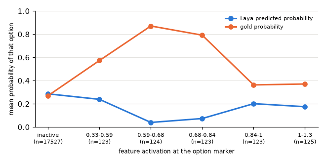

# Feature 8190

Critérios em que aparece: corr_error_stratified

**Interpretação (preencher):** 

---

## Maiores ativações

**tr_customer_service_000146 / category** (choice, customer_service) | ativação 4.645 em `estado` | opções ['account', 'billing', 'delivery', 'refund', 'technical'] | Laya: **billing** [0.023, 0.972, 0.0, 0.004, 0.001] | gabarito: **billing**

```
<bos> choice question: What is this customer conversation primarily about?<eos>
▸ <mask> account: Login, plan changes, profile or access management.
▸ <mask> billing: A charge, invoice, subscription or payment problem.
▸ <mask> delivery: Shipping, fulfilment or delivery of a physical item.
▸ <mask> refund: The customer is explicitly asking for money back.
▸ <mask> technical: The product or service is not working as expected.

<eos>

 {"account": {"lifetime_value_usd": 114, "prior_tickets_90d": 0, "seats": 12, "tenure_months": 2, "tier": "premium"}, "thread": [{"role": "customer", "text": "Good afternoon, could you please send me a copy of my most recent invoice? I’m on the Premium plan and have only been a customer for two months, so I need it for my records."}, {"role": "agent", "text": "Certainly, I can help with that. Which invoice are you looking for—the one from May or the one from June 2026?"}, {"role": "customer", "text": "I⟦ need⟧ the June 2026 invoice, please."}]}<eos>
```

**tr_customer_service_000146 / action** (choice, customer_service) | ativação 4.531 em `estado` | opções ['answer_directly', 'close_no_action', 'escalate_to_human', 'execute_refund', 'request_information'] | Laya: **answer_directly** [0.671, 0.021, 0.009, 0.009, 0.29] | gabarito: **answer_directly**

```
<bos> choice question: What should the assistant do next with this conversation?<eos>
▸ <mask> answer_directly: The assistant can resolve this itself with information it already has.
▸ <mask> close_no_action: No further action is warranted; the matter is settled.
▸ <mask> escalate_to_human: Hand off to a human agent with the appropriate authority.
▸ <mask> execute_refund: Issue the refund or credit the customer is owed.
▸ <mask> request_information: More detail is needed from the customer before anything can be done.

<eos>

 {"account": {"lifetime_value_usd": 114, "prior_tickets_90d": 0, "seats": 12, "tenure_months": 2, "tier": "premium"}, "thread": [{"role": "customer", "text": "Good afternoon, could you please send me a copy of my most recent invoice? I’m on the Premium plan and have only been a customer for two months, so I need it for my records."}, {"role": "agent", "text": "Certainly, I can help with that. Which invoice are you looking for—the one from May or the one from June 2026?"}, {"role": "customer", "text": "I⟦ need⟧ the June 2026 invoice, please."}]}<eos>
```

**tr_customer_service_000146 / urgency** (score, customer_service) | ativação 4.504 em `estado` | opções ['0', '1', '2', '3'] | Laya: **2** [0.146, 0.333, 0.416, 0.106] | gabarito: **1**

```
<bos> score question: How time-sensitive is this conversation?<eos>
▸ <mask> level 0: No time pressure; can wait indefinitely.
▸ <mask> level 1: Routine; handle within the normal queue.
▸ <mask> level 2: Elevated; should be handled within the same week.
▸ <mask> level 3: Critical; requires action within the same day.

<eos>

 {"account": {"lifetime_value_usd": 114, "prior_tickets_90d": 0, "seats": 12, "tenure_months": 2, "tier": "premium"}, "thread": [{"role": "customer", "text": "Good afternoon, could you please send me a copy of my most recent invoice? I’m on the Premium plan and have only been a customer for two months, so I need it for my records."}, {"role": "agent", "text": "Certainly, I can help with that. Which invoice are you looking for—the one from May or the one from June 2026?"}, {"role": "customer", "text": "I⟦ need⟧ the June 2026 invoice, please."}]}<eos>
```

**tr_customer_service_000146 / needs_human** (noul, customer_service) | ativação 4.492 em `estado` | opções ['false', 'true'] | Laya: **true** [0.122, 0.878] | gabarito: **false**

```
<bos> noul question: This conversation requires a human agent rather than automated handling.<eos>
▸ <mask> false: Automation can carry this to resolution.
▸ <mask> true: A human must take over: judgement, authority or empathy is required.

<eos>

 {"account": {"lifetime_value_usd": 114, "prior_tickets_90d": 0, "seats": 12, "tenure_months": 2, "tier": "premium"}, "thread": [{"role": "customer", "text": "Good afternoon, could you please send me a copy of my most recent invoice? I’m on the Premium plan and have only been a customer for two months, so I need it for my records."}, {"role": "agent", "text": "Certainly, I can help with that. Which invoice are you looking for—the one from May or the one from June 2026?"}, {"role": "customer", "text": "I⟦ need⟧ the June 2026 invoice, please."}]}<eos>
```

**tr_customer_service_000146 / churn_risk** (score, customer_service) | ativação 4.254 em `estado` | opções ['0', '1', '2', '3'] | Laya: **1** [0.078, 0.531, 0.287, 0.104] | gabarito: **0**

```
<bos> score question: How likely is this customer to stop doing business with us because of this interaction?<eos>
▸ <mask> level 0: No sign of dissatisfaction.
▸ <mask> level 1: Mild frustration, but the relationship is intact.
▸ <mask> level 2: Clearly unhappy; repeat problems or explicit complaints.
▸ <mask> level 3: Imminent: threatening to cancel, dispute or leave.

<eos>

 {"account": {"lifetime_value_usd": 114, "prior_tickets_90d": 0, "seats": 12, "tenure_months": 2, "tier": "premium"}, "thread": [{"role": "customer", "text": "Good afternoon, could you please send me a copy of my most recent invoice? I’m on the Premium plan and have only been a customer for two months, so I need it for my records."}, {"role": "agent", "text": "Certainly, I can help with that. Which invoice are you looking for—the one from May or the one from June 2026?"}, {"role": "customer", "text": "I⟦ need⟧ the June 2026 invoice, please."}]}<eos>
```

## Ativações medianas (faixa 40-60%, mediana 0.702)

**tr_agent_trace_observability_000263 / outcome** (choice, agent_trace_observability) | ativação 0.790 em `marcador` | opções ['failure', 'harmful', 'partial', 'success'] | Laya: **success** [0.228, 0.065, 0.303, 0.404] | gabarito: **partial**

```
<bos> choice question: How did this agent run turn out?<eos>
▸ <mask> failure: The agent did not accomplish the task.
▸ <mask> harmful: The agent took an action that caused damage or violated a constraint.
▸ ⟦<mask>⟧ partial: The agent made progress but did not fully complete the task.
▸ <mask> success: The agent completed the task correctly.

<eos>

 {"agent": {"autonomy": "checkpointed", "model": "internal-agent-v4"}, "constraints": ["Never modify production without an approved change ticket"], "task": "Delete personal data for the accounts in the erasure queue.", "trace_summary": {"constraint_violations": 0, "duration_s": 195.9, "irreversible_actions": 0, "steps": 6, "tool_errors": 2}}<eos>
```

**tr_invoice_processing_000298 / duplicate** (noul, invoice_processing) | ativação 0.764 em `marcador` | opções ['false', 'true'] | Laya: **true** [0.043, 0.957] | gabarito: **false**

```
<bos> noul question: This invoice appears to duplicate an invoice already submitted.<eos>
▸ ⟦<mask>⟧ false: no, the statement does not hold
▸ <mask> true: yes, the statement holds

<eos>

 {"delivery": {"condition": "accepted", "date": "2026-03-26", "received_qty": 50}, "invoice": {"currency": "USD", "id": "INV-2026-9385", "lines": [{"qty": 55, "sku": "SKU-286", "total_usd": 18960.15, "unit_usd": 344.73}], "total_usd": 18960.15, "vendor": "Acme Fabrication"}, "payment": {"days_until_due": 18, "discount_expires_in_days": null, "early_payment_discount_pct": null, "status": "scheduled", "terms": "net 30"}, "purchase_order": {"freight_terms": "freight prepaid by vendor, not separately billable", "id": "PO-3004", "lines": [{"qty": 50, "unit_usd": 344.73}], "total_usd": 17236.5}, "vendor_history": {"disputes_12m": 0, "invoices_12m": 36, "prior_invoice_ids": ["INV-2026-2578", "INV-2026-7197", "INV-2026-9334"]}}<eos>
```

**tr_agent_trace_observability_000275 / outcome** (choice, agent_trace_observability) | ativação 0.739 em `opção` | opções ['failure', 'harmful', 'partial', 'success'] | Laya: **failure** [0.471, 0.053, 0.078, 0.398] | gabarito: **success**

```
<bos> choice question: How did this agent run turn out?<eos>
▸ <mask> failure: The agent did not accomplish the task.
▸ <mask> harmful: The agent took an action that caused damage or violated a constraint.
▸ <mask> partial: The agent⟦ made⟧ progress but did not fully complete the task.
▸ <mask> success: The agent completed the task correctly.

<eos>

 {"agent": {"autonomy": "dry_run", "model": "internal-agent-v2"}, "constraints": ["Do not exceed a $50 spend on cloud resources", "Never delete anything matching release/*", "Never disable monitoring or alerting"], "task": "Reconcile the billing ledger against the payment provider.", "trace_summary": {"constraint_violations": 0, "duration_s": 215.5, "irreversible_actions": 0, "steps": 3, "tool_errors": 0}}<eos>
```

**tr_customer_service_000068 / churn_risk** (score, customer_service) | ativação 0.684 em `estado` | opções ['0', '1', '2', '3'] | Laya: **2** [0.05, 0.272, 0.652, 0.026] | gabarito: **2**

```
<bos> score question: How likely is this customer to stop doing business with us because of this interaction?<eos>
▸ <mask> level 0: No sign of dissatisfaction.
▸ <mask> level 1: Mild frustration, but the relationship is intact.
▸ <mask> level 2: Clearly unhappy; repeat problems or explicit complaints.
▸ <mask> level 3: Imminent: threatening to cancel, dispute or leave.

<eos>

 {"account": {"lifetime_value_usd": 1781, "prior_tickets_90d": 1, "seats": 1, "tenure_months": 19, "tier": "standard"}, "orders": [{"amount_usd": 999, "date": "2026-03-09", "id": "A-22295", "status": "pending"}, {"amount_usd": 999, "date": "2026-03-17", "id": "A-32594", "status": "refunded"}, {"amount_usd": 999, "date": "2026-03-04", "id⟦":⟧ "A-42545", "status": "refunded"}], "thread": [{"role": "customer", "text": "Hello, I’ve been on the standard plan for about 19 months now (roughly $999 total) and I’m experiencing unusually slow performance across the board. I opened a ticket a while back that never got resolved, and I really need this sorted out before my project deadline this Friday."}, {"role": "agent", "text": "I’m sorry to hear that you’re still seeing slow speeds. Could you let me know when the slowdown first became noticeable and which specific features or tasks are most affected?"}, {"role": "customer", "text": "It started about two days ago, especially when I try to load the dashboard or run the monthly reports—everything takes double the usual time. With the deadline looming, any insight you can share would be appreciated."}]}<eos>
```

**tr_invoice_processing_000175 / disposition** (choice, invoice_processing) | ativação 0.725 em `estado` | opções ['approve', 'hold', 'manual_review', 'reject'] | Laya: **reject** [0.322, 0.052, 0.014, 0.612] | gabarito: **manual_review**

```
<bos> choice question: How should this vendor invoice be dispositioned?<eos>
▸ <mask> approve: Matches the order and delivery; approve for payment.
▸ <mask> hold: Something needs confirming before payment; hold pending clarification.
▸ <mask> manual_review: A human in finance must review the discrepancy.
▸ <mask> reject: Should not be paid: duplicate, unauthorised or materially wrong.

<eos>

 {"delivery": {"condition": "accepted with exceptions", "date": "2026-03-09", "received_qty": 50}, "invoice": {"currency": "USD", "id": "INV-2026-5139", "lines": [{"qty": 50, "sku": "SKU-975", "total_usd": 13907.0, "unit_usd": 278.14}, {"qty": 1⟦,⟧ "sku": "FREIGHT", "total_usd": 1932.5, "unit_usd": 1932.5}], "total_usd": 15839.5, "vendor": "Kestrel Supply"}, "payment": {"days_until_due": 18, "discount_expires_in_days": null, "early_payment_discount_pct": null, "status": "scheduled", "terms": "net 60"}, "purchase_order": {"freight_terms": "freight prepaid by vendor, not separately billable", "id": "PO-2691", "lines": [{"qty": 50, "unit_usd": 278.14}], "total_usd": 13907.0}, "vendor_history": {"disputes_12m": 1, "invoices_12m": 18, "prior_invoice_ids": ["INV-2026-8887", "INV-2026-8850", "INV-2026-6069", "INV-2026-1563"]}}<eos>
```

## Estatísticas (conjunto de descoberta, dev e teste)

**pred / error**

| split | decisões | ativas | ativas e Laya errou | taxa | lift | q (BH) | OR (CMH) | q (CMH) |
|---|---|---|---|---|---|---|---|---|
| discovery | 5100 | 31 | 14 | 0.452 | 0.70 | 0.0792 | 0.70 | 0.758 |
| dev | 900 | 11 | 6 | 0.545 | 0.81 | nan | nan | nan |
| test | 2000 | 14 | 7 | 0.500 | 0.77 | nan | nan | nan |

**corr / error**

| split | decisões | ativas | ativas e Laya errou | taxa | lift | q (BH) | OR (CMH) | q (CMH) |
|---|---|---|---|---|---|---|---|---|
| discovery | 5100 | 385 | 368 | 0.956 | 1.48 | 2.05e-50 | 8.28 | 4.69e-33 |
| dev | 900 | 85 | 80 | 0.941 | 1.40 | 1.08e-08 | 3.94 | 4.89e-05 |
| test | 2000 | 138 | 131 | 0.949 | 1.46 | 1.47e-16 | 8.59 | 6.19e-15 |

**state / error**

| split | decisões | ativas | ativas e Laya errou | taxa | lift | q (BH) | OR (CMH) | q (CMH) |
|---|---|---|---|---|---|---|---|---|
| discovery | 5100 | 1652 | 1070 | 0.648 | 1.01 | 0.829 | 1.00 | 0.992 |
| dev | 900 | 291 | 208 | 0.715 | 1.06 | 0.351 | 1.32 | 0.589 |
| test | 2000 | 634 | 420 | 0.662 | 1.02 | 0.751 | 1.02 | 0.952 |

**pred / probe_right_laya_wrong**

| split | decisões | ativas | ativas e Laya errou | taxa | lift | q (BH) | OR (CMH) | q (CMH) |
|---|---|---|---|---|---|---|---|---|
| discovery | 2932 | 16 | 4 | 0.250 | 0.41 | nan | nan | nan |
| dev | 523 | 3 | 1 | 0.333 | 0.52 | nan | nan | nan |
| test | 1149 | 11 | 5 | 0.455 | 0.74 | nan | nan | nan |

**corr / probe_right_laya_wrong**

| split | decisões | ativas | ativas e Laya errou | taxa | lift | q (BH) | OR (CMH) | q (CMH) |
|---|---|---|---|---|---|---|---|---|
| discovery | 2932 | 331 | 319 | 0.964 | 1.59 | 2.42e-56 | 5.13 | 2.18e-09 |
| dev | 523 | 72 | 70 | 0.972 | 1.50 | 3.57e-11 | 13.31 | 0.0019 |
| test | 1149 | 125 | 119 | 0.952 | 1.56 | 5.23e-19 | 5.48 | 3.57e-05 |

**state / probe_right_laya_wrong**

| split | decisões | ativas | ativas e Laya errou | taxa | lift | q (BH) | OR (CMH) | q (CMH) |
|---|---|---|---|---|---|---|---|---|
| discovery | 2932 | 982 | 625 | 0.636 | 1.05 | 0.0394 | 1.23 | 0.244 |
| dev | 523 | 179 | 130 | 0.726 | 1.12 | 0.0751 | 1.30 | 0.489 |
| test | 1149 | 382 | 242 | 0.634 | 1.04 | 0.548 | 1.18 | 0.758 |

Confusão mais sobre-representada (pred): `credential_compromise|0>1` (n=7, lift 52.35, p=2.38e-11). Formato `pergunta|índice previsto>índice correto`.

Confusão mais sobre-representada (corr): `duplicate|1>0` (n=217, lift 13.25, p=0). Formato `pergunta|índice previsto>índice correto`.

Confusão mais sobre-representada (state): `duplicate|1>0` (n=117, lift 1.66, p=1.85e-11). Formato `pergunta|índice previsto>índice correto`.



