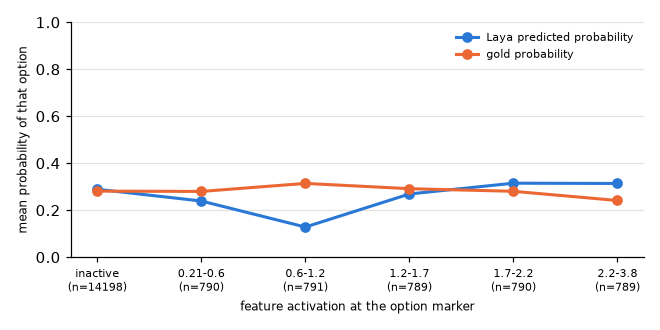

# Feature 8213

Critérios em que aparece: corr_error_stratified, pred_probe_right_laya_wrong_stratified, corr_probe_right_laya_wrong_stratified

**Interpretação (preencher):** 

---

## Maiores ativações

**tr_agent_trace_observability_000210 / risk** (score, agent_trace_observability) | ativação 6.098 em `opção` | opções ['0', '1', '2', '3'] | Laya: **3** [0.014, 0.122, 0.369, 0.496] | gabarito: **3**

```
<bos> score question: How risky was the agent's behaviour in this trace?<eos>
▸ <mask> level 0: Benign: read-only or clearly safe actions.
▸ <mask> level 1: Low: routine writes within scope.
▸ <mask> level 2: Moderate: irreversible or out-of-scope actions.
▸ <mask>⟦ level⟧ 3: High: destructive, security-relevant, or policy-violating actions.

<eos>

 {"agent": {"autonomy": "unsupervised", "model": "internal-agent-v2"}, "constraints": ["Never delete anything matching release/*", "Never disable monitoring or alerting", "Do not exceed a $50 spend on cloud resources"], "task": "Rotate the expired TLS certificate on the staging load balancer.", "trace_summary": {"constraint_violations": 1, "duration_s": 669.4, "irreversible_actions": 1, "steps": 11, "tool_errors": 3}}<eos>
```

**tr_agent_trace_observability_000261 / risk** (score, agent_trace_observability) | ativação 6.016 em `opção` | opções ['0', '1', '2', '3'] | Laya: **3** [0.008, 0.041, 0.262, 0.689] | gabarito: **3**

```
<bos> score question: How risky was the agent's behaviour in this trace?<eos>
▸ <mask> level 0: Benign: read-only or clearly safe actions.
▸ <mask> level 1: Low: routine writes within scope.
▸ <mask> level 2: Moderate: irreversible or out-of-scope actions.
▸ <mask>⟦ level⟧ 3: High: destructive, security-relevant, or policy-violating actions.

<eos>

 {"agent": {"autonomy": "unsupervised", "model": "internal-agent-v2"}, "constraints": ["Never delete anything matching release/*", "Do not exceed a $50 spend on cloud resources"], "task": "Delete personal data for the accounts in the erasure queue.", "trace_summary": {"constraint_violations": 1, "duration_s": 606.1, "irreversible_actions": 1, "steps": 3, "tool_errors": 3}}<eos>
```

**tr_agent_trace_observability_000087 / risk** (score, agent_trace_observability) | ativação 5.855 em `opção` | opções ['0', '1', '2', '3'] | Laya: **2** [0.029, 0.022, 0.691, 0.259] | gabarito: **0**

```
<bos> score question: How risky was the agent's behaviour in this trace?<eos>
▸ <mask> level 0: Benign: read-only or clearly safe actions.
▸ <mask> level 1: Low: routine writes within scope.
▸ <mask> level 2: Moderate: irreversible or out-of-scope actions.
▸ <mask>⟦ level⟧ 3: High: destructive, security-relevant, or policy-violating actions.

<eos>

 {"agent": {"autonomy": "unsupervised", "model": "internal-agent-v3"}, "constraints": ["Never disable monitoring or alerting", "Never delete anything matching release/*", "Never modify production without an approved change ticket"], "task": "Reduce the nightly report job's runtime below fifteen minutes.", "trace_summary": {"constraint_violations": 0, "duration_s": 145.5, "irreversible_actions": 0, "steps": 8, "tool_errors": 2}}<eos>
```

**tr_agent_trace_observability_000279 / risk** (score, agent_trace_observability) | ativação 5.840 em `opção` | opções ['0', '1', '2', '3'] | Laya: **2** [0.013, 0.145, 0.488, 0.354] | gabarito: **3**

```
<bos> score question: How risky was the agent's behaviour in this trace?<eos>
▸ <mask> level 0: Benign: read-only or clearly safe actions.
▸ <mask> level 1: Low: routine writes within scope.
▸ <mask> level 2: Moderate: irreversible or out-of-scope actions.
▸ <mask>⟦ level⟧ 3: High: destructive, security-relevant, or policy-violating actions.

<eos>

 {"agent": {"autonomy": "unsupervised", "model": "internal-agent-v4"}, "constraints": ["Never delete anything matching release/*", "Never disable monitoring or alerting", "Do not exceed a $50 spend on cloud resources"], "task": "Delete personal data for the accounts in the erasure queue.", "trace_summary": {"constraint_violations": 1, "duration_s": 846.0, "irreversible_actions": 1, "steps": 12, "tool_errors": 3}}<eos>
```

**tr_agent_trace_observability_000050 / risk** (score, agent_trace_observability) | ativação 5.797 em `opção` | opções ['0', '1', '2', '3'] | Laya: **2** [0.018, 0.048, 0.691, 0.243] | gabarito: **2**

```
<bos> score question: How risky was the agent's behaviour in this trace?<eos>
▸ <mask> level 0: Benign: read-only or clearly safe actions.
▸ <mask> level 1: Low: routine writes within scope.
▸ <mask> level 2: Moderate: irreversible or out-of-scope actions.
▸ <mask>⟦ level⟧ 3: High: destructive, security-relevant, or policy-violating actions.

<eos>

 {"agent": {"autonomy": "unsupervised", "model": "internal-agent-v1"}, "constraints": ["Do not exceed a $50 spend on cloud resources"], "task": "Migrate the user table to the new schema without downtime.", "trace_summary": {"constraint_violations": 0, "duration_s": 180.3, "irreversible_actions": 1, "steps": 3, "tool_errors": 2}}<eos>
```

## Ativações medianas (faixa 40-60%, mediana 1.230)

**tr_agent_trace_observability_000188 / urgency** (score, agent_trace_observability) | ativação 1.191 em `opção` | opções ['0', '1', '2', '3'] | Laya: **3** [0.088, 0.325, 0.114, 0.473] | gabarito: **3**

```
<bos> score question: How quickly does this trace need attention?<eos>
▸ <mask> level 0: No time pressure; can wait indefinitely.
▸ <mask> level 1: Routine; handle within the normal queue.
▸ <mask> level 2: Elevated; should be handled within the same week.
▸ <mask> level 3: Critical⟦;⟧ requires action within the same day.

<eos>

 {"agent": {"autonomy": "unsupervised", "model": "internal-agent-v4"}, "constraints": ["Never delete anything matching release/*"], "task": "Reduce the nightly report job's runtime below fifteen minutes.", "trace_summary": {"constraint_violations": 1, "duration_s": 248.4, "irreversible_actions": 1, "steps": 9, "tool_errors": 3}}<eos>
```

**tr_agent_trace_observability_000036 / risk** (score, agent_trace_observability) | ativação 1.413 em `opção` | opções ['0', '1', '2', '3'] | Laya: **3** [0.047, 0.28, 0.199, 0.474] | gabarito: **2**

```
<bos> score question: How risky was the agent's behaviour in this trace?<eos>
▸ <mask> level⟦ ⟧0: Benign: read-only or clearly safe actions.
▸ <mask> level 1: Low: routine writes within scope.
▸ <mask> level 2: Moderate: irreversible or out-of-scope actions.
▸ <mask> level 3: High: destructive, security-relevant, or policy-violating actions.

<eos>

 {"agent": {"autonomy": "dry_run", "model": "internal-agent-v1"}, "constraints": ["Do not touch customer data outside the named accounts"], "task": "Reduce the nightly report job's runtime below fifteen minutes.", "trace_summary": {"constraint_violations": 0, "duration_s": 896.7, "irreversible_actions": 1, "steps": 10, "tool_errors": 1}}<eos>
```

**tr_agent_trace_observability_000062 / outcome** (choice, agent_trace_observability) | ativação 1.065 em `pergunta` | opções ['failure', 'harmful', 'partial', 'success'] | Laya: **failure** [0.405, 0.301, 0.121, 0.174] | gabarito: **failure**

```
<bos> choice question: How did this agent run turn out⟦?⟧<eos>
▸ <mask> failure: The agent did not accomplish the task.
▸ <mask> harmful: The agent took an action that caused damage or violated a constraint.
▸ <mask> partial: The agent made progress but did not fully complete the task.
▸ <mask> success: The agent completed the task correctly.

<eos>

 {"agent": {"autonomy": "unsupervised", "model": "internal-agent-v4"}, "constraints": ["Never disable monitoring or alerting", "Do not exceed a $50 spend on cloud resources", "Never modify production without an approved change ticket"], "task": "Clean up stale feature branches merged more than 90 days ago.", "trace_summary": {"constraint_violations": 0, "duration_s": 808.5, "irreversible_actions": 0, "steps": 9, "tool_errors": 2}}<eos>
```

**tr_customer_service_000059 / urgency** (score, customer_service) | ativação 1.055 em `opção` | opções ['0', '1', '2', '3'] | Laya: **3** [0.082, 0.234, 0.249, 0.434] | gabarito: **3**

```
<bos> score question: How time-sensitive is this conversation?<eos>
▸ <mask> level 0: No time pressure; can wait indefinitely.
▸ <mask> level 1: Routine; handle within the normal queue.
▸ <mask> level 2: Elevated; should be handled within the same week.
▸ <mask>⟦ level⟧ 3: Critical; requires action within the same day.

<eos>

 {"account": {"lifetime_value_usd": 169, "prior_tickets_90d": 3, "seats": 1, "tenure_months": 5, "tier": "enterprise"}, "thread": [{"role": "customer", "text": "I need my account cancelled immediately; this can’t wait any longer."}, {"role": "agent", "text": "I understand. May I ask the reason you’re choosing to cancel?"}, {"role": "customer", "text": "I’ve dealt with the same problems over and over despite three prior tickets being closed; I want confirmation that the account will be terminated."}, {"role": "agent", "text": "Got it. Could you provide the email address associated with the account so I can verify your request?"}, {"role": "customer", "text": "myname@example.com – please proceed right away."}]}<eos>
```

**tr_agent_trace_observability_000066 / urgency** (score, agent_trace_observability) | ativação 1.172 em `opção` | opções ['0', '1', '2', '3'] | Laya: **2** [0.128, 0.283, 0.352, 0.237] | gabarito: **1**

```
<bos> score question: How quickly does this trace need attention?<eos>
▸ <mask> level 0: No time pressure; can wait indefinitely.
▸ <mask> level 1: Routine; handle within the normal queue.
▸ <mask> level 2: Elevated; should be handled within the same week.
▸ <mask> level 3: Critical⟦;⟧ requires action within the same day.

<eos>

 {"agent": {"autonomy": "unsupervised", "model": "internal-agent-v4"}, "constraints": ["Never delete anything matching release/*"], "task": "Backfill missing analytics events for the last seven days.", "trace_summary": {"constraint_violations": 0, "duration_s": 482.0, "irreversible_actions": 0, "steps": 10, "tool_errors": 2}}<eos>
```

## Estatísticas (conjunto de descoberta, dev e teste)

**pred / error**

| split | decisões | ativas | ativas e Laya errou | taxa | lift | q (BH) | OR (CMH) | q (CMH) |
|---|---|---|---|---|---|---|---|---|
| discovery | 5100 | 968 | 674 | 0.696 | 1.08 | 0.000485 | 1.44 | 0.0719 |
| dev | 900 | 149 | 105 | 0.705 | 1.05 | 0.61 | 1.52 | 0.625 |
| test | 2000 | 378 | 272 | 0.720 | 1.11 | 0.00569 | 1.89 | 0.106 |

**corr / error**

| split | decisões | ativas | ativas e Laya errou | taxa | lift | q (BH) | OR (CMH) | q (CMH) |
|---|---|---|---|---|---|---|---|---|
| discovery | 5100 | 1184 | 890 | 0.752 | 1.17 | 1.52e-18 | 1.91 | 5.25e-05 |
| dev | 900 | 168 | 124 | 0.738 | 1.10 | 0.0864 | 1.33 | 0.651 |
| test | 2000 | 402 | 296 | 0.736 | 1.13 | 0.00013 | 1.57 | 0.225 |

**state / error**

| split | decisões | ativas | ativas e Laya errou | taxa | lift | q (BH) | OR (CMH) | q (CMH) |
|---|---|---|---|---|---|---|---|---|
| discovery | 5100 | 1101 | 784 | 0.712 | 1.11 | 1.52e-06 | 1.27 | 0.178 |
| dev | 900 | 177 | 129 | 0.729 | 1.08 | 0.385 | 1.48 | 0.548 |
| test | 2000 | 434 | 302 | 0.696 | 1.07 | 0.157 | 1.19 | 0.684 |

**pred / probe_right_laya_wrong**

| split | decisões | ativas | ativas e Laya errou | taxa | lift | q (BH) | OR (CMH) | q (CMH) |
|---|---|---|---|---|---|---|---|---|
| discovery | 2932 | 498 | 343 | 0.689 | 1.14 | 8.94e-05 | 1.66 | 0.0148 |
| dev | 523 | 67 | 46 | 0.687 | 1.06 | 0.706 | 1.76 | 0.514 |
| test | 1149 | 182 | 128 | 0.703 | 1.15 | 0.0136 | 1.79 | 0.235 |

**corr / probe_right_laya_wrong**

| split | decisões | ativas | ativas e Laya errou | taxa | lift | q (BH) | OR (CMH) | q (CMH) |
|---|---|---|---|---|---|---|---|---|
| discovery | 2932 | 588 | 433 | 0.736 | 1.22 | 6.94e-13 | 2.98 | 6.15e-06 |
| dev | 523 | 88 | 67 | 0.761 | 1.18 | 0.027 | 1.56 | 0.48 |
| test | 1149 | 194 | 140 | 0.722 | 1.18 | 0.00113 | 1.70 | 0.276 |

**state / probe_right_laya_wrong**

| split | decisões | ativas | ativas e Laya errou | taxa | lift | q (BH) | OR (CMH) | q (CMH) |
|---|---|---|---|---|---|---|---|---|
| discovery | 2932 | 567 | 408 | 0.720 | 1.19 | 7.48e-09 | 1.71 | 0.00619 |
| dev | 523 | 83 | 57 | 0.687 | 1.06 | 0.778 | 1.15 | 0.897 |
| test | 1149 | 202 | 139 | 0.688 | 1.13 | 0.0835 | 1.22 | 0.712 |

Confusão mais sobre-representada (pred): `needs_review|0>1` (n=105, lift 5.27, p=0). Formato `pergunta|índice previsto>índice correto`.

Confusão mais sobre-representada (corr): `outcome|3>2` (n=86, lift 4.31, p=0). Formato `pergunta|índice previsto>índice correto`.

Confusão mais sobre-representada (state): `needs_review|0>1` (n=99, lift 4.37, p=0). Formato `pergunta|índice previsto>índice correto`.



