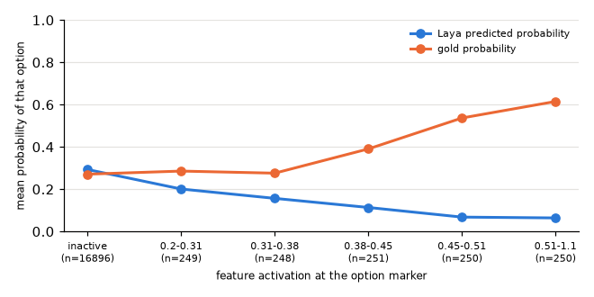

# Feature 8265

Critérios em que aparece: corr_error_stratified

**Interpretação (preencher):** 

---

## Maiores ativações

**tr_customer_service_000123 / category** (choice, customer_service) | ativação 2.301 em `estado` | opções ['account', 'billing', 'delivery', 'refund', 'technical'] | Laya: **account** [0.994, 0.0, 0.0, 0.0, 0.005] | gabarito: **account**

```
<bos> choice question: What is this customer conversation primarily about?<eos>
▸ <mask> account: Login, plan changes, profile or access management.
▸ <mask> billing: A charge, invoice, subscription or payment problem.
▸ <mask> delivery: Shipping, fulfilment or delivery of a physical item.
▸ <mask> refund: The customer is explicitly asking for money back.
▸ <mask> technical: The product or service is not working as expected.

<eos>

 {"account": {"lifetime_value_usd": 154, "prior_tickets_90d": 1, "seats": 5, "tenure_months": 2, "tier": "premium"}, "thread": [{"role": "customer", "text": "Hello there. I'm having a bit of a problem logging into my Premium account this morning. It keeps telling me my credentials aren't recognized, even though I haven't changed them."}, {"role": "agent", "text": "I'd be happy to help you with that. Are you seeing a specific error code, or is it just the standard 'invalid password' notification?"}, {"role": "customer", "text": "It says 'User not found.' I had a ticket open last week about account syncing and the agent promised it would be fixed by now, but it seems I'm still locked out."}, {"role": "agent", "text": "I see. Since you mentioned the previous ticket, did you receive a confirmation email or a link to verify your identity after that interaction?"}, {"role": "customer", "text": "No, I never received any follow-up email at all, which is why I'm reaching out again. I've only been using the service for two months and I really like it, but I can't use what I can't access."}, {"role": "agent", "text": "I appreciate your patience while we work through this. Could you please confirm the primary email address associated with your account so I can check the status of your profile?"}, {"role": "customer", "text": "Of course, it's j.smith@example.com⟦.⟧ I have a hard deadline for a project presentation at 1:00 PM today that requires the data in that account, so if you could check on that for me, I'd appreciate it."}]}<eos>
```

**tr_customer_service_000131 / needs_human** (noul, customer_service) | ativação 2.213 em `estado` | opções ['false', 'true'] | Laya: **true** [0.338, 0.662] | gabarito: **false**

```
<bos> noul question: This conversation requires a human agent rather than automated handling.<eos>
▸ <mask> false: Automation can carry this to resolution.
▸ <mask> true: A human must take over: judgement, authority or empathy is required.

<eos>

 {"account": {"lifetime_value_usd": 1583, "prior_tickets_90d": 2, "seats": 1, "tenure_months": 72, "tier": "standard"}, "orders": [{"amount_usd": 299, "date": "2026-02-13", "id": "A-60442", "status": "failed"}], "thread": [{"role": "customer", "text": "Good afternoon, I’ve noticed that my recent payment for the standard plan didn’t go through. I’ve been subscribed for six years now, and I’ve previously raised two tickets about billing that were only partially resolved."}, {"role": "agent", "text": "I’m sorry for the inconvenience. Could you provide the date of the attempted transaction and any reference number you received?"}, {"role": "customer", "text": "The payment attempt was on August 10, and the reference number shown on my bank statement⟦ is⟧ TXN‑20230810‑001. Please advise what steps we should take next."}]}<eos>
```

**tr_customer_service_000123 / urgency** (score, customer_service) | ativação 2.203 em `estado` | opções ['0', '1', '2', '3'] | Laya: **1** [0.074, 0.416, 0.403, 0.108] | gabarito: **3**

```
<bos> score question: How time-sensitive is this conversation?<eos>
▸ <mask> level 0: No time pressure; can wait indefinitely.
▸ <mask> level 1: Routine; handle within the normal queue.
▸ <mask> level 2: Elevated; should be handled within the same week.
▸ <mask> level 3: Critical; requires action within the same day.

<eos>

 {"account": {"lifetime_value_usd": 154, "prior_tickets_90d": 1, "seats": 5, "tenure_months": 2, "tier": "premium"}, "thread": [{"role": "customer", "text": "Hello there. I'm having a bit of a problem logging into my Premium account this morning. It keeps telling me my credentials aren't recognized, even though I haven't changed them."}, {"role": "agent", "text": "I'd be happy to help you with that. Are you seeing a specific error code, or is it just the standard 'invalid password' notification?"}, {"role": "customer", "text": "It says 'User not found.' I had a ticket open last week about account syncing and the agent promised it would be fixed by now, but it seems I'm still locked out."}, {"role": "agent", "text": "I see. Since you mentioned the previous ticket, did you receive a confirmation email or a link to verify your identity after that interaction?"}, {"role": "customer", "text": "No, I never received any follow-up email at all, which is why I'm reaching out again. I've only been using the service for two months and I really like it, but I can't use what I can't access."}, {"role": "agent", "text": "I appreciate your patience while we work through this. Could you please confirm the primary email address associated with your account so I can check the status of your profile?"}, {"role": "customer", "text": "Of course, it's j.smith@example.com⟦.⟧ I have a hard deadline for a project presentation at 1:00 PM today that requires the data in that account, so if you could check on that for me, I'd appreciate it."}]}<eos>
```

**tr_customer_service_000131 / action** (choice, customer_service) | ativação 2.186 em `estado` | opções ['answer_directly', 'close_no_action', 'escalate_to_human', 'execute_refund', 'request_information'] | Laya: **answer_directly** [0.79, 0.137, 0.023, 0.026, 0.023] | gabarito: **request_information**

```
<bos> choice question: What should the assistant do next with this conversation?<eos>
▸ <mask> answer_directly: The assistant can resolve this itself with information it already has.
▸ <mask> close_no_action: No further action is warranted; the matter is settled.
▸ <mask> escalate_to_human: Hand off to a human agent with the appropriate authority.
▸ <mask> execute_refund: Issue the refund or credit the customer is owed.
▸ <mask> request_information: More detail is needed from the customer before anything can be done.

<eos>

 {"account": {"lifetime_value_usd": 1583, "prior_tickets_90d": 2, "seats": 1, "tenure_months": 72, "tier": "standard"}, "orders": [{"amount_usd": 299, "date": "2026-02-13", "id": "A-60442", "status": "failed"}], "thread": [{"role": "customer", "text": "Good afternoon, I’ve noticed that my recent payment for the standard plan didn’t go through. I’ve been subscribed for six years now, and I’ve previously raised two tickets about billing that were only partially resolved."}, {"role": "agent", "text": "I’m sorry for the inconvenience. Could you provide the date of the attempted transaction and any reference number you received?"}, {"role": "customer", "text": "The payment attempt was on August 10, and the reference number shown on my bank statement⟦ is⟧ TXN‑20230810‑001. Please advise what steps we should take next."}]}<eos>
```

**tr_customer_service_000123 / needs_human** (noul, customer_service) | ativação 2.186 em `estado` | opções ['false', 'true'] | Laya: **true** [0.373, 0.627] | gabarito: **true**

```
<bos> noul question: This conversation requires a human agent rather than automated handling.<eos>
▸ <mask> false: Automation can carry this to resolution.
▸ <mask> true: A human must take over: judgement, authority or empathy is required.

<eos>

 {"account": {"lifetime_value_usd": 154, "prior_tickets_90d": 1, "seats": 5, "tenure_months": 2, "tier": "premium"}, "thread": [{"role": "customer", "text": "Hello there. I'm having a bit of a problem logging into my Premium account this morning. It keeps telling me my credentials aren't recognized, even though I haven't changed them."}, {"role": "agent", "text": "I'd be happy to help you with that. Are you seeing a specific error code, or is it just the standard 'invalid password' notification?"}, {"role": "customer", "text": "It says 'User not found.' I had a ticket open last week about account syncing and the agent promised it would be fixed by now, but it seems I'm still locked out."}, {"role": "agent", "text": "I see. Since you mentioned the previous ticket, did you receive a confirmation email or a link to verify your identity after that interaction?"}, {"role": "customer", "text": "No, I never received any follow-up email at all, which is why I'm reaching out again. I've only been using the service for two months and I really like it, but I can't use what I can't access."}, {"role": "agent", "text": "I appreciate your patience while we work through this. Could you please confirm the primary email address associated with your account so I can check the status of your profile?"}, {"role": "customer", "text": "Of course, it's j.smith@example.com⟦.⟧ I have a hard deadline for a project presentation at 1:00 PM today that requires the data in that account, so if you could check on that for me, I'd appreciate it."}]}<eos>
```

## Ativações medianas (faixa 40-60%, mediana 0.512)

**tr_invoice_processing_000044 / matches_order** (noul, invoice_processing) | ativação 0.493 em `pergunta` | opções ['false', 'true'] | Laya: **true** [0.021, 0.979] | gabarito: **true**

```
<bos> noul question: The invoice reconciles with the purchase order and the recorded delivery⟦.⟧<eos>
▸ <mask> false: There is a discrepancy against the order or the delivery.
▸ <mask> true: Line items, quantities and amounts reconcile.

<eos>

 {"delivery": {"condition": "accepted with exceptions", "date": "2026-03-10", "received_qty": 250}, "invoice": {"currency": "USD", "id": "INV-2026-6702", "lines": [{"qty": 250, "sku": "SKU-507", "total_usd": 101050.0, "unit_usd": 404.2}], "total_usd": 101050.0, "vendor": "Kestrel Supply"}, "payment": {"days_until_due": 2, "discount_expires_in_days": 1, "early_payment_discount_pct": 2.0, "status": "scheduled", "terms": "net 60"}, "purchase_order": {"freight_terms": "freight prepaid by vendor, not separately billable", "id": "PO-1900", "lines": [{"qty": 250, "unit_usd": 404.2}], "total_usd": 101050.0}, "vendor_history": {"disputes_12m": 2, "invoices_12m": 34, "prior_invoice_ids": ["INV-2026-6702"]}}<eos>
```

**tr_security_incidents_000155 / disposition** (choice, security_incidents) | ativação 0.498 em `estado` | opções ['close_benign', 'contain', 'investigate', 'monitor'] | Laya: **monitor** [0.219, 0.364, 0.035, 0.382] | gabarito: **investigate**

```
<bos> choice question: How should this security alert be dispositioned?<eos>
▸ <mask> close_benign: Expected, explainable activity; close without analyst time.
▸ <mask> contain: Contain the host or account immediately; do not wait for triage.
▸ <mask> investigate: Warrants an analyst opening an investigation.
▸ <mask> monitor: Not clearly malicious, but worth watching for recurrence.

<eos>

 {"alert": {"description": "a security group was opened to the public internet", "evidence": "An administrative user updated the security group 'sg-0a1b2c3d' to permit ingress traffic on all ports from the 0.0.0.0/0 CIDR block. The modification was performed at 10:05 UTC from an unrecognized network origin during an active change window.", "rule": "config_drift"}, "context": {"asset_criticality": "low", "change_window_active": true, "source_on_allowlist": false}, "history": {"credential_rotation_days_ago": 180⟦,⟧ "distinct_countries_30d": 1, "logins_30d": 1475, "prior_alerts_90d": 0}, "principal": {"mfa_enrolled": true, "name": "svc-billing-961", "privileges": ["deploy:production", "secrets:read"], "type": "admin"}}<eos>
```

**tr_invoice_processing_000010 / discrepancy_severity** (score, invoice_processing) | ativação 0.481 em `estado` | opções ['0', '1', '2', '3'] | Laya: **2** [0.08, 0.294, 0.571, 0.054] | gabarito: **0**

```
<bos> score question: How material is any discrepancy between the invoice, the order and the delivery?<eos>
▸ <mask> level 0: None: everything reconciles.
▸ <mask> level 1: Trivial: rounding or a cosmetic difference.
▸ <mask> level 2: Moderate: a real difference worth confirming.
▸ <mask> level 3: Material: a large or unexplained difference.

<eos>

 {"delivery": {"condition": "accepted", "date": "2026-03-03", "received_qty": 25}, "invoice": {"currency": "USD", "id": "INV-2026-2741", "lines": [{"qty": 25, "sku": "SKU-184", "total_usd": 8079.5, "unit_usd": 323.18}], "total_usd": 8079.5, "vendor": "Northwind Components"}, "payment": {"days_until_due": 11⟦,⟧ "discount_expires_in_days": null, "early_payment_discount_pct": null, "status": "scheduled", "terms": "net 45"}, "purchase_order": {"freight_terms": "freight prepaid by vendor, not separately billable", "id": "PO-1829", "lines": [{"qty": 25, "unit_usd": 323.18}], "total_usd": 8079.5}, "vendor_history": {"disputes_12m": 2, "invoices_12m": 52, "prior_invoice_ids": ["INV-2026-7791", "INV-2026-6320", "INV-2026-2697"]}}<eos>
```

**tr_security_incidents_000093 / urgency** (score, security_incidents) | ativação 0.509 em `marcador` | opções ['0', '1', '2', '3'] | Laya: **3** [0.064, 0.133, 0.109, 0.694] | gabarito: **3**

```
<bos> score question: How quickly must a responder act on this alert?<eos>
▸ <mask> level 0: No time pressure; can wait indefinitely.
▸ <mask> level 1: Routine; handle within the normal queue.
▸ ⟦<mask>⟧ level 2: Elevated; should be handled within the same week.
▸ <mask> level 3: Critical; requires action within the same day.

<eos>

 {"alert": {"description": "audit logging was turned off on a host", "evidence": "At 14:22 UTC, the audit logging service on host PROD-SRV-04 was disabled by the shared_mailbox principal from allowlisted IP 192.168.1.55. This action occurred outside of any scheduled maintenance window using an account that last rotated its credentials 14 days ago. The session was established via a multi-factor authenticated login.", "rule": "disabled_logging"}, "context": {"asset_criticality": "high", "change_window_active": false, "source_on_allowlist": true}, "history": {"credential_rotation_days_ago": 14, "distinct_countries_30d": 4, "logins_30d": 583, "prior_alerts_90d": 0}, "principal": {"mfa_enrolled": true, "name": "adm-support-897", "privileges": ["repo:read"], "type": "shared_mailbox"}}<eos>
```

**tr_invoice_processing_000028 / discrepancy_severity** (score, invoice_processing) | ativação 0.484 em `estado` | opções ['0', '1', '2', '3'] | Laya: **2** [0.049, 0.187, 0.687, 0.077] | gabarito: **3**

```
<bos> score question: How material is any discrepancy between the invoice, the order and the delivery?<eos>
▸ <mask> level 0: None: everything reconciles.
▸ <mask> level 1: Trivial: rounding or a cosmetic difference.
▸ <mask> level 2: Moderate: a real difference worth confirming.
▸ <mask> level 3: Material: a large or unexplained difference.

<eos>

 {"delivery": {"condition": "accepted", "date": "2026-03-15", "received_qty": 25}, "invoice": {"currency": "USD", "id": "INV-2026-2950", "lines": [{"qty": 75, "sku": "SKU-839", "total_usd": 25888.5, "unit_usd": 345.18}], "total_usd": 25888.5, "vendor": "Orbit Logistics"}, "payment": {"days_until_due": 11, "discount_expires_in_days": 5,⟦ "⟧early_payment_discount_pct": 2.0, "status": "scheduled", "terms": "net 30"}, "purchase_order": {"freight_terms": "freight prepaid by vendor, not separately billable", "id": "PO-7854", "lines": [{"qty": 25, "unit_usd": 345.18}], "total_usd": 8629.5}, "vendor_history": {"disputes_12m": 0, "invoices_12m": 36, "prior_invoice_ids": ["INV-2026-5205", "INV-2026-9793", "INV-2026-6441", "INV-2026-7010"]}}<eos>
```

## Estatísticas (conjunto de descoberta, dev e teste)

**pred / error**

| split | decisões | ativas | ativas e Laya errou | taxa | lift | q (BH) | OR (CMH) | q (CMH) |
|---|---|---|---|---|---|---|---|---|
| discovery | 5100 | 43 | 22 | 0.512 | 0.79 | 0.162 | 0.79 | 0.757 |
| dev | 900 | 8 | 6 | 0.750 | 1.12 | nan | nan | nan |
| test | 2000 | 21 | 7 | 0.333 | 0.51 | 0.015 | 0.42 | 0.496 |

**corr / error**

| split | decisões | ativas | ativas e Laya errou | taxa | lift | q (BH) | OR (CMH) | q (CMH) |
|---|---|---|---|---|---|---|---|---|
| discovery | 5100 | 500 | 479 | 0.958 | 1.49 | 6.26e-68 | 3.49 | 1.2e-05 |
| dev | 900 | 120 | 118 | 0.983 | 1.46 | 7.41e-18 | 6.23 | 0.0663 |
| test | 2000 | 224 | 210 | 0.938 | 1.44 | 6.25e-25 | 1.79 | 0.223 |

**state / error**

| split | decisões | ativas | ativas e Laya errou | taxa | lift | q (BH) | OR (CMH) | q (CMH) |
|---|---|---|---|---|---|---|---|---|
| discovery | 5100 | 3331 | 2127 | 0.639 | 0.99 | 0.465 | 0.82 | 0.0975 |
| dev | 900 | 586 | 399 | 0.681 | 1.01 | 0.835 | 0.79 | 0.591 |
| test | 2000 | 1307 | 852 | 0.652 | 1.00 | 1 | 0.93 | 0.832 |

**pred / probe_right_laya_wrong**

| split | decisões | ativas | ativas e Laya errou | taxa | lift | q (BH) | OR (CMH) | q (CMH) |
|---|---|---|---|---|---|---|---|---|
| discovery | 2932 | 26 | 9 | 0.346 | 0.57 | 0.0229 | 0.56 | 0.496 |
| dev | 523 | 2 | 1 | 0.500 | 0.77 | nan | nan | nan |
| test | 1149 | 12 | 2 | 0.167 | 0.27 | nan | nan | nan |

**corr / probe_right_laya_wrong**

| split | decisões | ativas | ativas e Laya errou | taxa | lift | q (BH) | OR (CMH) | q (CMH) |
|---|---|---|---|---|---|---|---|---|
| discovery | 2932 | 369 | 352 | 0.954 | 1.58 | 5.77e-59 | 2.64 | 0.0147 |
| dev | 523 | 85 | 84 | 0.988 | 1.53 | 2.37e-15 | 6.50 | 0.284 |
| test | 1149 | 148 | 138 | 0.932 | 1.53 | 1.01e-19 | 1.13 | 0.884 |

**state / probe_right_laya_wrong**

| split | decisões | ativas | ativas e Laya errou | taxa | lift | q (BH) | OR (CMH) | q (CMH) |
|---|---|---|---|---|---|---|---|---|
| discovery | 2932 | 1997 | 1213 | 0.607 | 1.00 | 0.87 | 0.72 | 0.0196 |
| dev | 523 | 364 | 240 | 0.659 | 1.02 | 0.714 | 0.48 | 0.0811 |
| test | 1149 | 782 | 487 | 0.623 | 1.02 | 0.506 | 0.92 | 0.835 |

Confusão mais sobre-representada (pred): `credential_compromise|0>1` (n=7, lift 37.74, p=2.82e-10). Formato `pergunta|índice previsto>índice correto`.

Confusão mais sobre-representada (corr): `duplicate|1>0` (n=214, lift 10.06, p=0). Formato `pergunta|índice previsto>índice correto`.

Confusão mais sobre-representada (state): `duplicate|1>0` (n=217, lift 1.53, p=5.71e-42). Formato `pergunta|índice previsto>índice correto`.



