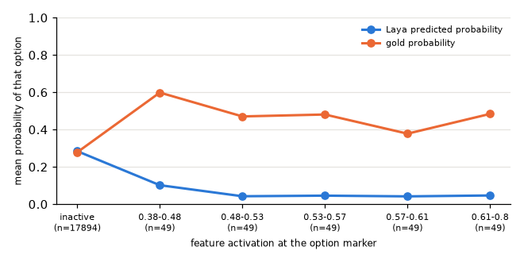

# Feature 8276

Critérios em que aparece: corr_error_stratified, corr_probe_right_laya_wrong_stratified

**Interpretação (preencher):** 

---

## Maiores ativações

**tr_invoice_processing_000208 / matches_order** (noul, invoice_processing) | ativação 8.805 em `opção` | opções ['false', 'true'] | Laya: **true** [0.054, 0.946] | gabarito: **true**

```
<bos> noul question: The invoice reconciles with the purchase order and the recorded delivery.<eos>
▸ <mask> false: There⟦ is⟧ a discrepancy against the order or the delivery.
▸ <mask> true: Line items, quantities and amounts reconcile.

<eos>

 {"delivery": {"condition": "accepted", "date": "2026-03-19", "received_qty": 10}, "invoice": {"currency": "USD", "id": "INV-2026-6082", "lines": [{"qty": 10, "sku": "SKU-170", "total_usd": 1515.9, "unit_usd": 151.59}], "total_usd": 1515.9, "vendor": "Orbit Logistics"}, "payment": {"days_until_due": -9, "discount_expires_in_days": null, "early_payment_discount_pct": null, "status": "overdue", "terms": "net 45"}, "purchase_order": {"freight_terms": "freight prepaid by vendor, not separately billable", "id": "PO-4990", "lines": [{"qty": 10, "unit_usd": 151.59}], "total_usd": 1515.9}, "vendor_history": {"disputes_12m": 0, "invoices_12m": 22, "prior_invoice_ids": ["INV-2026-4660"]}}<eos>
```

**tr_invoice_processing_000068 / matches_order** (noul, invoice_processing) | ativação 8.789 em `opção` | opções ['false', 'true'] | Laya: **true** [0.044, 0.956] | gabarito: **true**

```
<bos> noul question: The invoice reconciles with the purchase order and the recorded delivery.<eos>
▸ <mask> false: There⟦ is⟧ a discrepancy against the order or the delivery.
▸ <mask> true: Line items, quantities and amounts reconcile.

<eos>

 {"delivery": {"condition": "accepted with exceptions", "date": "2026-03-18", "received_qty": 50}, "invoice": {"currency": "USD", "id": "INV-2026-5355", "lines": [{"qty": 50, "sku": "SKU-380", "total_usd": 1136.5, "unit_usd": 22.73}], "total_usd": 1136.5, "vendor": "Vantage Materials"}, "payment": {"days_until_due": 27, "discount_expires_in_days": 3, "early_payment_discount_pct": 2.0, "status": "scheduled", "terms": "net 45"}, "purchase_order": {"freight_terms": "freight prepaid by vendor, not separately billable", "id": null, "lines": [{"qty": 50, "unit_usd": 22.73}], "total_usd": 1136.5}, "vendor_history": {"disputes_12m": 1, "invoices_12m": 33, "prior_invoice_ids": ["INV-2026-2856", "INV-2026-9344"]}}<eos>
```

**tr_invoice_processing_000253 / matches_order** (noul, invoice_processing) | ativação 8.766 em `opção` | opções ['false', 'true'] | Laya: **true** [0.073, 0.927] | gabarito: **true**

```
<bos> noul question: The invoice reconciles with the purchase order and the recorded delivery.<eos>
▸ <mask> false: There⟦ is⟧ a discrepancy against the order or the delivery.
▸ <mask> true: Line items, quantities and amounts reconcile.

<eos>

 {"delivery": {"condition": "accepted", "date": "2026-03-23", "received_qty": 50}, "invoice": {"currency": "USD", "id": "INV-2026-6964", "lines": [{"qty": 50, "sku": "SKU-290", "total_usd": 620.5, "unit_usd": 12.41}], "total_usd": 620.5, "vendor": "Orbit Logistics"}, "payment": {"days_until_due": 5, "discount_expires_in_days": 7, "early_payment_discount_pct": 2.0, "status": "scheduled", "terms": "net 15"}, "purchase_order": {"freight_terms": "freight prepaid by vendor, not separately billable", "id": "PO-4144", "lines": [{"qty": 50, "unit_usd": 12.41}], "total_usd": 620.5}, "vendor_history": {"disputes_12m": 0, "invoices_12m": 23, "prior_invoice_ids": ["INV-2026-6197", "INV-2026-7648"]}}<eos>
```

**tr_invoice_processing_000295 / matches_order** (noul, invoice_processing) | ativação 8.766 em `opção` | opções ['false', 'true'] | Laya: **true** [0.047, 0.953] | gabarito: **false**

```
<bos> noul question: The invoice reconciles with the purchase order and the recorded delivery.<eos>
▸ <mask> false: There⟦ is⟧ a discrepancy against the order or the delivery.
▸ <mask> true: Line items, quantities and amounts reconcile.

<eos>

 {"delivery": {"condition": "accepted with exceptions", "date": "2026-03-12", "received_qty": 25}, "invoice": {"currency": "EUR", "id": "INV-2026-7576", "lines": [{"qty": 25, "sku": "SKU-352", "total_usd": 9343.0, "unit_usd": 373.72}], "total_usd": 9343.0, "vendor": "Orbit Logistics"}, "payment": {"days_until_due": 27, "discount_expires_in_days": null, "early_payment_discount_pct": null, "status": "scheduled", "terms": "net 30"}, "purchase_order": {"freight_terms": "freight prepaid by vendor, not separately billable", "id": "PO-3117", "lines": [{"qty": 25, "unit_usd": 373.72}], "total_usd": 9343.0}, "vendor_history": {"disputes_12m": 0, "invoices_12m": 9, "prior_invoice_ids": ["INV-2026-6695"]}}<eos>
```

**tr_invoice_processing_000196 / matches_order** (noul, invoice_processing) | ativação 8.758 em `opção` | opções ['false', 'true'] | Laya: **true** [0.038, 0.962] | gabarito: **true**

```
<bos> noul question: The invoice reconciles with the purchase order and the recorded delivery.<eos>
▸ <mask> false: There⟦ is⟧ a discrepancy against the order or the delivery.
▸ <mask> true: Line items, quantities and amounts reconcile.

<eos>

 {"delivery": {"condition": "accepted", "date": "2026-03-12", "received_qty": 50}, "invoice": {"currency": "USD", "id": "INV-2026-9921", "lines": [{"qty": 50, "sku": "SKU-318", "total_usd": 4862.0, "unit_usd": 97.24}], "total_usd": 4862.0, "vendor": "Vantage Materials"}, "payment": {"days_until_due": 0, "discount_expires_in_days": null, "early_payment_discount_pct": null, "status": "scheduled", "terms": "net 30"}, "purchase_order": {"freight_terms": "freight prepaid by vendor, not separately billable", "id": "PO-1505", "lines": [{"qty": 50, "unit_usd": 97.24}], "total_usd": 4862.0}, "vendor_history": {"disputes_12m": 1, "invoices_12m": 25, "prior_invoice_ids": ["INV-2026-5325"]}}<eos>
```

## Ativações medianas (faixa 40-60%, mediana 2.324)

**tr_invoice_processing_000074 / discrepancy_severity** (score, invoice_processing) | ativação 2.482 em `pergunta` | opções ['0', '1', '2', '3'] | Laya: **2** [0.074, 0.23, 0.616, 0.081] | gabarito: **3**

```
<bos> score question: How material is⟦ any⟧ discrepancy between the invoice, the order and the delivery?<eos>
▸ <mask> level 0: None: everything reconciles.
▸ <mask> level 1: Trivial: rounding or a cosmetic difference.
▸ <mask> level 2: Moderate: a real difference worth confirming.
▸ <mask> level 3: Material: a large or unexplained difference.

<eos>

 {"delivery": {"condition": "accepted", "date": null, "received_qty": 0}, "invoice": {"currency": "USD", "id": "INV-2026-8150", "lines": [{"qty": 10, "sku": "SKU-228", "total_usd": 2795.6, "unit_usd": 279.56}], "total_usd": 2795.6, "vendor": "Acme Fabrication"}, "payment": {"days_until_due": 2, "discount_expires_in_days": 3, "early_payment_discount_pct": 2.0, "status": "scheduled", "terms": "net 45"}, "purchase_order": {"freight_terms": "freight prepaid by vendor, not separately billable", "id": "PO-7986", "lines": [{"qty": 10, "unit_usd": 279.56}], "total_usd": 2795.6}, "vendor_history": {"disputes_12m": 1, "invoices_12m": 19, "prior_invoice_ids": ["INV-2026-4271"]}}<eos>
```

**tr_invoice_processing_000281 / matches_order** (noul, invoice_processing) | ativação 2.287 em `opção` | opções ['false', 'true'] | Laya: **true** [0.032, 0.968] | gabarito: **false**

```
<bos> noul question: The invoice reconciles with the purchase order and the recorded delivery.<eos>
▸ <mask> false⟦:⟧ There is a discrepancy against the order or the delivery.
▸ <mask> true: Line items, quantities and amounts reconcile.

<eos>

 {"delivery": {"condition": "accepted", "date": null, "received_qty": 0}, "invoice": {"currency": "USD", "id": "INV-2026-1417", "lines": [{"qty": 50, "sku": "SKU-310", "total_usd": 11531.0, "unit_usd": 230.62}], "total_usd": 11531.0, "vendor": "Orbit Logistics"}, "payment": {"days_until_due": 18, "discount_expires_in_days": null, "early_payment_discount_pct": null, "status": "scheduled", "terms": "net 30"}, "purchase_order": {"freight_terms": "freight prepaid by vendor, not separately billable", "id": "PO-4042", "lines": [{"qty": 50, "unit_usd": 230.62}], "total_usd": 11531.0}, "vendor_history": {"disputes_12m": 1, "invoices_12m": 20, "prior_invoice_ids": ["INV-2026-3644"]}}<eos>
```

**tr_invoice_processing_000051 / matches_order** (noul, invoice_processing) | ativação 2.266 em `opção` | opções ['false', 'true'] | Laya: **true** [0.055, 0.945] | gabarito: **false**

```
<bos> noul question: The invoice reconciles with the purchase order and the recorded delivery.<eos>
▸ <mask> false⟦:⟧ There is a discrepancy against the order or the delivery.
▸ <mask> true: Line items, quantities and amounts reconcile.

<eos>

 {"delivery": {"condition": "accepted", "date": "2026-03-21", "received_qty": 50}, "invoice": {"currency": "USD", "id": "INV-2026-9184", "lines": [{"qty": 50, "sku": "SKU-942", "total_usd": 13431.0, "unit_usd": 268.62}, {"qty": 1, "sku": "FREIGHT", "total_usd": 826.36, "unit_usd": 826.36}], "total_usd": 14257.36, "vendor": "Vantage Materials"}, "payment": {"days_until_due": 2, "discount_expires_in_days": 5, "early_payment_discount_pct": 2.0, "status": "scheduled", "terms": "net 45"}, "purchase_order": {"freight_terms": "freight prepaid by vendor, not separately billable", "id": "PO-3229", "lines": [{"qty": 50, "unit_usd": 268.62}], "total_usd": 13431.0}, "vendor_history": {"disputes_12m": 1, "invoices_12m": 20, "prior_invoice_ids": ["INV-2026-5102", "INV-2026-3057"]}}<eos>
```

**tr_invoice_processing_000266 / discrepancy_severity** (score, invoice_processing) | ativação 2.301 em `pergunta` | opções ['0', '1', '2', '3'] | Laya: **2** [0.058, 0.362, 0.523, 0.056] | gabarito: **0**

```
<bos> score question: How material is⟦ any⟧ discrepancy between the invoice, the order and the delivery?<eos>
▸ <mask> level 0: None: everything reconciles.
▸ <mask> level 1: Trivial: rounding or a cosmetic difference.
▸ <mask> level 2: Moderate: a real difference worth confirming.
▸ <mask> level 3: Material: a large or unexplained difference.

<eos>

 {"delivery": {"condition": "accepted", "date": "2026-03-01", "received_qty": 10}, "invoice": {"currency": "USD", "id": "INV-2026-9048", "lines": [{"qty": 10, "sku": "SKU-496", "total_usd": 1442.8, "unit_usd": 144.28}], "total_usd": 1442.8, "vendor": "Kestrel Supply"}, "payment": {"days_until_due": -21, "discount_expires_in_days": null, "early_payment_discount_pct": null, "status": "overdue", "terms": "net 30"}, "purchase_order": {"freight_terms": "freight prepaid by vendor, not separately billable", "id": "PO-8683", "lines": [{"qty": 10, "unit_usd": 144.28}], "total_usd": 1442.8}, "vendor_history": {"disputes_12m": 2, "invoices_12m": 17, "prior_invoice_ids": ["INV-2026-2055", "INV-2026-5598", "INV-2026-7732", "INV-2026-9595"]}}<eos>
```

**tr_invoice_processing_000065 / discrepancy_severity** (score, invoice_processing) | ativação 2.572 em `pergunta` | opções ['0', '1', '2', '3'] | Laya: **2** [0.054, 0.384, 0.503, 0.058] | gabarito: **0**

```
<bos> score question: How material is⟦ any⟧ discrepancy between the invoice, the order and the delivery?<eos>
▸ <mask> level 0: None: everything reconciles.
▸ <mask> level 1: Trivial: rounding or a cosmetic difference.
▸ <mask> level 2: Moderate: a real difference worth confirming.
▸ <mask> level 3: Material: a large or unexplained difference.

<eos>

 {"delivery": {"condition": "accepted", "date": "2026-03-22", "received_qty": 250}, "invoice": {"currency": "USD", "id": "INV-2026-7887", "lines": [{"qty": 250, "sku": "SKU-490", "total_usd": 31982.5, "unit_usd": 127.93}], "total_usd": 31982.5, "vendor": "Orbit Logistics"}, "payment": {"days_until_due": 0, "discount_expires_in_days": 5, "early_payment_discount_pct": 2.0, "status": "scheduled", "terms": "net 15"}, "purchase_order": {"freight_terms": "freight prepaid by vendor, not separately billable", "id": "PO-8246", "lines": [{"qty": 250, "unit_usd": 127.93}], "total_usd": 31982.5}, "vendor_history": {"disputes_12m": 1, "invoices_12m": 17, "prior_invoice_ids": ["INV-2026-4688", "INV-2026-4365", "INV-2026-2955"]}}<eos>
```

## Estatísticas (conjunto de descoberta, dev e teste)

**pred / error**

| split | decisões | ativas | ativas e Laya errou | taxa | lift | q (BH) | OR (CMH) | q (CMH) |
|---|---|---|---|---|---|---|---|---|
| discovery | 5100 | 3 | 2 | 0.667 | 1.04 | nan | nan | nan |
| dev | 900 | 0 | 0 | nan | nan | nan | nan | nan |
| test | 2000 | 1 | 1 | 1.000 | 1.54 | nan | nan | nan |

**corr / error**

| split | decisões | ativas | ativas e Laya errou | taxa | lift | q (BH) | OR (CMH) | q (CMH) |
|---|---|---|---|---|---|---|---|---|
| discovery | 5100 | 120 | 119 | 0.992 | 1.54 | 5.92e-21 | inf | 5.97e-52 |
| dev | 900 | 32 | 32 | 1.000 | 1.49 | 2.16e-05 | inf | 1.05e-12 |
| test | 2000 | 46 | 46 | 1.000 | 1.54 | 1.95e-08 | inf | 5.93e-22 |

**state / error**

| split | decisões | ativas | ativas e Laya errou | taxa | lift | q (BH) | OR (CMH) | q (CMH) |
|---|---|---|---|---|---|---|---|---|
| discovery | 5100 | 115 | 67 | 0.583 | 0.91 | 0.344 | 0.92 | 0.929 |
| dev | 900 | 15 | 10 | 0.667 | 0.99 | nan | nan | nan |
| test | 2000 | 36 | 21 | 0.583 | 0.90 | 0.763 | 0.69 | 0.787 |

**pred / probe_right_laya_wrong**

| split | decisões | ativas | ativas e Laya errou | taxa | lift | q (BH) | OR (CMH) | q (CMH) |
|---|---|---|---|---|---|---|---|---|
| discovery | 2932 | 1 | 0 | 0.000 | 0.00 | nan | nan | nan |
| dev | 523 | 0 | 0 | nan | nan | nan | nan | nan |
| test | 1149 | 1 | 1 | 1.000 | 1.64 | nan | nan | nan |

**corr / probe_right_laya_wrong**

| split | decisões | ativas | ativas e Laya errou | taxa | lift | q (BH) | OR (CMH) | q (CMH) |
|---|---|---|---|---|---|---|---|---|
| discovery | 2932 | 91 | 90 | 0.989 | 1.63 | 4.68e-18 | inf | 2.91e-41 |
| dev | 523 | 26 | 26 | 1.000 | 1.55 | 5.71e-05 | inf | 2.69e-10 |
| test | 1149 | 32 | 32 | 1.000 | 1.64 | 7.35e-07 | inf | 4.76e-18 |

**state / probe_right_laya_wrong**

| split | decisões | ativas | ativas e Laya errou | taxa | lift | q (BH) | OR (CMH) | q (CMH) |
|---|---|---|---|---|---|---|---|---|
| discovery | 2932 | 68 | 35 | 0.515 | 0.85 | 0.256 | 0.89 | 0.902 |
| dev | 523 | 8 | 4 | 0.500 | 0.77 | nan | nan | nan |
| test | 1149 | 20 | 7 | 0.350 | 0.57 | 0.133 | 0.45 | 0.669 |

Confusão mais sobre-representada (pred): `matches_order|1>0` (n=2, lift 28.57, p=nan). Formato `pergunta|índice previsto>índice correto`.

Confusão mais sobre-representada (corr): `matches_order|1>0` (n=119, lift 42.50, p=0). Formato `pergunta|índice previsto>índice correto`.

Confusão mais sobre-representada (state): `needs_human|0>1` (n=8, lift 6.57, p=2.29e-05). Formato `pergunta|índice previsto>índice correto`.



