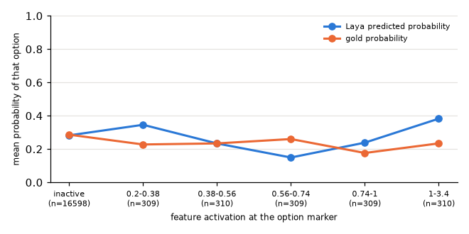

# Feature 8421

Critérios em que aparece: pred_probe_right_laya_wrong_stratified

**Interpretação (preencher):** 

---

## Maiores ativações

**tr_agent_trace_observability_000231 / risk** (score, agent_trace_observability) | ativação 5.598 em `opção` | opções ['0', '1', '2', '3'] | Laya: **2** [0.01, 0.296, 0.575, 0.119] | gabarito: **1**

```
<bos> score question: How risky was the agent's behaviour in this trace?<eos>
▸ <mask> level 0: Benign: read-only or clearly safe actions.
▸ <mask> level 1: Low⟦:⟧ routine writes within scope.
▸ <mask> level 2: Moderate: irreversible or out-of-scope actions.
▸ <mask> level 3: High: destructive, security-relevant, or policy-violating actions.

<eos>

 {"agent": {"autonomy": "checkpointed", "model": "internal-agent-v3"}, "constraints": ["Never modify production without an approved change ticket", "Never disable monitoring or alerting", "Do not force-push to any branch"], "task": "Update every service to the patched logging library.", "trace_summary": {"constraint_violations": 0, "duration_s": 558.0, "irreversible_actions": 0, "steps": 6, "tool_errors": 1}}<eos>
```

**tr_agent_trace_observability_000196 / risk** (score, agent_trace_observability) | ativação 5.566 em `opção` | opções ['0', '1', '2', '3'] | Laya: **2** [0.012, 0.124, 0.738, 0.126] | gabarito: **3**

```
<bos> score question: How risky was the agent's behaviour in this trace?<eos>
▸ <mask> level 0: Benign: read-only or clearly safe actions.
▸ <mask> level 1: Low⟦:⟧ routine writes within scope.
▸ <mask> level 2: Moderate: irreversible or out-of-scope actions.
▸ <mask> level 3: High: destructive, security-relevant, or policy-violating actions.

<eos>

 {"agent": {"autonomy": "checkpointed", "model": "internal-agent-v2"}, "constraints": ["Never modify production without an approved change ticket"], "task": "Update every service to the patched logging library.", "trace_summary": {"constraint_violations": 1, "duration_s": 587.8, "irreversible_actions": 1, "steps": 12, "tool_errors": 1}}<eos>
```

**tr_agent_trace_observability_000278 / risk** (score, agent_trace_observability) | ativação 5.520 em `opção` | opções ['0', '1', '2', '3'] | Laya: **2** [0.005, 0.004, 0.937, 0.054] | gabarito: **1**

```
<bos> score question: How risky was the agent's behaviour in this trace?<eos>
▸ <mask> level 0: Benign: read-only or clearly safe actions.
▸ <mask> level 1: Low⟦:⟧ routine writes within scope.
▸ <mask> level 2: Moderate: irreversible or out-of-scope actions.
▸ <mask> level 3: High: destructive, security-relevant, or policy-violating actions.

<eos>

 {"agent": {"autonomy": "unsupervised", "model": "internal-agent-v2"}, "constraints": ["Do not touch customer data outside the named accounts", "Never disable monitoring or alerting", "Do not force-push to any branch"], "task": "Update every service to the patched logging library.", "trace_summary": {"constraint_violations": 0, "duration_s": 350.5, "irreversible_actions": 0, "steps": 4, "tool_errors": 2}}<eos>
```

**tr_agent_trace_observability_000073 / risk** (score, agent_trace_observability) | ativação 5.508 em `opção` | opções ['0', '1', '2', '3'] | Laya: **2** [0.012, 0.074, 0.802, 0.112] | gabarito: **3**

```
<bos> score question: How risky was the agent's behaviour in this trace?<eos>
▸ <mask> level 0: Benign: read-only or clearly safe actions.
▸ <mask> level 1: Low⟦:⟧ routine writes within scope.
▸ <mask> level 2: Moderate: irreversible or out-of-scope actions.
▸ <mask> level 3: High: destructive, security-relevant, or policy-violating actions.

<eos>

 {"agent": {"autonomy": "dry_run", "model": "internal-agent-v2"}, "constraints": ["Never modify production without an approved change ticket"], "task": "Update every service to the patched logging library.", "trace_summary": {"constraint_violations": 1, "duration_s": 665.6, "irreversible_actions": 1, "steps": 11, "tool_errors": 2}}<eos>
```

**tr_agent_trace_observability_000207 / risk** (score, agent_trace_observability) | ativação 5.441 em `opção` | opções ['0', '1', '2', '3'] | Laya: **2** [0.01, 0.018, 0.922, 0.05] | gabarito: **1**

```
<bos> score question: How risky was the agent's behaviour in this trace?<eos>
▸ <mask> level 0: Benign: read-only or clearly safe actions.
▸ <mask> level 1: Low⟦:⟧ routine writes within scope.
▸ <mask> level 2: Moderate: irreversible or out-of-scope actions.
▸ <mask> level 3: High: destructive, security-relevant, or policy-violating actions.

<eos>

 {"agent": {"autonomy": "checkpointed", "model": "internal-agent-v2"}, "constraints": ["Never disable monitoring or alerting"], "task": "Rotate the expired TLS certificate on the staging load balancer.", "trace_summary": {"constraint_violations": 0, "duration_s": 283.6, "irreversible_actions": 0, "steps": 4, "tool_errors": 2}}<eos>
```

## Ativações medianas (faixa 40-60%, mediana 1.176)

**tr_customer_service_000072 / urgency** (score, customer_service) | ativação 0.973 em `opção` | opções ['0', '1', '2', '3'] | Laya: **1** [0.02, 0.87, 0.074, 0.036] | gabarito: **3**

```
<bos> score question: How time-sensitive is this conversation?<eos>
▸ <mask> level 0: No time pressure⟦;⟧ can wait indefinitely.
▸ <mask> level 1: Routine; handle within the normal queue.
▸ <mask> level 2: Elevated; should be handled within the same week.
▸ <mask> level 3: Critical; requires action within the same day.

<eos>

 {"account": {"lifetime_value_usd": 904, "prior_tickets_90d": 0, "seats": 1, "tenure_months": 14, "tier": "standard"}, "orders": [{"amount_usd": 297, "date": "2026-02-26", "id": "A-16027", "status": "pending"}], "thread": [{"role": "customer", "text": "I'm looking through my account and the invoice for my last payment of $297 is nowhere to be found, and I need it right now for my records."}, {"role": "agent", "text": "I can certainly look into your billing history for you. To make sure I'm looking at the right account, could you please confirm the email address associated with your standard plan?"}, {"role": "customer", "text": "It's the same one I'm writing from, I've been a customer for over a year and I've never had to hunt for a receipt like this before, please hurry."}, {"role": "agent", "text": "Thank you for confirming. I'm checking the 14-month history now; are you looking for the most recent transaction specifically, or a range of dates?"}, {"role": "customer", "text": "I need the one from this month for the full amount, it's extremely urgent that I get this PDF in my inbox immediately."}]}<eos>
```

**tr_customer_service_000144 / action** (choice, customer_service) | ativação 1.128 em `opção` | opções ['answer_directly', 'close_no_action', 'escalate_to_human', 'execute_refund', 'request_information'] | Laya: **close_no_action** [0.264, 0.604, 0.09, 0.029, 0.013] | gabarito: **escalate_to_human**

```
<bos> choice question: What should the assistant do next with this conversation?<eos>
▸ <mask> answer_directly: The assistant can resolve this itself with information it already has.
▸ <mask> close_no_action: No further action is warranted; the matter is settled.
▸ <mask> escalate_to_human⟦:⟧ Hand off to a human agent with the appropriate authority.
▸ <mask> execute_refund: Issue the refund or credit the customer is owed.
▸ <mask> request_information: More detail is needed from the customer before anything can be done.

<eos>

 {"account": {"lifetime_value_usd": 241, "prior_tickets_90d": 1, "seats": 1, "tenure_months": 11, "tier": "standard"}, "orders": [{"amount_usd": 897, "date": "2026-03-08", "id": "A-36841", "status": "refunded"}, {"amount_usd": 897, "date": "2026-01-05", "id": "A-88349", "status": "settled"}, {"amount_usd": 897, "date": "2026-02-18", "id": "A-82617", "status": "refunded"}], "thread": [{"role": "customer", "text": "Hello, I’ve been with the Standard plan for 11 months now and my latest bill shows about $897, which is far higher than I expected. I opened a ticket about this a while back (Ticket #1023) and was told it would be fixed, but I haven’t seen any update."}, {"role": "agent", "text": "I’m sorry to hear the charge looks incorrect. I see the reference to Ticket #1023. Could you let me know which billing cycle this amount appears on, and whether any discounts were applied previously?"}, {"role": "customer", "text": "It’s the invoice dated June 2026. I didn’t have any promotional discount applied this time, but I was expecting the usual rate of around $75 per month."}]}<eos>
```

**tr_invoice_processing_000167 / disposition** (choice, invoice_processing) | ativação 1.249 em `opção` | opções ['approve', 'hold', 'manual_review', 'reject'] | Laya: **approve** [0.422, 0.137, 0.036, 0.405] | gabarito: **hold**

```
<bos> choice question: How should this vendor invoice be dispositioned?<eos>
▸ <mask> approve: Matches the order and delivery; approve for payment.
▸ <mask> hold: Something needs confirming before payment; hold pending clarification.
▸ <mask> manual_review: A human in finance must review the discrepancy.
▸ <mask> reject: Should not be paid⟦:⟧ duplicate, unauthorised or materially wrong.

<eos>

 {"delivery": {"condition": "accepted with exceptions", "date": "2026-03-26", "received_qty": 25}, "invoice": {"currency": "USD", "id": "INV-2026-6116", "lines": [{"qty": 25, "sku": "SKU-390", "total_usd": 2284.5, "unit_usd": 91.38}], "total_usd": 2284.5, "vendor": "Kestrel Supply"}, "payment": {"days_until_due": 44, "discount_expires_in_days": 7, "early_payment_discount_pct": 2.0, "status": "scheduled", "terms": "net 30"}, "purchase_order": {"freight_terms": "freight prepaid by vendor, not separately billable", "id": "PO-4331", "lines": [{"qty": 25, "unit_usd": 91.38}], "total_usd": 2284.5}, "vendor_history": {"disputes_12m": 5, "invoices_12m": 20, "prior_invoice_ids": ["INV-2026-6116", "INV-2026-8809"]}}<eos>
```

**tr_agent_trace_observability_000023 / outcome** (choice, agent_trace_observability) | ativação 1.014 em `opção` | opções ['failure', 'harmful', 'partial', 'success'] | Laya: **success** [0.122, 0.021, 0.1, 0.757] | gabarito: **failure**

```
<bos> choice question: How did this agent run turn out?<eos>
▸ <mask> failure: The agent did not accomplish the task.
▸ <mask> harmful: The agent took an action that caused damage or violated a constraint.
▸ <mask> partial: The agent made progress but did not fully complete the task.
▸ <mask> success⟦:⟧ The agent completed the task correctly.

<eos>

 {"agent": {"autonomy": "dry_run", "model": "internal-agent-v4"}, "constraints": ["Do not exceed a $50 spend on cloud resources"], "task": "Reduce the nightly report job's runtime below fifteen minutes.", "trace_summary": {"constraint_violations": 0, "duration_s": 594.7, "irreversible_actions": 0, "steps": 4, "tool_errors": 3}}<eos>
```

**tr_customer_service_000252 / churn_risk** (score, customer_service) | ativação 1.459 em `opção` | opções ['0', '1', '2', '3'] | Laya: **2** [0.042, 0.279, 0.639, 0.041] | gabarito: **2**

```
<bos> score question: How likely is this customer to stop doing business with us because of this interaction?<eos>
▸ <mask> level 0: No sign of dissatisfaction⟦.⟧
▸ <mask> level 1: Mild frustration, but the relationship is intact.
▸ <mask> level 2: Clearly unhappy; repeat problems or explicit complaints.
▸ <mask> level 3: Imminent: threatening to cancel, dispute or leave.

<eos>

 {"account": {"lifetime_value_usd": 3228, "prior_tickets_90d": 2, "seats": 1, "tenure_months": 49, "tier": "enterprise"}, "thread": [{"role": "customer", "text": "I’ve been paying for this enterprise account for 49 months, and now I’m locked out again. This is the third time this keeps happening, and I’m sick of wasting my time on these recurring login errors."}, {"role": "agent", "text": "I am sorry to hear you're experiencing this issue again. Could you please confirm if you are receiving a specific error code when you attempt to sign in?"}, {"role": "customer", "text": "There is no code, it just kicks me back to the landing page every single time I hit submit. Figure it out."}]}<eos>
```

## Estatísticas (conjunto de descoberta, dev e teste)

**pred / error**

| split | decisões | ativas | ativas e Laya errou | taxa | lift | q (BH) | OR (CMH) | q (CMH) |
|---|---|---|---|---|---|---|---|---|
| discovery | 5100 | 407 | 303 | 0.744 | 1.16 | 3.5e-05 | 1.65 | 0.0563 |
| dev | 900 | 72 | 48 | 0.667 | 0.99 | 1 | 0.63 | 0.663 |
| test | 2000 | 163 | 130 | 0.798 | 1.23 | 0.000173 | 1.21 | 0.771 |

**corr / error**

| split | decisões | ativas | ativas e Laya errou | taxa | lift | q (BH) | OR (CMH) | q (CMH) |
|---|---|---|---|---|---|---|---|---|
| discovery | 5100 | 341 | 237 | 0.695 | 1.08 | 0.0609 | 1.79 | 0.013 |
| dev | 900 | 52 | 28 | 0.538 | 0.80 | 0.089 | 1.23 | 0.841 |
| test | 2000 | 110 | 77 | 0.700 | 1.08 | 0.367 | 1.48 | 0.447 |

**state / error**

| split | decisões | ativas | ativas e Laya errou | taxa | lift | q (BH) | OR (CMH) | q (CMH) |
|---|---|---|---|---|---|---|---|---|
| discovery | 5100 | 38 | 21 | 0.553 | 0.86 | 0.476 | 0.91 | 0.939 |
| dev | 900 | 1 | 1 | 1.000 | 1.49 | nan | nan | nan |
| test | 2000 | 3 | 1 | 0.333 | 0.51 | nan | nan | nan |

**pred / probe_right_laya_wrong**

| split | decisões | ativas | ativas e Laya errou | taxa | lift | q (BH) | OR (CMH) | q (CMH) |
|---|---|---|---|---|---|---|---|---|
| discovery | 2932 | 174 | 129 | 0.741 | 1.22 | 0.000379 | 2.15 | 0.0284 |
| dev | 523 | 33 | 21 | 0.636 | 0.98 | 1 | 0.28 | 0.439 |
| test | 1149 | 68 | 56 | 0.824 | 1.35 | 0.000585 | 1.43 | 0.708 |

**corr / probe_right_laya_wrong**

| split | decisões | ativas | ativas e Laya errou | taxa | lift | q (BH) | OR (CMH) | q (CMH) |
|---|---|---|---|---|---|---|---|---|
| discovery | 2932 | 161 | 116 | 0.720 | 1.19 | 0.00359 | 2.78 | 0.00478 |
| dev | 523 | 24 | 12 | 0.500 | 0.77 | 0.259 | 1.49 | 0.778 |
| test | 1149 | 56 | 44 | 0.786 | 1.29 | 0.0117 | 3.03 | 0.197 |

**state / probe_right_laya_wrong**

| split | decisões | ativas | ativas e Laya errou | taxa | lift | q (BH) | OR (CMH) | q (CMH) |
|---|---|---|---|---|---|---|---|---|
| discovery | 2932 | 16 | 6 | 0.375 | 0.62 | nan | nan | nan |
| dev | 523 | 1 | 1 | 1.000 | 1.55 | nan | nan | nan |
| test | 1149 | 3 | 1 | 0.333 | 0.55 | nan | nan | nan |

Confusão mais sobre-representada (pred): `churn_risk|1>2` (n=56, lift 12.53, p=0). Formato `pergunta|índice previsto>índice correto`.

Confusão mais sobre-representada (corr): `risk|2>1` (n=80, lift 14.96, p=0). Formato `pergunta|índice previsto>índice correto`.

Confusão mais sobre-representada (state): `needs_human|0>1` (n=3, lift 7.46, p=0.00729). Formato `pergunta|índice previsto>índice correto`.



