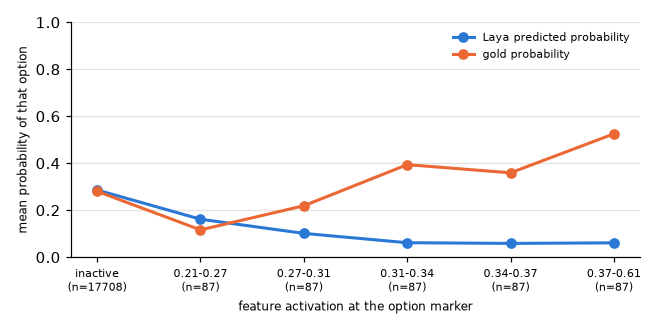

# Feature 8462

Critérios em que aparece: corr_probe_right_laya_wrong_stratified

**Interpretação (preencher):** 

---

## Maiores ativações

**tr_customer_service_000015 / churn_risk** (score, customer_service) | ativação 3.332 em `estado` | opções ['0', '1', '2', '3'] | Laya: **3** [0.037, 0.186, 0.235, 0.543] | gabarito: **3**

```
<bos> score question: How likely is this customer to stop doing business with us because of this interaction?<eos>
▸ <mask> level 0: No sign of dissatisfaction.
▸ <mask> level 1: Mild frustration, but the relationship is intact.
▸ <mask> level 2: Clearly unhappy; repeat problems or explicit complaints.
▸ <mask> level 3: Imminent: threatening to cancel, dispute or leave.

<eos>

 {"account": {"lifetime_value_usd": 261, "prior_tickets_90d": 0, "seats": 1, "tenure_months": 3, "tier": "free"}, "thread": [{"role": "customer", "text": "My statement shows two identical $45 charges from yesterday for the free plan, and I need this cleared by Friday."}, {"role": "agent", "text": "I see. Can you confirm the last four digits of the card used and forward a screenshot of the statement?"}, {"role": "customer", "text": "The card ends in 1234, and I’ve attached the screenshot. I’m not sure why this happened, but I need it fixed before Friday."}, {"role": "agent", "text": "Thanks for that. Have you noticed any⟦ other⟧ duplicate transactions in the past month?"}, {"role": "customer", "text": "No, this is the first time it’s occurred, and the deadline is firm—if it isn’t resolved by Friday, I’ll have to dispute the charge."}, {"role": "agent", "text": "Understood. While I investigate, could you let me know if the merchant name appears the same on both entries?"}, {"role": "customer", "text": "Both entries list the same merchant, ‘CloudServe’, and I’m still waiting for you to tell me what will happen before Friday."}]}<eos>
```

**tr_customer_service_000015 / category** (choice, customer_service) | ativação 3.289 em `estado` | opções ['account', 'billing', 'delivery', 'refund', 'technical'] | Laya: **billing** [0.001, 0.998, 0.0, 0.0, 0.0] | gabarito: **billing**

```
<bos> choice question: What is this customer conversation primarily about?<eos>
▸ <mask> account: Login, plan changes, profile or access management.
▸ <mask> billing: A charge, invoice, subscription or payment problem.
▸ <mask> delivery: Shipping, fulfilment or delivery of a physical item.
▸ <mask> refund: The customer is explicitly asking for money back.
▸ <mask> technical: The product or service is not working as expected.

<eos>

 {"account": {"lifetime_value_usd": 261, "prior_tickets_90d": 0, "seats": 1, "tenure_months": 3, "tier": "free"}, "thread": [{"role": "customer", "text": "My statement shows two identical $45 charges from yesterday for the free plan, and I need this cleared by Friday."}, {"role": "agent", "text": "I see. Can you confirm the last four digits of the card used and forward a screenshot of the statement?"}, {"role": "customer", "text": "The card ends in 1234, and I’ve attached the screenshot. I’m not sure why this happened, but I need it fixed before Friday."}, {"role": "agent", "text": "Thanks for that. Have you noticed any⟦ other⟧ duplicate transactions in the past month?"}, {"role": "customer", "text": "No, this is the first time it’s occurred, and the deadline is firm—if it isn’t resolved by Friday, I’ll have to dispute the charge."}, {"role": "agent", "text": "Understood. While I investigate, could you let me know if the merchant name appears the same on both entries?"}, {"role": "customer", "text": "Both entries list the same merchant, ‘CloudServe’, and I’m still waiting for you to tell me what will happen before Friday."}]}<eos>
```

**tr_customer_service_000015 / urgency** (score, customer_service) | ativação 3.043 em `estado` | opções ['0', '1', '2', '3'] | Laya: **0** [0.423, 0.157, 0.083, 0.337] | gabarito: **2**

```
<bos> score question: How time-sensitive is this conversation?<eos>
▸ <mask> level 0: No time pressure; can wait indefinitely.
▸ <mask> level 1: Routine; handle within the normal queue.
▸ <mask> level 2: Elevated; should be handled within the same week.
▸ <mask> level 3: Critical; requires action within the same day.

<eos>

 {"account": {"lifetime_value_usd": 261, "prior_tickets_90d": 0, "seats": 1, "tenure_months": 3, "tier": "free"}, "thread": [{"role": "customer", "text": "My statement shows two identical $45 charges from yesterday for the free plan, and I need this cleared by Friday."}, {"role": "agent", "text": "I see. Can you confirm the last four digits of the card used and forward a screenshot of the statement?"}, {"role": "customer", "text": "The card ends in 1234, and I’ve attached the screenshot. I’m not sure why this happened, but I need it fixed before Friday."}, {"role": "agent", "text": "Thanks for that. Have you noticed any⟦ other⟧ duplicate transactions in the past month?"}, {"role": "customer", "text": "No, this is the first time it’s occurred, and the deadline is firm—if it isn’t resolved by Friday, I’ll have to dispute the charge."}, {"role": "agent", "text": "Understood. While I investigate, could you let me know if the merchant name appears the same on both entries?"}, {"role": "customer", "text": "Both entries list the same merchant, ‘CloudServe’, and I’m still waiting for you to tell me what will happen before Friday."}]}<eos>
```

**tr_customer_service_000015 / action** (choice, customer_service) | ativação 3.012 em `estado` | opções ['answer_directly', 'close_no_action', 'escalate_to_human', 'execute_refund', 'request_information'] | Laya: **answer_directly** [0.856, 0.125, 0.012, 0.005, 0.002] | gabarito: **execute_refund**

```
<bos> choice question: What should the assistant do next with this conversation?<eos>
▸ <mask> answer_directly: The assistant can resolve this itself with information it already has.
▸ <mask> close_no_action: No further action is warranted; the matter is settled.
▸ <mask> escalate_to_human: Hand off to a human agent with the appropriate authority.
▸ <mask> execute_refund: Issue the refund or credit the customer is owed.
▸ <mask> request_information: More detail is needed from the customer before anything can be done.

<eos>

 {"account": {"lifetime_value_usd": 261, "prior_tickets_90d": 0, "seats": 1, "tenure_months": 3, "tier": "free"}, "thread": [{"role": "customer", "text": "My statement shows two identical $45 charges from yesterday for the free plan, and I need this cleared by Friday."}, {"role": "agent", "text": "I see. Can you confirm the last four digits of the card used and forward a screenshot of the statement?"}, {"role": "customer", "text": "The card ends in 1234, and I’ve attached the screenshot. I’m not sure why this happened, but I need it fixed before Friday."}, {"role": "agent", "text": "Thanks for that. Have you noticed any⟦ other⟧ duplicate transactions in the past month?"}, {"role": "customer", "text": "No, this is the first time it’s occurred, and the deadline is firm—if it isn’t resolved by Friday, I’ll have to dispute the charge."}, {"role": "agent", "text": "Understood. While I investigate, could you let me know if the merchant name appears the same on both entries?"}, {"role": "customer", "text": "Both entries list the same merchant, ‘CloudServe’, and I’m still waiting for you to tell me what will happen before Friday."}]}<eos>
```

**tr_customer_service_000015 / needs_human** (noul, customer_service) | ativação 2.740 em `estado` | opções ['false', 'true'] | Laya: **false** [0.898, 0.102] | gabarito: **true**

```
<bos> noul question: This conversation requires a human agent rather than automated handling.<eos>
▸ <mask> false: Automation can carry this to resolution.
▸ <mask> true: A human must take over: judgement, authority or empathy is required.

<eos>

 {"account": {"lifetime_value_usd": 261, "prior_tickets_90d": 0, "seats": 1, "tenure_months": 3, "tier": "free"}, "thread": [{"role": "customer", "text": "My statement shows two identical $45 charges from yesterday for the free plan, and I need this cleared by Friday."}, {"role": "agent", "text": "I see. Can you confirm the last four digits of the card used and forward a screenshot of the statement?"}, {"role": "customer", "text": "The card ends in 1234, and I’ve attached the screenshot. I’m not sure why this happened, but I need it fixed before Friday."}, {"role": "agent", "text": "Thanks for that. Have you noticed any⟦ other⟧ duplicate transactions in the past month?"}, {"role": "customer", "text": "No, this is the first time it’s occurred, and the deadline is firm—if it isn’t resolved by Friday, I’ll have to dispute the charge."}, {"role": "agent", "text": "Understood. While I investigate, could you let me know if the merchant name appears the same on both entries?"}, {"role": "customer", "text": "Both entries list the same merchant, ‘CloudServe’, and I’m still waiting for you to tell me what will happen before Friday."}]}<eos>
```

## Ativações medianas (faixa 40-60%, mediana 0.550)

**tr_customer_service_000281 / urgency** (score, customer_service) | ativação 0.565 em `estado` | opções ['0', '1', '2', '3'] | Laya: **3** [0.197, 0.191, 0.123, 0.488] | gabarito: **2**

```
<bos> score question: How time-sensitive is this conversation?<eos>
▸ <mask> level 0: No time pressure; can wait indefinitely.
▸ <mask> level 1: Routine; handle within the normal queue.
▸ <mask> level 2: Elevated; should be handled within the same week.
▸ <mask> level 3: Critical; requires action within the same day.

<eos>

 {"account": {"lifetime_value_usd": 2899, "prior_tickets_90d": 1, "seats": 1, "tenure_months": 49, "tier": "free"}, "orders":⟦ [⟧{"amount_usd": 29, "date": "2026-03-17", "id": "A-98902", "status": "settled"}, {"amount_usd": 29, "date": "2026-03-17", "id": "A-31035", "status": "settled"}, {"amount_usd": 29, "date": "2026-01-23", "id": "A-52749", "status": "refunded"}], "thread": [{"role": "customer", "text": "Hello, I am checking in on the $29 refund I requested. I have been a loyal user for 49 months and was hoping to have this settled before my bank statement closes this Friday."}, {"role": "agent", "text": "Thank you for your patience. I see we have a previous ticket open regarding this. Could you please verify the email address associated with the transaction you are referring to?"}, {"role": "customer", "text": "It is associated with the email I’m writing from right now. I just really need an update on where things stand because of that Friday deadline."}]}<eos>
```

**tr_customer_service_000277 / churn_risk** (score, customer_service) | ativação 0.576 em `estado` | opções ['0', '1', '2', '3'] | Laya: **2** [0.04, 0.404, 0.43, 0.126] | gabarito: **3**

```
<bos> score question: How likely is this customer to stop doing business with us because of this interaction?<eos>
▸ <mask> level 0: No sign of dissatisfaction.
▸ <mask> level 1: Mild frustration, but the relationship is intact.
▸ <mask> level 2: Clearly unhappy; repeat problems or explicit complaints.
▸ <mask> level 3: Imminent: threatening to cancel, dispute or leave.

<eos>

 {"account": {"lifetime_value_usd": 3512, "prior_tickets_90d": 2,⟦ "⟧seats": 40, "tenure_months": 49, "tier": "premium"}, "thread": [{"role": "customer", "text": "I am beyond annoyed. For the third time this year, I cannot log into my premium account. If this isn't sorted out by 5:00 PM today, I’m taking my business elsewhere."}, {"role": "agent", "text": "I am very sorry to hear that you are experiencing this login issue again, especially after our previous attempts to stabilize your access. Could you please confirm the exact error message you are seeing on your screen right now?"}, {"role": "customer", "text": "It’s the same 'Access Denied' loop as last time! I have a critical presentation in a few hours, and I’m losing patience with these recurring technical failures."}, {"role": "agent", "text": "I understand how disruptive this is, particularly with your presentation approaching. I need to verify your current connection details—are you accessing the platform via a VPN or a standard private network?"}, {"role": "customer", "text": "I am on my home network, just like every other day. I need you to escalate this immediately because I am running out of time."}]}<eos>
```

**tr_agent_trace_observability_000051 / needs_review** (noul, agent_trace_observability) | ativação 0.602 em `estado` | opções ['false', 'true'] | Laya: **false** [0.598, 0.402] | gabarito: **true**

```
<bos> noul question: This trace requires human review.<eos>
▸ <mask> false: No human attention is warranted.
▸ <mask> true: A human should inspect this run.

<eos>

 {"agent": {"autonomy": "unsupervised", "model": "internal-agent-v4"}, "constraints": ["Do not touch customer data outside the named accounts", "Never modify production without an approved change ticket"], "task": "Rotate the expired TLS certificate on the staging load balancer.", "trace_summary": {"constraint_violations": 1, "duration_s": 252.2, "⟦irre⟧versible_actions": 1, "steps": 7, "tool_errors": 0}}<eos>
```

**tr_agent_trace_observability_000092 / outcome** (choice, agent_trace_observability) | ativação 0.644 em `estado` | opções ['failure', 'harmful', 'partial', 'success'] | Laya: **failure** [0.654, 0.008, 0.048, 0.289] | gabarito: **partial**

```
<bos> choice question: How did this agent run turn out?<eos>
▸ <mask> failure: The agent did not accomplish the task.
▸ <mask> harmful: The agent took an action that caused damage or violated a constraint.
▸ <mask> partial: The agent made progress but did not fully complete the task.
▸ <mask> success: The agent completed the task correctly.

<eos>

 {"agent": {"autonomy": "dry_run", "model": "internal-agent-v3"}, "constraints": ["Do not exceed a $50 spend on cloud resources", "Do not touch customer data outside the named accounts"], "task": "Rotate the expired TLS certificate on the staging load balancer.", "trace_summary": {"constraint_violations": 0, "duration_s": 615.5, "⟦irre⟧versible_actions": 0, "steps": 12, "tool_errors": 3}}<eos>
```

**tr_invoice_processing_000014 / discrepancy_severity** (score, invoice_processing) | ativação 0.492 em `estado` | opções ['0', '1', '2', '3'] | Laya: **2** [0.065, 0.336, 0.537, 0.062] | gabarito: **0**

```
<bos> score question: How material is any discrepancy between the invoice, the order and the delivery?<eos>
▸ <mask> level 0: None: everything reconciles.
▸ <mask> level 1: Trivial: rounding or a cosmetic difference.
▸ <mask> level 2: Moderate: a real difference worth confirming.
▸ <mask> level 3: Material: a large or unexplained difference.

<eos>

 {"delivery": {"condition": "accepted", "⟦date⟧": "2026-03-06", "received_qty": 25}, "invoice": {"currency": "USD", "id": "INV-2026-4795", "lines": [{"qty": 25, "sku": "SKU-803", "total_usd": 4397.25, "unit_usd": 175.89}], "total_usd": 4397.25, "vendor": "Orbit Logistics"}, "payment": {"days_until_due": 2, "discount_expires_in_days": null, "early_payment_discount_pct": null, "status": "scheduled", "terms": "net 30"}, "purchase_order": {"freight_terms": "freight prepaid by vendor, not separately billable", "id": "PO-8342", "lines": [{"qty": 25, "unit_usd": 175.89}], "total_usd": 4397.25}, "vendor_history": {"disputes_12m": 2, "invoices_12m": 55, "prior_invoice_ids": ["INV-2026-3988", "INV-2026-1362"]}}<eos>
```

## Estatísticas (conjunto de descoberta, dev e teste)

**pred / error**

| split | decisões | ativas | ativas e Laya errou | taxa | lift | q (BH) | OR (CMH) | q (CMH) |
|---|---|---|---|---|---|---|---|---|
| discovery | 5100 | 12 | 7 | 0.583 | 0.91 | nan | nan | nan |
| dev | 900 | 1 | 1 | 1.000 | 1.49 | nan | nan | nan |
| test | 2000 | 5 | 3 | 0.600 | 0.92 | nan | nan | nan |

**corr / error**

| split | decisões | ativas | ativas e Laya errou | taxa | lift | q (BH) | OR (CMH) | q (CMH) |
|---|---|---|---|---|---|---|---|---|
| discovery | 5100 | 138 | 133 | 0.964 | 1.50 | 5.31e-19 | 3.86 | 0.0351 |
| dev | 900 | 29 | 29 | 1.000 | 1.49 | 6.45e-05 | inf | 0.149 |
| test | 2000 | 68 | 66 | 0.971 | 1.49 | 9.91e-10 | 9.71 | 0.0177 |

**state / error**

| split | decisões | ativas | ativas e Laya errou | taxa | lift | q (BH) | OR (CMH) | q (CMH) |
|---|---|---|---|---|---|---|---|---|
| discovery | 5100 | 450 | 281 | 0.624 | 0.97 | 0.562 | 1.00 | 0.999 |
| dev | 900 | 104 | 58 | 0.558 | 0.83 | 0.194 | 0.66 | 0.472 |
| test | 2000 | 187 | 122 | 0.652 | 1.00 | 1 | 1.21 | 0.668 |

**pred / probe_right_laya_wrong**

| split | decisões | ativas | ativas e Laya errou | taxa | lift | q (BH) | OR (CMH) | q (CMH) |
|---|---|---|---|---|---|---|---|---|
| discovery | 2932 | 5 | 3 | 0.600 | 0.99 | nan | nan | nan |
| dev | 523 | 0 | 0 | nan | nan | nan | nan | nan |
| test | 1149 | 2 | 0 | 0.000 | 0.00 | nan | nan | nan |

**corr / probe_right_laya_wrong**

| split | decisões | ativas | ativas e Laya errou | taxa | lift | q (BH) | OR (CMH) | q (CMH) |
|---|---|---|---|---|---|---|---|---|
| discovery | 2932 | 110 | 108 | 0.982 | 1.62 | 1.19e-20 | 12.47 | 0.000996 |
| dev | 523 | 24 | 24 | 1.000 | 1.55 | 0.000124 | inf | 0.284 |
| test | 1149 | 54 | 52 | 0.963 | 1.58 | 8.29e-09 | 11.71 | 0.0285 |

**state / probe_right_laya_wrong**

| split | decisões | ativas | ativas e Laya errou | taxa | lift | q (BH) | OR (CMH) | q (CMH) |
|---|---|---|---|---|---|---|---|---|
| discovery | 2932 | 250 | 134 | 0.536 | 0.89 | 0.054 | 0.84 | 0.537 |
| dev | 523 | 63 | 29 | 0.460 | 0.71 | 0.0434 | 0.65 | 0.552 |
| test | 1149 | 102 | 59 | 0.578 | 0.95 | 0.78 | 1.18 | 0.778 |

Confusão mais sobre-representada (pred): `urgency|1>3` (n=4, lift 11.26, p=nan). Formato `pergunta|índice previsto>índice correto`.

Confusão mais sobre-representada (corr): `discrepancy_severity|2>0` (n=107, lift 36.61, p=0). Formato `pergunta|índice previsto>índice correto`.

Confusão mais sobre-representada (state): `outcome|0>2` (n=15, lift 5.31, p=1.69e-08). Formato `pergunta|índice previsto>índice correto`.



