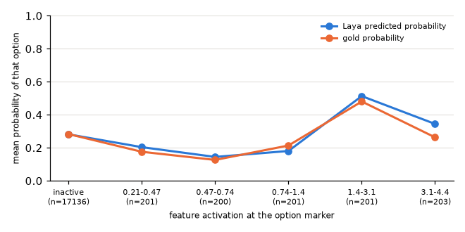

# Feature 8514

Critérios em que aparece: pred_probe_right_laya_wrong_stratified

**Interpretação (preencher):** 

---

## Maiores ativações

**tr_customer_service_000157 / category** (choice, customer_service) | ativação 6.285 em `opção` | opções ['account', 'billing', 'delivery', 'refund', 'technical'] | Laya: **account** [1.0, 0.0, 0.0, 0.0, 0.0] | gabarito: **account**

```
<bos> choice question: What is this customer conversation primarily about?<eos>
▸ <mask> account⟦:⟧ Login, plan changes, profile or access management.
▸ <mask> billing: A charge, invoice, subscription or payment problem.
▸ <mask> delivery: Shipping, fulfilment or delivery of a physical item.
▸ <mask> refund: The customer is explicitly asking for money back.
▸ <mask> technical: The product or service is not working as expected.

<eos>

 {"account": {"lifetime_value_usd": 3086, "prior_tickets_90d": 3, "seats": 1, "tenure_months": 49, "tier": "standard"}, "thread": [{"role": "customer", "text": "I need to get into my account right now – the login page just keeps looping back to the password screen and I can’t access anything."}, {"role": "agent", "text": "I understand the urgency. Could you share the exact error message you’re seeing, or let me know if you’ve tried resetting the password?"}, {"role": "customer", "text": "The message says “authentication failed” after I enter my credentials, and I’ve already tried the password reset twice with no luck."}]}<eos>
```

**tr_customer_service_000178 / category** (choice, customer_service) | ativação 6.211 em `opção` | opções ['account', 'billing', 'delivery', 'refund', 'technical'] | Laya: **account** [0.999, 0.0, 0.0, 0.0, 0.001] | gabarito: **account**

```
<bos> choice question: What is this customer conversation primarily about?<eos>
▸ <mask> account⟦:⟧ Login, plan changes, profile or access management.
▸ <mask> billing: A charge, invoice, subscription or payment problem.
▸ <mask> delivery: Shipping, fulfilment or delivery of a physical item.
▸ <mask> refund: The customer is explicitly asking for money back.
▸ <mask> technical: The product or service is not working as expected.

<eos>

 {"account": {"lifetime_value_usd": 337, "prior_tickets_90d": 2, "seats": 1, "tenure_months": 5, "tier": "premium"}, "thread": [{"role": "customer", "text": "Good morning, I hope you can help—I'm unable to log into my premium account."}, {"role": "agent", "text": "Good morning! Could you let me know what you see on the screen when you try to sign in?"}, {"role": "customer", "text": "When I enter my password, the system just reloads the login page without an error."}, {"role": "agent", "text": "Thanks for the detail. Are you using two‑factor authentication, and have you tried clearing your browser cache?"}, {"role": "customer", "text": "I do have 2FA enabled, and I've cleared my browser cache, but the issue persists."}, {"role": "agent", "text": "Understood. When was the last time you successfully logged in, and have you changed your phone number or authentication app recently?"}, {"role": "customer", "text": "The last time I logged in was about a week ago, and I haven't changed my phone; I really need access before Friday's meeting."}]}<eos>
```

**tr_customer_service_000245 / category** (choice, customer_service) | ativação 6.184 em `opção` | opções ['account', 'billing', 'delivery', 'refund', 'technical'] | Laya: **account** [0.999, 0.0, 0.0, 0.0, 0.001] | gabarito: **account**

```
<bos> choice question: What is this customer conversation primarily about?<eos>
▸ <mask> account⟦:⟧ Login, plan changes, profile or access management.
▸ <mask> billing: A charge, invoice, subscription or payment problem.
▸ <mask> delivery: Shipping, fulfilment or delivery of a physical item.
▸ <mask> refund: The customer is explicitly asking for money back.
▸ <mask> technical: The product or service is not working as expected.

<eos>

 {"account": {"lifetime_value_usd": 1250, "prior_tickets_90d": 0, "seats": 1, "tenure_months": 14, "tier": "enterprise"}, "thread": [{"role": "customer", "text": "I'm a bit lost—I've been trying to log into our enterprise portal for the last twenty minutes but it keeps saying my credentials aren't recognized. I haven't changed anything since yesterday, and I'm not seeing any emails about account updates even though I've used this login for over a year. Is there something special I need to do to get back in?"}]}<eos>
```

**tr_customer_service_000246 / category** (choice, customer_service) | ativação 5.996 em `opção` | opções ['account', 'billing', 'delivery', 'refund', 'technical'] | Laya: **account** [0.492, 0.02, 0.002, 0.002, 0.484] | gabarito: **account**

```
<bos> choice question: What is this customer conversation primarily about?<eos>
▸ <mask> account⟦:⟧ Login, plan changes, profile or access management.
▸ <mask> billing: A charge, invoice, subscription or payment problem.
▸ <mask> delivery: Shipping, fulfilment or delivery of a physical item.
▸ <mask> refund: The customer is explicitly asking for money back.
▸ <mask> technical: The product or service is not working as expected.

<eos>

 {"account": {"lifetime_value_usd": 2575, "prior_tickets_90d": 0, "seats": 1, "tenure_months": 60, "tier": "free"}, "orders": [{"amount_usd": 9, "date": "2026-01-21", "id": "A-12450", "status": "settled"}], "thread": [{"role": "customer", "text": "I need someone to help me right now, I'm completely locked out of my account and I have a major presentation starting in less than twenty minutes!"}, {"role": "agent", "text": "I understand the urgency of getting back into your account before your presentation. Could you tell me the exact error message you receive when you try to log in?"}, {"role": "customer", "text": "It just says 'Authentication Failed' over and over again, and I've already tried the password reset button three times but no email is showing up!"}, {"role": "agent", "text": "Thank you for that information. To help me narrow this down, are you attempting to log in through our desktop application or via a web browser?"}, {"role": "customer", "text": "I've tried Chrome, Safari, and the desktop app, and nothing is working; I'm starting to panic because all my files are in there and I can't get to them!"}, {"role": "agent", "text": "I see. Have you had a chance to check your junk or spam folders for that reset link, or are you using a corporate network that might have a strict firewall?"}, {"role": "customer", "text": "I've checked every folder and there is nothing, and I'm just on my home Wi-Fi, so please tell me what else I can try because I'm running out of time!"}]}<eos>
```

**tr_customer_service_000191 / category** (choice, customer_service) | ativação 5.984 em `opção` | opções ['account', 'billing', 'delivery', 'refund', 'technical'] | Laya: **account** [1.0, 0.0, 0.0, 0.0, 0.0] | gabarito: **account**

```
<bos> choice question: What is this customer conversation primarily about?<eos>
▸ <mask> account⟦:⟧ Login, plan changes, profile or access management.
▸ <mask> billing: A charge, invoice, subscription or payment problem.
▸ <mask> delivery: Shipping, fulfilment or delivery of a physical item.
▸ <mask> refund: The customer is explicitly asking for money back.
▸ <mask> technical: The product or service is not working as expected.

<eos>

 {"account": {"lifetime_value_usd": 35, "prior_tickets_90d": 5, "seats": 1, "tenure_months": 1, "tier": "standard"}, "thread": [{"role": "customer", "text": "I’m done with this login nonsense. I’ve only been on the standard plan for a month, and already I can’t get into my dashboard. I’ve opened five tickets already that never got resolved, and I’m ready to cancel."}, {"role": "agent", "text": "I hear your frustration. Can you tell me the exact message you see when you attempt to sign in and the browser you’re using?"}, {"role": "customer", "text": "It just loops back to the login page with no error, even after clearing cookies. I’ve tried Chrome and Firefox, same thing."}]}<eos>
```

## Ativações medianas (faixa 40-60%, mediana 0.825)

**tr_customer_service_000081 / category** (choice, customer_service) | ativação 0.927 em `pergunta` | opções ['account', 'billing', 'delivery', 'refund', 'technical'] | Laya: **technical** [0.306, 0.008, 0.001, 0.002, 0.683] | gabarito: **technical**

```
<bos> choice question: What is this customer conversation primarily about⟦?⟧<eos>
▸ <mask> account: Login, plan changes, profile or access management.
▸ <mask> billing: A charge, invoice, subscription or payment problem.
▸ <mask> delivery: Shipping, fulfilment or delivery of a physical item.
▸ <mask> refund: The customer is explicitly asking for money back.
▸ <mask> technical: The product or service is not working as expected.

<eos>

 {"account": {"lifetime_value_usd": 2666, "prior_tickets_90d": 0, "seats": 1, "tenure_months": 33, "tier": "free"}, "orders": [{"amount_usd": 99, "date": "2026-03-03", "id": "A-62974", "status": "settled"}, {"amount_usd": 99, "date": "2026-01-10", "id": "A-57266", "status": "pending"}, {"amount_usd": 99, "date": "2026-02-19", "id": "A-75157", "status": "refunded"}], "thread": [{"role": "customer", "text": "Hello, I’m having trouble with the new analytics widget on my dashboard – it just stays blank. I’m on the free plan and have been with you for 33 months, but I need it working by next Monday for a presentation."}, {"role": "agent", "text": "Thank you for reaching out. Could you describe what you see when you try to load the widget and any error messages that appear?"}, {"role": "customer", "text": "Sure, the area where the chart should be just shows a gray box with the text “Loading…”. No other error pops up. I’ve tried refreshing and clearing cache."}, {"role": "agent", "text": "I appreciate the details. May I ask which browser and version you’re using, as that can affect the widget rendering?"}, {"role": "customer", "text": "I’m on Chrome version 115.0.5790.110 on Windows 10."}, {"role": "agent", "text": "Got it, thank you. I’ll investigate this on my end and let you know if we need any additional info."}, {"role": "customer", "text": "Thanks for looking into it. Please keep me posted—I really need this fixed before my Monday deadline."}]}<eos>
```

**tr_customer_service_000220 / needs_human** (noul, customer_service) | ativação 0.742 em `estado` | opções ['false', 'true'] | Laya: **true** [0.057, 0.943] | gabarito: **false**

```
<bos> noul question: This conversation requires a human agent rather than automated handling.<eos>
▸ <mask> false: Automation can carry this to resolution.
▸ <mask> true: A human must take over: judgement, authority or empathy is required.

<eos>

 {"account": {"lifetime_value_usd": 94,⟦ "⟧prior_tickets_90d": 0, "seats": 1, "tenure_months": 1, "tier": "standard"}, "orders": [{"amount_usd": 9, "date": "2026-01-18", "id": "A-69685", "status": "settled"}, {"amount_usd": 9, "date": "2026-03-15", "id": "A-58214", "status": "settled"}, {"amount_usd": 9, "date": "2026-02-06", "id": "A-56446", "status": "failed"}], "thread": [{"role": "customer", "text": "I’ve been trying to log into my account for the past hour and it keeps throwing an error. I have a major presentation due in two hours and this is beyond frustrating. Why is this happening?"}, {"role": "agent", "text": "I’m sorry to hear you're experiencing trouble accessing your account right before your deadline. Could you please provide the specific error message or code you are seeing on your screen?"}, {"role": "customer", "text": "It just says 'Authentication Failed' no matter how many times I reset my password. I don't have time for this nonsense, I need access now."}, {"role": "agent", "text": "Thank you for that information. To help me investigate further, are you attempting to log in via a web browser or our mobile application?"}, {"role": "customer", "text": "I am using Chrome on my laptop, just like I do every single day. Just fix it, I have people waiting on these files."}]}<eos>
```

**tr_customer_service_000190 / action** (choice, customer_service) | ativação 0.864 em `opção` | opções ['answer_directly', 'close_no_action', 'escalate_to_human', 'execute_refund', 'request_information'] | Laya: **answer_directly** [0.759, 0.012, 0.01, 0.006, 0.212] | gabarito: **answer_directly**

```
<bos> choice question: What should the assistant do next with this conversation?<eos>
▸ <mask> answer_directly: The assistant can resolve this itself with information it already has.
▸ <mask> close_no_action: No further action is warranted; the matter is settled.
▸ <mask> escalate_to_human: Hand off to a human agent with the appropriate authority.
▸ <mask> execute_refund⟦:⟧ Issue the refund or credit the customer is owed.
▸ <mask> request_information: More detail is needed from the customer before anything can be done.

<eos>

 {"account": {"lifetime_value_usd": 245, "prior_tickets_90d": 0, "seats": 1, "tenure_months": 14, "tier": "standard"}, "orders": [{"amount_usd": 299, "date": "2026-03-03", "id": "A-23818", "status": "settled"}], "thread": [{"role": "customer", "text": "I’m not sure what’s going on—I need a copy of my invoice for the $299 charge, but I can’t find it anywhere in the portal. I’ve only been with the standard plan for 14 months, so I thought it would be straightforward."}, {"role": "agent", "text": "I’m sorry for the confusion. Could you let me know the month you’re looking for and which email you use for the account?"}, {"role": "customer", "text": "It’s the invoice for March 2026, and the account email is jane.doe@example.com."}, {"role": "agent", "text": "Thanks, Jane. I’ll check the records for that invoice. Just to be clear, are you looking for the PDF version or a printed copy?"}, {"role": "customer", "text": "A PDF would be fine, I just need it to submit to my accountant by the 20th."}]}<eos>
```

**tr_security_incidents_000108 / severity** (score, security_incidents) | ativação 0.769 em `opção` | opções ['0', '1', '2', '3', '4'] | Laya: **2** [0.14, 0.224, 0.352, 0.14, 0.144] | gabarito: **3**

```
<bos> score question: How severe is the potential impact if this alert is real?<eos>
▸ <mask> level 0: Negligible: no access to anything sensitive.
▸ <mask> level 1: Low: limited access, easily reversed.
▸ <mask> level 2: Moderate⟦:⟧ access to internal systems or non-public data.
▸ <mask> level 3: High: access to production, secrets or customer data.
▸ <mask> level 4: Critical: active compromise of crown-jewel systems.

<eos>

 {"alert": {"description": "a large transfer to an external destination", "evidence": "A transfer of approximately 2.3 TB was recorded from internal address 10.12.45.78 to external destination 203.0.113.45 over TCP port 443, beginning at 2026-09-15 02:14 UTC and completing at 03:01 UTC. The activity originated from a shared_mailbox account with privileged rights, MFA enabled, and a password last rotated 90 days ago, occurring outside any defined change window.", "rule": "data_egress"}, "context": {"asset_criticality": "medium", "change_window_active": false, "source_on_allowlist": false}, "history": {"credential_rotation_days_ago": 90, "distinct_countries_30d": 1, "logins_30d": 1708, "prior_alerts_90d": 3}, "principal": {"mfa_enrolled": true, "name": "usr-support-496", "privileges": ["deploy:production", "secrets:read"], "type": "shared_mailbox"}}<eos>
```

**tr_invoice_processing_000073 / urgency** (score, invoice_processing) | ativação 0.943 em `estado` | opções ['0', '1', '2', '3'] | Laya: **1** [0.128, 0.415, 0.313, 0.143] | gabarito: **3**

```
<bos> score question: How time-sensitive is processing this invoice?<eos>
▸ <mask> level 0: No time pressure; can wait indefinitely.
▸ <mask> level 1: Routine; handle within the normal queue.
▸ <mask> level 2: Elevated; should be handled within the same week.
▸ <mask> level 3: Critical; requires action within the same day.

<eos>

 {"delivery": {"condition": "accepted", "date": "2026-03-01", "received_qty": 100}, "invoice": {"currency": "EUR", "id": "INV-2026-9369", "lines": [{"qty": 100, "sku": "SKU-485", "total_usd": 35742.0, "unit_usd": 357.42}], "total_usd": 35742.0, "vendor": "Vantage Materials"}, "payment": {"days_until_due": 18, "discount_expires_in_days": 1, "early_payment_discount_pct": 2.0, "status": "scheduled", "terms": "net 60"}, "purchase_order": {"freight_terms": "freight prepaid⟦ by⟧ vendor, not separately billable", "id": "PO-8320", "lines": [{"qty": 100, "unit_usd": 357.42}], "total_usd": 35742.0}, "vendor_history": {"disputes_12m": 0, "invoices_12m": 44, "prior_invoice_ids": ["INV-2026-7453"]}}<eos>
```

## Estatísticas (conjunto de descoberta, dev e teste)

**pred / error**

| split | decisões | ativas | ativas e Laya errou | taxa | lift | q (BH) | OR (CMH) | q (CMH) |
|---|---|---|---|---|---|---|---|---|
| discovery | 5100 | 277 | 119 | 0.430 | 0.67 | 2e-12 | 2.30 | 0.0777 |
| dev | 900 | 52 | 26 | 0.500 | 0.74 | 0.0431 | 1.55 | 0.782 |
| test | 2000 | 117 | 48 | 0.410 | 0.63 | 8.15e-07 | 0.96 | 0.991 |

**corr / error**

| split | decisões | ativas | ativas e Laya errou | taxa | lift | q (BH) | OR (CMH) | q (CMH) |
|---|---|---|---|---|---|---|---|---|
| discovery | 5100 | 254 | 96 | 0.378 | 0.59 | 1.09e-17 | 1.57 | 0.236 |
| dev | 900 | 40 | 14 | 0.350 | 0.52 | 0.000148 | 1.92 | 0.66 |
| test | 2000 | 101 | 32 | 0.317 | 0.49 | 3.82e-11 | 1.03 | 0.985 |

**state / error**

| split | decisões | ativas | ativas e Laya errou | taxa | lift | q (BH) | OR (CMH) | q (CMH) |
|---|---|---|---|---|---|---|---|---|
| discovery | 5100 | 3016 | 1866 | 0.619 | 0.96 | 8e-05 | 0.92 | 0.554 |
| dev | 900 | 565 | 365 | 0.646 | 0.96 | 0.278 | 0.74 | 0.406 |
| test | 2000 | 1140 | 728 | 0.639 | 0.98 | 0.495 | 0.97 | 0.942 |

**pred / probe_right_laya_wrong**

| split | decisões | ativas | ativas e Laya errou | taxa | lift | q (BH) | OR (CMH) | q (CMH) |
|---|---|---|---|---|---|---|---|---|
| discovery | 2932 | 196 | 62 | 0.316 | 0.52 | 7.34e-16 | 4.96 | 0.000347 |
| dev | 523 | 37 | 15 | 0.405 | 0.63 | 0.0132 | 3.24 | 0.386 |
| test | 1149 | 92 | 30 | 0.326 | 0.53 | 1.32e-07 | 1.69 | 0.677 |

**corr / probe_right_laya_wrong**

| split | decisões | ativas | ativas e Laya errou | taxa | lift | q (BH) | OR (CMH) | q (CMH) |
|---|---|---|---|---|---|---|---|---|
| discovery | 2932 | 176 | 42 | 0.239 | 0.39 | 3.56e-23 | 0.20 | 0.0767 |
| dev | 523 | 28 | 6 | 0.214 | 0.33 | 1.65e-05 | 0.71 | 0.855 |
| test | 1149 | 79 | 17 | 0.215 | 0.35 | 1.76e-12 | 0.07 | 0.276 |

**state / probe_right_laya_wrong**

| split | decisões | ativas | ativas e Laya errou | taxa | lift | q (BH) | OR (CMH) | q (CMH) |
|---|---|---|---|---|---|---|---|---|
| discovery | 2932 | 1771 | 1018 | 0.575 | 0.95 | 0.000186 | 0.92 | 0.646 |
| dev | 523 | 331 | 206 | 0.622 | 0.96 | 0.437 | 0.67 | 0.304 |
| test | 1149 | 697 | 412 | 0.591 | 0.97 | 0.281 | 0.87 | 0.668 |

Confusão mais sobre-representada (pred): `disposition|0>2` (n=26, lift 8.25, p=1.88e-18). Formato `pergunta|índice previsto>índice correto`.

Confusão mais sobre-representada (corr): `category|4>0` (n=10, lift 20.08, p=7.92e-14). Formato `pergunta|índice previsto>índice correto`.

Confusão mais sobre-representada (state): `needs_human|0>1` (n=49, lift 1.53, p=2.47e-07). Formato `pergunta|índice previsto>índice correto`.



