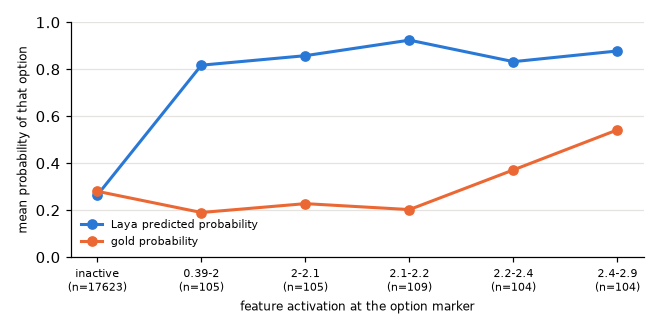

# Feature 8644

Critérios em que aparece: pred_probe_right_laya_wrong_stratified, attribution_toward_wrong

**Interpretação (preencher):** 

---

## Maiores ativações

**tr_security_incidents_000012 / credential_compromise** (noul, security_incidents) | ativação 10.758 em `opção` | opções ['false', 'true'] | Laya: **true** [0.059, 0.941] | gabarito: **false**

```
<bos> noul question: The evidence indicates a credential or account has been compromised.<eos>
▸ <mask> false: no, the statement does not hold
▸ <mask> true⟦:⟧ yes, the statement holds

<eos>

 {"alert": {"description": "a long-unused account became active", "evidence": "A login attempt was recorded for service account \"svc_backup\" from IP 203.0.113.45 at 2026-09-15T03:12:09Z. The account had no successful logins since 2024-02-10, indicating a dormant period of over two years. MFA validation succeeded and the credential metadata shows the last rotation occurred 700 days ago.", "rule": "dormant_account_use"}, "context": {"asset_criticality": "medium", "change_window_active": true, "source_on_allowlist": false}, "history": {"credential_rotation_days_ago": 700, "distinct_countries_30d": 1, "logins_30d": 106, "prior_alerts_90d": 0}, "principal": {"mfa_enrolled": true, "name": "svc-deploy-184", "privileges": ["deploy:production", "secrets:read"], "type": "service_account"}}<eos>
```

**tr_security_incidents_000085 / credential_compromise** (noul, security_incidents) | ativação 10.727 em `opção` | opções ['false', 'true'] | Laya: **true** [0.013, 0.986] | gabarito: **true**

```
<bos> noul question: The evidence indicates a credential or account has been compromised.<eos>
▸ <mask> false: no, the statement does not hold
▸ <mask> true⟦:⟧ yes, the statement holds

<eos>

 {"alert": {"description": "an unrecognised binary executed on a server", "evidence": "A binary file named 'svchost_debug.exe' was executed on server-04 at 03:14 UTC, originating from an unknown external source. The executing user account has not performed a credential rotation in 365 days and was not associated with any active change management requests.", "rule": "suspicious_process"}, "context": {"asset_criticality": "medium", "change_window_active": false, "source_on_allowlist": false}, "history": {"credential_rotation_days_ago": 365, "distinct_countries_30d": 4, "logins_30d": 1334, "prior_alerts_90d": 0}, "principal": {"mfa_enrolled": true, "name": "ci-billing-513", "privileges": ["repo:read"], "type": "employee"}}<eos>
```

**tr_security_incidents_000161 / credential_compromise** (noul, security_incidents) | ativação 10.688 em `opção` | opções ['false', 'true'] | Laya: **true** [0.009, 0.991] | gabarito: **true**

```
<bos> noul question: The evidence indicates a credential or account has been compromised.<eos>
▸ <mask> false: no, the statement does not hold
▸ <mask> true⟦:⟧ yes, the statement holds

<eos>

 {"alert": {"description": "many failed authentications followed by a success", "evidence": "From 2026‑09‑15 01:05 to 01:12 UTC, 27 consecutive failed login attempts were logged for the privileged service account svc‑backup originating from allowlisted IP 10.0.2.5, after which a successful authentication occurred at 01:13 UTC. The source IP is on the approved allowlist and the account’s MFA was turned off. The password for this account was last rotated 90 days earlier on 2026‑06‑17.", "rule": "brute_force"}, "context": {"asset_criticality": "medium", "change_window_active": false, "source_on_allowlist": true}, "history": {"credential_rotation_days_ago": 90, "distinct_countries_30d": 1, "logins_30d": 205, "prior_alerts_90d": 1}, "principal": {"mfa_enrolled": false, "name": "usr-billing-991", "privileges": ["deploy:production", "secrets:read"], "type": "service_account"}}<eos>
```

**tr_security_incidents_000236 / credential_compromise** (noul, security_incidents) | ativação 10.680 em `opção` | opções ['false', 'true'] | Laya: **true** [0.186, 0.814] | gabarito: **false**

```
<bos> noul question: The evidence indicates a credential or account has been compromised.<eos>
▸ <mask> false: no, the statement does not hold
▸ <mask> true⟦:⟧ yes, the statement holds

<eos>

 {"alert": {"description": "a long-unused account became active", "evidence": "The privileged admin_01 account, which had shown no activity for 120 consecutive days, successfully authenticated from allowlisted IP 10.0.4.55 at 02:00 AM. This session was established with MFA enabled and used credentials rotated 30 days ago, though no change tickets were active at the time.", "rule": "dormant_account_use"}, "context": {"asset_criticality": "medium", "change_window_active": false, "source_on_allowlist": true}, "history": {"credential_rotation_days_ago": 30, "distinct_countries_30d": 3, "logins_30d": 15, "prior_alerts_90d": 0}, "principal": {"mfa_enrolled": true, "name": "ci-infra-266", "privileges": ["deploy:production", "secrets:read"], "type": "admin"}}<eos>
```

**tr_security_incidents_000079 / credential_compromise** (noul, security_incidents) | ativação 10.664 em `opção` | opções ['false', 'true'] | Laya: **true** [0.005, 0.995] | gabarito: **false**

```
<bos> noul question: The evidence indicates a credential or account has been compromised.<eos>
▸ <mask> false: no, the statement does not hold
▸ <mask> true⟦:⟧ yes, the statement holds

<eos>

 {"alert": {"description": "many failed authentications followed by a success", "evidence": "Between 2026-09-16T08:05:12Z and 08:12:47Z, the shared mailbox \"alerts@corp.com\" recorded 27 consecutive failed login attempts from allow‑listed IP 198.51.100.22, followed by a successful authentication at 08:13:04Z. MFA was active for this account, and the password was rotated 3 days prior to the event.", "rule": "brute_force"}, "context": {"asset_criticality": "medium", "change_window_active": false, "source_on_allowlist": true}, "history": {"credential_rotation_days_ago": 3, "distinct_countries_30d": 3, "logins_30d": 1029, "prior_alerts_90d": 0}, "principal": {"mfa_enrolled": true, "name": "svc-analytics-857", "privileges": ["repo:read"], "type": "shared_mailbox"}}<eos>
```

## Ativações medianas (faixa 40-60%, mediana 4.062)

**tr_invoice_processing_000086 / duplicate** (noul, invoice_processing) | ativação 4.258 em `opção` | opções ['false', 'true'] | Laya: **true** [0.014, 0.986] | gabarito: **false**

```
<bos> noul question: This invoice appears to duplicate an invoice already submitted.<eos>
▸ <mask> false⟦:⟧ no, the statement does not hold
▸ <mask> true: yes, the statement holds

<eos>

 {"delivery": {"condition": "accepted", "date": "2026-03-18", "received_qty": 50}, "invoice": {"currency": "EUR", "id": "INV-2026-8962", "lines": [{"qty": 50, "sku": "SKU-949", "total_usd": 10593.5, "unit_usd": 211.87}], "total_usd": 10593.5, "vendor": "Kestrel Supply"}, "payment": {"days_until_due": 0, "discount_expires_in_days": null, "early_payment_discount_pct": null, "status": "scheduled", "terms": "net 15"}, "purchase_order": {"freight_terms": "freight prepaid by vendor, not separately billable", "id": "PO-1068", "lines": [{"qty": 50, "unit_usd": 211.87}], "total_usd": 10593.5}, "vendor_history": {"disputes_12m": 2, "invoices_12m": 2, "prior_invoice_ids": ["INV-2026-2240", "INV-2026-1956", "INV-2026-2660"]}}<eos>
```

**tr_invoice_processing_000294 / duplicate** (noul, invoice_processing) | ativação 4.234 em `opção` | opções ['false', 'true'] | Laya: **true** [0.076, 0.924] | gabarito: **false**

```
<bos> noul question: This invoice appears to duplicate an invoice already submitted.<eos>
▸ <mask> false⟦:⟧ no, the statement does not hold
▸ <mask> true: yes, the statement holds

<eos>

 {"delivery": {"condition": "accepted with exceptions", "date": "2026-03-02", "received_qty": 100}, "invoice": {"currency": "USD", "id": "INV-2026-3359", "lines": [{"qty": 120, "sku": "SKU-891", "total_usd": 49472.4, "unit_usd": 412.27}], "total_usd": 49472.4, "vendor": "Northwind Components"}, "payment": {"days_until_due": -9, "discount_expires_in_days": null, "early_payment_discount_pct": null, "status": "overdue", "terms": "net 30"}, "purchase_order": {"freight_terms": "freight prepaid by vendor, not separately billable", "id": "PO-3955", "lines": [{"qty": 100, "unit_usd": 412.27}], "total_usd": 41227.0}, "vendor_history": {"disputes_12m": 0, "invoices_12m": 13, "prior_invoice_ids": ["INV-2026-2480", "INV-2026-4309"]}}<eos>
```

**tr_security_incidents_000036 / credential_compromise** (noul, security_incidents) | ativação 4.129 em `opção` | opções ['false', 'true'] | Laya: **true** [0.084, 0.916] | gabarito: **false**

```
<bos> noul question: The evidence indicates a credential or account has been compromised.<eos>
▸ <mask> false⟦:⟧ no, the statement does not hold
▸ <mask> true: yes, the statement holds

<eos>

 {"alert": {"description": "a long-unused account became active", "evidence": "At 2026-09-15 08:43:12 UTC, the employee account \"asmith\" generated a successful interactive login from source IP 198.51.100.22, the first recorded sign‑in in the past 412 days. The login was performed with MFA enabled and originated from a device that is listed on the allowlist.", "rule": "dormant_account_use"}, "context": {"asset_criticality": "crown_jewel", "change_window_active": false, "source_on_allowlist": true}, "history": {"credential_rotation_days_ago": 412, "distinct_countries_30d": 3, "logins_30d": 1445, "prior_alerts_90d": 1}, "principal": {"mfa_enrolled": true, "name": "usr-infra-849", "privileges": ["repo:read"], "type": "employee"}}<eos>
```

**tr_security_incidents_000054 / credential_compromise** (noul, security_incidents) | ativação 2.365 em `marcador` | opções ['false', 'true'] | Laya: **true** [0.035, 0.965] | gabarito: **false**

```
<bos> noul question: The evidence indicates a credential or account has been compromised.<eos>
▸ <mask> false: no, the statement does not hold
▸ ⟦<mask>⟧ true: yes, the statement holds

<eos>

 {"alert": {"description": "a first-ever sign-in from an unfamiliar country", "evidence": "An unprivileged ci_runner authenticated from an IP address in a new country at 04:30 UTC without MFA. The source is included on the allowlist, though no change window is active and the credentials were last rotated 30 days ago.", "rule": "new_country_login"}, "context": {"asset_criticality": "low", "change_window_active": false, "source_on_allowlist": true}, "history": {"credential_rotation_days_ago": 30, "distinct_countries_30d": 1, "logins_30d": 1911, "prior_alerts_90d": 0}, "principal": {"mfa_enrolled": false, "name": "ci-infra-676", "privileges": ["repo:read"], "type": "ci_runner"}}<eos>
```

**tr_security_incidents_000099 / credential_compromise** (noul, security_incidents) | ativação 4.172 em `opção` | opções ['false', 'true'] | Laya: **false** [1.0, 0.0] | gabarito: **false**

```
<bos> noul question: The evidence indicates a credential or account has been compromised.<eos>
▸ <mask> false⟦:⟧ no, the statement does not hold
▸ <mask> true: yes, the statement holds

<eos>

 {"alert": {"description": "a security group was opened to the public internet", "evidence": "At 2026-09-15 03:42 UTC, security group SG-9f2b3c was altered to include an inbound rule allowing 0.0.0.0/0 on TCP port 443. The change was performed by user alice@example.com (admin, MFA enabled) from IP 203.0.113.45, which is not listed in the known asset inventory. The credentials used for this action were last rotated on 2026-09-12.", "rule": "config_drift"}, "context": {"asset_criticality": "low", "change_window_active": false, "source_on_allowlist": false}, "history": {"credential_rotation_days_ago": 3, "distinct_countries_30d": 4, "logins_30d": 1790, "prior_alerts_90d": 8}, "principal": {"mfa_enrolled": true, "name": "ci-support-886", "privileges": ["repo:read"], "type": "admin"}}<eos>
```

## Estatísticas (conjunto de descoberta, dev e teste)

**pred / error**

| split | decisões | ativas | ativas e Laya errou | taxa | lift | q (BH) | OR (CMH) | q (CMH) |
|---|---|---|---|---|---|---|---|---|
| discovery | 5100 | 464 | 312 | 0.672 | 1.04 | 0.28 | 3.65 | 0.158 |
| dev | 900 | 94 | 72 | 0.766 | 1.14 | 0.139 | inf | 0.535 |
| test | 2000 | 182 | 125 | 0.687 | 1.06 | 0.422 | inf | 0.484 |

**corr / error**

| split | decisões | ativas | ativas e Laya errou | taxa | lift | q (BH) | OR (CMH) | q (CMH) |
|---|---|---|---|---|---|---|---|---|
| discovery | 5100 | 174 | 22 | 0.126 | 0.20 | 3.78e-45 | nan | nan |
| dev | 900 | 26 | 4 | 0.154 | 0.23 | 6.23e-07 | nan | nan |
| test | 2000 | 66 | 9 | 0.136 | 0.21 | 6.29e-17 | nan | nan |

**state / error**

| split | decisões | ativas | ativas e Laya errou | taxa | lift | q (BH) | OR (CMH) | q (CMH) |
|---|---|---|---|---|---|---|---|---|
| discovery | 5100 | 3 | 1 | 0.333 | 0.52 | nan | nan | nan |
| dev | 900 | 0 | 0 | nan | nan | nan | nan | nan |
| test | 2000 | 1 | 1 | 1.000 | 1.54 | nan | nan | nan |

**pred / probe_right_laya_wrong**

| split | decisões | ativas | ativas e Laya errou | taxa | lift | q (BH) | OR (CMH) | q (CMH) |
|---|---|---|---|---|---|---|---|---|
| discovery | 2932 | 362 | 287 | 0.793 | 1.31 | 1.38e-14 | 8.61 | 0.0136 |
| dev | 523 | 76 | 65 | 0.855 | 1.32 | 0.000277 | inf | 0.445 |
| test | 1149 | 137 | 114 | 0.832 | 1.36 | 5.34e-08 | inf | 0.516 |

**corr / probe_right_laya_wrong**

| split | decisões | ativas | ativas e Laya errou | taxa | lift | q (BH) | OR (CMH) | q (CMH) |
|---|---|---|---|---|---|---|---|---|
| discovery | 2932 | 88 | 13 | 0.148 | 0.24 | 4.07e-18 | nan | nan |
| dev | 523 | 12 | 1 | 0.083 | 0.13 | nan | nan | nan |
| test | 1149 | 28 | 5 | 0.179 | 0.29 | 1.52e-05 | nan | nan |

**state / probe_right_laya_wrong**

| split | decisões | ativas | ativas e Laya errou | taxa | lift | q (BH) | OR (CMH) | q (CMH) |
|---|---|---|---|---|---|---|---|---|
| discovery | 2932 | 3 | 1 | 0.333 | 0.55 | nan | nan | nan |
| dev | 523 | 0 | 0 | nan | nan | nan | nan | nan |
| test | 1149 | 1 | 1 | 1.000 | 1.64 | nan | nan | nan |

Confusão mais sobre-representada (pred): `credential_compromise|1>0` (n=82, lift 10.99, p=0). Formato `pergunta|índice previsto>índice correto`.

Confusão mais sobre-representada (corr): `credential_compromise|0>1` (n=22, lift 29.31, p=1.39e-33). Formato `pergunta|índice previsto>índice correto`.

Confusão mais sobre-representada (state): `credential_compromise|1>0` (n=1, lift 20.73, p=nan). Formato `pergunta|índice previsto>índice correto`.



