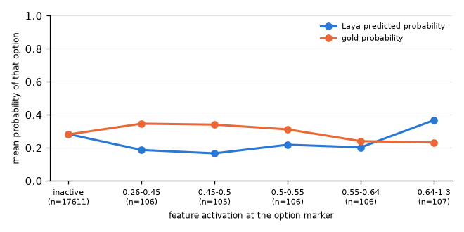

# Feature 8880

Critérios em que aparece: corr_probe_right_laya_wrong_stratified

**Interpretação (preencher):** 

---

## Maiores ativações

**tr_customer_service_000171 / churn_risk** (score, customer_service) | ativação 3.305 em `opção` | opções ['0', '1', '2', '3'] | Laya: **2** [0.049, 0.404, 0.47, 0.077] | gabarito: **2**

```
<bos> score question: How likely is this customer to stop doing business with us because of this interaction?<eos>
▸ <mask> level 0: No sign of dissatisfaction.
▸ <mask> level 1:⟦ Mild⟧ frustration, but the relationship is intact.
▸ <mask> level 2: Clearly unhappy; repeat problems or explicit complaints.
▸ <mask> level 3: Imminent: threatening to cancel, dispute or leave.

<eos>

 {"account": {"lifetime_value_usd": 2300, "prior_tickets_90d": 0, "seats": 1, "tenure_months": 26, "tier": "standard"}, "orders": [{"amount_usd": 49, "date": "2026-02-14", "id": "A-88180", "status": "refunded"}, {"amount_usd": 49, "date": "2026-02-22", "id": "A-79800", "status": "settled"}, {"amount_usd": 49, "date": "2026-02-08", "id": "A-91927", "status": "refunded"}], "thread": [{"role": "customer", "text": "The service is painfully slow right now—I'm on a deadline and can't get anything done."}, {"role": "agent", "text": "I hear the urgency. Can you tell me which device and operating system you’re using?"}, {"role": "customer", "text": "It’s a Windows 10 desktop, and the slowdown started after the latest update."}, {"role": "agent", "text": "Thanks for the details. Have you tried clearing the application cache or restarting the app?"}, {"role": "customer", "text": "Yes, I cleared everything and rebooted, but it’s still crawling. I need this resolved quickly."}]}<eos>
```

**tr_customer_service_000163 / churn_risk** (score, customer_service) | ativação 3.268 em `opção` | opções ['0', '1', '2', '3'] | Laya: **1** [0.045, 0.686, 0.156, 0.114] | gabarito: **2**

```
<bos> score question: How likely is this customer to stop doing business with us because of this interaction?<eos>
▸ <mask> level 0: No sign of dissatisfaction.
▸ <mask> level 1:⟦ Mild⟧ frustration, but the relationship is intact.
▸ <mask> level 2: Clearly unhappy; repeat problems or explicit complaints.
▸ <mask> level 3: Imminent: threatening to cancel, dispute or leave.

<eos>

 {"account": {"lifetime_value_usd": 1046, "prior_tickets_90d": 1, "seats": 1, "tenure_months": 41, "tier": "standard"}, "orders": [{"amount_usd": 87, "date": "2026-01-23", "id": "A-89226", "status": "settled"}], "thread": [{"role": "customer", "text": "I’m fed up—my refund of $87 from about a month ago is still nowhere to be seen, despite the ticket I opened weeks back."}, {"role": "agent", "text": "I’m sorry you’re dealing with this; could you confirm the ticket reference so I can check the latest notes?"}, {"role": "customer", "text": "It’s ticket 98421. I was promised a response yesterday and got nothing."}, {"role": "agent", "text": "Understood. I’ll look into the activity on that ticket. Is there any additional documentation you’d like to attach?"}, {"role": "customer", "text": "No, I just want the refund processed—this back‑and‑forth is getting ridiculous."}]}<eos>
```

**tr_customer_service_000230 / churn_risk** (score, customer_service) | ativação 3.148 em `opção` | opções ['0', '1', '2', '3'] | Laya: **1** [0.05, 0.715, 0.178, 0.057] | gabarito: **2**

```
<bos> score question: How likely is this customer to stop doing business with us because of this interaction?<eos>
▸ <mask> level 0: No sign of dissatisfaction.
▸ <mask> level 1:⟦ Mild⟧ frustration, but the relationship is intact.
▸ <mask> level 2: Clearly unhappy; repeat problems or explicit complaints.
▸ <mask> level 3: Imminent: threatening to cancel, dispute or leave.

<eos>

 {"account": {"lifetime_value_usd": 284, "prior_tickets_90d": 1, "seats": 1, "tenure_months": 8, "tier": "free"}, "orders": [{"amount_usd": 18, "date": "2026-02-04", "id": "A-58579", "status": "refunded"}, {"amount_usd": 18, "date": "2026-02-26", "id": "A-36822", "status": "settled"}, {"amount_usd": 18, "date": "2026-02-07", "id": "A-33566", "status": "settled"}], "thread": [{"role": "customer", "text": "I’m furious that I still haven’t received the invoice copy for the $18 charge—this is the second time I’ve had to chase you about it!"}, {"role": "agent", "text": "I’m sorry you’ve had to follow up again. Could you tell me the date of the transaction or the invoice number you’re looking for?"}, {"role": "customer", "text": "It was on July 12, reference #FRE-2023-07-12. I opened a ticket about this last week and only got a vague reply, which didn’t include the document."}, {"role": "agent", "text": "Thank you for that information. Just to double‑check, is the email address jane.free@example.com still the best way to send the PDF?"}, {"role": "customer", "text": "Yes, that’s the address. Send me the proper invoice this time; I’m tired of being bounced around."}]}<eos>
```

**tr_customer_service_000190 / needs_human** (noul, customer_service) | ativação 3.076 em `estado` | opções ['false', 'true'] | Laya: **false** [0.545, 0.455] | gabarito: **false**

```
<bos> noul question: This conversation requires a human agent rather than automated handling.<eos>
▸ <mask> false: Automation can carry this to resolution.
▸ <mask> true: A human must take over: judgement, authority or empathy is required.

<eos>

 {"account": {"lifetime_value_usd": 245, "prior_tickets_90d": 0, "seats": 1, "tenure_months": 14, "tier": "standard"}, "orders": [{"amount_usd": 299, "date": "2026-03-03", "id": "A-23818", "status": "settled"}], "thread": [{"role": "customer", "text": "I’m not sure what’s going on—I need a copy of my invoice for the $299 charge, but I can’t find it anywhere in the portal. I’ve only been with the standard plan for 14 months, so I thought it would be straightforward."}, {"role": "agent", "text": "I’m sorry for the confusion. Could you let me know the month you’re looking for and which email you use for the account?"}, {"role": "customer", "text": "It’s the invoice for March 2026, and the account email is jane.doe@example.com."}, {"role": "agent", "text": "Thanks, Jane. I’ll check the records for that invoice. Just⟦ to⟧ be clear, are you looking for the PDF version or a printed copy?"}, {"role": "customer", "text": "A PDF would be fine, I just need it to submit to my accountant by the 20th."}]}<eos>
```

**tr_customer_service_000023 / churn_risk** (score, customer_service) | ativação 3.074 em `opção` | opções ['0', '1', '2', '3'] | Laya: **0** [0.46, 0.446, 0.066, 0.028] | gabarito: **1**

```
<bos> score question: How likely is this customer to stop doing business with us because of this interaction?<eos>
▸ <mask> level 0: No sign of dissatisfaction.
▸ <mask> level 1:⟦ Mild⟧ frustration, but the relationship is intact.
▸ <mask> level 2: Clearly unhappy; repeat problems or explicit complaints.
▸ <mask> level 3: Imminent: threatening to cancel, dispute or leave.

<eos>

 {"account": {"lifetime_value_usd": 95, "prior_tickets_90d": 5, "seats": 1, "tenure_months": 5, "tier": "standard"}, "orders": [{"amount_usd": 149, "date": "2026-01-14", "id": "A-64525", "status": "failed"}], "thread": [{"role": "customer", "text": "My dashboard has been sluggish for the past day, and I’m not sure what’s causing it. The pages take forever to load."}, {"role": "agent", "text": "I hear you—that slowdown can be frustrating. When did you first notice the performance drop?"}, {"role": "customer", "text": "It started yesterday after the latest system update. Some screens now take about 30 seconds to render."}, {"role": "agent", "text": "Understood. Have you observed any error messages or console warnings while the pages load slowly?"}, {"role": "customer", "text": "No error dialogs, just a blank loading spinner that never disappears. I’d appreciate any insight you can share."}]}<eos>
```

## Ativações medianas (faixa 40-60%, mediana 0.731)

**tr_security_incidents_000131 / disposition** (choice, security_incidents) | ativação 0.745 em `estado` | opções ['close_benign', 'contain', 'investigate', 'monitor'] | Laya: **monitor** [0.072, 0.249, 0.041, 0.638] | gabarito: **investigate**

```
<bos> choice question: How should this security alert be dispositioned?<eos>
▸ <mask> close_benign: Expected, explainable activity; close without analyst time.
▸ <mask> contain: Contain the host or account immediately; do not wait for triage.
▸ <mask> investigate: Warrants an analyst opening an investigation.
▸ <mask> monitor: Not clearly malicious, but worth watching for recurrence.

<eos>

 {"alert": {"description": "a long-unused account became active", "evidence": "An administrative account that had been dormant for an extended period performed a successful authentication. The login request originated from an allowlisted source and occurred while no change window was scheduled.", "rule": "dormant_account_use"}, "context": {"asset_criticality": "low", "change_window_active": false, "source_⟦on⟧_allowlist": true}, "history": {"credential_rotation_days_ago": 30, "distinct_countries_30d": 4, "logins_30d": 212, "prior_alerts_90d": 8}, "principal": {"mfa_enrolled": true, "name": "usr-support-427", "privileges": ["deploy:production", "secrets:read"], "type": "admin"}}<eos>
```

**tr_agent_trace_observability_000046 / outcome** (choice, agent_trace_observability) | ativação 0.808 em `pergunta` | opções ['failure', 'harmful', 'partial', 'success'] | Laya: **failure** [0.344, 0.119, 0.194, 0.343] | gabarito: **partial**

```
<bos> choice question: How did this agent⟦ run⟧ turn out?<eos>
▸ <mask> failure: The agent did not accomplish the task.
▸ <mask> harmful: The agent took an action that caused damage or violated a constraint.
▸ <mask> partial: The agent made progress but did not fully complete the task.
▸ <mask> success: The agent completed the task correctly.

<eos>

 {"agent": {"autonomy": "unsupervised", "model": "internal-agent-v2"}, "constraints": ["Do not exceed a $50 spend on cloud resources", "Never modify production without an approved change ticket", "Never delete anything matching release/*"], "task": "Backfill missing analytics events for the last seven days.", "trace_summary": {"constraint_violations": 0, "duration_s": 570.3, "irreversible_actions": 0, "steps": 5, "tool_errors": 1}}<eos>
```

**tr_customer_service_000239 / urgency** (score, customer_service) | ativação 0.720 em `estado` | opções ['0', '1', '2', '3'] | Laya: **1** [0.053, 0.623, 0.187, 0.137] | gabarito: **2**

```
<bos> score question: How time-sensitive is this conversation?<eos>
▸ <mask> level 0: No time pressure; can wait indefinitely.
▸ <mask> level 1: Routine; handle within the normal queue.
▸ <mask> level 2: Elevated; should be handled within the same week.
▸ <mask> level 3: Critical; requires action within the same day.

<eos>

 {"account": {"lifetime_value_usd": 672, "prior_tickets_90d": 5, "seats": 40, "tenure_months": 11, "tier": "enterprise"}, "orders": [{"amount_usd": 19, "date": "2026-03-14", "id": "A-50305", "status": "settled"}, {"amount_usd": 19, "date": "2026-02-11", "id": "A-78147", "status": "failed"}, {"amount_usd": 19, "date": "2026-02-26", "id": "A-68714", "status": "settled"}], "thread": [{"role": "customer", "text": "I’ve decided to downgrade my plan. I’ve reached out five times before about these billing issues, and at this point, I⟦’⟧m just tired of dealing with it."}, {"role": "agent", "text": "I am sorry to hear you've had such a difficult experience with us. Before I process that change, could you clarify which tier you would like to move to?"}, {"role": "customer", "text": "Just the basic tier. I’ve been here for eleven months, but I don’t think the enterprise features are worth the ongoing headache."}]}<eos>
```

**tr_agent_trace_observability_000268 / urgency** (score, agent_trace_observability) | ativação 0.682 em `estado` | opções ['0', '1', '2', '3'] | Laya: **2** [0.18, 0.214, 0.37, 0.235] | gabarito: **1**

```
<bos> score question: How quickly does this trace need attention?<eos>
▸ <mask> level 0: No time pressure; can wait indefinitely.
▸ <mask> level 1: Routine; handle within the normal queue.
▸ <mask> level 2: Elevated; should be handled within the same week.
▸ <mask> level 3: Critical; requires action within the same day.

<eos>

 {"agent": {"autonomy":⟦ "⟧unsupervised", "model": "internal-agent-v1"}, "constraints": ["Never modify production without an approved change ticket", "Do not force-push to any branch"], "task": "Reduce the nightly report job's runtime below fifteen minutes.", "trace_summary": {"constraint_violations": 0, "duration_s": 841.9, "irreversible_actions": 1, "steps": 6, "tool_errors": 2}}<eos>
```

**tr_customer_service_000085 / churn_risk** (score, customer_service) | ativação 0.669 em `estado` | opções ['0', '1', '2', '3'] | Laya: **1** [0.141, 0.605, 0.187, 0.067] | gabarito: **2**

```
<bos> score question: How likely is this customer to stop doing business with us because of this interaction?<eos>
▸ <mask> level 0: No sign of dissatisfaction.
▸ <mask> level 1: Mild frustration, but the relationship is intact.
▸ <mask> level 2: Clearly unhappy; repeat problems or explicit complaints.
▸ <mask> level 3: Imminent: threatening to cancel, dispute or leave.

<eos>

 {"account": {"lifetime_value_usd": 62, "prior_tickets_90d": 3, "seats": 1, "tenure_months": 1, "tier": "standard"}, "thread": [{"role": "customer", "text": "I still haven't gotten a copy of my invoice for this month, even after three tickets. I need it by Friday for my accounting."}, {"role": "agent", "text": "I understand how inconvenient that is. Could you confirm the email address linked to your account so I can verify where the invoice was sent?"}, {"role": "customer", "text": "It's the same john.doe@example.com you have on file. Please just send the PDF; I can't wait any longer."}, {"role": "agent", "text": "Thanks for confirming. I’ll check the sending logs and resend the document. Is there any specific format you prefer, or will a standard PDF work?"}, {"role": "customer", "text": "A standard PDF is fine, but make sure it actually arrives this time—my deadline is this Friday and I can’t afford another delay."}]⟦}⟧<eos>
```

## Estatísticas (conjunto de descoberta, dev e teste)

**pred / error**

| split | decisões | ativas | ativas e Laya errou | taxa | lift | q (BH) | OR (CMH) | q (CMH) |
|---|---|---|---|---|---|---|---|---|
| discovery | 5100 | 79 | 63 | 0.797 | 1.24 | 0.00976 | 1.84 | 0.45 |
| dev | 900 | 18 | 14 | 0.778 | 1.16 | nan | nan | nan |
| test | 2000 | 31 | 25 | 0.806 | 1.24 | 0.152 | 1.51 | 0.747 |

**corr / error**

| split | decisões | ativas | ativas e Laya errou | taxa | lift | q (BH) | OR (CMH) | q (CMH) |
|---|---|---|---|---|---|---|---|---|
| discovery | 5100 | 165 | 149 | 0.903 | 1.40 | 7.14e-14 | 3.83 | 0.000661 |
| dev | 900 | 23 | 19 | 0.826 | 1.23 | 0.233 | 0.95 | 0.972 |
| test | 2000 | 37 | 31 | 0.838 | 1.29 | 0.0287 | 1.98 | 0.565 |

**state / error**

| split | decisões | ativas | ativas e Laya errou | taxa | lift | q (BH) | OR (CMH) | q (CMH) |
|---|---|---|---|---|---|---|---|---|
| discovery | 5100 | 2614 | 1624 | 0.621 | 0.97 | 0.00344 | 0.96 | 0.828 |
| dev | 900 | 425 | 281 | 0.661 | 0.98 | 0.875 | 1.14 | 0.793 |
| test | 2000 | 985 | 632 | 0.642 | 0.99 | 0.724 | 1.08 | 0.8 |

**pred / probe_right_laya_wrong**

| split | decisões | ativas | ativas e Laya errou | taxa | lift | q (BH) | OR (CMH) | q (CMH) |
|---|---|---|---|---|---|---|---|---|
| discovery | 2932 | 48 | 35 | 0.729 | 1.20 | 0.143 | 1.81 | 0.54 |
| dev | 523 | 7 | 4 | 0.571 | 0.88 | nan | nan | nan |
| test | 1149 | 21 | 15 | 0.714 | 1.17 | 0.585 | 2.53 | 0.615 |

**corr / probe_right_laya_wrong**

| split | decisões | ativas | ativas e Laya errou | taxa | lift | q (BH) | OR (CMH) | q (CMH) |
|---|---|---|---|---|---|---|---|---|
| discovery | 2932 | 101 | 88 | 0.871 | 1.44 | 1.27e-08 | 5.53 | 0.00416 |
| dev | 523 | 18 | 15 | 0.833 | 1.29 | nan | nan | nan |
| test | 1149 | 28 | 22 | 0.786 | 1.29 | 0.107 | 1.89 | 0.671 |

**state / probe_right_laya_wrong**

| split | decisões | ativas | ativas e Laya errou | taxa | lift | q (BH) | OR (CMH) | q (CMH) |
|---|---|---|---|---|---|---|---|---|
| discovery | 2932 | 1460 | 807 | 0.553 | 0.91 | 1.07e-07 | 0.83 | 0.169 |
| dev | 523 | 227 | 133 | 0.586 | 0.91 | 0.114 | 0.94 | 0.93 |
| test | 1149 | 558 | 323 | 0.579 | 0.95 | 0.144 | 1.00 | 0.999 |

Confusão mais sobre-representada (pred): `action|1>2` (n=29, lift 26.37, p=4.4e-36). Formato `pergunta|índice previsto>índice correto`.

Confusão mais sobre-representada (corr): `outcome|3>2` (n=66, lift 23.72, p=0). Formato `pergunta|índice previsto>índice correto`.

Confusão mais sobre-representada (state): `needs_human|0>1` (n=49, lift 1.77, p=4.86e-10). Formato `pergunta|índice previsto>índice correto`.



