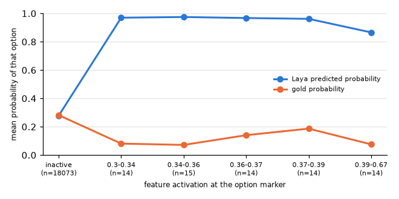

# Feature 8919

Critérios em que aparece: pred_probe_right_laya_wrong

**Interpretação (preencher):** 

---

## Maiores ativações

**tr_customer_service_000228 / category** (choice, customer_service) | ativação 2.689 em `estado` | opções ['account', 'billing', 'delivery', 'refund', 'technical'] | Laya: **account** [0.917, 0.002, 0.002, 0.004, 0.076] | gabarito: **account**

```
<bos> choice question: What is this customer conversation primarily about?<eos>
▸ <mask> account: Login, plan changes, profile or access management.
▸ <mask> billing: A charge, invoice, subscription or payment problem.
▸ <mask> delivery: Shipping, fulfilment or delivery of a physical item.
▸ <mask> refund: The customer is explicitly asking for money back.
▸ <mask> technical: The product or service is not working as expected.

<eos>

 {"account": {"lifetime_value_usd": 1521, "prior_tickets_90d": 1, "seats": 1, "tenure_months": 26, "tier": "standard"}, "thread": [{"role": "customer", "text": "I've been with the standard plan for over two years now, and I think it's time to close my account. Please go ahead and⟦ cancel⟧ it."}, {"role": "agent", "text": "I’m sorry to hear you’d like to cancel. Could you confirm the email address associated with the account so I can pull up the details?"}, {"role": "customer", "text": "Sure, it's jane.doe@example.com. I’ve already tried this before; the last ticket was closed but the issue kept coming back."}]}<eos>
```

**tr_customer_service_000228 / action** (choice, customer_service) | ativação 2.152 em `estado` | opções ['answer_directly', 'close_no_action', 'escalate_to_human', 'execute_refund', 'request_information'] | Laya: **close_no_action** [0.162, 0.783, 0.045, 0.005, 0.005] | gabarito: **escalate_to_human**

```
<bos> choice question: What should the assistant do next with this conversation?<eos>
▸ <mask> answer_directly: The assistant can resolve this itself with information it already has.
▸ <mask> close_no_action: No further action is warranted; the matter is settled.
▸ <mask> escalate_to_human: Hand off to a human agent with the appropriate authority.
▸ <mask> execute_refund: Issue the refund or credit the customer is owed.
▸ <mask> request_information: More detail is needed from the customer before anything can be done.

<eos>

 {"account": {"lifetime_value_usd": 1521, "prior_tickets_90d": 1, "seats": 1, "tenure_months": 26, "tier": "standard"}, "thread": [{"role": "customer", "text": "I've been with the standard plan for over two years now, and I think it's time to close my account. Please go ahead and⟦ cancel⟧ it."}, {"role": "agent", "text": "I’m sorry to hear you’d like to cancel. Could you confirm the email address associated with the account so I can pull up the details?"}, {"role": "customer", "text": "Sure, it's jane.doe@example.com. I’ve already tried this before; the last ticket was closed but the issue kept coming back."}]}<eos>
```

**tr_customer_service_000228 / churn_risk** (score, customer_service) | ativação 2.043 em `estado` | opções ['0', '1', '2', '3'] | Laya: **3** [0.073, 0.325, 0.266, 0.336] | gabarito: **3**

```
<bos> score question: How likely is this customer to stop doing business with us because of this interaction?<eos>
▸ <mask> level 0: No sign of dissatisfaction.
▸ <mask> level 1: Mild frustration, but the relationship is intact.
▸ <mask> level 2: Clearly unhappy; repeat problems or explicit complaints.
▸ <mask> level 3: Imminent: threatening to cancel, dispute or leave.

<eos>

 {"account": {"lifetime_value_usd": 1521, "prior_tickets_90d": 1, "seats": 1, "tenure_months": 26, "tier": "standard"}, "thread": [{"role": "customer", "text": "I've been with the standard plan for over two years now, and I think it's time to close my account. Please go ahead and⟦ cancel⟧ it."}, {"role": "agent", "text": "I’m sorry to hear you’d like to cancel. Could you confirm the email address associated with the account so I can pull up the details?"}, {"role": "customer", "text": "Sure, it's jane.doe@example.com. I’ve already tried this before; the last ticket was closed but the issue kept coming back."}]}<eos>
```

**tr_customer_service_000228 / urgency** (score, customer_service) | ativação 1.945 em `estado` | opções ['0', '1', '2', '3'] | Laya: **2** [0.073, 0.264, 0.364, 0.299] | gabarito: **1**

```
<bos> score question: How time-sensitive is this conversation?<eos>
▸ <mask> level 0: No time pressure; can wait indefinitely.
▸ <mask> level 1: Routine; handle within the normal queue.
▸ <mask> level 2: Elevated; should be handled within the same week.
▸ <mask> level 3: Critical; requires action within the same day.

<eos>

 {"account": {"lifetime_value_usd": 1521, "prior_tickets_90d": 1, "seats": 1, "tenure_months": 26, "tier": "standard"}, "thread": [{"role": "customer", "text": "I've been with the standard plan for over two years now, and I think it's time to close my account. Please go ahead and⟦ cancel⟧ it."}, {"role": "agent", "text": "I’m sorry to hear you’d like to cancel. Could you confirm the email address associated with the account so I can pull up the details?"}, {"role": "customer", "text": "Sure, it's jane.doe@example.com. I’ve already tried this before; the last ticket was closed but the issue kept coming back."}]}<eos>
```

**tr_customer_service_000228 / needs_human** (noul, customer_service) | ativação 1.897 em `estado` | opções ['false', 'true'] | Laya: **true** [0.228, 0.772] | gabarito: **true**

```
<bos> noul question: This conversation requires a human agent rather than automated handling.<eos>
▸ <mask> false: Automation can carry this to resolution.
▸ <mask> true: A human must take over: judgement, authority or empathy is required.

<eos>

 {"account": {"lifetime_value_usd": 1521, "prior_tickets_90d": 1, "seats": 1, "tenure_months": 26, "tier": "standard"}, "thread": [{"role": "customer", "text": "I've been with the standard plan for over two years now, and I think it's time to close my account. Please go ahead and⟦ cancel⟧ it."}, {"role": "agent", "text": "I’m sorry to hear you’d like to cancel. Could you confirm the email address associated with the account so I can pull up the details?"}, {"role": "customer", "text": "Sure, it's jane.doe@example.com. I’ve already tried this before; the last ticket was closed but the issue kept coming back."}]}<eos>
```

## Ativações medianas (faixa 40-60%, mediana 0.760)

**tr_customer_service_000086 / category** (choice, customer_service) | ativação 0.776 em `estado` | opções ['account', 'billing', 'delivery', 'refund', 'technical'] | Laya: **billing** [0.0, 1.0, 0.0, 0.0, 0.0] | gabarito: **billing**

```
<bos> choice question: What is this customer conversation primarily about?<eos>
▸ <mask> account: Login, plan changes, profile or access management.
▸ <mask> billing: A charge, invoice, subscription or payment problem.
▸ <mask> delivery: Shipping, fulfilment or delivery of a physical item.
▸ <mask> refund: The customer is explicitly asking for money back.
▸ <mask> technical: The product or service is not working as expected.

<eos>

 {"account": {"lifetime_value_usd": 1071, "prior_tickets_90d": 2, "seats": 1, "tenure_months": 19, "tier": "standard"}, "⟦thread⟧": [{"role": "customer", "text": "I just got a bill that’s higher than what I expected, and I don’t understand why the charge jumped. Can someone explain what’s going on? I need this cleared up by tomorrow."}, {"role": "agent", "text": "I’m sorry for the surprise. Could you tell me the date and amount shown on the statement so I can compare it to your plan details?"}, {"role": "customer", "text": "It’s the charge dated 9/14 and I need to know if this is a mistake or a new fee before the end of the day."}]}<eos>
```

**tr_customer_service_000203 / action** (choice, customer_service) | ativação 0.751 em `opção` | opções ['answer_directly', 'close_no_action', 'escalate_to_human', 'execute_refund', 'request_information'] | Laya: **close_no_action** [0.201, 0.711, 0.023, 0.034, 0.031] | gabarito: **request_information**

```
<bos> choice question: What should the assistant do next with this conversation?<eos>
▸ <mask> answer_directly: The⟦ assistant⟧ can resolve this itself with information it already has.
▸ <mask> close_no_action: No further action is warranted; the matter is settled.
▸ <mask> escalate_to_human: Hand off to a human agent with the appropriate authority.
▸ <mask> execute_refund: Issue the refund or credit the customer is owed.
▸ <mask> request_information: More detail is needed from the customer before anything can be done.

<eos>

 {"account": {"lifetime_value_usd": 303, "prior_tickets_90d": 1, "seats": 12, "tenure_months": 5, "tier": "premium"}, "thread": [{"role": "customer", "text": "Since the last update, the sync process has been taking around 15 minutes for a few megabytes, which is much slower than before."}]}<eos>
```

**tr_security_incidents_000162 / urgency** (score, security_incidents) | ativação 0.790 em `estado` | opções ['0', '1', '2', '3'] | Laya: **1** [0.098, 0.463, 0.202, 0.236] | gabarito: **2**

```
<bos> score question: How quickly must a responder act on this alert?<eos>
▸ <mask> level 0: No time pressure; can wait indefinitely.
▸ <mask> level 1: Routine; handle within the normal queue.
▸ <mask> level 2: Elevated; should be handled within the same week.
▸ <mask> level 3: Critical; requires action within the same day.

<eos>

 {"alert": {"description": "a first-ever sign-in from an unfamiliar country", "evidence": "An administrative account accessed the system from an unrecognized IP address located in a country with no prior login history. The credentials for this principal have not been updated in 700 days.", "rule": "new_country_login"}, "context": {"asset_criticality": "medium", "change_window_active": false, "source_on_allowlist": false}, "⟦history⟧": {"credential_rotation_days_ago": 700, "distinct_countries_30d": 1, "logins_30d": 1674, "prior_alerts_90d": 1}, "principal": {"mfa_enrolled": true, "name": "svc-support-499", "privileges": ["repo:read"], "type": "admin"}}<eos>
```

**tr_security_incidents_000084 / credential_compromise** (noul, security_incidents) | ativação 0.757 em `estado` | opções ['false', 'true'] | Laya: **true** [0.005, 0.995] | gabarito: **true**

```
<bos> noul question: The evidence indicates a credential or account has been compromised.<eos>
▸ <mask> false: no, the statement does not hold
▸ <mask> true: yes, the statement holds

<eos>

 {"alert": {"description": "many failed authentications followed by a success", "evidence": "The service account 'ci_runner' recorded 52 failed authentication attempts within a three-minute window, followed by a single successful login from an unrecognized IP address. This access occurred outside of a designated change window, and the account credentials have not been updated in 180 days.", "rule": "brute_force"}, "context": {"asset_criticality": "medium", "change_window_active": false, "source_on_allowlist": false}, "history": {"⟦credential⟧_rotation_days_ago": 180, "distinct_countries_30d": 2, "logins_30d": 1289, "prior_alerts_90d": 0}, "principal": {"mfa_enrolled": true, "name": "usr-infra-939", "privileges": ["repo:read"], "type": "ci_runner"}}<eos>
```

**tr_invoice_processing_000044 / duplicate** (noul, invoice_processing) | ativação 0.819 em `estado` | opções ['false', 'true'] | Laya: **true** [0.075, 0.925] | gabarito: **true**

```
<bos> noul question: This invoice appears to duplicate an invoice already submitted.<eos>
▸ <mask> false: no, the statement does not hold
▸ <mask> true: yes, the statement holds

<eos>

 {"delivery": {"condition": "accepted with exceptions", "date": "2026-03-10", "received_qty": 250}, "invoice": {"currency": "USD", "id": "INV-2026-6702", "lines": [{"qty": 250, "sku": "SKU-507", "total_usd": 101050.0, "unit_usd": 404.2}], "⟦total⟧_usd": 101050.0, "vendor": "Kestrel Supply"}, "payment": {"days_until_due": 2, "discount_expires_in_days": 1, "early_payment_discount_pct": 2.0, "status": "scheduled", "terms": "net 60"}, "purchase_order": {"freight_terms": "freight prepaid by vendor, not separately billable", "id": "PO-1900", "lines": [{"qty": 250, "unit_usd": 404.2}], "total_usd": 101050.0}, "vendor_history": {"disputes_12m": 2, "invoices_12m": 34, "prior_invoice_ids": ["INV-2026-6702"]}}<eos>
```

## Estatísticas (conjunto de descoberta, dev e teste)

**pred / error**

| split | decisões | ativas | ativas e Laya errou | taxa | lift | q (BH) | OR (CMH) | q (CMH) |
|---|---|---|---|---|---|---|---|---|
| discovery | 5100 | 65 | 57 | 0.877 | 1.36 | 0.000146 | 0.79 | 0.798 |
| dev | 900 | 30 | 27 | 0.900 | 1.34 | 0.0287 | 0.00 | 0.625 |
| test | 2000 | 21 | 17 | 0.810 | 1.24 | 0.264 | 0.41 | 0.618 |

**corr / error**

| split | decisões | ativas | ativas e Laya errou | taxa | lift | q (BH) | OR (CMH) | q (CMH) |
|---|---|---|---|---|---|---|---|---|
| discovery | 5100 | 8 | 0 | 0.000 | 0.00 | nan | nan | nan |
| dev | 900 | 3 | 0 | 0.000 | 0.00 | nan | nan | nan |
| test | 2000 | 4 | 0 | 0.000 | 0.00 | nan | nan | nan |

**state / error**

| split | decisões | ativas | ativas e Laya errou | taxa | lift | q (BH) | OR (CMH) | q (CMH) |
|---|---|---|---|---|---|---|---|---|
| discovery | 5100 | 427 | 254 | 0.595 | 0.92 | 0.0872 | 1.03 | 0.945 |
| dev | 900 | 59 | 36 | 0.610 | 0.91 | 0.732 | 0.85 | 0.853 |
| test | 2000 | 175 | 116 | 0.663 | 1.02 | 0.958 | 1.19 | 0.693 |

**pred / probe_right_laya_wrong**

| split | decisões | ativas | ativas e Laya errou | taxa | lift | q (BH) | OR (CMH) | q (CMH) |
|---|---|---|---|---|---|---|---|---|
| discovery | 2932 | 58 | 57 | 0.983 | 1.62 | 1.1e-10 | 0.00 | 0.531 |
| dev | 523 | 27 | 27 | 1.000 | 1.55 | 0.000172 | nan | nan |
| test | 1149 | 17 | 17 | 1.000 | 1.64 | nan | nan | nan |

**corr / probe_right_laya_wrong**

| split | decisões | ativas | ativas e Laya errou | taxa | lift | q (BH) | OR (CMH) | q (CMH) |
|---|---|---|---|---|---|---|---|---|
| discovery | 2932 | 1 | 0 | 0.000 | 0.00 | nan | nan | nan |
| dev | 523 | 0 | 0 | nan | nan | nan | nan | nan |
| test | 1149 | 0 | 0 | nan | nan | nan | nan | nan |

**state / probe_right_laya_wrong**

| split | decisões | ativas | ativas e Laya errou | taxa | lift | q (BH) | OR (CMH) | q (CMH) |
|---|---|---|---|---|---|---|---|---|
| discovery | 2932 | 249 | 130 | 0.522 | 0.86 | 0.0183 | 0.93 | 0.82 |
| dev | 523 | 29 | 15 | 0.517 | 0.80 | 0.497 | 0.58 | 0.53 |
| test | 1149 | 100 | 62 | 0.620 | 1.01 | 1 | 1.04 | 0.951 |

Confusão mais sobre-representada (pred): `duplicate|1>0` (n=56, lift 20.25, p=0). Formato `pergunta|índice previsto>índice correto`.

Confusão mais sobre-representada (state): `credential_compromise|1>0` (n=19, lift 2.77, p=3.16e-05). Formato `pergunta|índice previsto>índice correto`.



