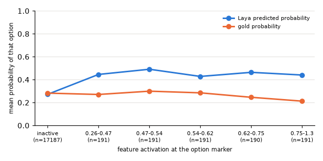

# Feature 9049

Critérios em que aparece: attribution_toward_correct

**Interpretação (preencher):** 

---

## Maiores ativações

**tr_customer_service_000084 / needs_human** (noul, customer_service) | ativação 6.684 em `estado` | opções ['false', 'true'] | Laya: **true** [0.293, 0.707] | gabarito: **true**

```
<bos> noul question: This conversation requires a human agent rather than automated handling.<eos>
▸ <mask> false: Automation can carry this to resolution.
▸ <mask> true: A human must take over: judgement, authority or empathy is required.

<eos>

 {"account": {"lifetime_value_usd": 228, "prior_tickets_90d": 1, "seats": 12, "tenure_months": 5, "tier": "premium"}, "orders": [{"amount_usd": 49, "date": "2026-02-23", "id": "A-33356", "status": "settled"}, {"amount_usd": 49, "date": "2026-03-08", "id": "A-82014", "status": "pending"}, {"amount_usd": 49, "date": "2026-02-05", "id": "A-73657", "status": "settled"}], "thread": [{"role": "customer", "text": "I've been waiting for my refund for the $49 I was charged on my premium plan, and this is the second time you've said it'll be processed and nothing happened. I'm fed up⟦ and⟧ I'm ready to cancel my subscription if this isn't sorted right now."}, {"role": "agent", "text": "I’m sorry you’ve had to deal with this again. Could you please share the ticket number you received previously so I can pull up the details and see where the hold‑up is?"}, {"role": "customer", "text": "The ticket was #123456, and I need that money back today—otherwise I'm pulling my account and moving to a competitor."}]}<eos>
```

**tr_customer_service_000073 / category** (choice, customer_service) | ativação 6.367 em `estado` | opções ['account', 'billing', 'delivery', 'refund', 'technical'] | Laya: **billing** [0.001, 0.977, 0.0, 0.0, 0.022] | gabarito: **billing**

```
<bos> choice question: What is this customer conversation primarily about?<eos>
▸ <mask> account: Login, plan changes, profile or access management.
▸ <mask> billing: A charge, invoice, subscription or payment problem.
▸ <mask> delivery: Shipping, fulfilment or delivery of a physical item.
▸ <mask> refund: The customer is explicitly asking for money back.
▸ <mask> technical: The product or service is not working as expected.

<eos>

 {"account": {"lifetime_value_usd": 54, "prior_tickets_90d": 1, "seats": 1, "tenure_months": 1, "tier": "premium"}, "orders": [{"amount_usd": 29, "date": "2026-01-23", "id": "A-91950", "status": "failed"}], "thread": [{"role": "customer", "text": "I am absolutely livid that my payment failed again after I was told this was fixed last week, this is ridiculous!"}, {"role": "agent", "text": "I'm very sorry for the ongoing trouble with your premium subscription payment; I see your previous ticket regarding this same issue."}, {"role": "customer", "text": "Seeing it doesn't help me! I've only been a member for a month and you've already messed up the $29 charge twice now."}, {"role": "agent", "text": "I understand how frustrating that is. To help me investigate, are you receiving a specific error message from your bank or within our portal?"}, {"role": "customer", "text": "It just says 'transaction failed' with no explanation, which is exactly what happened the first time I complained."}, {"role": "agent", "text": "Thank you for that detail. I'm going to pull up the logs from our payment processor to see if there's a more descriptive rejection code on the backend."}, {"role": "customer", "text": "You do that, but if this isn't sorted out once and for all⟦,⟧ I'm canceling this plan and moving to a competitor who actually wants my money."}]}<eos>
```

**tr_customer_service_000084 / urgency** (score, customer_service) | ativação 6.312 em `estado` | opções ['0', '1', '2', '3'] | Laya: **1** [0.059, 0.479, 0.137, 0.324] | gabarito: **3**

```
<bos> score question: How time-sensitive is this conversation?<eos>
▸ <mask> level 0: No time pressure; can wait indefinitely.
▸ <mask> level 1: Routine; handle within the normal queue.
▸ <mask> level 2: Elevated; should be handled within the same week.
▸ <mask> level 3: Critical; requires action within the same day.

<eos>

 {"account": {"lifetime_value_usd": 228, "prior_tickets_90d": 1, "seats": 12, "tenure_months": 5, "tier": "premium"}, "orders": [{"amount_usd": 49, "date": "2026-02-23", "id": "A-33356", "status": "settled"}, {"amount_usd": 49, "date": "2026-03-08", "id": "A-82014", "status": "pending"}, {"amount_usd": 49, "date": "2026-02-05", "id": "A-73657", "status": "settled"}], "thread": [{"role": "customer", "text": "I've been waiting for my refund for the $49 I was charged on my premium plan, and this is the second time you've said it'll be processed and nothing happened. I'm fed up⟦ and⟧ I'm ready to cancel my subscription if this isn't sorted right now."}, {"role": "agent", "text": "I’m sorry you’ve had to deal with this again. Could you please share the ticket number you received previously so I can pull up the details and see where the hold‑up is?"}, {"role": "customer", "text": "The ticket was #123456, and I need that money back today—otherwise I'm pulling my account and moving to a competitor."}]}<eos>
```

**tr_customer_service_000073 / action** (choice, customer_service) | ativação 6.270 em `estado` | opções ['answer_directly', 'close_no_action', 'escalate_to_human', 'execute_refund', 'request_information'] | Laya: **close_no_action** [0.184, 0.794, 0.004, 0.017, 0.0] | gabarito: **escalate_to_human**

```
<bos> choice question: What should the assistant do next with this conversation?<eos>
▸ <mask> answer_directly: The assistant can resolve this itself with information it already has.
▸ <mask> close_no_action: No further action is warranted; the matter is settled.
▸ <mask> escalate_to_human: Hand off to a human agent with the appropriate authority.
▸ <mask> execute_refund: Issue the refund or credit the customer is owed.
▸ <mask> request_information: More detail is needed from the customer before anything can be done.

<eos>

 {"account": {"lifetime_value_usd": 54, "prior_tickets_90d": 1, "seats": 1, "tenure_months": 1, "tier": "premium"}, "orders": [{"amount_usd": 29, "date": "2026-01-23", "id": "A-91950", "status": "failed"}], "thread": [{"role": "customer", "text": "I am absolutely livid that my payment failed again after I was told this was fixed last week, this is ridiculous!"}, {"role": "agent", "text": "I'm very sorry for the ongoing trouble with your premium subscription payment; I see your previous ticket regarding this same issue."}, {"role": "customer", "text": "Seeing it doesn't help me! I've only been a member for a month and you've already messed up the $29 charge twice now."}, {"role": "agent", "text": "I understand how frustrating that is. To help me investigate, are you receiving a specific error message from your bank or within our portal?"}, {"role": "customer", "text": "It just says 'transaction failed' with no explanation, which is exactly what happened the first time I complained."}, {"role": "agent", "text": "Thank you for that detail. I'm going to pull up the logs from our payment processor to see if there's a more descriptive rejection code on the backend."}, {"role": "customer", "text": "You do that, but if this isn't sorted out once and for all⟦,⟧ I'm canceling this plan and moving to a competitor who actually wants my money."}]}<eos>
```

**tr_customer_service_000051 / category** (choice, customer_service) | ativação 6.203 em `estado` | opções ['account', 'billing', 'delivery', 'refund', 'technical'] | Laya: **billing** [0.0, 1.0, 0.0, 0.0, 0.0] | gabarito: **billing**

```
<bos> choice question: What is this customer conversation primarily about?<eos>
▸ <mask> account: Login, plan changes, profile or access management.
▸ <mask> billing: A charge, invoice, subscription or payment problem.
▸ <mask> delivery: Shipping, fulfilment or delivery of a physical item.
▸ <mask> refund: The customer is explicitly asking for money back.
▸ <mask> technical: The product or service is not working as expected.

<eos>

 {"account": {"lifetime_value_usd": 2213, "prior_tickets_90d": 1, "seats": 1, "tenure_months": 60, "tier": "standard"}, "thread": [{"role": "customer", "text": "My bill is higher than expected again. This is the second time I've had to bring this up, and I'm honestly fed up. If this isn't fixed before my 2 PM deadline, I⟦ am⟧ canceling my account for good."}, {"role": "agent", "text": "I understand your frustration regarding the recurring billing concerns. Would you be able to provide the invoice number in question so I can review the charges?"}, {"role": "customer", "text": "It’s the most recent one. Can you please check your system instead of making me jump through these hoops while my deadline approaches?"}]}<eos>
```

## Ativações medianas (faixa 40-60%, mediana 0.933)

**tr_agent_trace_observability_000113 / outcome** (choice, agent_trace_observability) | ativação 1.052 em `estado` | opções ['failure', 'harmful', 'partial', 'success'] | Laya: **success** [0.112, 0.013, 0.105, 0.77] | gabarito: **success**

```
<bos> choice question: How did this agent run turn out?<eos>
▸ <mask> failure: The agent did not accomplish the task.
▸ <mask> harmful: The agent took an action that caused damage or violated a constraint.
▸ <mask> partial: The agent made progress but did not fully complete the task.
▸ <mask> success: The agent completed the task correctly.

<eos>

 {"agent": {"autonomy": "dry_run", "model": "internal-agent-v4"}, "constraints": ["Never disable monitoring or alerting", "Never modify production without an approved change ticket"], "task": "Triage⟦ and⟧ close duplicate issues in the support tracker.", "trace_summary": {"constraint_violations": 0, "duration_s": 807.3, "irreversible_actions": 1, "steps": 12, "tool_errors": 0}}<eos>
```

**tr_customer_service_000073 / category** (choice, customer_service) | ativação 1.002 em `estado` | opções ['account', 'billing', 'delivery', 'refund', 'technical'] | Laya: **billing** [0.001, 0.977, 0.0, 0.0, 0.022] | gabarito: **billing**

```
<bos> choice question: What is this customer conversation primarily about?<eos>
▸ <mask> account: Login, plan changes, profile or access management.
▸ <mask> billing: A charge, invoice, subscription or payment problem.
▸ <mask> delivery: Shipping, fulfilment or delivery of a physical item.
▸ <mask> refund: The customer is explicitly asking for money back.
▸ <mask> technical: The product or service is not working as expected.

<eos>

 {"account": {"lifetime_value_usd": 54, "prior_tickets_90d": 1, "seats": 1, "tenure_months": 1, "tier": "premium"}, "orders": [{"amount_usd": 29, "date": "2026-01-23", "id": "A-91950", "status": "failed"}], "thread": [{"role": "customer", "text": "I am absolutely livid that my payment failed again after I was told this was fixed last week, this is ridiculous!"}, {"role": "agent", "text": "I'm very sorry for the ongoing trouble with your premium subscription payment; I see your previous ticket regarding this same issue."}, {"role": "customer", "text": "Seeing it doesn't help me! I've only been a member for a month and you've already messed up the $29 charge twice now."}, {"role": "agent", "text": "I understand how frustrating that is. To help me investigate, are you receiving a specific error message from your bank or within our portal?"}, {"role": "customer", "text": "It just says 'transaction failed' with no explanation, which is exactly what happened the first time I complained."}, {"role": "agent", "text": "Thank you for that detail. I⟦'⟧m going to pull up the logs from our payment processor to see if there's a more descriptive rejection code on the backend."}, {"role": "customer", "text": "You do that, but if this isn't sorted out once and for all, I'm canceling this plan and moving to a competitor who actually wants my money."}]}<eos>
```

**tr_customer_service_000051 / churn_risk** (score, customer_service) | ativação 0.928 em `opção` | opções ['0', '1', '2', '3'] | Laya: **1** [0.02, 0.563, 0.355, 0.062] | gabarito: **3**

```
<bos> score question: How likely is this customer to stop doing business with us because of this interaction?<eos>
▸ <mask> level 0: No sign of dissatisfaction.
▸ <mask> level 1: Mild frustration, but the relationship is intact.
▸ <mask> level 2: Clearly unhappy; repeat problems or explicit complaints.
▸ <mask> level 3: Imminent⟦:⟧ threatening to cancel, dispute or leave.

<eos>

 {"account": {"lifetime_value_usd": 2213, "prior_tickets_90d": 1, "seats": 1, "tenure_months": 60, "tier": "standard"}, "thread": [{"role": "customer", "text": "My bill is higher than expected again. This is the second time I've had to bring this up, and I'm honestly fed up. If this isn't fixed before my 2 PM deadline, I am canceling my account for good."}, {"role": "agent", "text": "I understand your frustration regarding the recurring billing concerns. Would you be able to provide the invoice number in question so I can review the charges?"}, {"role": "customer", "text": "It’s the most recent one. Can you please check your system instead of making me jump through these hoops while my deadline approaches?"}]}<eos>
```

**tr_agent_trace_observability_000007 / risk** (score, agent_trace_observability) | ativação 0.926 em `estado` | opções ['0', '1', '2', '3'] | Laya: **2** [0.016, 0.032, 0.887, 0.065] | gabarito: **1**

```
<bos> score question: How risky was the agent's behaviour in this trace?<eos>
▸ <mask> level 0: Benign: read-only or clearly safe actions.
▸ <mask> level 1: Low: routine writes within scope.
▸ <mask> level 2: Moderate: irreversible or out-of-scope actions.
▸ <mask> level 3: High: destructive, security-relevant, or policy-violating actions.

<eos>

 {"agent": {"autonomy⟦":⟧ "dry_run", "model": "internal-agent-v4"}, "constraints": ["Do not force-push to any branch", "Never delete anything matching release/*", "Do not exceed a $50 spend on cloud resources"], "task": "Backfill missing analytics events for the last seven days.", "trace_summary": {"constraint_violations": 0, "duration_s": 315.5, "irreversible_actions": 1, "steps": 12, "tool_errors": 2}}<eos>
```

**tr_customer_service_000061 / action** (choice, customer_service) | ativação 0.875 em `estado` | opções ['answer_directly', 'close_no_action', 'escalate_to_human', 'execute_refund', 'request_information'] | Laya: **escalate_to_human** [0.041, 0.138, 0.817, 0.002, 0.001] | gabarito: **request_information**

```
<bos> choice question: What should the assistant do next with this conversation?<eos>
▸ <mask> answer_directly: The assistant can resolve this itself with information it already has.
▸ <mask> close_no_action: No further action is warranted; the matter is settled.
▸ <mask> escalate_to_human: Hand off to a human agent with the appropriate authority.
▸ <mask> execute_refund: Issue the refund or credit the customer is owed.
▸ <mask> request_information: More detail is needed from the customer before anything can be done.

<eos>

 {"account": {"lifetime_value_usd": 1585, "prior_tickets_90d": 2, "seats": 1, "tenure_months": 41, "tier": "premium"}, "thread": [{"role": "customer", "text": "I'm trying to adjust my seat count again, but the dashboard is just giving me the same greyed-out error as last time."}, {"role": "agent", "text": "I apologize for the frustration; could you confirm if you are seeing this error on the billing page or the team management tab?"}, {"role": "customer", "text": "It's on the team management tab. Honestly, I'm used to this by now."}, {"role": "agent", "text": "Thank you for clarifying. Are you currently logged in as the primary account administrator when accessing that specific tab?"}, {"role": "customer", "text": "Yes, I am the admin. Nothing ever seems to change with these permissions."}, {"role": "agent", "text": "I appreciate your patience while we look into this. Could⟦ you⟧ please send me a screenshot of the specific error message you see?"}, {"role": "customer", "text": "I'll try to get that over later, but I don't really expect it to make a difference."}]}<eos>
```

## Estatísticas (conjunto de descoberta, dev e teste)

**pred / error**

| split | decisões | ativas | ativas e Laya errou | taxa | lift | q (BH) | OR (CMH) | q (CMH) |
|---|---|---|---|---|---|---|---|---|
| discovery | 5100 | 503 | 390 | 0.775 | 1.20 | 3.01e-10 | 0.76 | 0.667 |
| dev | 900 | 81 | 64 | 0.790 | 1.18 | 0.0677 | 0.00 | 0.75 |
| test | 2000 | 196 | 151 | 0.770 | 1.18 | 0.00083 | 1.07 | 0.991 |

**corr / error**

| split | decisões | ativas | ativas e Laya errou | taxa | lift | q (BH) | OR (CMH) | q (CMH) |
|---|---|---|---|---|---|---|---|---|
| discovery | 5100 | 259 | 146 | 0.564 | 0.88 | 0.0117 | 0.73 | 0.499 |
| dev | 900 | 39 | 22 | 0.564 | 0.84 | 0.278 | 0.47 | 0.737 |
| test | 2000 | 106 | 61 | 0.575 | 0.88 | 0.158 | 0.88 | 0.884 |

**state / error**

| split | decisões | ativas | ativas e Laya errou | taxa | lift | q (BH) | OR (CMH) | q (CMH) |
|---|---|---|---|---|---|---|---|---|
| discovery | 5100 | 2477 | 1559 | 0.629 | 0.98 | 0.104 | 1.04 | 0.818 |
| dev | 900 | 402 | 268 | 0.667 | 0.99 | 1 | 1.36 | 0.458 |
| test | 2000 | 946 | 596 | 0.630 | 0.97 | 0.276 | 0.89 | 0.698 |

**pred / probe_right_laya_wrong**

| split | decisões | ativas | ativas e Laya errou | taxa | lift | q (BH) | OR (CMH) | q (CMH) |
|---|---|---|---|---|---|---|---|---|
| discovery | 2932 | 285 | 220 | 0.772 | 1.28 | 4.02e-09 | 0.36 | 0.22 |
| dev | 523 | 38 | 30 | 0.789 | 1.22 | 0.145 | nan | nan |
| test | 1149 | 96 | 78 | 0.812 | 1.33 | 7.38e-05 | 0.92 | 0.959 |

**corr / probe_right_laya_wrong**

| split | decisões | ativas | ativas e Laya errou | taxa | lift | q (BH) | OR (CMH) | q (CMH) |
|---|---|---|---|---|---|---|---|---|
| discovery | 2932 | 153 | 88 | 0.575 | 0.95 | 0.53 | 0.48 | 0.436 |
| dev | 523 | 20 | 12 | 0.600 | 0.93 | 0.903 | 0.57 | 0.796 |
| test | 1149 | 57 | 39 | 0.684 | 1.12 | 0.372 | 1.46 | 0.743 |

**state / probe_right_laya_wrong**

| split | decisões | ativas | ativas e Laya errou | taxa | lift | q (BH) | OR (CMH) | q (CMH) |
|---|---|---|---|---|---|---|---|---|
| discovery | 2932 | 1363 | 773 | 0.567 | 0.94 | 0.000468 | 1.03 | 0.892 |
| dev | 523 | 222 | 137 | 0.617 | 0.95 | 0.588 | 1.81 | 0.181 |
| test | 1149 | 515 | 295 | 0.573 | 0.94 | 0.0981 | 1.06 | 0.896 |

Confusão mais sobre-representada (pred): `action|3>1` (n=94, lift 8.59, p=0). Formato `pergunta|índice previsto>índice correto`.

Confusão mais sobre-representada (corr): `action|1>2` (n=49, lift 13.59, p=0). Formato `pergunta|índice previsto>índice correto`.

Confusão mais sobre-representada (state): `action|1>2` (n=69, lift 2.00, p=9.66e-20). Formato `pergunta|índice previsto>índice correto`.



