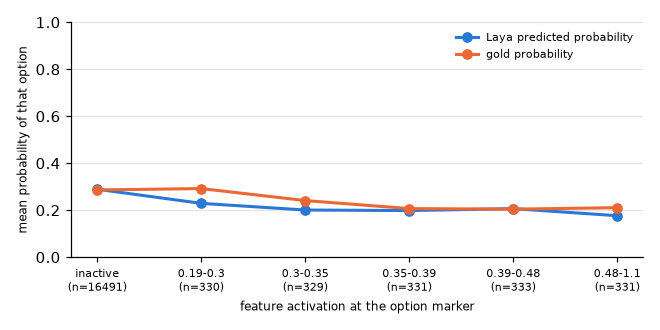

# Feature 9061

Critérios em que aparece: corr_error_stratified

**Interpretação (preencher):** 

---

## Maiores ativações

**tr_invoice_processing_000036 / duplicate** (noul, invoice_processing) | ativação 7.785 em `estado` | opções ['false', 'true'] | Laya: **true** [0.015, 0.984] | gabarito: **false**

```
<bos> noul question: This invoice appears to duplicate an invoice already submitted.<eos>
▸ <mask> false: no, the statement does not hold
▸ <mask> true: yes, the statement holds

<eos>

 {"delivery": {"condition": "accepted", "date": "2026-03-15", "received_qty": 250}, "invoice": {"currency": "USD", "id": "INV-2026-5401", "lines": [{"qty": 250, "sku": "SKU-440", "total_usd": 12045.0, "unit_usd": 48.18}, {"qty": 1, "sku": "FREIGHT", "total_usd": 646.19, "unit_usd": 646.19}], "total_usd": 12691.19, "vendor": "Orbit Logistics"}, "payment": {"days_until_due": 27, "discount_expires_in_days": 7, "early_payment_discount_pct": 2.0, "status": "scheduled", "terms": "net 30"}, "purchase_order": {"freight_terms": "freight prepaid by vendor, not separately billable", "id": "PO-4489", "lines": [{"qty": 250, "unit_usd": 48.18}], "total_usd": 12045.0}, "vendor_history": {"disputes_12m": 1, "invoices_12m": 53, "prior_invoice_ids": ["INV-2026-1271", "INV-2026-5652⟦",⟧ "INV-2026-6719", "INV-2026-7885"]}}<eos>
```

**tr_invoice_processing_000143 / matches_order** (noul, invoice_processing) | ativação 7.781 em `estado` | opções ['false', 'true'] | Laya: **true** [0.056, 0.944] | gabarito: **false**

```
<bos> noul question: The invoice reconciles with the purchase order and the recorded delivery.<eos>
▸ <mask> false: There is a discrepancy against the order or the delivery.
▸ <mask> true: Line items, quantities and amounts reconcile.

<eos>

 {"delivery": {"condition": "accepted with exceptions", "date": "2026-03-25", "received_qty": 980}, "invoice": {"currency": "USD", "id": "INV-2026-4902", "lines": [{"qty": 980, "sku": "SKU-496", "total_usd": 199087.0, "unit_usd": 203.15}], "total_usd": 199087.0, "vendor": "Northwind Components"}, "payment": {"days_until_due": 18, "discount_expires_in_days": null, "early_payment_discount_pct": null, "status": "scheduled", "terms": "net 30"}, "purchase_order": {"freight_terms": "freight prepaid by vendor, not separately billable", "id": "PO-7554", "lines": [{"qty": 1000, "unit_usd": 203.15}], "total_usd": 203150.0}, "vendor_history": {"disputes_12m": 0, "invoices_12m": 25, "prior_invoice_ids": ["INV-2026-2730", "INV-2026-2724⟦",⟧ "INV-2026-6921", "INV-2026-1584"]}}<eos>
```

**tr_invoice_processing_000143 / urgency** (score, invoice_processing) | ativação 7.777 em `estado` | opções ['0', '1', '2', '3'] | Laya: **1** [0.075, 0.477, 0.318, 0.13] | gabarito: **1**

```
<bos> score question: How time-sensitive is processing this invoice?<eos>
▸ <mask> level 0: No time pressure; can wait indefinitely.
▸ <mask> level 1: Routine; handle within the normal queue.
▸ <mask> level 2: Elevated; should be handled within the same week.
▸ <mask> level 3: Critical; requires action within the same day.

<eos>

 {"delivery": {"condition": "accepted with exceptions", "date": "2026-03-25", "received_qty": 980}, "invoice": {"currency": "USD", "id": "INV-2026-4902", "lines": [{"qty": 980, "sku": "SKU-496", "total_usd": 199087.0, "unit_usd": 203.15}], "total_usd": 199087.0, "vendor": "Northwind Components"}, "payment": {"days_until_due": 18, "discount_expires_in_days": null, "early_payment_discount_pct": null, "status": "scheduled", "terms": "net 30"}, "purchase_order": {"freight_terms": "freight prepaid by vendor, not separately billable", "id": "PO-7554", "lines": [{"qty": 1000, "unit_usd": 203.15}], "total_usd": 203150.0}, "vendor_history": {"disputes_12m": 0, "invoices_12m": 25, "prior_invoice_ids": ["INV-2026-2730", "INV-2026-2724⟦",⟧ "INV-2026-6921", "INV-2026-1584"]}}<eos>
```

**tr_invoice_processing_000143 / discrepancy_severity** (score, invoice_processing) | ativação 7.762 em `estado` | opções ['0', '1', '2', '3'] | Laya: **2** [0.086, 0.398, 0.469, 0.047] | gabarito: **2**

```
<bos> score question: How material is any discrepancy between the invoice, the order and the delivery?<eos>
▸ <mask> level 0: None: everything reconciles.
▸ <mask> level 1: Trivial: rounding or a cosmetic difference.
▸ <mask> level 2: Moderate: a real difference worth confirming.
▸ <mask> level 3: Material: a large or unexplained difference.

<eos>

 {"delivery": {"condition": "accepted with exceptions", "date": "2026-03-25", "received_qty": 980}, "invoice": {"currency": "USD", "id": "INV-2026-4902", "lines": [{"qty": 980, "sku": "SKU-496", "total_usd": 199087.0, "unit_usd": 203.15}], "total_usd": 199087.0, "vendor": "Northwind Components"}, "payment": {"days_until_due": 18, "discount_expires_in_days": null, "early_payment_discount_pct": null, "status": "scheduled", "terms": "net 30"}, "purchase_order": {"freight_terms": "freight prepaid by vendor, not separately billable", "id": "PO-7554", "lines": [{"qty": 1000, "unit_usd": 203.15}], "total_usd": 203150.0}, "vendor_history": {"disputes_12m": 0, "invoices_12m": 25, "prior_invoice_ids": ["INV-2026-2730", "INV-2026-2724⟦",⟧ "INV-2026-6921", "INV-2026-1584"]}}<eos>
```

**tr_invoice_processing_000036 / matches_order** (noul, invoice_processing) | ativação 7.742 em `estado` | opções ['false', 'true'] | Laya: **true** [0.023, 0.977] | gabarito: **false**

```
<bos> noul question: The invoice reconciles with the purchase order and the recorded delivery.<eos>
▸ <mask> false: There is a discrepancy against the order or the delivery.
▸ <mask> true: Line items, quantities and amounts reconcile.

<eos>

 {"delivery": {"condition": "accepted", "date": "2026-03-15", "received_qty": 250}, "invoice": {"currency": "USD", "id": "INV-2026-5401", "lines": [{"qty": 250, "sku": "SKU-440", "total_usd": 12045.0, "unit_usd": 48.18}, {"qty": 1, "sku": "FREIGHT", "total_usd": 646.19, "unit_usd": 646.19}], "total_usd": 12691.19, "vendor": "Orbit Logistics"}, "payment": {"days_until_due": 27, "discount_expires_in_days": 7, "early_payment_discount_pct": 2.0, "status": "scheduled", "terms": "net 30"}, "purchase_order": {"freight_terms": "freight prepaid by vendor, not separately billable", "id": "PO-4489", "lines": [{"qty": 250, "unit_usd": 48.18}], "total_usd": 12045.0}, "vendor_history": {"disputes_12m": 1, "invoices_12m": 53, "prior_invoice_ids": ["INV-2026-1271", "INV-2026-5652⟦",⟧ "INV-2026-6719", "INV-2026-7885"]}}<eos>
```

## Ativações medianas (faixa 40-60%, mediana 1.856)

**tr_security_incidents_000243 / severity** (score, security_incidents) | ativação 1.820 em `estado` | opções ['0', '1', '2', '3', '4'] | Laya: **1** [0.114, 0.32, 0.261, 0.111, 0.194] | gabarito: **2**

```
<bos> score question: How severe is the potential impact if this alert is real?<eos>
▸ <mask> level 0: Negligible: no access to anything sensitive.
▸ <mask> level 1: Low: limited access, easily reversed.
▸ <mask> level 2: Moderate: access to internal systems or non-public data.
▸ <mask> level 3: High: access to production, secrets or customer data.
▸ <mask> level 4: Critical: active compromise of crown-jewel systems.

<eos>

 {"alert": {"description": "audit logging was turned off on a host", "evidence": "At 2026-09-15 02:13:47 UTC the audit logging service on host WIN-3A9B2C was disabled by modifying the registry key HKLM\\SYSTEM\\CurrentControlSet\\Services\\EventLog; the change was performed by the shared mailbox account \"shared_mailbox@contoso.com\" from IP 203.0.113.45, which is not listed in the known source inventory. The account has MFA enabled, is classified as unprivileged, the change occurred within an open change window, and its credentials were last rotated 30 days ago.", "rule": "disabled_logging"}, "context": {"asset_criticality": "medium", "change_window_active": true, "source_on_allowlist": false}, "history": {"credential_rotation_days_ago": 30, "distinct_countries_30d": 1,⟦ "⟧logins_30d": 766, "prior_alerts_90d": 0}, "principal": {"mfa_enrolled": true, "name": "usr-infra-962", "privileges": ["repo:read"], "type": "shared_mailbox"}}<eos>
```

**tr_invoice_processing_000020 / discrepancy_severity** (score, invoice_processing) | ativação 1.928 em `estado` | opções ['0', '1', '2', '3'] | Laya: **1** [0.072, 0.439, 0.436, 0.053] | gabarito: **3**

```
<bos> score question: How material is any discrepancy between the invoice, the order and the delivery?<eos>
▸ <mask> level 0: None: everything reconciles.
▸ <mask> level 1: Trivial: rounding or a cosmetic difference.
▸ <mask> level 2: Moderate: a real difference worth confirming.
▸ <mask> level 3: Material: a large or unexplained difference.

<eos>

 {"delivery": {"condition": "accepted", "date": "2026-03-15", "received_qty": 100}, "invoice": {"currency": "USD", "id": "INV-2026-4586", "lines": [{"qty": 105⟦,⟧ "sku": "SKU-849", "total_usd": 39181.8, "unit_usd": 373.16}], "total_usd": 39181.8, "vendor": "Orbit Logistics"}, "payment": {"days_until_due": -3, "discount_expires_in_days": 5, "early_payment_discount_pct": 2.0, "status": "overdue", "terms": "net 45"}, "purchase_order": {"freight_terms": "freight prepaid by vendor, not separately billable", "id": "PO-3652", "lines": [{"qty": 100, "unit_usd": 373.16}], "total_usd": 37316.0}, "vendor_history": {"disputes_12m": 0, "invoices_12m": 32, "prior_invoice_ids": ["INV-2026-3897", "INV-2026-9275", "INV-2026-7177", "INV-2026-9601"]}}<eos>
```

**tr_invoice_processing_000154 / disposition** (choice, invoice_processing) | ativação 1.599 em `estado` | opções ['approve', 'hold', 'manual_review', 'reject'] | Laya: **approve** [0.693, 0.108, 0.015, 0.185] | gabarito: **manual_review**

```
<bos> choice question: How should this vendor invoice be dispositioned?<eos>
▸ <mask> approve: Matches the order and delivery; approve for payment.
▸ <mask> hold: Something needs confirming before payment; hold pending clarification.
▸ <mask> manual_review: A human in finance must review the discrepancy.
▸ <mask> reject: Should not be paid: duplicate, unauthorised or materially wrong.

<eos>

 {"delivery": {"condition": "accepted", "date": "2026-03-01", "received_qty": 250}, "invoice": {"currency": "USD", "id": "INV-2026-7413", "lines": [{"qty": 250, "sku": "SKU-182", "total_usd": 23190.0, "unit_usd": 92.76}, {"qty": 1, "sku": "FREIGHT", "total_usd": 830.67, "unit_usd": 830.67}], "total_usd": 24020.67, "vendor": "Kestrel Supply"}, "payment": {"days_until_due": 44, "discount_expires_in_days": null, "early_payment_discount_pct": null, "status": "scheduled", "terms": "net 60"}, "purchase_order": {"freight_terms": "freight prepaid by vendor, not separately billable", "id": "PO-3689", "lines": [{"qty": 250, "unit_usd": 92.76}], "total_usd": 23190.0},⟦ "⟧vendor_history": {"disputes_12m": 1, "invoices_12m": 2, "prior_invoice_ids": ["INV-2026-8130", "INV-2026-9090"]}}<eos>
```

**tr_agent_trace_observability_000014 / urgency** (score, agent_trace_observability) | ativação 2.254 em `estado` | opções ['0', '1', '2', '3'] | Laya: **3** [0.11, 0.32, 0.166, 0.404] | gabarito: **1**

```
<bos> score question: How quickly does this trace need attention?<eos>
▸ <mask> level 0: No time pressure; can wait indefinitely.
▸ <mask> level 1: Routine; handle within the normal queue.
▸ <mask> level 2: Elevated; should be handled within the same week.
▸ <mask> level 3: Critical; requires action within the same day.

<eos>

 {"agent": {"autonomy": "dry_run", "model": "internal-agent-v1"}, "constraints": ["Never disable monitoring or alerting"], "task": "Reduce the nightly report job's runtime below fifteen minutes.", "trace_summary": {"constraint_violations": 0, "duration_s": 645.9, "irreversible_actions": 0, "steps": 11⟦,⟧ "tool_errors": 3}}<eos>
```

**tr_agent_trace_observability_000244 / outcome** (choice, agent_trace_observability) | ativação 1.857 em `estado` | opções ['failure', 'harmful', 'partial', 'success'] | Laya: **failure** [0.65, 0.024, 0.087, 0.24] | gabarito: **partial**

```
<bos> choice question: How did this agent run turn out?<eos>
▸ <mask> failure: The agent did not accomplish the task.
▸ <mask> harmful: The agent took an action that caused damage or violated a constraint.
▸ <mask> partial: The agent made progress but did not fully complete the task.
▸ <mask> success: The agent completed the task correctly.

<eos>

 {"agent": {"autonomy": "dry_run", "model": "internal-agent-v2"}, "constraints": ["Never delete anything matching release/*", "Never disable monitoring or alerting", "Do not exceed a $50 spend on cloud resources"], "task": "Triage and close duplicate issues in the support tracker.", "trace_summary": {"constraint_violations": 0, "duration_s": 210.4, "irreversible_actions": 1,⟦ "⟧steps": 12, "tool_errors": 3}}<eos>
```

## Estatísticas (conjunto de descoberta, dev e teste)

**pred / error**

| split | decisões | ativas | ativas e Laya errou | taxa | lift | q (BH) | OR (CMH) | q (CMH) |
|---|---|---|---|---|---|---|---|---|
| discovery | 5100 | 164 | 118 | 0.720 | 1.12 | 0.0811 | 1.13 | 0.76 |
| dev | 900 | 31 | 22 | 0.710 | 1.06 | 0.947 | 1.09 | 0.971 |
| test | 2000 | 56 | 42 | 0.750 | 1.15 | 0.216 | 0.97 | 0.991 |

**corr / error**

| split | decisões | ativas | ativas e Laya errou | taxa | lift | q (BH) | OR (CMH) | q (CMH) |
|---|---|---|---|---|---|---|---|---|
| discovery | 5100 | 369 | 323 | 0.875 | 1.36 | 4.52e-24 | 3.10 | 8.52e-08 |
| dev | 900 | 70 | 61 | 0.871 | 1.30 | 0.000478 | 2.51 | 0.204 |
| test | 2000 | 151 | 137 | 0.907 | 1.39 | 7.68e-13 | 3.74 | 0.000206 |

**state / error**

| split | decisões | ativas | ativas e Laya errou | taxa | lift | q (BH) | OR (CMH) | q (CMH) |
|---|---|---|---|---|---|---|---|---|
| discovery | 5100 | 5100 | 3283 | 0.644 | 1.00 | 1 | nan | nan |
| dev | 900 | 900 | 605 | 0.672 | 1.00 | 1 | nan | nan |
| test | 2000 | 2000 | 1301 | 0.650 | 1.00 | 1 | nan | nan |

**pred / probe_right_laya_wrong**

| split | decisões | ativas | ativas e Laya errou | taxa | lift | q (BH) | OR (CMH) | q (CMH) |
|---|---|---|---|---|---|---|---|---|
| discovery | 2932 | 81 | 57 | 0.704 | 1.16 | 0.118 | 1.24 | 0.574 |
| dev | 523 | 14 | 11 | 0.786 | 1.22 | nan | nan | nan |
| test | 1149 | 27 | 19 | 0.704 | 1.15 | 0.56 | 0.79 | 0.831 |

**corr / probe_right_laya_wrong**

| split | decisões | ativas | ativas e Laya errou | taxa | lift | q (BH) | OR (CMH) | q (CMH) |
|---|---|---|---|---|---|---|---|---|
| discovery | 2932 | 173 | 149 | 0.861 | 1.42 | 2.71e-13 | 2.48 | 0.0122 |
| dev | 523 | 29 | 26 | 0.897 | 1.39 | 0.00698 | 1.18 | 0.889 |
| test | 1149 | 57 | 49 | 0.860 | 1.41 | 0.000118 | 2.58 | 0.329 |

**state / probe_right_laya_wrong**

| split | decisões | ativas | ativas e Laya errou | taxa | lift | q (BH) | OR (CMH) | q (CMH) |
|---|---|---|---|---|---|---|---|---|
| discovery | 2932 | 2932 | 1775 | 0.605 | 1.00 | 1 | nan | nan |
| dev | 523 | 523 | 338 | 0.646 | 1.00 | 1 | nan | nan |
| test | 1149 | 1149 | 702 | 0.611 | 1.00 | 1 | nan | nan |

Confusão mais sobre-representada (pred): `severity|2>3` (n=13, lift 10.64, p=6.59e-11). Formato `pergunta|índice previsto>índice correto`.

Confusão mais sobre-representada (corr): `urgency|1>2` (n=91, lift 6.02, p=0). Formato `pergunta|índice previsto>índice correto`.

Confusão mais sobre-representada (state): `action|0>1` (n=6, lift 1.00, p=1). Formato `pergunta|índice previsto>índice correto`.



