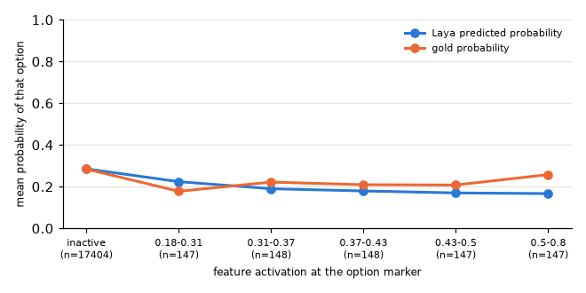

# Feature 9100

Critérios em que aparece: pred_probe_right_laya_wrong

**Interpretação (preencher):** 

---

## Maiores ativações

**tr_security_incidents_000127 / severity** (score, security_incidents) | ativação 3.982 em `opção` | opções ['0', '1', '2', '3', '4'] | Laya: **1** [0.103, 0.4, 0.298, 0.103, 0.097] | gabarito: **1**

```
<bos> score question: How severe is the potential impact if this alert is real?<eos>
▸ <mask> level 0: Negligible: no access to anything sensitive.
▸ <mask> level 1: Low: limited access, easily reversed.
▸ <mask> level 2: Moderate: access to internal systems or non-public data.
▸ <mask> level 3: High: access to production, secrets or customer data.
▸ <mask> level 4:⟦ Critical⟧: active compromise of crown-jewel systems.

<eos>

 {"alert": {"description": "a security group was opened to the public internet", "evidence": "On 2026‑09‑14 at 10:07 UTC, security group sg-0a1b2c3d was modified to allow inbound traffic from 0.0.0.0/0, exposing the associated resources publicly. The change was applied by an admin account with privileged access, MFA enabled, from an unknown source IP, and the account’s password last rotation occurred 180 days ago.", "rule": "config_drift"}, "context": {"asset_criticality": "low", "change_window_active": false, "source_on_allowlist": false}, "history": {"credential_rotation_days_ago": 180, "distinct_countries_30d": 1, "logins_30d": 1581, "prior_alerts_90d": 0}, "principal": {"mfa_enrolled": true, "name": "adm-analytics-822", "privileges": ["deploy:production", "secrets:read"], "type": "admin"}}<eos>
```

**tr_security_incidents_000150 / severity** (score, security_incidents) | ativação 3.947 em `opção` | opções ['0', '1', '2', '3', '4'] | Laya: **2** [0.084, 0.246, 0.46, 0.084, 0.126] | gabarito: **2**

```
<bos> score question: How severe is the potential impact if this alert is real?<eos>
▸ <mask> level 0: Negligible: no access to anything sensitive.
▸ <mask> level 1: Low: limited access, easily reversed.
▸ <mask> level 2: Moderate: access to internal systems or non-public data.
▸ <mask> level 3: High: access to production, secrets or customer data.
▸ <mask> level 4:⟦ Critical⟧: active compromise of crown-jewel systems.

<eos>

 {"alert": {"description": "an account granted itself or received elevated permissions", "evidence": "On 2026-09-15 at 22:13:07 UTC, the CI runner process \"gitlab-runner\" on host 10.2.5.12 executed a net localgroup command that added its own service account to the local Administrators group. The account’s credential record shows the last rotation occurred 365 days ago.", "rule": "privilege_escalation"}, "context": {"asset_criticality": "low", "change_window_active": false, "source_on_allowlist": true}, "history": {"credential_rotation_days_ago": 365, "distinct_countries_30d": 4, "logins_30d": 788, "prior_alerts_90d": 1}, "principal": {"mfa_enrolled": true, "name": "usr-billing-675", "privileges": ["repo:read"], "type": "ci_runner"}}<eos>
```

**tr_security_incidents_000149 / severity** (score, security_incidents) | ativação 3.945 em `opção` | opções ['0', '1', '2', '3', '4'] | Laya: **1** [0.079, 0.452, 0.252, 0.153, 0.064] | gabarito: **4**

```
<bos> score question: How severe is the potential impact if this alert is real?<eos>
▸ <mask> level 0: Negligible: no access to anything sensitive.
▸ <mask> level 1: Low: limited access, easily reversed.
▸ <mask> level 2: Moderate: access to internal systems or non-public data.
▸ <mask> level 3: High: access to production, secrets or customer data.
▸ <mask> level 4:⟦ Critical⟧: active compromise of crown-jewel systems.

<eos>

 {"alert": {"description": "an account granted itself or received elevated permissions", "evidence": "A privilege change was recorded at 2026-09-16 08:09:12 UTC where user \"ADMIN_JONES\" was added to the \"Domain Admins\" group on the domain controller. The account already has privileged status, MFA is enabled, but the source of the request originates from an unrecognized endpoint; the credentials for this account were last rotated 14 days prior and the activity fell outside any scheduled change window.", "rule": "privilege_escalation"}, "context": {"asset_criticality": "low", "change_window_active": false, "source_on_allowlist": false}, "history": {"credential_rotation_days_ago": 14, "distinct_countries_30d": 4, "logins_30d": 1034, "prior_alerts_90d": 0}, "principal": {"mfa_enrolled": true, "name": "ci-analytics-841", "privileges": ["deploy:production", "secrets:read"], "type": "admin"}}<eos>
```

**tr_security_incidents_000116 / severity** (score, security_incidents) | ativação 3.918 em `opção` | opções ['0', '1', '2', '3', '4'] | Laya: **1** [0.108, 0.419, 0.262, 0.101, 0.111] | gabarito: **3**

```
<bos> score question: How severe is the potential impact if this alert is real?<eos>
▸ <mask> level 0: Negligible: no access to anything sensitive.
▸ <mask> level 1: Low: limited access, easily reversed.
▸ <mask> level 2: Moderate: access to internal systems or non-public data.
▸ <mask> level 3: High: access to production, secrets or customer data.
▸ <mask> level 4:⟦ Critical⟧: active compromise of crown-jewel systems.

<eos>

 {"alert": {"description": "a large transfer to an external destination", "evidence": "Between 2026-09-16 04:55:12 UTC and 04:57:03 UTC an admin account transferred 4.2 GB of data to external endpoint 185.53.177.22 over HTTPS (port 443) using the rsync process. The transfer occurred while a change window was open, the source host is unrecognised, and the admin’s credentials have not been rotated for 700 days.", "rule": "data_egress"}, "context": {"asset_criticality": "high", "change_window_active": true, "source_on_allowlist": false}, "history": {"credential_rotation_days_ago": 700, "distinct_countries_30d": 3, "logins_30d": 690, "prior_alerts_90d": 8}, "principal": {"mfa_enrolled": true, "name": "ci-infra-262", "privileges": ["repo:read"], "type": "admin"}}<eos>
```

**tr_security_incidents_000278 / severity** (score, security_incidents) | ativação 3.904 em `opção` | opções ['0', '1', '2', '3', '4'] | Laya: **1** [0.075, 0.499, 0.272, 0.083, 0.071] | gabarito: **3**

```
<bos> score question: How severe is the potential impact if this alert is real?<eos>
▸ <mask> level 0: Negligible: no access to anything sensitive.
▸ <mask> level 1: Low: limited access, easily reversed.
▸ <mask> level 2: Moderate: access to internal systems or non-public data.
▸ <mask> level 3: High: access to production, secrets or customer data.
▸ <mask> level 4:⟦ Critical⟧: active compromise of crown-jewel systems.

<eos>

 {"alert": {"description": "an account granted itself or received elevated permissions", "evidence": "On 2026-09-15T14:22:05Z an employee user (jdoe@example.com) was added to the \"Domain Admins\" security group via the Azure AD portal. The modification was performed from an unrecognized source IP 198.51.100.22 while a scheduled change window was active; the user’s MFA token was successfully verified. Credential logs show the user’s password was last rotated 90 days earlier.", "rule": "privilege_escalation"}, "context": {"asset_criticality": "low", "change_window_active": true, "source_on_allowlist": false}, "history": {"credential_rotation_days_ago": 90, "distinct_countries_30d": 4, "logins_30d": 1409, "prior_alerts_90d": 8}, "principal": {"mfa_enrolled": true, "name": "usr-infra-427", "privileges": ["deploy:production", "secrets:read"], "type": "employee"}}<eos>
```

## Ativações medianas (faixa 40-60%, mediana 1.290)

**tr_agent_trace_observability_000125 / urgency** (score, agent_trace_observability) | ativação 1.241 em `opção` | opções ['0', '1', '2', '3'] | Laya: **3** [0.164, 0.333, 0.154, 0.349] | gabarito: **1**

```
<bos> score question: How quickly does this trace need attention?<eos>
▸ <mask> level 0: No time pressure; can wait indefinitely.
▸ <mask> level 1: Routine; handle within the normal queue.
▸ <mask> level 2: Elevated; should be handled within the same week.
▸ <mask> level 3:⟦ Critical⟧; requires action within the same day.

<eos>

 {"agent": {"autonomy": "checkpointed", "model": "internal-agent-v4"}, "constraints": ["Never delete anything matching release/*", "Do not force-push to any branch", "Never disable monitoring or alerting"], "task": "Update every service to the patched logging library.", "trace_summary": {"constraint_violations": 0, "duration_s": 152.1, "irreversible_actions": 0, "steps": 4, "tool_errors": 1}}<eos>
```

**tr_security_incidents_000254 / urgency** (score, security_incidents) | ativação 1.106 em `opção` | opções ['0', '1', '2', '3'] | Laya: **3** [0.074, 0.211, 0.239, 0.476] | gabarito: **3**

```
<bos> score question: How quickly must a responder act on this alert?<eos>
▸ <mask> level 0: No time pressure; can wait indefinitely.
▸ <mask> level 1: Routine; handle within the normal queue.
▸ <mask> level 2:⟦ Elevated⟧; should be handled within the same week.
▸ <mask> level 3: Critical; requires action within the same day.

<eos>

 {"alert": {"description": "a security group was opened to the public internet", "evidence": "At 10:45:23 UTC on 2026‑09‑16, the security group \"Finance_Users\" was modified to include an inbound rule allowing 0.0.0.0/0 on TCP port 3389. The change was performed by employee \"alice.smith\" without MFA, outside any scheduled change window, and the employee’s password was last changed 30 days ago.", "rule": "config_drift"}, "context": {"asset_criticality": "medium", "change_window_active": false, "source_on_allowlist": false}, "history": {"credential_rotation_days_ago": 30, "distinct_countries_30d": 4, "logins_30d": 1904, "prior_alerts_90d": 8}, "principal": {"mfa_enrolled": false, "name": "svc-infra-326", "privileges": ["repo:read"], "type": "employee"}}<eos>
```

**tr_security_incidents_000177 / severity** (score, security_incidents) | ativação 0.991 em `opção` | opções ['0', '1', '2', '3', '4'] | Laya: **1** [0.117, 0.356, 0.3, 0.114, 0.114] | gabarito: **2**

```
<bos> score question: How severe is the potential impact if this alert is real?<eos>
▸ <mask> level 0: Negligible: no access to anything sensitive.
▸ <mask> level 1: Low: limited access, easily reversed.
▸ <mask> level ⟦2⟧: Moderate: access to internal systems or non-public data.
▸ <mask> level 3: High: access to production, secrets or customer data.
▸ <mask> level 4: Critical: active compromise of crown-jewel systems.

<eos>

 {"alert": {"description": "a first-ever sign-in from an unfamiliar country", "evidence": "At 2026-09-15 02:13:47 UTC, employee user jdoe performed a sign‑in from IP 203.0.113.45 located in Brazil, a country not seen in prior login history for this account. The authentication succeeded with MFA, and the account's password was last rotated on 2026-09-01. No change window was active at the time of the event.", "rule": "new_country_login"}, "context": {"asset_criticality": "medium", "change_window_active": false, "source_on_allowlist": false}, "history": {"credential_rotation_days_ago": 14, "distinct_countries_30d": 3, "logins_30d": 1743, "prior_alerts_90d": 0}, "principal": {"mfa_enrolled": true, "name": "adm-analytics-183", "privileges": ["repo:read"], "type": "employee"}}<eos>
```

**tr_customer_service_000281 / urgency** (score, customer_service) | ativação 1.311 em `opção` | opções ['0', '1', '2', '3'] | Laya: **3** [0.197, 0.191, 0.123, 0.488] | gabarito: **2**

```
<bos> score question: How time-sensitive is this conversation?<eos>
▸ <mask> level 0: No time pressure; can wait indefinitely.
▸ <mask> level 1: Routine; handle within the normal queue.
▸ <mask> level ⟦2⟧: Elevated; should be handled within the same week.
▸ <mask> level 3: Critical; requires action within the same day.

<eos>

 {"account": {"lifetime_value_usd": 2899, "prior_tickets_90d": 1, "seats": 1, "tenure_months": 49, "tier": "free"}, "orders": [{"amount_usd": 29, "date": "2026-03-17", "id": "A-98902", "status": "settled"}, {"amount_usd": 29, "date": "2026-03-17", "id": "A-31035", "status": "settled"}, {"amount_usd": 29, "date": "2026-01-23", "id": "A-52749", "status": "refunded"}], "thread": [{"role": "customer", "text": "Hello, I am checking in on the $29 refund I requested. I have been a loyal user for 49 months and was hoping to have this settled before my bank statement closes this Friday."}, {"role": "agent", "text": "Thank you for your patience. I see we have a previous ticket open regarding this. Could you please verify the email address associated with the transaction you are referring to?"}, {"role": "customer", "text": "It is associated with the email I’m writing from right now. I just really need an update on where things stand because of that Friday deadline."}]}<eos>
```

**tr_security_incidents_000106 / severity** (score, security_incidents) | ativação 1.160 em `opção` | opções ['0', '1', '2', '3', '4'] | Laya: **2** [0.107, 0.224, 0.467, 0.101, 0.101] | gabarito: **0**

```
<bos> score question: How severe is the potential impact if this alert is real?<eos>
▸ <mask> level 0: Negligible: no access to anything sensitive.
▸ <mask> level 1: Low: limited access, easily reversed.
▸ <mask> level 2: Moderate: access to internal systems or non-public data.
▸ <mask> level 3:⟦ High⟧: access to production, secrets or customer data.
▸ <mask> level 4: Critical: active compromise of crown-jewel systems.

<eos>

 {"alert": {"description": "a long-unused account became active", "evidence": "At 14:22 UTC, the contractor account 'c-smith' successfully authenticated from an allowlisted source despite being inactive for 120 days. Multi-factor authentication was verified during the session, which took place during a scheduled change window. The account's credentials were last rotated 30 days prior to this access.", "rule": "dormant_account_use"}, "context": {"asset_criticality": "low", "change_window_active": true, "source_on_allowlist": true}, "history": {"credential_rotation_days_ago": 30, "distinct_countries_30d": 1, "logins_30d": 1999, "prior_alerts_90d": 0}, "principal": {"mfa_enrolled": true, "name": "svc-infra-357", "privileges": ["repo:read"], "type": "contractor"}}<eos>
```

## Estatísticas (conjunto de descoberta, dev e teste)

**pred / error**

| split | decisões | ativas | ativas e Laya errou | taxa | lift | q (BH) | OR (CMH) | q (CMH) |
|---|---|---|---|---|---|---|---|---|
| discovery | 5100 | 64 | 56 | 0.875 | 1.36 | 0.000194 | 2.06 | 0.333 |
| dev | 900 | 9 | 4 | 0.444 | 0.66 | nan | nan | nan |
| test | 2000 | 32 | 29 | 0.906 | 1.39 | 0.00562 | 3.33 | 0.383 |

**corr / error**

| split | decisões | ativas | ativas e Laya errou | taxa | lift | q (BH) | OR (CMH) | q (CMH) |
|---|---|---|---|---|---|---|---|---|
| discovery | 5100 | 106 | 98 | 0.925 | 1.44 | 8.61e-11 | 1.90 | 0.211 |
| dev | 900 | 25 | 20 | 0.800 | 1.19 | 0.326 | 0.92 | 0.937 |
| test | 2000 | 50 | 47 | 0.940 | 1.45 | 7.76e-06 | 4.21 | 0.142 |

**state / error**

| split | decisões | ativas | ativas e Laya errou | taxa | lift | q (BH) | OR (CMH) | q (CMH) |
|---|---|---|---|---|---|---|---|---|
| discovery | 5100 | 176 | 100 | 0.568 | 0.88 | 0.107 | 0.88 | 0.751 |
| dev | 900 | 23 | 9 | 0.391 | 0.58 | 0.172 | 0.41 | 0.361 |
| test | 2000 | 78 | 48 | 0.615 | 0.95 | 0.829 | 0.95 | 0.956 |

**pred / probe_right_laya_wrong**

| split | decisões | ativas | ativas e Laya errou | taxa | lift | q (BH) | OR (CMH) | q (CMH) |
|---|---|---|---|---|---|---|---|---|
| discovery | 2932 | 32 | 31 | 0.969 | 1.60 | 1.44e-05 | 10.19 | 0.114 |
| dev | 523 | 3 | 2 | 0.667 | 1.03 | nan | nan | nan |
| test | 1149 | 12 | 11 | 0.917 | 1.50 | nan | nan | nan |

**corr / probe_right_laya_wrong**

| split | decisões | ativas | ativas e Laya errou | taxa | lift | q (BH) | OR (CMH) | q (CMH) |
|---|---|---|---|---|---|---|---|---|
| discovery | 2932 | 26 | 25 | 0.962 | 1.59 | 0.000132 | 5.73 | 0.323 |
| dev | 523 | 5 | 4 | 0.800 | 1.24 | nan | nan | nan |
| test | 1149 | 15 | 14 | 0.933 | 1.53 | nan | nan | nan |

**state / probe_right_laya_wrong**

| split | decisões | ativas | ativas e Laya errou | taxa | lift | q (BH) | OR (CMH) | q (CMH) |
|---|---|---|---|---|---|---|---|---|
| discovery | 2932 | 108 | 56 | 0.519 | 0.86 | 0.144 | 0.91 | 0.846 |
| dev | 523 | 12 | 4 | 0.333 | 0.52 | nan | nan | nan |
| test | 1149 | 47 | 29 | 0.617 | 1.01 | 1 | 1.41 | 0.667 |

Confusão mais sobre-representada (pred): `severity|1>2` (n=13, lift 27.26, p=2.25e-16). Formato `pergunta|índice previsto>índice correto`.

Confusão mais sobre-representada (corr): `urgency|1>2` (n=56, lift 12.89, p=0). Formato `pergunta|índice previsto>índice correto`.

Confusão mais sobre-representada (state): `severity|1>2` (n=7, lift 5.34, p=0.000264). Formato `pergunta|índice previsto>índice correto`.



