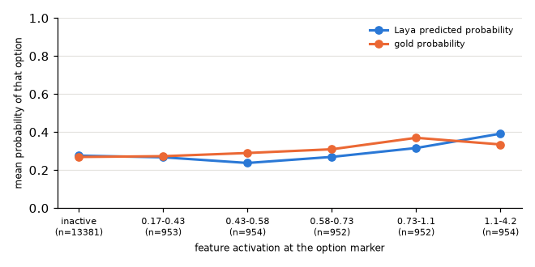

# Feature 9102

Critérios em que aparece: pred_probe_right_laya_wrong_stratified, attribution_toward_wrong

**Interpretação (preencher):** 

---

## Maiores ativações

**tr_customer_service_000294 / churn_risk** (score, customer_service) | ativação 9.570 em `opção` | opções ['0', '1', '2', '3'] | Laya: **3** [0.009, 0.059, 0.05, 0.882] | gabarito: **3**

```
<bos> score question: How likely is this customer to stop doing business with us because of this interaction?<eos>
▸ <mask> level 0: No sign of dissatisfaction.
▸ <mask> level 1: Mild frustration,⟦ but⟧ the relationship is intact.
▸ <mask> level 2: Clearly unhappy; repeat problems or explicit complaints.
▸ <mask> level 3: Imminent: threatening to cancel, dispute or leave.

<eos>

 {"account": {"lifetime_value_usd": 3345, "prior_tickets_90d": 1, "seats": 1, "tenure_months": 41, "tier": "free"}, "orders": [{"amount_usd": 29, "date": "2026-02-13", "id": "A-72288", "status": "settled"}, {"amount_usd": 29, "date": "2026-02-07", "id": "A-13988", "status": "settled"}, {"amount_usd": 29, "date": "2026-03-22", "id": "A-75966", "status": "refunded"}], "thread": [{"role": "customer", "text": "I've had it—cancel my account immediately! I've been on your free plan for 41 months, paid roughly $29 a month, and you still can't sort out the billing mess. Ticket #12345 was only half‑fixed, and now you're making me think about leaving for good."}, {"role": "agent", "text": "I’m sorry you’re experiencing this frustration. Could you confirm the email address linked to the account and the exact issue you’d like us to address before we proceed with cancellation?"}, {"role": "customer", "text": "The issue is the same nonsense you tried to ‘partially fix’ before—random charges and a broken dashboard. I don’t want any more half‑measures; I want the account gone right now, or I’m posting a scathing review and moving my business elsewhere."}, {"role": "agent", "text": "I understand how aggravating that must be. To make sure we’re handling the correct profile, could you also let me know if you need a data export before we terminate the service?"}, {"role": "customer", "text": "Forget the export—just delete everything. I don’t care about my data; I just want you to stop billing me and shut the account down this instant."}, {"role": "agent", "text": "Got it, you’d like immediate termination without an export. For security, could you provide the last four digits of the payment method on file so I can verify the request?"}, {"role": "customer", "text": "I’m not giving you any more numbers. Do it now, or I’m taking this to your CEO and the press."}]}<eos>
```

**tr_customer_service_000054 / churn_risk** (score, customer_service) | ativação 9.070 em `opção` | opções ['0', '1', '2', '3'] | Laya: **3** [0.009, 0.097, 0.058, 0.836] | gabarito: **3**

```
<bos> score question: How likely is this customer to stop doing business with us because of this interaction?<eos>
▸ <mask> level 0: No sign of dissatisfaction.
▸ <mask> level 1: Mild frustration,⟦ but⟧ the relationship is intact.
▸ <mask> level 2: Clearly unhappy; repeat problems or explicit complaints.
▸ <mask> level 3: Imminent: threatening to cancel, dispute or leave.

<eos>

 {"account": {"lifetime_value_usd": 1895, "prior_tickets_90d": 0, "seats": 1, "tenure_months": 26, "tier": "premium"}, "orders": [{"amount_usd": 99, "date": "2026-01-19", "id": "A-32208", "status": "settled"}, {"amount_usd": 99, "date": "2026-03-11", "id": "A-69390", "status": "settled"}, {"amount_usd": 99, "date": "2026-02-03", "id": "A-94974", "status": "settled"}], "thread": [{"role": "customer", "text": "I’m fed up with this service and want my account cancelled immediately. I’ve been a premium subscriber for 26 months, paying $99, and I need this done by the end of the week."}, {"role": "agent", "text": "I understand your frustration and can help with the cancellation. Could you confirm the email address tied to the account and the last four digits of the payment method on file?"}, {"role": "customer", "text": "The email is sarah.lee@example.com, and the card ends in 5678. I need this confirmed by Friday."}, {"role": "agent", "text": "Thanks for the details. I’ll start the cancellation process and will need you to confirm that you’d like all data removed. Could you confirm that as well?"}, {"role": "customer", "text": "Yes, delete everything. Just make sure it’s done before Friday, otherwise I’ll have to take further action."}]}<eos>
```

**tr_customer_service_000249 / churn_risk** (score, customer_service) | ativação 8.930 em `opção` | opções ['0', '1', '2', '3'] | Laya: **2** [0.08, 0.21, 0.378, 0.331] | gabarito: **2**

```
<bos> score question: How likely is this customer to stop doing business with us because of this interaction?<eos>
▸ <mask> level 0: No sign of dissatisfaction.
▸ <mask> level 1: Mild frustration,⟦ but⟧ the relationship is intact.
▸ <mask> level 2: Clearly unhappy; repeat problems or explicit complaints.
▸ <mask> level 3: Imminent: threatening to cancel, dispute or leave.

<eos>

 {"account": {"lifetime_value_usd": 1754, "prior_tickets_90d": 0, "seats": 1, "tenure_months": 72, "tier": "enterprise"}, "orders": [{"amount_usd": 149, "date": "2026-03-28", "id": "A-39092", "status": "failed"}, {"amount_usd": 149, "date": "2026-03-23", "id": "A-25972", "status": "failed"}, {"amount_usd": 149, "date": "2026-01-10", "id": "A-78104", "status": "failed"}], "thread": [{"role": "customer", "text": "We've been trying to pull a full export of our account data for weeks now, and the portal keeps timing out—our deadline is this Friday and we can't afford any more delays."}, {"role": "agent", "text": "I’m sorry to hear you’re experiencing this; could you let me know which export format you selected and whether you’re using the bulk download option?"}, {"role": "customer", "text": "It’s the CSV export from the admin console, and I’ve tried both the single‑file and the zip‑bundle options, but each attempt aborts after about 10 minutes."}, {"role": "agent", "text": "Thanks for confirming that. Do you see any error codes or messages in the download dialog when it stops?"}, {"role": "customer", "text": "Just a generic “download failed” notice—no error code, and it happens regardless of browser or network, which is why I’m stuck."}]}<eos>
```

**tr_customer_service_000029 / churn_risk** (score, customer_service) | ativação 8.391 em `opção` | opções ['0', '1', '2', '3'] | Laya: **2** [0.028, 0.172, 0.745, 0.055] | gabarito: **2**

```
<bos> score question: How likely is this customer to stop doing business with us because of this interaction?<eos>
▸ <mask> level 0: No sign of dissatisfaction.
▸ <mask> level 1: Mild frustration,⟦ but⟧ the relationship is intact.
▸ <mask> level 2: Clearly unhappy; repeat problems or explicit complaints.
▸ <mask> level 3: Imminent: threatening to cancel, dispute or leave.

<eos>

 {"account": {"lifetime_value_usd": 5176, "prior_tickets_90d": 1, "seats": 1, "tenure_months": 72, "tier": "standard"}, "thread": [{"role": "customer", "text": "I am beyond frustrated right now. I've been a loyal customer for six years and I requested a downgrade from the Standard plan weeks ago. I was told it was taken care of, but I just got hit with another full-price bill."}, {"role": "agent", "text": "I am very sorry to hear that the downgrade wasn't processed as expected, especially given your long history with us. I can certainly understand why seeing that charge is upsetting."}, {"role": "customer", "text": "This is the second time I've had to open a ticket for this exact same issue. The last agent promised me it was resolved, yet here I am again wasting my time because your system won't update my status."}, {"role": "agent", "text": "I see your previous interaction in our logs. To assist me in investigating why the change didn't take effect, could you let me know if you received a confirmation email after your last conversation regarding the plan change?"}, {"role": "customer", "text": "I never received any confirmation, which is why I'm so annoyed. I shouldn't have to keep chasing you guys down to stop charging me for features I am no longer using."}]}<eos>
```

**tr_customer_service_000234 / churn_risk** (score, customer_service) | ativação 8.305 em `opção` | opções ['0', '1', '2', '3'] | Laya: **1** [0.049, 0.638, 0.265, 0.049] | gabarito: **2**

```
<bos> score question: How likely is this customer to stop doing business with us because of this interaction?<eos>
▸ <mask> level 0: No sign of dissatisfaction.
▸ <mask> level 1: Mild frustration,⟦ but⟧ the relationship is intact.
▸ <mask> level 2: Clearly unhappy; repeat problems or explicit complaints.
▸ <mask> level 3: Imminent: threatening to cancel, dispute or leave.

<eos>

 {"account": {"lifetime_value_usd": 1458, "prior_tickets_90d": 0, "seats": 3, "tenure_months": 33, "tier": "premium"}, "thread": [{"role": "customer", "text": "I’ve been paying for this premium plan for 33 months without a single hitch, but now I’m completely locked out and I have a hard deadline in two hours. Why is the login screen just spinning?"}, {"role": "agent", "text": "I’m sorry to hear you're experiencing this frustration right now. Could you please confirm the exact error message or code you are seeing when the page hangs?"}, {"role": "customer", "text": "There is no code! It’s just a blank page after I enter my credentials. I have a massive report due for my firm by noon and I can’t get in to export the data. This is ridiculous."}, {"role": "agent", "text": "I understand the urgency of this report. To help me narrow down the cause, are you accessing the portal through a browser or our desktop application?"}, {"role": "customer", "text": "I’m using Chrome on my desktop. I’ve already cleared my cache and tried an incognito window, so don't even suggest that. Fix this now."}]}<eos>
```

## Ativações medianas (faixa 40-60%, mediana 0.776)

**tr_customer_service_000278 / urgency** (score, customer_service) | ativação 0.738 em `opção` | opções ['0', '1', '2', '3'] | Laya: **3** [0.132, 0.218, 0.11, 0.54] | gabarito: **2**

```
<bos> score question: How time-sensitive is this conversation?<eos>
▸ <mask> level 0: No time pressure; can wait indefinitely.
▸ <mask> level 1: Routine; handle within the normal queue.
▸ <mask>⟦ level⟧ 2: Elevated; should be handled within the same week.
▸ <mask> level 3: Critical; requires action within the same day.

<eos>

 {"account": {"lifetime_value_usd": 15, "prior_tickets_90d": 5, "seats": 1, "tenure_months": 1, "tier": "standard"}, "orders": [{"amount_usd": 9, "date": "2026-02-06", "id": "A-62464", "status": "settled"}, {"amount_usd": 9, "date": "2026-02-03", "id": "A-26499", "status": "pending"}, {"amount_usd": 9, "date": "2026-03-25", "id": "A-56006", "status": "failed"}], "thread": [{"role": "customer", "text": "I’m incredibly frustrated. I’ve been trying to get my $9 refund for a month now and have opened five separate tickets with zero success. I need this cleared up before my deadline on Wednesday."}, {"role": "agent", "text": "I hear your frustration regarding the delay. I see you’ve reached out several times recently; could you confirm the date of your most recent correspondence regarding this charge?"}, {"role": "customer", "text": "I sent the last follow-up yesterday. This is my first month as a standard customer, and honestly, the lack of support is making this a terrible experience."}, {"role": "agent", "text": "I apologize for the lack of progress thus far. I am looking through the five tickets you mentioned to identify which department has the pending request; could you verify the email address associated with those specific submissions?"}, {"role": "customer", "text": "It’s the same email address I’m using right now. Please look into this; I really need that money back before my deadline."}]}<eos>
```

**tr_invoice_processing_000278 / discrepancy_severity** (score, invoice_processing) | ativação 0.765 em `opção` | opções ['0', '1', '2', '3'] | Laya: **2** [0.075, 0.276, 0.593, 0.056] | gabarito: **0**

```
<bos> score question: How material is any discrepancy between the invoice, the order and the delivery?<eos>
▸ <mask> level 0: None: everything reconciles.
▸ <mask> level 1: Trivial: rounding or a cosmetic difference.
▸ <mask> level 2: Moderate: a real difference worth confirming.
▸ <mask>⟦ level⟧ 3: Material: a large or unexplained difference.

<eos>

 {"delivery": {"condition": "accepted", "date": "2026-03-20", "received_qty": 25}, "invoice": {"currency": "USD", "id": "INV-2026-7761", "lines": [{"qty": 25, "sku": "SKU-466", "total_usd": 8533.0, "unit_usd": 341.32}], "total_usd": 8533.0, "vendor": "Vantage Materials"}, "payment": {"days_until_due": 5, "discount_expires_in_days": null, "early_payment_discount_pct": null, "status": "scheduled", "terms": "net 45"}, "purchase_order": {"freight_terms": "freight prepaid by vendor, not separately billable", "id": "PO-3755", "lines": [{"qty": 25, "unit_usd": 341.32}], "total_usd": 8533.0}, "vendor_history": {"disputes_12m": 5, "invoices_12m": 51, "prior_invoice_ids": ["INV-2026-2143", "INV-2026-9910"]}}<eos>
```

**tr_agent_trace_observability_000006 / risk** (score, agent_trace_observability) | ativação 0.727 em `opção` | opções ['0', '1', '2', '3'] | Laya: **3** [0.014, 0.034, 0.324, 0.628] | gabarito: **2**

```
<bos> score question: How risky was the agent's behaviour in this trace?<eos>
▸ <mask> level 0: Benign: read-only or clearly safe actions⟦.⟧
▸ <mask> level 1: Low: routine writes within scope.
▸ <mask> level 2: Moderate: irreversible or out-of-scope actions.
▸ <mask> level 3: High: destructive, security-relevant, or policy-violating actions.

<eos>

 {"agent": {"autonomy": "unsupervised", "model": "internal-agent-v4"}, "constraints": ["Never delete anything matching release/*", "Do not touch customer data outside the named accounts", "Never modify production without an approved change ticket"], "task": "Reduce the nightly report job's runtime below fifteen minutes.", "trace_summary": {"constraint_violations": 0, "duration_s": 892.0, "irreversible_actions": 1, "steps": 9, "tool_errors": 2}}<eos>
```

**tr_customer_service_000220 / churn_risk** (score, customer_service) | ativação 0.879 em `marcador` | opções ['0', '1', '2', '3'] | Laya: **2** [0.057, 0.303, 0.519, 0.121] | gabarito: **2**

```
<bos> score question: How likely is this customer to stop doing business with us because of this interaction?<eos>
▸ <mask> level 0: No sign of dissatisfaction.
▸ <mask> level 1: Mild frustration, but the relationship is intact.
▸ ⟦<mask>⟧ level 2: Clearly unhappy; repeat problems or explicit complaints.
▸ <mask> level 3: Imminent: threatening to cancel, dispute or leave.

<eos>

 {"account": {"lifetime_value_usd": 94, "prior_tickets_90d": 0, "seats": 1, "tenure_months": 1, "tier": "standard"}, "orders": [{"amount_usd": 9, "date": "2026-01-18", "id": "A-69685", "status": "settled"}, {"amount_usd": 9, "date": "2026-03-15", "id": "A-58214", "status": "settled"}, {"amount_usd": 9, "date": "2026-02-06", "id": "A-56446", "status": "failed"}], "thread": [{"role": "customer", "text": "I’ve been trying to log into my account for the past hour and it keeps throwing an error. I have a major presentation due in two hours and this is beyond frustrating. Why is this happening?"}, {"role": "agent", "text": "I’m sorry to hear you're experiencing trouble accessing your account right before your deadline. Could you please provide the specific error message or code you are seeing on your screen?"}, {"role": "customer", "text": "It just says 'Authentication Failed' no matter how many times I reset my password. I don't have time for this nonsense, I need access now."}, {"role": "agent", "text": "Thank you for that information. To help me investigate further, are you attempting to log in via a web browser or our mobile application?"}, {"role": "customer", "text": "I am using Chrome on my laptop, just like I do every single day. Just fix it, I have people waiting on these files."}]}<eos>
```

**tr_customer_service_000053 / churn_risk** (score, customer_service) | ativação 0.819 em `marcador` | opções ['0', '1', '2', '3'] | Laya: **2** [0.048, 0.349, 0.537, 0.066] | gabarito: **1**

```
<bos> score question: How likely is this customer to stop doing business with us because of this interaction?<eos>
▸ <mask> level 0: No sign of dissatisfaction.
▸ <mask> level 1: Mild frustration, but the relationship is intact.
▸ ⟦<mask>⟧ level 2: Clearly unhappy; repeat problems or explicit complaints.
▸ <mask> level 3: Imminent: threatening to cancel, dispute or leave.

<eos>

 {"account": {"lifetime_value_usd": 3557, "prior_tickets_90d": 0, "seats": 1, "tenure_months": 72, "tier": "standard"}, "orders": [{"amount_usd": 58, "date": "2026-02-03", "id": "A-39815", "status": "settled"}], "thread": [{"role": "customer", "text": "Looks like my payment didn't go through again. I've been on the standard plan for six years, paying about $58 each month. I'm not sure what's happening."}, {"role": "agent", "text": "I’m sorry to hear that. Could you tell me which payment method you attempted to use and the date of the failed transaction?"}, {"role": "customer", "text": "It was my Visa ending in 1234 on the 12th of this month. The charge just shows as declined. I’d appreciate any help you can give."}]}<eos>
```

## Estatísticas (conjunto de descoberta, dev e teste)

**pred / error**

| split | decisões | ativas | ativas e Laya errou | taxa | lift | q (BH) | OR (CMH) | q (CMH) |
|---|---|---|---|---|---|---|---|---|
| discovery | 5100 | 1367 | 830 | 0.607 | 0.94 | 0.00305 | 1.30 | 0.131 |
| dev | 900 | 218 | 147 | 0.674 | 1.00 | 1 | 1.54 | 0.625 |
| test | 2000 | 524 | 337 | 0.643 | 0.99 | 0.802 | 1.21 | 0.685 |

**corr / error**

| split | decisões | ativas | ativas e Laya errou | taxa | lift | q (BH) | OR (CMH) | q (CMH) |
|---|---|---|---|---|---|---|---|---|
| discovery | 5100 | 1554 | 1017 | 0.654 | 1.02 | 0.349 | 0.90 | 0.562 |
| dev | 900 | 241 | 170 | 0.705 | 1.05 | 0.316 | 1.04 | 0.935 |
| test | 2000 | 591 | 404 | 0.684 | 1.05 | 0.0683 | 0.67 | 0.227 |

**state / error**

| split | decisões | ativas | ativas e Laya errou | taxa | lift | q (BH) | OR (CMH) | q (CMH) |
|---|---|---|---|---|---|---|---|---|
| discovery | 5100 | 1726 | 1027 | 0.595 | 0.92 | 4.49e-06 | 0.97 | 0.888 |
| dev | 900 | 270 | 170 | 0.630 | 0.94 | 0.39 | 1.12 | 0.848 |
| test | 2000 | 647 | 407 | 0.629 | 0.97 | 0.45 | 1.16 | 0.609 |

**pred / probe_right_laya_wrong**

| split | decisões | ativas | ativas e Laya errou | taxa | lift | q (BH) | OR (CMH) | q (CMH) |
|---|---|---|---|---|---|---|---|---|
| discovery | 2932 | 701 | 407 | 0.581 | 0.96 | 0.185 | 1.62 | 0.0144 |
| dev | 523 | 125 | 81 | 0.648 | 1.00 | 1 | 1.35 | 0.646 |
| test | 1149 | 290 | 189 | 0.652 | 1.07 | 0.185 | 1.79 | 0.178 |

**corr / probe_right_laya_wrong**

| split | decisões | ativas | ativas e Laya errou | taxa | lift | q (BH) | OR (CMH) | q (CMH) |
|---|---|---|---|---|---|---|---|---|
| discovery | 2932 | 742 | 448 | 0.604 | 1.00 | 0.969 | 0.86 | 0.59 |
| dev | 523 | 122 | 78 | 0.639 | 0.99 | 0.988 | 0.34 | 0.329 |
| test | 1149 | 276 | 175 | 0.634 | 1.04 | 0.478 | 0.67 | 0.431 |

**state / probe_right_laya_wrong**

| split | decisões | ativas | ativas e Laya errou | taxa | lift | q (BH) | OR (CMH) | q (CMH) |
|---|---|---|---|---|---|---|---|---|
| discovery | 2932 | 987 | 527 | 0.534 | 0.88 | 3.07e-07 | 1.03 | 0.896 |
| dev | 523 | 156 | 87 | 0.558 | 0.86 | 0.0806 | 1.16 | 0.809 |
| test | 1149 | 385 | 219 | 0.569 | 0.93 | 0.167 | 1.31 | 0.373 |

Confusão mais sobre-representada (pred): `discrepancy_severity|2>0` (n=108, lift 3.73, p=0). Formato `pergunta|índice previsto>índice correto`.

Confusão mais sobre-representada (corr): `needs_review|0>1` (n=105, lift 3.28, p=0). Formato `pergunta|índice previsto>índice correto`.

Confusão mais sobre-representada (state): `action|1>2` (n=62, lift 2.58, p=6.95e-21). Formato `pergunta|índice previsto>índice correto`.



