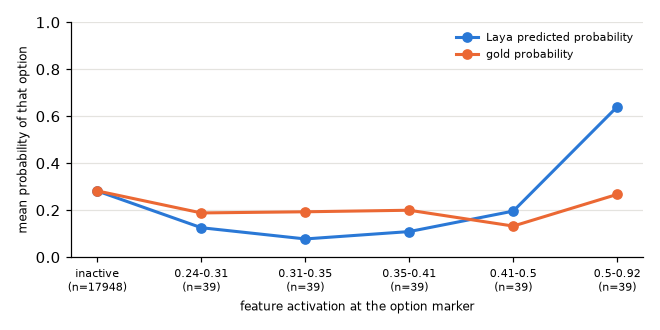

# Feature 9155

Critérios em que aparece: pred_error_stratified, pred_probe_right_laya_wrong_stratified

**Interpretação (preencher):** 

---

## Maiores ativações

**tr_security_incidents_000069 / severity** (score, security_incidents) | ativação 1.751 em `estado` | opções ['0', '1', '2', '3', '4'] | Laya: **1** [0.135, 0.309, 0.299, 0.135, 0.123] | gabarito: **3**

```
<bos> score question: How severe is the potential impact if this alert is real?<eos>
▸ <mask> level 0: Negligible: no access to anything sensitive.
▸ <mask> level 1: Low: limited access, easily reversed.
▸ <mask> level 2: Moderate: access to internal systems or non-public data.
▸ <mask> level 3: High: access to production, secrets or customer data.
▸ <mask> level 4: Critical: active compromise of crown-jewel systems.

<eos>

 {"alert": {"description": "a session token was presented from a second address", "evidence": "⟦A⟧ session token issued to a shared_mailbox principal was presented from a secondary, unrecognized IP address while no change window was active. The account is currently configured with MFA, though the credentials have not been rotated in 365 days.", "rule": "token_reuse"}, "context": {"asset_criticality": "crown_jewel", "change_window_active": false, "source_on_allowlist": false}, "history": {"credential_rotation_days_ago": 365, "distinct_countries_30d": 4, "logins_30d": 1871, "prior_alerts_90d": 0}, "principal": {"mfa_enrolled": true, "name": "ci-infra-665", "privileges": ["repo:read"], "type": "shared_mailbox"}}<eos>
```

**tr_security_incidents_000046 / true_positive** (noul, security_incidents) | ativação 1.653 em `estado` | opções ['false', 'true'] | Laya: **true** [0.083, 0.917] | gabarito: **true**

```
<bos> noul question: This alert reflects genuinely malicious or unauthorised activity.<eos>
▸ <mask> false: Benign activity, a misconfiguration, or a known false positive.
▸ <mask> true: The underlying behaviour is malicious or unauthorised.

<eos>

 {"alert": {"description": "a large transfer to an external destination", "evidence": "On 2026-09-15 09:22:03 UTC, a shared mailbox credential⟦ \"⟧svc_mailbox\" initiated an outbound TCP session to 203.0.113.45:443, transferring approximately 1.3 TB of data over 38 minutes. The connection originated from the allowlisted IP 192.168.10.55, MFA was off for the account, and its password was last changed 14 days ago.", "rule": "data_egress"}, "context": {"asset_criticality": "medium", "change_window_active": false, "source_on_allowlist": true}, "history": {"credential_rotation_days_ago": 14, "distinct_countries_30d": 3, "logins_30d": 1058, "prior_alerts_90d": 8}, "principal": {"mfa_enrolled": false, "name": "svc-support-440", "privileges": ["deploy:production", "secrets:read"], "type": "shared_mailbox"}}<eos>
```

**tr_security_incidents_000018 / urgency** (score, security_incidents) | ativação 1.613 em `estado` | opções ['0', '1', '2', '3'] | Laya: **3** [0.167, 0.25, 0.177, 0.406] | gabarito: **2**

```
<bos> score question: How quickly must a responder act on this alert?<eos>
▸ <mask> level 0: No time pressure; can wait indefinitely.
▸ <mask> level 1: Routine; handle within the normal queue.
▸ <mask> level 2: Elevated; should be handled within the same week.
▸ <mask> level 3: Critical; requires action within the same day.

<eos>

 {"alert": {"description": "⟦an⟧ endpoint agent matched a known signature", "evidence": "The endpoint agent identified a signature match for 'Malware.Variant.Alpha' within the 'sys_utility.exe' process initiated by an unprivileged contractor account. This activity originated from an allowlisted source address 180 days after the account's credentials were last rotated. MFA was active during the session, which occurred outside of any scheduled change window.", "rule": "malware_signature"}, "context": {"asset_criticality": "medium", "change_window_active": false, "source_on_allowlist": true}, "history": {"credential_rotation_days_ago": 180, "distinct_countries_30d": 3, "logins_30d": 1800, "prior_alerts_90d": 0}, "principal": {"mfa_enrolled": true, "name": "ci-analytics-427", "privileges": ["repo:read"], "type": "contractor"}}<eos>
```

**tr_security_incidents_000069 / credential_compromise** (noul, security_incidents) | ativação 1.604 em `estado` | opções ['false', 'true'] | Laya: **true** [0.03, 0.97] | gabarito: **false**

```
<bos> noul question: The evidence indicates a credential or account has been compromised.<eos>
▸ <mask> false: no, the statement does not hold
▸ <mask> true: yes, the statement holds

<eos>

 {"alert": {"description": "a session token was presented from a second address", "evidence": "⟦A⟧ session token issued to a shared_mailbox principal was presented from a secondary, unrecognized IP address while no change window was active. The account is currently configured with MFA, though the credentials have not been rotated in 365 days.", "rule": "token_reuse"}, "context": {"asset_criticality": "crown_jewel", "change_window_active": false, "source_on_allowlist": false}, "history": {"credential_rotation_days_ago": 365, "distinct_countries_30d": 4, "logins_30d": 1871, "prior_alerts_90d": 0}, "principal": {"mfa_enrolled": true, "name": "ci-infra-665", "privileges": ["repo:read"], "type": "shared_mailbox"}}<eos>
```

**tr_security_incidents_000018 / disposition** (choice, security_incidents) | ativação 1.564 em `estado` | opções ['close_benign', 'contain', 'investigate', 'monitor'] | Laya: **monitor** [0.007, 0.107, 0.225, 0.661] | gabarito: **investigate**

```
<bos> choice question: How should this security alert be dispositioned?<eos>
▸ <mask> close_benign: Expected, explainable activity; close without analyst time.
▸ <mask> contain: Contain the host or account immediately; do not wait for triage.
▸ <mask> investigate: Warrants an analyst opening an investigation.
▸ <mask> monitor: Not clearly malicious, but worth watching for recurrence.

<eos>

 {"alert": {"description": "⟦an⟧ endpoint agent matched a known signature", "evidence": "The endpoint agent identified a signature match for 'Malware.Variant.Alpha' within the 'sys_utility.exe' process initiated by an unprivileged contractor account. This activity originated from an allowlisted source address 180 days after the account's credentials were last rotated. MFA was active during the session, which occurred outside of any scheduled change window.", "rule": "malware_signature"}, "context": {"asset_criticality": "medium", "change_window_active": false, "source_on_allowlist": true}, "history": {"credential_rotation_days_ago": 180, "distinct_countries_30d": 3, "logins_30d": 1800, "prior_alerts_90d": 0}, "principal": {"mfa_enrolled": true, "name": "ci-analytics-427", "privileges": ["repo:read"], "type": "contractor"}}<eos>
```

## Ativações medianas (faixa 40-60%, mediana 0.584)

**tr_customer_service_000178 / category** (choice, customer_service) | ativação 0.653 em `estado` | opções ['account', 'billing', 'delivery', 'refund', 'technical'] | Laya: **account** [0.999, 0.0, 0.0, 0.0, 0.001] | gabarito: **account**

```
<bos> choice question: What is this customer conversation primarily about?<eos>
▸ <mask> account: Login, plan changes, profile or access management.
▸ <mask> billing: A charge, invoice, subscription or payment problem.
▸ <mask> delivery: Shipping, fulfilment or delivery of a physical item.
▸ <mask> refund: The customer is explicitly asking for money back.
▸ <mask> technical: The product or service is not working as expected.

<eos>

 {"account": {"lifetime_value_usd": 337, "prior_tickets_90d": 2, "seats": 1, "tenure_months": 5, "tier": "premium"}, "thread": [{"role": "customer", "text": "Good morning, I hope you can help—I'm unable to log into my premium account."}, {"role": "agent", "text": "Good morning! Could you let me know what you see on the screen when you try to sign in?"}, {"role": "customer", "text": "When I enter my password, the system just reloads the login page without an error."}, {"role": "agent", "text": "Thanks for the detail. Are you using two‑factor authentication, and have you tried clearing your browser cache?"}, {"role": "customer", "text": "I do have 2FA enabled, and I've cleared my browser cache, but the issue persists."}, {"role": "agent", "text": "Understood. When was the last time you successfully logged in, and have you changed your phone number or authentication app recently?"}, {"role⟦":⟧ "customer", "text": "The last time I logged in was about a week ago, and I haven't changed my phone; I really need access before Friday's meeting."}]}<eos>
```

**tr_security_incidents_000150 / true_positive** (noul, security_incidents) | ativação 0.518 em `pergunta` | opções ['false', 'true'] | Laya: **true** [0.277, 0.722] | gabarito: **true**

```
<bos> noul question⟦:⟧ This alert reflects genuinely malicious or unauthorised activity.<eos>
▸ <mask> false: Benign activity, a misconfiguration, or a known false positive.
▸ <mask> true: The underlying behaviour is malicious or unauthorised.

<eos>

 {"alert": {"description": "an account granted itself or received elevated permissions", "evidence": "On 2026-09-15 at 22:13:07 UTC, the CI runner process \"gitlab-runner\" on host 10.2.5.12 executed a net localgroup command that added its own service account to the local Administrators group. The account’s credential record shows the last rotation occurred 365 days ago.", "rule": "privilege_escalation"}, "context": {"asset_criticality": "low", "change_window_active": false, "source_on_allowlist": true}, "history": {"credential_rotation_days_ago": 365, "distinct_countries_30d": 4, "logins_30d": 788, "prior_alerts_90d": 1}, "principal": {"mfa_enrolled": true, "name": "usr-billing-675", "privileges": ["repo:read"], "type": "ci_runner"}}<eos>
```

**tr_security_incidents_000093 / urgency** (score, security_incidents) | ativação 0.604 em `estado` | opções ['0', '1', '2', '3'] | Laya: **3** [0.064, 0.133, 0.109, 0.694] | gabarito: **3**

```
<bos> score question: How quickly must a responder act on this alert?<eos>
▸ <mask> level 0: No time pressure; can wait indefinitely.
▸ <mask> level 1: Routine; handle within the normal queue.
▸ <mask> level 2: Elevated; should be handled within the same week.
▸ <mask> level 3: Critical; requires action within the same day.

<eos>

 {"alert": {"description": "audit logging was turned off on a host", "evidence":⟦ "⟧At 14:22 UTC, the audit logging service on host PROD-SRV-04 was disabled by the shared_mailbox principal from allowlisted IP 192.168.1.55. This action occurred outside of any scheduled maintenance window using an account that last rotated its credentials 14 days ago. The session was established via a multi-factor authenticated login.", "rule": "disabled_logging"}, "context": {"asset_criticality": "high", "change_window_active": false, "source_on_allowlist": true}, "history": {"credential_rotation_days_ago": 14, "distinct_countries_30d": 4, "logins_30d": 583, "prior_alerts_90d": 0}, "principal": {"mfa_enrolled": true, "name": "adm-support-897", "privileges": ["repo:read"], "type": "shared_mailbox"}}<eos>
```

**tr_security_incidents_000109 / true_positive** (noul, security_incidents) | ativação 0.611 em `opção` | opções ['false', 'true'] | Laya: **true** [0.007, 0.993] | gabarito: **true**

```
<bos> noul question: This alert reflects genuinely malicious or unauthorised activity.<eos>
▸ <mask> false⟦:⟧ Benign activity, a misconfiguration, or a known false positive.
▸ <mask> true: The underlying behaviour is malicious or unauthorised.

<eos>

 {"alert": {"description": "two successful logins from distant locations too close together", "evidence": "Successful VPN logins were observed for the contractor account \"jdoe_cont\" at 2026-09-16 08:02 UTC from IP 198.51.100.22 (Chicago) and again at 08:07 UTC from IP 203.0.113.77 (Tokyo), representing a distance of over 9,000 km within a five‑minute interval. The account is unprivileged, MFA is active, credentials were rotated 14 days prior, and the source devices are not on the recognized inventory list.", "rule": "impossible_travel"}, "context": {"asset_criticality": "medium", "change_window_active": false, "source_on_allowlist": false}, "history": {"credential_rotation_days_ago": 14, "distinct_countries_30d": 2, "logins_30d": 650, "prior_alerts_90d": 0}, "principal": {"mfa_enrolled": true, "name": "adm-billing-167", "privileges": ["repo:read"], "type": "contractor"}}<eos>
```

**tr_agent_trace_observability_000011 / outcome** (choice, agent_trace_observability) | ativação 0.613 em `estado` | opções ['failure', 'harmful', 'partial', 'success'] | Laya: **success** [0.232, 0.009, 0.137, 0.623] | gabarito: **partial**

```
<bos> choice question: How did this agent run turn out?<eos>
▸ <mask> failure: The agent did not accomplish the task.
▸ <mask> harmful: The agent took an action that caused damage or violated a constraint.
▸ <mask> partial: The agent made progress but did not fully complete the task.
▸ <mask> success: The agent completed the task correctly.

<eos>

 {"agent": {"autonomy": "dry_run", "model": "internal-agent-v1"}, "constraints": ["Do not force-push to any branch"],⟦ "⟧task": "Update every service to the patched logging library.", "trace_summary": {"constraint_violations": 0, "duration_s": 352.9, "irreversible_actions": 1, "steps": 11, "tool_errors": 3}}<eos>
```

## Estatísticas (conjunto de descoberta, dev e teste)

**pred / error**

| split | decisões | ativas | ativas e Laya errou | taxa | lift | q (BH) | OR (CMH) | q (CMH) |
|---|---|---|---|---|---|---|---|---|
| discovery | 5100 | 43 | 30 | 0.698 | 1.08 | 0.688 | 4.54 | 0.0128 |
| dev | 900 | 6 | 4 | 0.667 | 0.99 | nan | nan | nan |
| test | 2000 | 12 | 9 | 0.750 | 1.15 | nan | nan | nan |

**corr / error**

| split | decisões | ativas | ativas e Laya errou | taxa | lift | q (BH) | OR (CMH) | q (CMH) |
|---|---|---|---|---|---|---|---|---|
| discovery | 5100 | 34 | 21 | 0.618 | 0.96 | 0.912 | 1.16 | 0.801 |
| dev | 900 | 6 | 4 | 0.667 | 0.99 | nan | nan | nan |
| test | 2000 | 9 | 6 | 0.667 | 1.02 | nan | nan | nan |

**state / error**

| split | decisões | ativas | ativas e Laya errou | taxa | lift | q (BH) | OR (CMH) | q (CMH) |
|---|---|---|---|---|---|---|---|---|
| discovery | 5100 | 1118 | 665 | 0.595 | 0.92 | 0.000935 | 0.91 | 0.524 |
| dev | 900 | 212 | 129 | 0.608 | 0.91 | 0.261 | 0.77 | 0.53 |
| test | 2000 | 486 | 297 | 0.611 | 0.94 | 0.196 | 0.99 | 0.984 |

**pred / probe_right_laya_wrong**

| split | decisões | ativas | ativas e Laya errou | taxa | lift | q (BH) | OR (CMH) | q (CMH) |
|---|---|---|---|---|---|---|---|---|
| discovery | 2932 | 25 | 17 | 0.680 | 1.12 | 0.652 | 10.08 | 0.00187 |
| dev | 523 | 4 | 3 | 0.750 | 1.16 | nan | nan | nan |
| test | 1149 | 10 | 7 | 0.700 | 1.15 | nan | nan | nan |

**corr / probe_right_laya_wrong**

| split | decisões | ativas | ativas e Laya errou | taxa | lift | q (BH) | OR (CMH) | q (CMH) |
|---|---|---|---|---|---|---|---|---|
| discovery | 2932 | 14 | 6 | 0.429 | 0.71 | nan | nan | nan |
| dev | 523 | 3 | 2 | 0.667 | 1.03 | nan | nan | nan |
| test | 1149 | 5 | 2 | 0.400 | 0.65 | nan | nan | nan |

**state / probe_right_laya_wrong**

| split | decisões | ativas | ativas e Laya errou | taxa | lift | q (BH) | OR (CMH) | q (CMH) |
|---|---|---|---|---|---|---|---|---|
| discovery | 2932 | 713 | 390 | 0.547 | 0.90 | 0.00135 | 0.89 | 0.5 |
| dev | 523 | 130 | 76 | 0.585 | 0.90 | 0.367 | 0.73 | 0.515 |
| test | 1149 | 320 | 182 | 0.569 | 0.93 | 0.246 | 1.07 | 0.864 |

Confusão mais sobre-representada (pred): `category|0>2` (n=9, lift 106.74, p=8.78e-19). Formato `pergunta|índice previsto>índice correto`.

Confusão mais sobre-representada (corr): `action|3>1` (n=8, lift 10.81, p=4.43e-07). Formato `pergunta|índice previsto>índice correto`.

Confusão mais sobre-representada (state): `matches_order|1>0` (n=64, lift 2.45, p=1.57e-14). Formato `pergunta|índice previsto>índice correto`.



