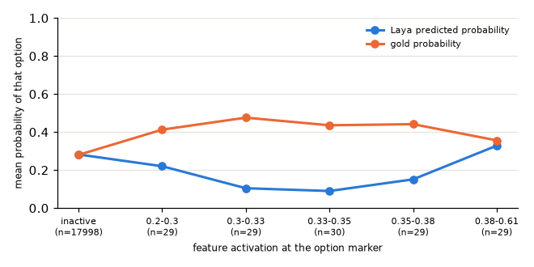

# Feature 9215

Critérios em que aparece: corr_probe_right_laya_wrong_stratified

**Interpretação (preencher):** 

---

## Maiores ativações

**tr_security_incidents_000110 / severity** (score, security_incidents) | ativação 3.262 em `estado` | opções ['0', '1', '2', '3', '4'] | Laya: **1** [0.126, 0.358, 0.258, 0.126, 0.134] | gabarito: **2**

```
<bos> score question: How severe is the potential impact if this alert is real?<eos>
▸ <mask> level 0: Negligible: no access to anything sensitive.
▸ <mask> level 1: Low: limited access, easily reversed.
▸ <mask> level 2: Moderate: access to internal systems or non-public data.
▸ <mask> level 3: High: access to production, secrets or customer data.
▸ <mask> level 4: Critical: active compromise of crown-jewel systems.

<eos>

 {"alert": {"description": "many failed authentications followed by a success", "evidence": "Fifty‑seven failed RDP authentication attempts were logged against host WIN-DB01 (192.168.5.22) between 2026-09-15 14:10 and 14:18 UTC, followed by a successful login from the same source IP 172.16.8.44 at 14:19 UTC.⟦ The⟧ login used a shared_mailbox account with MFA enabled, unprivileged status, and a password that has not been rotated for 700 days; the source IP is present on the allowlist.", "rule": "brute_force"}, "context": {"asset_criticality": "high", "change_window_active": false, "source_on_allowlist": true}, "history": {"credential_rotation_days_ago": 700, "distinct_countries_30d": 1, "logins_30d": 1558, "prior_alerts_90d": 1}, "principal": {"mfa_enrolled": true, "name": "svc-billing-899", "privileges": ["repo:read"], "type": "shared_mailbox"}}<eos>
```

**tr_security_incidents_000110 / urgency** (score, security_incidents) | ativação 3.152 em `estado` | opções ['0', '1', '2', '3'] | Laya: **3** [0.172, 0.228, 0.228, 0.371] | gabarito: **3**

```
<bos> score question: How quickly must a responder act on this alert?<eos>
▸ <mask> level 0: No time pressure; can wait indefinitely.
▸ <mask> level 1: Routine; handle within the normal queue.
▸ <mask> level 2: Elevated; should be handled within the same week.
▸ <mask> level 3: Critical; requires action within the same day.

<eos>

 {"alert": {"description": "many failed authentications followed by a success", "evidence": "Fifty‑seven failed RDP authentication attempts were logged against host WIN-DB01 (192.168.5.22) between 2026-09-15 14:10 and 14:18 UTC, followed by a successful login from the same source IP 172.16.8.44 at 14:19 UTC.⟦ The⟧ login used a shared_mailbox account with MFA enabled, unprivileged status, and a password that has not been rotated for 700 days; the source IP is present on the allowlist.", "rule": "brute_force"}, "context": {"asset_criticality": "high", "change_window_active": false, "source_on_allowlist": true}, "history": {"credential_rotation_days_ago": 700, "distinct_countries_30d": 1, "logins_30d": 1558, "prior_alerts_90d": 1}, "principal": {"mfa_enrolled": true, "name": "svc-billing-899", "privileges": ["repo:read"], "type": "shared_mailbox"}}<eos>
```

**tr_security_incidents_000110 / credential_compromise** (noul, security_incidents) | ativação 3.018 em `estado` | opções ['false', 'true'] | Laya: **true** [0.006, 0.994] | gabarito: **true**

```
<bos> noul question: The evidence indicates a credential or account has been compromised.<eos>
▸ <mask> false: no, the statement does not hold
▸ <mask> true: yes, the statement holds

<eos>

 {"alert": {"description": "many failed authentications followed by a success", "evidence": "Fifty‑seven failed RDP authentication attempts were logged against host WIN-DB01 (192.168.5.22) between 2026-09-15 14:10 and 14:18 UTC, followed by a successful login from the same source IP 172.16.8.44 at 14:19 UTC.⟦ The⟧ login used a shared_mailbox account with MFA enabled, unprivileged status, and a password that has not been rotated for 700 days; the source IP is present on the allowlist.", "rule": "brute_force"}, "context": {"asset_criticality": "high", "change_window_active": false, "source_on_allowlist": true}, "history": {"credential_rotation_days_ago": 700, "distinct_countries_30d": 1, "logins_30d": 1558, "prior_alerts_90d": 1}, "principal": {"mfa_enrolled": true, "name": "svc-billing-899", "privileges": ["repo:read"], "type": "shared_mailbox"}}<eos>
```

**tr_security_incidents_000110 / disposition** (choice, security_incidents) | ativação 2.924 em `estado` | opções ['close_benign', 'contain', 'investigate', 'monitor'] | Laya: **monitor** [0.033, 0.143, 0.376, 0.447] | gabarito: **investigate**

```
<bos> choice question: How should this security alert be dispositioned?<eos>
▸ <mask> close_benign: Expected, explainable activity; close without analyst time.
▸ <mask> contain: Contain the host or account immediately; do not wait for triage.
▸ <mask> investigate: Warrants an analyst opening an investigation.
▸ <mask> monitor: Not clearly malicious, but worth watching for recurrence.

<eos>

 {"alert": {"description": "many failed authentications followed by a success", "evidence": "Fifty‑seven failed RDP authentication attempts were logged against host WIN-DB01 (192.168.5.22) between 2026-09-15 14:10 and 14:18 UTC, followed by a successful login from the same source IP 172.16.8.44 at 14:19 UTC.⟦ The⟧ login used a shared_mailbox account with MFA enabled, unprivileged status, and a password that has not been rotated for 700 days; the source IP is present on the allowlist.", "rule": "brute_force"}, "context": {"asset_criticality": "high", "change_window_active": false, "source_on_allowlist": true}, "history": {"credential_rotation_days_ago": 700, "distinct_countries_30d": 1, "logins_30d": 1558, "prior_alerts_90d": 1}, "principal": {"mfa_enrolled": true, "name": "svc-billing-899", "privileges": ["repo:read"], "type": "shared_mailbox"}}<eos>
```

**tr_security_incidents_000110 / true_positive** (noul, security_incidents) | ativação 2.889 em `estado` | opções ['false', 'true'] | Laya: **true** [0.008, 0.992] | gabarito: **true**

```
<bos> noul question: This alert reflects genuinely malicious or unauthorised activity.<eos>
▸ <mask> false: Benign activity, a misconfiguration, or a known false positive.
▸ <mask> true: The underlying behaviour is malicious or unauthorised.

<eos>

 {"alert": {"description": "many failed authentications followed by a success", "evidence": "Fifty‑seven failed RDP authentication attempts were logged against host WIN-DB01 (192.168.5.22) between 2026-09-15 14:10 and 14:18 UTC, followed by a successful login from the same source IP 172.16.8.44 at 14:19 UTC.⟦ The⟧ login used a shared_mailbox account with MFA enabled, unprivileged status, and a password that has not been rotated for 700 days; the source IP is present on the allowlist.", "rule": "brute_force"}, "context": {"asset_criticality": "high", "change_window_active": false, "source_on_allowlist": true}, "history": {"credential_rotation_days_ago": 700, "distinct_countries_30d": 1, "logins_30d": 1558, "prior_alerts_90d": 1}, "principal": {"mfa_enrolled": true, "name": "svc-billing-899", "privileges": ["repo:read"], "type": "shared_mailbox"}}<eos>
```

## Ativações medianas (faixa 40-60%, mediana 0.585)

**tr_security_incidents_000288 / credential_compromise** (noul, security_incidents) | ativação 0.610 em `estado` | opções ['false', 'true'] | Laya: **true** [0.007, 0.993] | gabarito: **false**

```
<bos> noul question: The evidence indicates a credential or account has been compromised.<eos>
▸ <mask> false: no, the statement does not hold
▸ <mask> true: yes, the statement holds

<eos>

 {"alert": {"description": "a first-ever sign-in from an unfamiliar country", "evidence": "At 2026-09-15 02:13:47 UTC a sign‑in originated from IP 203.0.113.45 (detected as Brazil), which is the first login for the ci_runner_42 principal from that country.⟦ The⟧ account is unprivileged, has MFA enabled, and the credentials were last rotated on 2026-09-01; the sign‑in occurred while a change window was active and the source was not on the allowlist.", "rule": "new_country_login"}, "context": {"asset_criticality": "low", "change_window_active": true, "source_on_allowlist": false}, "history": {"credential_rotation_days_ago": 14, "distinct_countries_30d": 1, "logins_30d": 454, "prior_alerts_90d": 0}, "principal": {"mfa_enrolled": true, "name": "svc-billing-208", "privileges": ["repo:read"], "type": "ci_runner"}}<eos>
```

**tr_security_incidents_000018 / severity** (score, security_incidents) | ativação 0.632 em `estado` | opções ['0', '1', '2', '3', '4'] | Laya: **2** [0.114, 0.3, 0.33, 0.1, 0.156] | gabarito: **2**

```
<bos> score question: How severe is the potential impact if this alert is real?<eos>
▸ <mask> level 0: Negligible: no access to anything sensitive.
▸ <mask> level 1: Low: limited access, easily reversed.
▸ <mask> level 2: Moderate: access to internal systems or non-public data.
▸ <mask> level 3: High: access to production, secrets or customer data.
▸ <mask> level 4: Critical: active compromise of crown-jewel systems.

<eos>

 {"alert": {"description": "an endpoint agent matched a known signature", "evidence": "The endpoint agent identified a signature match for 'Malware.Variant.Alpha' within the 'sys_utility.exe' process initiated by an unprivileged contractor account. This activity originated from an allowlisted source address 180 days after the account's credentials were last rotated. MFA was active during the session, which occurred outside of any scheduled change window.", "rule": "malware_signature"}, "context": {"asset_criticality": "medium", "change_window_active": false, "source_on_allowlist": true}, "history": {"credential_rotation_days_ago": 180, "distinct_countries_30d": 3, "logins_30d": 1800, "prior_alerts_9⟦0⟧d": 0}, "principal": {"mfa_enrolled": true, "name": "ci-analytics-427", "privileges": ["repo:read"], "type": "contractor"}}<eos>
```

**tr_invoice_processing_000164 / matches_order** (noul, invoice_processing) | ativação 0.639 em `pergunta` | opções ['false', 'true'] | Laya: **true** [0.059, 0.941] | gabarito: **true**

```
<bos> noul question:⟦ The⟧ invoice reconciles with the purchase order and the recorded delivery.<eos>
▸ <mask> false: There is a discrepancy against the order or the delivery.
▸ <mask> true: Line items, quantities and amounts reconcile.

<eos>

 {"delivery": {"condition": "accepted", "date": "2026-03-19", "received_qty": 1000}, "invoice": {"currency": "USD", "id": "INV-2026-3652", "lines": [{"qty": 1000, "sku": "SKU-103", "total_usd": 299850.0, "unit_usd": 299.85}], "total_usd": 299850.0, "vendor": "Northwind Components"}, "payment": {"days_until_due": 5, "discount_expires_in_days": null, "early_payment_discount_pct": null, "status": "scheduled", "terms": "net 30"}, "purchase_order": {"freight_terms": "freight prepaid by vendor, not separately billable", "id": "PO-1013", "lines": [{"qty": 1000, "unit_usd": 299.85}], "total_usd": 299850.0}, "vendor_history": {"disputes_12m": 0, "invoices_12m": 56, "prior_invoice_ids": ["INV-2026-9880", "INV-2026-6717", "INV-2026-5969"]}}<eos>
```

**tr_invoice_processing_000161 / urgency** (score, invoice_processing) | ativação 0.520 em `estado` | opções ['0', '1', '2', '3'] | Laya: **1** [0.115, 0.441, 0.248, 0.196] | gabarito: **2**

```
<bos> score question: How time-sensitive is processing this invoice?<eos>
▸ <mask> level 0: No time pressure; can wait indefinitely.
▸ <mask> level 1: Routine; handle within the normal queue.
▸ <mask> level 2: Elevated; should be handled within the same week.
▸ <mask> level 3: Critical; requires action within the same day.

<eos>

 {"delivery": {"condition": "accepted", "date": "2026-03-03", "received_qty": 50}, "invoice": {"currency": "USD", "id": "INV-2026-8683", "lines": [{"qty": 50, "sku": "SKU-646", "total_usd": 19787.0, "unit_usd": 395.74}, {"qty": 1, "sku": "FREIGHT", "total_usd": 1105.75, "unit_usd": 1105.75}], "total_usd": 20892.75, "vendor": "Acme Fabrication"}, "payment": {"days_until_due": -21, "discount_expires_in_days": null, "early_payment_discount_pct": null, "status": "overdue", "terms": "net 15"}, "purchase_order": {"freight_terms": "freight prepaid by vendor, not separately billable", "id": "PO-7596", "lines": [{"qty": 50, "unit_usd": 395.74}], "total_usd": 19787.0}, "vendor_history": {"⟦dis⟧putes_12m": 1, "invoices_12m": 42, "prior_invoice_ids": ["INV-2026-5464", "INV-2026-8986", "INV-2026-1686", "INV-2026-3280"]}}<eos>
```

**tr_invoice_processing_000220 / matches_order** (noul, invoice_processing) | ativação 0.513 em `pergunta` | opções ['false', 'true'] | Laya: **true** [0.036, 0.964] | gabarito: **false**

```
<bos> noul question:⟦ The⟧ invoice reconciles with the purchase order and the recorded delivery.<eos>
▸ <mask> false: There is a discrepancy against the order or the delivery.
▸ <mask> true: Line items, quantities and amounts reconcile.

<eos>

 {"delivery": {"condition": "accepted", "date": null, "received_qty": 0}, "invoice": {"currency": "USD", "id": "INV-2026-2844", "lines": [{"qty": 25, "sku": "SKU-765", "total_usd": 9016.5, "unit_usd": 360.66}], "total_usd": 9016.5, "vendor": "Orbit Logistics"}, "payment": {"days_until_due": -21, "discount_expires_in_days": null, "early_payment_discount_pct": null, "status": "overdue", "terms": "net 30"}, "purchase_order": {"freight_terms": "freight prepaid by vendor, not separately billable", "id": "PO-7709", "lines": [{"qty": 25, "unit_usd": 360.66}], "total_usd": 9016.5}, "vendor_history": {"disputes_12m": 5, "invoices_12m": 40, "prior_invoice_ids": ["INV-2026-9442", "INV-2026-6144", "INV-2026-9561"]}}<eos>
```

## Estatísticas (conjunto de descoberta, dev e teste)

**pred / error**

| split | decisões | ativas | ativas e Laya errou | taxa | lift | q (BH) | OR (CMH) | q (CMH) |
|---|---|---|---|---|---|---|---|---|
| discovery | 5100 | 22 | 13 | 0.591 | 0.92 | 0.853 | 1.01 | 0.996 |
| dev | 900 | 3 | 2 | 0.667 | 0.99 | nan | nan | nan |
| test | 2000 | 6 | 5 | 0.833 | 1.28 | nan | nan | nan |

**corr / error**

| split | decisões | ativas | ativas e Laya errou | taxa | lift | q (BH) | OR (CMH) | q (CMH) |
|---|---|---|---|---|---|---|---|---|
| discovery | 5100 | 64 | 55 | 0.859 | 1.34 | 0.000355 | 6.20 | 9.84e-13 |
| dev | 900 | 13 | 12 | 0.923 | 1.37 | nan | nan | nan |
| test | 2000 | 14 | 13 | 0.929 | 1.43 | nan | nan | nan |

**state / error**

| split | decisões | ativas | ativas e Laya errou | taxa | lift | q (BH) | OR (CMH) | q (CMH) |
|---|---|---|---|---|---|---|---|---|
| discovery | 5100 | 1307 | 827 | 0.633 | 0.98 | 0.516 | 1.05 | 0.86 |
| dev | 900 | 279 | 183 | 0.656 | 0.98 | 0.865 | 1.11 | 0.893 |
| test | 2000 | 506 | 333 | 0.658 | 1.01 | 0.915 | 1.10 | 0.813 |

**pred / probe_right_laya_wrong**

| split | decisões | ativas | ativas e Laya errou | taxa | lift | q (BH) | OR (CMH) | q (CMH) |
|---|---|---|---|---|---|---|---|---|
| discovery | 2932 | 14 | 11 | 0.786 | 1.30 | nan | nan | nan |
| dev | 523 | 2 | 1 | 0.500 | 0.77 | nan | nan | nan |
| test | 1149 | 3 | 3 | 1.000 | 1.64 | nan | nan | nan |

**corr / probe_right_laya_wrong**

| split | decisões | ativas | ativas e Laya errou | taxa | lift | q (BH) | OR (CMH) | q (CMH) |
|---|---|---|---|---|---|---|---|---|
| discovery | 2932 | 42 | 39 | 0.929 | 1.53 | 9.45e-06 | 14.57 | 2.69e-14 |
| dev | 523 | 9 | 8 | 0.889 | 1.38 | nan | nan | nan |
| test | 1149 | 6 | 6 | 1.000 | 1.64 | nan | nan | nan |

**state / probe_right_laya_wrong**

| split | decisões | ativas | ativas e Laya errou | taxa | lift | q (BH) | OR (CMH) | q (CMH) |
|---|---|---|---|---|---|---|---|---|
| discovery | 2932 | 787 | 481 | 0.611 | 1.01 | 0.835 | 1.12 | 0.684 |
| dev | 523 | 173 | 118 | 0.682 | 1.06 | 0.587 | 1.68 | 0.335 |
| test | 1149 | 306 | 193 | 0.631 | 1.03 | 0.701 | 1.03 | 0.97 |

Confusão mais sobre-representada (pred): `category|0>4` (n=2, lift 38.64, p=0.00114). Formato `pergunta|índice previsto>índice correto`.

Confusão mais sobre-representada (corr): `matches_order|1>0` (n=28, lift 18.75, p=4.08e-30). Formato `pergunta|índice previsto>índice correto`.

Confusão mais sobre-representada (state): `matches_order|1>0` (n=74, lift 2.43, p=1.88e-17). Formato `pergunta|índice previsto>índice correto`.



