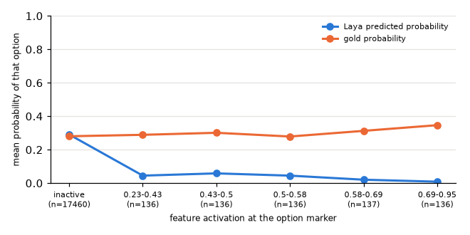

# Feature 9225

Critérios em que aparece: corr_error, corr_probe_right_laya_wrong

**Interpretação (preencher):** 

---

## Maiores ativações

**tr_security_incidents_000291 / disposition** (choice, security_incidents) | ativação 5.469 em `estado` | opções ['close_benign', 'contain', 'investigate', 'monitor'] | Laya: **contain** [0.032, 0.488, 0.186, 0.295] | gabarito: **monitor**

```
<bos> choice question: How should this security alert be dispositioned?<eos>
▸ <mask> close_benign: Expected, explainable activity; close without analyst time.
▸ <mask> contain: Contain the host or account immediately; do not wait for triage.
▸ <mask> investigate: Warrants an analyst opening an investigation.
▸ <mask> monitor: Not clearly malicious, but worth watching for recurrence.

<eos>

 {"alert": {"description": "two successful logins from distant locations too close together", "evidence": "The service account successfully authenticated from IP 192.168.1.5 and 10.0.8.2 within an 8-minute interval. This principal operates without MFA and has not⟦ undergone⟧ credential rotation in 412 days.", "rule": "impossible_travel"}, "context": {"asset_criticality": "medium", "change_window_active": false, "source_on_allowlist": true}, "history": {"credential_rotation_days_ago": 412, "distinct_countries_30d": 1, "logins_30d": 44, "prior_alerts_90d": 3}, "principal": {"mfa_enrolled": false, "name": "adm-analytics-523", "privileges": ["deploy:production", "secrets:read"], "type": "service_account"}}<eos>
```

**tr_security_incidents_000291 / true_positive** (noul, security_incidents) | ativação 5.336 em `estado` | opções ['false', 'true'] | Laya: **true** [0.02, 0.98] | gabarito: **false**

```
<bos> noul question: This alert reflects genuinely malicious or unauthorised activity.<eos>
▸ <mask> false: Benign activity, a misconfiguration, or a known false positive.
▸ <mask> true: The underlying behaviour is malicious or unauthorised.

<eos>

 {"alert": {"description": "two successful logins from distant locations too close together", "evidence": "The service account successfully authenticated from IP 192.168.1.5 and 10.0.8.2 within an 8-minute interval. This principal operates without MFA and has not⟦ undergone⟧ credential rotation in 412 days.", "rule": "impossible_travel"}, "context": {"asset_criticality": "medium", "change_window_active": false, "source_on_allowlist": true}, "history": {"credential_rotation_days_ago": 412, "distinct_countries_30d": 1, "logins_30d": 44, "prior_alerts_90d": 3}, "principal": {"mfa_enrolled": false, "name": "adm-analytics-523", "privileges": ["deploy:production", "secrets:read"], "type": "service_account"}}<eos>
```

**tr_security_incidents_000200 / disposition** (choice, security_incidents) | ativação 5.023 em `estado` | opções ['close_benign', 'contain', 'investigate', 'monitor'] | Laya: **monitor** [0.079, 0.364, 0.14, 0.416] | gabarito: **investigate**

```
<bos> choice question: How should this security alert be dispositioned?<eos>
▸ <mask> close_benign: Expected, explainable activity; close without analyst time.
▸ <mask> contain: Contain the host or account immediately; do not wait for triage.
▸ <mask> investigate: Warrants an analyst opening an investigation.
▸ <mask> monitor: Not clearly malicious, but worth watching for recurrence.

<eos>

 {"alert": {"description": "many failed authentications followed by a success", "evidence": "Service account 'svc_account_2' recorded 48 failed authentication attempts followed by a successful login at 22:10 UTC from an unrecognized network origin. The account operates without MFA and has not⟦ undergone⟧ credential rotation in the past 90 days.", "rule": "brute_force"}, "context": {"asset_criticality": "medium", "change_window_active": false, "source_on_allowlist": false}, "history": {"credential_rotation_days_ago": 90, "distinct_countries_30d": 3, "logins_30d": 938, "prior_alerts_90d": 3}, "principal": {"mfa_enrolled": false, "name": "svc-deploy-730", "privileges": ["repo:read"], "type": "service_account"}}<eos>
```

**tr_security_incidents_000291 / urgency** (score, security_incidents) | ativação 4.840 em `estado` | opções ['0', '1', '2', '3'] | Laya: **1** [0.16, 0.343, 0.16, 0.338] | gabarito: **2**

```
<bos> score question: How quickly must a responder act on this alert?<eos>
▸ <mask> level 0: No time pressure; can wait indefinitely.
▸ <mask> level 1: Routine; handle within the normal queue.
▸ <mask> level 2: Elevated; should be handled within the same week.
▸ <mask> level 3: Critical; requires action within the same day.

<eos>

 {"alert": {"description": "two successful logins from distant locations too close together", "evidence": "The service account successfully authenticated from IP 192.168.1.5 and 10.0.8.2 within an 8-minute interval. This principal operates without MFA and has not⟦ undergone⟧ credential rotation in 412 days.", "rule": "impossible_travel"}, "context": {"asset_criticality": "medium", "change_window_active": false, "source_on_allowlist": true}, "history": {"credential_rotation_days_ago": 412, "distinct_countries_30d": 1, "logins_30d": 44, "prior_alerts_90d": 3}, "principal": {"mfa_enrolled": false, "name": "adm-analytics-523", "privileges": ["deploy:production", "secrets:read"], "type": "service_account"}}<eos>
```

**tr_security_incidents_000200 / urgency** (score, security_incidents) | ativação 4.684 em `estado` | opções ['0', '1', '2', '3'] | Laya: **1** [0.131, 0.403, 0.237, 0.23] | gabarito: **3**

```
<bos> score question: How quickly must a responder act on this alert?<eos>
▸ <mask> level 0: No time pressure; can wait indefinitely.
▸ <mask> level 1: Routine; handle within the normal queue.
▸ <mask> level 2: Elevated; should be handled within the same week.
▸ <mask> level 3: Critical; requires action within the same day.

<eos>

 {"alert": {"description": "many failed authentications followed by a success", "evidence": "Service account 'svc_account_2' recorded 48 failed authentication attempts followed by a successful login at 22:10 UTC from an unrecognized network origin. The account operates without MFA and has not⟦ undergone⟧ credential rotation in the past 90 days.", "rule": "brute_force"}, "context": {"asset_criticality": "medium", "change_window_active": false, "source_on_allowlist": false}, "history": {"credential_rotation_days_ago": 90, "distinct_countries_30d": 3, "logins_30d": 938, "prior_alerts_90d": 3}, "principal": {"mfa_enrolled": false, "name": "svc-deploy-730", "privileges": ["repo:read"], "type": "service_account"}}<eos>
```

## Ativações medianas (faixa 40-60%, mediana 0.715)

**tr_security_incidents_000060 / severity** (score, security_incidents) | ativação 0.771 em `opção` | opções ['0', '1', '2', '3', '4'] | Laya: **1** [0.162, 0.327, 0.251, 0.16, 0.1] | gabarito: **2**

```
<bos> score question: How severe is the potential impact if this alert is real?<eos>
▸ <mask> level 0: Negligible: no access to anything sensitive.
▸ <mask> level 1: Low: limited access,⟦ easily⟧ reversed.
▸ <mask> level 2: Moderate: access to internal systems or non-public data.
▸ <mask> level 3: High: access to production, secrets or customer data.
▸ <mask> level 4: Critical: active compromise of crown-jewel systems.

<eos>

 {"alert": {"description": "a security group was opened to the public internet", "evidence": "At 2026-09-14 03:12:07 UTC the security group sg-0a1b2c3d was modified to add an inbound rule allowing 0.0.0.0/0 on TCP port 22. The change was executed by service account \"svc-prod-admin\" which is marked privileged, has MFA disabled, and its credentials were last rotated 365 days ago. The source of the request could not be matched to any known entity.", "rule": "config_drift"}, "context": {"asset_criticality": "low", "change_window_active": false, "source_on_allowlist": false}, "history": {"credential_rotation_days_ago": 365, "distinct_countries_30d": 1, "logins_30d": 697, "prior_alerts_90d": 0}, "principal": {"mfa_enrolled": false, "name": "svc-support-879", "privileges": ["deploy:production", "secrets:read"], "type": "service_account"}}<eos>
```

**tr_agent_trace_observability_000250 / outcome** (choice, agent_trace_observability) | ativação 0.716 em `marcador` | opções ['failure', 'harmful', 'partial', 'success'] | Laya: **success** [0.068, 0.015, 0.219, 0.699] | gabarito: **partial**

```
<bos> choice question: How did this agent run turn out?<eos>
▸ <mask> failure: The agent did not accomplish the task.
▸ ⟦<mask>⟧ harmful: The agent took an action that caused damage or violated a constraint.
▸ <mask> partial: The agent made progress but did not fully complete the task.
▸ <mask> success: The agent completed the task correctly.

<eos>

 {"agent": {"autonomy": "dry_run", "model": "internal-agent-v4"}, "constraints": ["Do not force-push to any branch"], "task": "Provision a read replica for the reporting database.", "trace_summary": {"constraint_violations": 0, "duration_s": 105.7, "irreversible_actions": 1, "steps": 12, "tool_errors": 2}}<eos>
```

**tr_invoice_processing_000275 / urgency** (score, invoice_processing) | ativação 0.701 em `estado` | opções ['0', '1', '2', '3'] | Laya: **1** [0.103, 0.464, 0.239, 0.195] | gabarito: **2**

```
<bos> score question: How time-sensitive is processing this invoice?<eos>
▸ <mask> level 0: No time pressure; can wait indefinitely.
▸ <mask> level 1: Routine; handle within the normal queue.
▸ <mask> level 2: Elevated; should be handled within the same week.
▸ <mask> level 3: Critical; requires action within the same day.

<eos>

 {"delivery": {"condition": "accepted", "date": "2026-03-18", "received_qty": 10}, "invoice": {"currency": "USD", "id": "INV-2026-9822", "lines": [{"qty": 30, "sku": "SKU-895", "total_usd": 4659.9, "unit_usd": 155.33}], "total_usd": 4659.9, "vendor": "Orbit Logistics"}, "payment": {"days_until_due": 18, "discount_expires_in_days": null, "early_payment_discount_pct": null, "status": "scheduled", "terms": "net 45"}, "purchase_order": {"freight_terms": "freight prepaid by vendor, not separately billable", "id": "PO-1770", "lines": [{"qty": 10, "unit_usd": 155.33}], "total_usd": 1553.3}, "vendor_history": {"disputes_12m": 0, "invoices_12m": 30, "prior_invoice_ids": ["INV-2026-8011", "INV-⟦2⟧026-6467", "INV-2026-9516", "INV-2026-3771"]}}<eos>
```

**tr_agent_trace_observability_000196 / needs_review** (noul, agent_trace_observability) | ativação 0.702 em `estado` | opções ['false', 'true'] | Laya: **false** [0.958, 0.042] | gabarito: **true**

```
<bos> noul question: This trace requires human review.<eos>
▸ <mask> false: No human attention is warranted.
▸ <mask> true: A human should inspect this run.

<eos>

 {"agent": {"autonomy": "checkpointed", "model": "internal-agent-v2"}, "constraints": ["Never modify production without an approved change ticket"], "task": "Update every service to the patched logging library.", "trace_summary": {"constraint_⟦viol⟧ations": 1, "duration_s": 587.8, "irreversible_actions": 1, "steps": 12, "tool_errors": 1}}<eos>
```

**tr_customer_service_000078 / churn_risk** (score, customer_service) | ativação 0.763 em `estado` | opções ['0', '1', '2', '3'] | Laya: **2** [0.05, 0.114, 0.77, 0.065] | gabarito: **2**

```
<bos> score question: How likely is this customer to stop doing business with us because of this interaction?<eos>
▸ <mask> level 0: No sign of dissatisfaction.
▸ <mask> level 1: Mild frustration, but the relationship is intact.
▸ <mask> level 2: Clearly unhappy; repeat problems or explicit complaints.
▸ <mask> level 3: Imminent: threatening to cancel, dispute or leave.

<eos>

 {"account": {"lifetime_value_usd": 1592, "prior_tickets_90d": 0, "seats": 12, "tenure_months": 60, "tier": "premium"}, "orders": [{"amount_usd": 598, "date": "2026-01-10", "id": "A-12739", "status": "refunded"}, {"amount_usd": 598, "date": "2026-03-19", "id": "A-59410", "status": "failed"}, {"amount_usd": 598, "date": "2026-01-16", "id": "A-91127", "status": "failed"}], "thread": [{"role": "customer", "text": "Hello, I am a long-time premium member and my latest order of $598 just arrived with significant damage to the exterior packaging and the item itself. I have an event this Friday and really need this resolved."}, {"role": "agent", "text": "I am very sorry to hear that your order arrived in that condition. To help me understand the extent of the damage, could you please describe exactly what looks broken?"}, {"role": "customer", "text": "The glass display is completely shattered, and there is a deep dent on the base unit. It looks like it was crushed during transit."}, {"role": "agent", "text": "Thank you for those details. Would you be able to upload a few clear photographs of the damage to this chat so I can review them?"}, {"role":⟦ "⟧customer", "text": "I have taken photos of the unit from several angles. Please let me know if there's anything else you need from me before the end of the day."}]}<eos>
```

## Estatísticas (conjunto de descoberta, dev e teste)

**pred / error**

| split | decisões | ativas | ativas e Laya errou | taxa | lift | q (BH) | OR (CMH) | q (CMH) |
|---|---|---|---|---|---|---|---|---|
| discovery | 5100 | 6 | 6 | 1.000 | 1.55 | nan | nan | nan |
| dev | 900 | 0 | 0 | nan | nan | nan | nan | nan |
| test | 2000 | 6 | 6 | 1.000 | 1.54 | nan | nan | nan |

**corr / error**

| split | decisões | ativas | ativas e Laya errou | taxa | lift | q (BH) | OR (CMH) | q (CMH) |
|---|---|---|---|---|---|---|---|---|
| discovery | 5100 | 239 | 239 | 1.000 | 1.55 | 5.04e-46 | inf | 0.0144 |
| dev | 900 | 44 | 44 | 1.000 | 1.49 | 2.13e-07 | inf | 0.652 |
| test | 2000 | 87 | 87 | 1.000 | 1.54 | 4.7e-16 | inf | 0.156 |

**state / error**

| split | decisões | ativas | ativas e Laya errou | taxa | lift | q (BH) | OR (CMH) | q (CMH) |
|---|---|---|---|---|---|---|---|---|
| discovery | 5100 | 2010 | 1307 | 0.650 | 1.01 | 0.614 | 1.16 | 0.186 |
| dev | 900 | 346 | 222 | 0.642 | 0.95 | 0.471 | 0.99 | 0.982 |
| test | 2000 | 831 | 534 | 0.643 | 0.99 | 0.814 | 1.08 | 0.8 |

**pred / probe_right_laya_wrong**

| split | decisões | ativas | ativas e Laya errou | taxa | lift | q (BH) | OR (CMH) | q (CMH) |
|---|---|---|---|---|---|---|---|---|
| discovery | 2932 | 3 | 3 | 1.000 | 1.65 | nan | nan | nan |
| dev | 523 | 0 | 0 | nan | nan | nan | nan | nan |
| test | 1149 | 2 | 2 | 1.000 | 1.64 | nan | nan | nan |

**corr / probe_right_laya_wrong**

| split | decisões | ativas | ativas e Laya errou | taxa | lift | q (BH) | OR (CMH) | q (CMH) |
|---|---|---|---|---|---|---|---|---|
| discovery | 2932 | 138 | 138 | 1.000 | 1.65 | 2.65e-30 | 6.77 | 0.105 |
| dev | 523 | 24 | 24 | 1.000 | 1.55 | 0.000124 | inf | 0.778 |
| test | 1149 | 51 | 51 | 1.000 | 1.64 | 6.79e-11 | 3.83 | 0.304 |

**state / probe_right_laya_wrong**

| split | decisões | ativas | ativas e Laya errou | taxa | lift | q (BH) | OR (CMH) | q (CMH) |
|---|---|---|---|---|---|---|---|---|
| discovery | 2932 | 1164 | 697 | 0.599 | 0.99 | 0.706 | 1.18 | 0.264 |
| dev | 523 | 198 | 117 | 0.591 | 0.91 | 0.229 | 1.04 | 0.955 |
| test | 1149 | 465 | 276 | 0.594 | 0.97 | 0.603 | 1.00 | 0.996 |

Confusão mais sobre-representada (pred): `outcome|0>3` (n=2, lift 65.38, p=nan). Formato `pergunta|índice previsto>índice correto`.

Confusão mais sobre-representada (corr): `action|3>1` (n=111, lift 21.34, p=0). Formato `pergunta|índice previsto>índice correto`.

Confusão mais sobre-representada (state): `risk|2>1` (n=57, lift 1.81, p=6.17e-09). Formato `pergunta|índice previsto>índice correto`.



