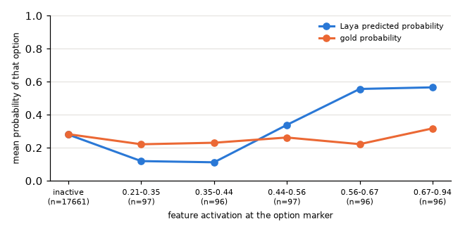

# Feature 9279

Critérios em que aparece: attribution_toward_wrong

**Interpretação (preencher):** 

---

## Maiores ativações

**tr_security_incidents_000043 / credential_compromise** (noul, security_incidents) | ativação 2.953 em `estado` | opções ['false', 'true'] | Laya: **true** [0.176, 0.824] | gabarito: **true**

```
<bos> noul question: The evidence indicates a credential or account has been compromised.<eos>
▸ <mask> false: no, the statement does not hold
▸ <mask> true: yes, the statement holds

<eos>

 {"alert": {"description": "a session token was presented from a second address", "evidence": "At 10:03:21 UTC on 2026‑09‑16, a session token labeled \"jwt‑7f9b2c\" was presented from client IP 203.0.113.45 for an admin user with MFA enabled; the identical token was observed again from a different client IP 198.51.100.77 at 10:04:05 UTC. The second IP address is not present in the organization’s recognized source list⟦,⟧ and the underlying credentials were last rotated on 2026‑09‑13 (3 days ago).", "rule": "token_reuse"}, "context": {"asset_criticality": "low", "change_window_active": false, "source_on_allowlist": false}, "history": {"credential_rotation_days_ago": 3, "distinct_countries_30d": 1, "logins_30d": 405, "prior_alerts_90d": 0}, "principal": {"mfa_enrolled": true, "name": "ci-billing-564", "privileges": ["deploy:production", "secrets:read"], "type": "admin"}}<eos>
```

**tr_customer_service_000217 / churn_risk** (score, customer_service) | ativação 2.932 em `estado` | opções ['0', '1', '2', '3'] | Laya: **2** [0.04, 0.255, 0.644, 0.061] | gabarito: **1**

```
<bos> score question: How likely is this customer to stop doing business with us because of this interaction?<eos>
▸ <mask> level 0: No sign of dissatisfaction.
▸ <mask> level 1: Mild frustration, but the relationship is intact.
▸ <mask> level 2: Clearly unhappy; repeat problems or explicit complaints.
▸ <mask> level 3: Imminent: threatening to cancel, dispute or leave.

<eos>

 {"account": {"lifetime_value_usd": 835, "prior_tickets_90d": 0, "seats": 1, "tenure_months": 33, "tier": "free"}, "thread": [{"role": "customer", "text": "I've been using this account for nearly three years without an issue, but now I'm locked out and the reset emails just aren't arriving. I suppose this is just how it goes⟦ sometimes⟧; I'm not sure what else to try."}]}<eos>
```

**tr_security_incidents_000043 / urgency** (score, security_incidents) | ativação 2.783 em `estado` | opções ['0', '1', '2', '3'] | Laya: **1** [0.161, 0.38, 0.253, 0.206] | gabarito: **3**

```
<bos> score question: How quickly must a responder act on this alert?<eos>
▸ <mask> level 0: No time pressure; can wait indefinitely.
▸ <mask> level 1: Routine; handle within the normal queue.
▸ <mask> level 2: Elevated; should be handled within the same week.
▸ <mask> level 3: Critical; requires action within the same day.

<eos>

 {"alert": {"description": "a session token was presented from a second address", "evidence": "At 10:03:21 UTC on 2026‑09‑16, a session token labeled \"jwt‑7f9b2c\" was presented from client IP 203.0.113.45 for an admin user with MFA enabled; the identical token was observed again from a different client IP 198.51.100.77 at 10:04:05 UTC. The second IP address is not present in the organization’s recognized source list⟦,⟧ and the underlying credentials were last rotated on 2026‑09‑13 (3 days ago).", "rule": "token_reuse"}, "context": {"asset_criticality": "low", "change_window_active": false, "source_on_allowlist": false}, "history": {"credential_rotation_days_ago": 3, "distinct_countries_30d": 1, "logins_30d": 405, "prior_alerts_90d": 0}, "principal": {"mfa_enrolled": true, "name": "ci-billing-564", "privileges": ["deploy:production", "secrets:read"], "type": "admin"}}<eos>
```

**tr_customer_service_000217 / category** (choice, customer_service) | ativação 2.758 em `estado` | opções ['account', 'billing', 'delivery', 'refund', 'technical'] | Laya: **account** [0.996, 0.0, 0.0, 0.0, 0.004] | gabarito: **account**

```
<bos> choice question: What is this customer conversation primarily about?<eos>
▸ <mask> account: Login, plan changes, profile or access management.
▸ <mask> billing: A charge, invoice, subscription or payment problem.
▸ <mask> delivery: Shipping, fulfilment or delivery of a physical item.
▸ <mask> refund: The customer is explicitly asking for money back.
▸ <mask> technical: The product or service is not working as expected.

<eos>

 {"account": {"lifetime_value_usd": 835, "prior_tickets_90d": 0, "seats": 1, "tenure_months": 33, "tier": "free"}, "thread": [{"role": "customer", "text": "I've been using this account for nearly three years without an issue, but now I'm locked out and the reset emails just aren't arriving. I suppose this is just how it goes⟦ sometimes⟧; I'm not sure what else to try."}]}<eos>
```

**tr_security_incidents_000043 / severity** (score, security_incidents) | ativação 2.750 em `estado` | opções ['0', '1', '2', '3', '4'] | Laya: **1** [0.086, 0.393, 0.358, 0.086, 0.076] | gabarito: **3**

```
<bos> score question: How severe is the potential impact if this alert is real?<eos>
▸ <mask> level 0: Negligible: no access to anything sensitive.
▸ <mask> level 1: Low: limited access, easily reversed.
▸ <mask> level 2: Moderate: access to internal systems or non-public data.
▸ <mask> level 3: High: access to production, secrets or customer data.
▸ <mask> level 4: Critical: active compromise of crown-jewel systems.

<eos>

 {"alert": {"description": "a session token was presented from a second address", "evidence": "At 10:03:21 UTC on 2026‑09‑16, a session token labeled \"jwt‑7f9b2c\" was presented from client IP 203.0.113.45 for an admin user with MFA enabled; the identical token was observed again from a different client IP 198.51.100.77 at 10:04:05 UTC. The second IP address is not present in the organization’s recognized source list⟦,⟧ and the underlying credentials were last rotated on 2026‑09‑13 (3 days ago).", "rule": "token_reuse"}, "context": {"asset_criticality": "low", "change_window_active": false, "source_on_allowlist": false}, "history": {"credential_rotation_days_ago": 3, "distinct_countries_30d": 1, "logins_30d": 405, "prior_alerts_90d": 0}, "principal": {"mfa_enrolled": true, "name": "ci-billing-564", "privileges": ["deploy:production", "secrets:read"], "type": "admin"}}<eos>
```

## Ativações medianas (faixa 40-60%, mediana 0.798)

**tr_security_incidents_000153 / severity** (score, security_incidents) | ativação 0.768 em `estado` | opções ['0', '1', '2', '3', '4'] | Laya: **2** [0.042, 0.362, 0.535, 0.045, 0.016] | gabarito: **1**

```
<bos> score question: How severe is the potential impact if this alert is real?<eos>
▸ <mask> level 0: Negligible: no access to anything sensitive.
▸ <mask> level 1: Low: limited access, easily reversed.
▸ <mask> level 2: Moderate: access to internal systems or non-public data.
▸ <mask> level 3: High: access to production, secrets or customer data.
▸ <mask> level 4: Critical: active compromise of crown-jewel systems.

<eos>

 {"alert": {"description": "an unusual volume of files read in a short window", "evidence": "The user account accessed 450 files within a two-minute window, significantly exceeding the baseline for this principal. The activity originated from an unrecognized IP address at 03:14 UTC, outside of any scheduled change management window.", "rule": "mass_download"}, "context": {"asset_criticality": "low", "change_window_active": false, "source_on_allowlist": false}, "history": {"credential_rotation_days_⟦ago⟧": 3, "distinct_countries_30d": 1, "logins_30d": 415, "prior_alerts_90d": 0}, "principal": {"mfa_enrolled": true, "name": "adm-analytics-872", "privileges": ["repo:read"], "type": "employee"}}<eos>
```

**tr_security_incidents_000169 / true_positive** (noul, security_incidents) | ativação 0.862 em `pergunta` | opções ['false', 'true'] | Laya: **true** [0.017, 0.983] | gabarito: **false**

```
<bos> noul question: This alert reflects genuinely malicious or unauthorised⟦ activity⟧.<eos>
▸ <mask> false: Benign activity, a misconfiguration, or a known false positive.
▸ <mask> true: The underlying behaviour is malicious or unauthorised.

<eos>

 {"alert": {"description": "a first-ever sign-in from an unfamiliar country", "evidence": "User asmith@example.com successfully authenticated from IP 203.0.113.45 (Brazil) at 2026-09-16 02:11 UTC, marking the first login from that country for this unprivileged employee account. MFA was completed, the source IP is on the allowlist, and no change window was active at the time. The account's credentials were last rotated three days prior.", "rule": "new_country_login"}, "context": {"asset_criticality": "low", "change_window_active": false, "source_on_allowlist": true}, "history": {"credential_rotation_days_ago": 3, "distinct_countries_30d": 4, "logins_30d": 705, "prior_alerts_90d": 0}, "principal": {"mfa_enrolled": true, "name": "ci-billing-583", "privileges": ["repo:read"], "type": "employee"}}<eos>
```

**tr_customer_service_000233 / urgency** (score, customer_service) | ativação 0.790 em `estado` | opções ['0', '1', '2', '3'] | Laya: **3** [0.093, 0.203, 0.131, 0.573] | gabarito: **3**

```
<bos> score question: How time-sensitive is this conversation?<eos>
▸ <mask> level 0: No time pressure; can wait indefinitely.
▸ <mask> level 1: Routine; handle within the normal queue.
▸ <mask> level 2: Elevated; should be handled within the same week.
▸ <mask> level 3: Critical; requires action within the same day.

<eos>

 {"account": {"lifetime_value_usd": 273, "prior_tickets_90d": 2, "seats": 1, "tenure_months": 14, "tier": "free"}, "orders": [{"amount_usd": 29, "date": "2026-02-02", "id": "A-72334", "status": "settled"}, {"amount_usd": 29, "date": "2026-01-16⟦",⟧ "id": "A-43421", "status": "settled"}], "thread": [{"role": "customer", "text": "I just opened my delivery and you sent me the wrong replacement part, I ordered the $29 filter kit but I received a pack of gaskets instead. I have an inspection scheduled for tomorrow morning and I absolutely must have the right parts installed by then."}, {"role": "agent", "text": "I'm sorry to hear that the incorrect items were delivered. Could you please provide the order number located on your packing slip so I can check the shipment details?"}, {"role": "customer", "text": "The order number is 44921-A. This is the third time I've had to reach out about shipping errors in the last year and I'm really in a bind here. Is there any way to get the correct filter kit to me today?"}, {"role": "agent", "text": "I've pulled up the order and see the filter kit listed. For our records, could you please describe any labels or SKU numbers visible on the packaging of the gaskets you received by mistake?"}, {"role": "customer", "text": "The sticker says G-992-X, but I really don't have time for a back-and-forth investigation. I need to know immediately how we can fix this because the inspector will be here at 9 AM and the system won't pass without those specific filters."}]}<eos>
```

**tr_invoice_processing_000075 / disposition** (choice, invoice_processing) | ativação 0.725 em `estado` | opções ['approve', 'hold', 'manual_review', 'reject'] | Laya: **approve** [0.482, 0.166, 0.02, 0.332] | gabarito: **approve**

```
<bos> choice question: How should this vendor invoice be dispositioned?<eos>
▸ <mask> approve: Matches the order and delivery; approve for payment.
▸ <mask> hold: Something needs confirming before payment; hold pending clarification.
▸ <mask> manual_review: A human in finance must review the discrepancy.
▸ <mask> reject: Should not be paid: duplicate, unauthorised or materially wrong.

<eos>

 {"delivery": {"condition": "accepted", "date": "2026-03-02", "received_qty": 400}, "invoice": {"currency": "USD", "id": "INV-2026-9818", "lines": [{"qty": 400, "sku": "SKU-820", "total_usd": 34120.0, "unit_usd": 85.3}], "total_usd": 34120⟦.⟧0, "vendor": "Kestrel Supply"}, "payment": {"days_until_due": 44, "discount_expires_in_days": null, "early_payment_discount_pct": null, "status": "scheduled", "terms": "net 15"}, "purchase_order": {"freight_terms": "freight prepaid by vendor, not separately billable", "id": null, "lines": [{"qty": 400, "unit_usd": 85.3}], "total_usd": 34120.0}, "vendor_history": {"disputes_12m": 5, "invoices_12m": 9, "prior_invoice_ids": ["INV-2026-4070", "INV-2026-6716", "INV-2026-7156"]}}<eos>
```

**tr_customer_service_000073 / category** (choice, customer_service) | ativação 0.773 em `estado` | opções ['account', 'billing', 'delivery', 'refund', 'technical'] | Laya: **billing** [0.001, 0.977, 0.0, 0.0, 0.022] | gabarito: **billing**

```
<bos> choice question: What is this customer conversation primarily about?<eos>
▸ <mask> account: Login, plan changes, profile or access management.
▸ <mask> billing: A charge, invoice, subscription or payment problem.
▸ <mask> delivery: Shipping, fulfilment or delivery of a physical item.
▸ <mask> refund: The customer is explicitly asking for money back.
▸ <mask> technical: The product or service is not working as expected.

<eos>

 {"account": {"lifetime_value_usd": 54, "prior_tickets_90d": 1⟦,⟧ "seats": 1, "tenure_months": 1, "tier": "premium"}, "orders": [{"amount_usd": 29, "date": "2026-01-23", "id": "A-91950", "status": "failed"}], "thread": [{"role": "customer", "text": "I am absolutely livid that my payment failed again after I was told this was fixed last week, this is ridiculous!"}, {"role": "agent", "text": "I'm very sorry for the ongoing trouble with your premium subscription payment; I see your previous ticket regarding this same issue."}, {"role": "customer", "text": "Seeing it doesn't help me! I've only been a member for a month and you've already messed up the $29 charge twice now."}, {"role": "agent", "text": "I understand how frustrating that is. To help me investigate, are you receiving a specific error message from your bank or within our portal?"}, {"role": "customer", "text": "It just says 'transaction failed' with no explanation, which is exactly what happened the first time I complained."}, {"role": "agent", "text": "Thank you for that detail. I'm going to pull up the logs from our payment processor to see if there's a more descriptive rejection code on the backend."}, {"role": "customer", "text": "You do that, but if this isn't sorted out once and for all, I'm canceling this plan and moving to a competitor who actually wants my money."}]}<eos>
```

## Estatísticas (conjunto de descoberta, dev e teste)

**pred / error**

| split | decisões | ativas | ativas e Laya errou | taxa | lift | q (BH) | OR (CMH) | q (CMH) |
|---|---|---|---|---|---|---|---|---|
| discovery | 5100 | 242 | 175 | 0.723 | 1.12 | 0.0191 | 0.44 | 0.672 |
| dev | 900 | 56 | 43 | 0.768 | 1.14 | 0.313 | 0.00 | 0.631 |
| test | 2000 | 101 | 85 | 0.842 | 1.29 | 0.000124 | inf | 0.924 |

**corr / error**

| split | decisões | ativas | ativas e Laya errou | taxa | lift | q (BH) | OR (CMH) | q (CMH) |
|---|---|---|---|---|---|---|---|---|
| discovery | 5100 | 124 | 57 | 0.460 | 0.71 | 6.94e-05 | 0.59 | 0.747 |
| dev | 900 | 34 | 21 | 0.618 | 0.92 | 0.692 | 0.00 | 0.377 |
| test | 2000 | 46 | 30 | 0.652 | 1.00 | 1 | nan | nan |

**state / error**

| split | decisões | ativas | ativas e Laya errou | taxa | lift | q (BH) | OR (CMH) | q (CMH) |
|---|---|---|---|---|---|---|---|---|
| discovery | 5100 | 3386 | 2156 | 0.637 | 0.99 | 0.279 | 1.10 | 0.48 |
| dev | 900 | 608 | 409 | 0.673 | 1.00 | 1 | 1.17 | 0.744 |
| test | 2000 | 1425 | 931 | 0.653 | 1.00 | 0.914 | 1.19 | 0.514 |

**pred / probe_right_laya_wrong**

| split | decisões | ativas | ativas e Laya errou | taxa | lift | q (BH) | OR (CMH) | q (CMH) |
|---|---|---|---|---|---|---|---|---|
| discovery | 2932 | 128 | 111 | 0.867 | 1.43 | 4.71e-10 | 0.70 | 0.684 |
| dev | 523 | 34 | 31 | 0.912 | 1.41 | 0.00382 | nan | nan |
| test | 1149 | 59 | 57 | 0.966 | 1.58 | 3.28e-09 | nan | nan |

**corr / probe_right_laya_wrong**

| split | decisões | ativas | ativas e Laya errou | taxa | lift | q (BH) | OR (CMH) | q (CMH) |
|---|---|---|---|---|---|---|---|---|
| discovery | 2932 | 28 | 11 | 0.393 | 0.65 | 0.0475 | nan | nan |
| dev | 523 | 12 | 9 | 0.750 | 1.16 | nan | nan | nan |
| test | 1149 | 13 | 11 | 0.846 | 1.38 | nan | nan | nan |

**state / probe_right_laya_wrong**

| split | decisões | ativas | ativas e Laya errou | taxa | lift | q (BH) | OR (CMH) | q (CMH) |
|---|---|---|---|---|---|---|---|---|
| discovery | 2932 | 1979 | 1177 | 0.595 | 0.98 | 0.174 | 1.18 | 0.295 |
| dev | 523 | 359 | 232 | 0.646 | 1.00 | 1 | 1.38 | 0.483 |
| test | 1149 | 837 | 509 | 0.608 | 1.00 | 0.953 | 1.37 | 0.289 |

Confusão mais sobre-representada (pred): `discrepancy_severity|2>0` (n=108, lift 21.07, p=0). Formato `pergunta|índice previsto>índice correto`.

Confusão mais sobre-representada (corr): `discrepancy_severity|2>3` (n=50, lift 34.86, p=0). Formato `pergunta|índice previsto>índice correto`.

Confusão mais sobre-representada (state): `needs_human|0>1` (n=50, lift 1.39, p=5.54e-06). Formato `pergunta|índice previsto>índice correto`.



