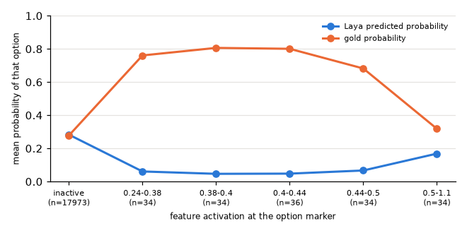

# Feature 9327

Critérios em que aparece: corr_error, corr_probe_right_laya_wrong

**Interpretação (preencher):** 

---

## Maiores ativações

**tr_customer_service_000277 / category** (choice, customer_service) | ativação 6.508 em `estado` | opções ['account', 'billing', 'delivery', 'refund', 'technical'] | Laya: **account** [1.0, 0.0, 0.0, 0.0, 0.0] | gabarito: **account**

```
<bos> choice question: What is this customer conversation primarily about?<eos>
▸ <mask> account: Login, plan changes, profile or access management.
▸ <mask> billing: A charge, invoice, subscription or payment problem.
▸ <mask> delivery: Shipping, fulfilment or delivery of a physical item.
▸ <mask> refund: The customer is explicitly asking for money back.
▸ <mask> technical: The product or service is not working as expected.

<eos>

 {"account": {"lifetime_value_usd": 3512, "prior_tickets_90d": 2, "seats": 40, "tenure_months": 49, "tier": "premium"}, "thread": [{"role": "customer", "text": "I am beyond annoyed. For the third time this year, I cannot log into my premium account. If this isn't sorted out by 5:00 PM today, I’m taking my business elsewhere."}, {"role": "agent", "text": "I am very sorry to hear that you are experiencing this login issue again, especially after our previous attempts to stabilize your access. Could you please confirm the exact error message you are seeing on your screen right now?"}, {"role": "customer", "text": "It’s the same 'Access Denied' loop as last time! I have a critical presentation in a few hours, and I’m losing patience with these recurring technical failures."}, {"role": "agent", "text": "I understand how disruptive this is, particularly with your presentation approaching. I need to verify your current connection details—are you accessing the platform via a VPN⟦ or⟧ a standard private network?"}, {"role": "customer", "text": "I am on my home network, just like every other day. I need you to escalate this immediately because I am running out of time."}]}<eos>
```

**tr_customer_service_000180 / needs_human** (noul, customer_service) | ativação 5.309 em `estado` | opções ['false', 'true'] | Laya: **true** [0.145, 0.855] | gabarito: **true**

```
<bos> noul question: This conversation requires a human agent rather than automated handling.<eos>
▸ <mask> false: Automation can carry this to resolution.
▸ <mask> true: A human must take over: judgement, authority or empathy is required.

<eos>

 {"account": {"lifetime_value_usd": 1386, "prior_tickets_90d": 0, "seats": 5, "tenure_months": 33, "tier": "premium"}, "orders": [{"amount_usd": 29, "date": "2026-01-04", "id": "A-58867", "status": "settled"}], "thread": [{"role": "customer", "text": "I need you to fix our seat management right now – we can't add any new users and the dashboard keeps throwing a 500 error. If this isn’t sorted out immediately I’m pulling us off the platform."}, {"role": "agent", "text": "I’m sorry you’re seeing that, and I understand the urgency. Could you tell me which team or project you’re trying to add seats to?"}, {"role": "customer", "text": "It’s the Sales Ops group – the “Add Seats” button just spins forever after I enter the email addresses, and none of the new accounts appear."}, {"role": "agent", "text": "Thanks for the detail. Are you getting any specific error message besides the spinner, maybe in the console or an email notification?"}, {"role": "customer", "text": "No email, just the endless loading. I’ve tried clearing cache, different browsers⟦,⟧ everything. I need this resolved today or we’re out."}]}<eos>
```

**tr_customer_service_000277 / needs_human** (noul, customer_service) | ativação 5.219 em `estado` | opções ['false', 'true'] | Laya: **true** [0.046, 0.954] | gabarito: **true**

```
<bos> noul question: This conversation requires a human agent rather than automated handling.<eos>
▸ <mask> false: Automation can carry this to resolution.
▸ <mask> true: A human must take over: judgement, authority or empathy is required.

<eos>

 {"account": {"lifetime_value_usd": 3512, "prior_tickets_90d": 2, "seats": 40, "tenure_months": 49, "tier": "premium"}, "thread": [{"role": "customer", "text": "I am beyond annoyed. For the third time this year, I cannot log into my premium account. If this isn't sorted out by 5:00 PM today, I’m taking my business elsewhere."}, {"role": "agent", "text": "I am very sorry to hear that you are experiencing this login issue again, especially after our previous attempts to stabilize your access. Could you please confirm the exact error message you are seeing on your screen right now?"}, {"role": "customer", "text": "It’s the same 'Access Denied' loop as last time! I have a critical presentation in a few hours, and I’m losing patience with these recurring technical failures."}, {"role": "agent", "text": "I understand how disruptive this is, particularly with your presentation approaching. I need to verify your current connection details—are you accessing the platform via a VPN⟦ or⟧ a standard private network?"}, {"role": "customer", "text": "I am on my home network, just like every other day. I need you to escalate this immediately because I am running out of time."}]}<eos>
```

**tr_customer_service_000043 / category** (choice, customer_service) | ativação 5.023 em `estado` | opções ['account', 'billing', 'delivery', 'refund', 'technical'] | Laya: **account** [0.892, 0.008, 0.008, 0.005, 0.087] | gabarito: **account**

```
<bos> choice question: What is this customer conversation primarily about?<eos>
▸ <mask> account: Login, plan changes, profile or access management.
▸ <mask> billing: A charge, invoice, subscription or payment problem.
▸ <mask> delivery: Shipping, fulfilment or delivery of a physical item.
▸ <mask> refund: The customer is explicitly asking for money back.
▸ <mask> technical: The product or service is not working as expected.

<eos>

 {"account": {"lifetime_value_usd": 208, "prior_tickets_90d": 0, "seats": 1, "tenure_months": 3, "tier": "free"}, "orders": [{"amount_usd": 999, "date": "2026-03-09", "id": "A-17017", "status": "refunded"}, {"amount_usd": 999, "date": "2026-01-04", "id": "A-58989", "status": "failed"}], "thread": [{"role": "customer", "text": "I need to get my data out of the system, but I’m not holding my breath—it probably won’t happen any time soon."}, {"role": "agent", "text": "I hear you. Could you tell me which parts of your account you’d like included in the export?"}, {"role": "customer", "text": "Just the basic account information—profile details and settings. Nothing fancy."}, {"role": "agent", "text": "Understood. Do you have a preferred format for the file—CSV, JSON,⟦ or⟧ something else?"}, {"role": "customer", "text": "Whatever you can manage, I don’t mind waiting."}]}<eos>
```

**tr_customer_service_000277 / urgency** (score, customer_service) | ativação 4.855 em `estado` | opções ['0', '1', '2', '3'] | Laya: **1** [0.072, 0.416, 0.193, 0.319] | gabarito: **3**

```
<bos> score question: How time-sensitive is this conversation?<eos>
▸ <mask> level 0: No time pressure; can wait indefinitely.
▸ <mask> level 1: Routine; handle within the normal queue.
▸ <mask> level 2: Elevated; should be handled within the same week.
▸ <mask> level 3: Critical; requires action within the same day.

<eos>

 {"account": {"lifetime_value_usd": 3512, "prior_tickets_90d": 2, "seats": 40, "tenure_months": 49, "tier": "premium"}, "thread": [{"role": "customer", "text": "I am beyond annoyed. For the third time this year, I cannot log into my premium account. If this isn't sorted out by 5:00 PM today, I’m taking my business elsewhere."}, {"role": "agent", "text": "I am very sorry to hear that you are experiencing this login issue again, especially after our previous attempts to stabilize your access. Could you please confirm the exact error message you are seeing on your screen right now?"}, {"role": "customer", "text": "It’s the same 'Access Denied' loop as last time! I have a critical presentation in a few hours, and I’m losing patience with these recurring technical failures."}, {"role": "agent", "text": "I understand how disruptive this is, particularly with your presentation approaching. I need to verify your current connection details—are you accessing the platform via a VPN⟦ or⟧ a standard private network?"}, {"role": "customer", "text": "I am on my home network, just like every other day. I need you to escalate this immediately because I am running out of time."}]}<eos>
```

## Ativações medianas (faixa 40-60%, mediana 0.730)

**tr_security_incidents_000157 / disposition** (choice, security_incidents) | ativação 0.698 em `estado` | opções ['close_benign', 'contain', 'investigate', 'monitor'] | Laya: **monitor** [0.192, 0.167, 0.066, 0.575] | gabarito: **investigate**

```
<bos> choice question: How should this security alert be dispositioned?<eos>
▸ <mask> close_benign: Expected, explainable activity; close without analyst time.
▸ <mask> contain: Contain the host or account immediately; do not wait for triage.
▸ <mask> investigate: Warrants an analyst opening an investigation.
▸ <mask> monitor: Not clearly malicious, but worth watching for recurrence.

<eos>

 {"alert": {"description": "a first-ever sign-in from an unfamiliar country", "evidence": "A privileged employee account performed a successful sign‑in at 2026-09-16 08:45 UTC from 185.76.234.12, located in Moscow, Russia, which is a country with no prior login history for this principal. The authentication employed MFA, the source IP is not recognized in the asset inventory, and the password for the account was last changed on 2026‑09‑13.", "rule": "new_country_login"}, "context": {"asset_criticality": "crown_jewel", "change_window_active": false, "source_on_allowlist": false}, "history": {"credential_rotation_days_ago": 3, "distinct_countries_30d": 3, "logins_30d": 744, "prior_alerts_90d": 0}, "principal": {"mfa_enrolled": true⟦,⟧ "name": "svc-billing-232", "privileges": ["deploy:production", "secrets:read"], "type": "employee"}}<eos>
```

**tr_security_incidents_000295 / urgency** (score, security_incidents) | ativação 0.771 em `estado` | opções ['0', '1', '2', '3'] | Laya: **3** [0.177, 0.257, 0.274, 0.292] | gabarito: **3**

```
<bos> score question: How quickly must a responder act on this alert?<eos>
▸ <mask> level 0: No time pressure; can wait indefinitely.
▸ <mask> level 1: Routine; handle within the normal queue.
▸ <mask> level 2: Elevated; should be handled within the same week.
▸ <mask> level 3: Critical; requires action within the same day.

<eos>

 {"alert": {"description": "a large transfer to an external destination", "evidence": "A CI runner account initiated a 4.2GB data transfer to an external, unrecognized destination IP at 11:45 UTC. No authorized change window is currently scheduled, and the account credentials were last updated 14 days ago.", "rule": "data_egress"}, "context": {"asset_criticality": "medium", "change_window_active": false, "source_on_allowlist": false}, "history": {"credential_rotation_days_ago": 14, "distinct_countries_30d": 1, "logins_⟦3⟧0d": 586, "prior_alerts_90d": 0}, "principal": {"mfa_enrolled": true, "name": "svc-billing-408", "privileges": ["repo:read"], "type": "ci_runner"}}<eos>
```

**tr_security_incidents_000002 / credential_compromise** (noul, security_incidents) | ativação 0.747 em `estado` | opções ['false', 'true'] | Laya: **true** [0.008, 0.992] | gabarito: **true**

```
<bos> noul question: The evidence indicates a credential or account has been compromised.<eos>
▸ <mask> false: no, the statement does not hold
▸ <mask> true: yes, the statement holds

<eos>

 {"alert": {"description": "many failed authentications followed by a success", "evidence": "A sequence of 95 failed login attempts followed by a single successful authentication was recorded for the privileged `admin-shared-inbox` from an unknown source. The successful access utilized MFA-protected credentials that were last rotated 14 days prior to the event.", "rule": "brute_force"}, "context": {"asset_criticality": "medium", "change_window_active": false, "source_on_allowlist": false}, "history": {"credential_rotation_days_ago": 14, "distinct_countries_30d": 4,⟦ "⟧logins_30d": 581, "prior_alerts_90d": 1}, "principal": {"mfa_enrolled": true, "name": "usr-support-225", "privileges": ["deploy:production", "secrets:read"], "type": "shared_mailbox"}}<eos>
```

**tr_invoice_processing_000220 / disposition** (choice, invoice_processing) | ativação 0.677 em `estado` | opções ['approve', 'hold', 'manual_review', 'reject'] | Laya: **hold** [0.309, 0.394, 0.034, 0.262] | gabarito: **manual_review**

```
<bos> choice question: How should this vendor invoice be dispositioned?<eos>
▸ <mask> approve: Matches the order and delivery; approve for payment.
▸ <mask> hold: Something needs confirming before payment; hold pending clarification.
▸ <mask> manual_review: A human in finance must review the discrepancy.
▸ <mask> reject: Should not be paid: duplicate, unauthorised or materially wrong.

<eos>

 {"delivery": {"condition": "accepted", "date": null, "received_qty": 0}, "invoice": {"currency": "USD", "id": "INV-2026-2844", "lines": [{"qty": 25, "sku": "SKU-765", "total_usd": 9016.5, "unit_usd": 360.66}], "total_usd": 9016.5, "vendor": "Orbit Logistics"}, "payment": {"days_until_due": -21, "discount_expires_in_days": null, "early_payment_discount_pct": null, "status": "overdue", "terms": "net 30"}, "purchase_order": {"freight_terms": "freight prepaid by vendor, not separately billable", "id": "PO-7709", "lines": [{"qty": 25, "unit_usd": 360.66}], "total_usd": 9016.5}, "vendor_history": {"disputes_12m": 5, "invoices_12m": 40, "prior_invoice_ids": ["INV-2026-9442", "INV-2026-6144", "⟦INV⟧-2026-9561"]}}<eos>
```

**tr_security_incidents_000068 / disposition** (choice, security_incidents) | ativação 0.695 em `estado` | opções ['close_benign', 'contain', 'investigate', 'monitor'] | Laya: **monitor** [0.034, 0.277, 0.18, 0.509] | gabarito: **investigate**

```
<bos> choice question: How should this security alert be dispositioned?<eos>
▸ <mask> close_benign: Expected, explainable activity; close without analyst time.
▸ <mask> contain: Contain the host or account immediately; do not wait for triage.
▸ <mask> investigate: Warrants an analyst opening an investigation.
▸ <mask> monitor: Not clearly malicious, but worth watching for recurrence.

<eos>

 {"alert": {"description": "two successful logins from distant locations too close together", "evidence": "Two successful authentication events for the service account occurred 12 minutes apart from IP addresses located in London and Singapore. The account credentials have not been updated in 412 days.", "rule": "impossible_travel"}, "context": {"asset_criticality": "high", "change_window_active": false, "source_on_allowlist": false}, "history": {"credential_rotation_days_ago": 412, "distinct_countries_30d": 1, "logins_30d": 521, "prior_alerts_90d": 8}, "principal": {"mfa_enrolled": true,⟦ "⟧name": "adm-analytics-682", "privileges": ["deploy:production", "secrets:read"], "type": "service_account"}}<eos>
```

## Estatísticas (conjunto de descoberta, dev e teste)

**pred / error**

| split | decisões | ativas | ativas e Laya errou | taxa | lift | q (BH) | OR (CMH) | q (CMH) |
|---|---|---|---|---|---|---|---|---|
| discovery | 5100 | 6 | 6 | 1.000 | 1.55 | nan | nan | nan |
| dev | 900 | 1 | 1 | 1.000 | 1.49 | nan | nan | nan |
| test | 2000 | 8 | 8 | 1.000 | 1.54 | nan | nan | nan |

**corr / error**

| split | decisões | ativas | ativas e Laya errou | taxa | lift | q (BH) | OR (CMH) | q (CMH) |
|---|---|---|---|---|---|---|---|---|
| discovery | 5100 | 110 | 110 | 1.000 | 1.55 | 7.69e-21 | inf | 0.00774 |
| dev | 900 | 22 | 22 | 1.000 | 1.49 | 0.000823 | nan | nan |
| test | 2000 | 50 | 50 | 1.000 | 1.54 | 3.46e-09 | inf | 0.531 |

**state / error**

| split | decisões | ativas | ativas e Laya errou | taxa | lift | q (BH) | OR (CMH) | q (CMH) |
|---|---|---|---|---|---|---|---|---|
| discovery | 5100 | 3628 | 2294 | 0.632 | 0.98 | 0.0279 | 0.96 | 0.841 |
| dev | 900 | 627 | 415 | 0.662 | 0.98 | 0.725 | 1.13 | 0.817 |
| test | 2000 | 1395 | 879 | 0.630 | 0.97 | 0.0518 | 0.86 | 0.579 |

**pred / probe_right_laya_wrong**

| split | decisões | ativas | ativas e Laya errou | taxa | lift | q (BH) | OR (CMH) | q (CMH) |
|---|---|---|---|---|---|---|---|---|
| discovery | 2932 | 5 | 5 | 1.000 | 1.65 | nan | nan | nan |
| dev | 523 | 0 | 0 | nan | nan | nan | nan | nan |
| test | 1149 | 5 | 5 | 1.000 | 1.64 | nan | nan | nan |

**corr / probe_right_laya_wrong**

| split | decisões | ativas | ativas e Laya errou | taxa | lift | q (BH) | OR (CMH) | q (CMH) |
|---|---|---|---|---|---|---|---|---|
| discovery | 2932 | 103 | 103 | 1.000 | 1.65 | 1.82e-22 | inf | 0.0878 |
| dev | 523 | 22 | 22 | 1.000 | 1.55 | 0.000288 | nan | nan |
| test | 1149 | 49 | 49 | 1.000 | 1.64 | 1.86e-10 | inf | 0.868 |

**state / probe_right_laya_wrong**

| split | decisões | ativas | ativas e Laya errou | taxa | lift | q (BH) | OR (CMH) | q (CMH) |
|---|---|---|---|---|---|---|---|---|
| discovery | 2932 | 2050 | 1195 | 0.583 | 0.96 | 0.000776 | 1.03 | 0.894 |
| dev | 523 | 371 | 230 | 0.620 | 0.96 | 0.256 | 1.04 | 0.954 |
| test | 1149 | 821 | 486 | 0.592 | 0.97 | 0.162 | 1.14 | 0.747 |

Confusão mais sobre-representada (pred): `urgency|1>2` (n=2, lift 8.13, p=nan). Formato `pergunta|índice previsto>índice correto`.

Confusão mais sobre-representada (corr): `duplicate|1>0` (n=96, lift 20.51, p=0). Formato `pergunta|índice previsto>índice correto`.

Confusão mais sobre-representada (state): `credential_compromise|1>0` (n=78, lift 1.34, p=3.33e-08). Formato `pergunta|índice previsto>índice correto`.



