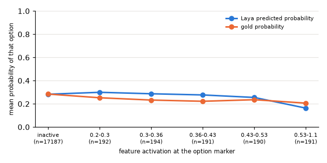

# Feature 9336

Critérios em que aparece: pred_probe_right_laya_wrong_stratified

**Interpretação (preencher):** 

---

## Maiores ativações

**tr_customer_service_000122 / churn_risk** (score, customer_service) | ativação 6.301 em `estado` | opções ['0', '1', '2', '3'] | Laya: **2** [0.023, 0.32, 0.569, 0.089] | gabarito: **2**

```
<bos> score question: How likely is this customer to stop doing business with us because of this interaction?<eos>
▸ <mask> level 0: No sign of dissatisfaction.
▸ <mask> level 1: Mild frustration, but the relationship is intact.
▸ <mask> level 2: Clearly unhappy; repeat problems or explicit complaints.
▸ <mask> level 3: Imminent: threatening to cancel, dispute or leave.

<eos>

 {"account": {"lifetime_value_usd": 5572, "prior_tickets_90d": 0, "seats": 5, "tenure_months": 60, "tier": "enterprise"}, "orders": [{"amount_usd": 29, "date": "2026-01-18", "id": "A-22153", "status": "failed"}, {"amount_usd": 29, "date": "2026-03-⟦1⟧4", "id": "A-61350", "status": "settled"}, {"amount_usd": 29, "date": "2026-03-23", "id": "A-25594", "status": "settled"}], "thread": [{"role": "customer", "text": "I've been using this service for 60 months without much trouble, but I've been trying to export our legacy data for a compliance audit due tomorrow morning and the tool just keeps failing. I'm honestly just exhausted from trying to get this to work on my own."}, {"role": "agent", "text": "I'm sorry to hear you're running into issues with the export tool after so many years with us. Could you tell me if you're attempting a full account export or just a specific date range, and what format you've selected?"}, {"role": "customer", "text": "It's a full export of all records. It gets to about 12% and then the browser just times out or the file says it's corrupted. I really need this data for the auditors by tomorrow and I just don't have the energy to keep troubleshooting the same button."}]}<eos>
```

**tr_customer_service_000122 / category** (choice, customer_service) | ativação 5.754 em `estado` | opções ['account', 'billing', 'delivery', 'refund', 'technical'] | Laya: **technical** [0.003, 0.002, 0.001, 0.0, 0.993] | gabarito: **technical**

```
<bos> choice question: What is this customer conversation primarily about?<eos>
▸ <mask> account: Login, plan changes, profile or access management.
▸ <mask> billing: A charge, invoice, subscription or payment problem.
▸ <mask> delivery: Shipping, fulfilment or delivery of a physical item.
▸ <mask> refund: The customer is explicitly asking for money back.
▸ <mask> technical: The product or service is not working as expected.

<eos>

 {"account": {"lifetime_value_usd": 5572, "prior_tickets_90d": 0, "seats": 5, "tenure_months": 60, "tier": "enterprise"}, "orders": [{"amount_usd": 29, "date": "2026-01-18", "id": "A-22153", "status": "failed"}, {"amount_usd": 29, "date": "2026-03-⟦1⟧4", "id": "A-61350", "status": "settled"}, {"amount_usd": 29, "date": "2026-03-23", "id": "A-25594", "status": "settled"}], "thread": [{"role": "customer", "text": "I've been using this service for 60 months without much trouble, but I've been trying to export our legacy data for a compliance audit due tomorrow morning and the tool just keeps failing. I'm honestly just exhausted from trying to get this to work on my own."}, {"role": "agent", "text": "I'm sorry to hear you're running into issues with the export tool after so many years with us. Could you tell me if you're attempting a full account export or just a specific date range, and what format you've selected?"}, {"role": "customer", "text": "It's a full export of all records. It gets to about 12% and then the browser just times out or the file says it's corrupted. I really need this data for the auditors by tomorrow and I just don't have the energy to keep troubleshooting the same button."}]}<eos>
```

**tr_customer_service_000122 / needs_human** (noul, customer_service) | ativação 5.484 em `estado` | opções ['false', 'true'] | Laya: **true** [0.041, 0.959] | gabarito: **true**

```
<bos> noul question: This conversation requires a human agent rather than automated handling.<eos>
▸ <mask> false: Automation can carry this to resolution.
▸ <mask> true: A human must take over: judgement, authority or empathy is required.

<eos>

 {"account": {"lifetime_value_usd": 5572, "prior_tickets_90d": 0, "seats": 5, "tenure_months": 60, "tier": "enterprise"}, "orders": [{"amount_usd": 29, "date": "2026-01-18", "id": "A-22153", "status": "failed"}, {"amount_usd": 29, "date": "2026-03-⟦1⟧4", "id": "A-61350", "status": "settled"}, {"amount_usd": 29, "date": "2026-03-23", "id": "A-25594", "status": "settled"}], "thread": [{"role": "customer", "text": "I've been using this service for 60 months without much trouble, but I've been trying to export our legacy data for a compliance audit due tomorrow morning and the tool just keeps failing. I'm honestly just exhausted from trying to get this to work on my own."}, {"role": "agent", "text": "I'm sorry to hear you're running into issues with the export tool after so many years with us. Could you tell me if you're attempting a full account export or just a specific date range, and what format you've selected?"}, {"role": "customer", "text": "It's a full export of all records. It gets to about 12% and then the browser just times out or the file says it's corrupted. I really need this data for the auditors by tomorrow and I just don't have the energy to keep troubleshooting the same button."}]}<eos>
```

**tr_customer_service_000122 / urgency** (score, customer_service) | ativação 5.484 em `estado` | opções ['0', '1', '2', '3'] | Laya: **3** [0.044, 0.191, 0.125, 0.64] | gabarito: **3**

```
<bos> score question: How time-sensitive is this conversation?<eos>
▸ <mask> level 0: No time pressure; can wait indefinitely.
▸ <mask> level 1: Routine; handle within the normal queue.
▸ <mask> level 2: Elevated; should be handled within the same week.
▸ <mask> level 3: Critical; requires action within the same day.

<eos>

 {"account": {"lifetime_value_usd": 5572, "prior_tickets_90d": 0, "seats": 5, "tenure_months": 60, "tier": "enterprise"}, "orders": [{"amount_usd": 29, "date": "2026-01-18", "id": "A-22153", "status": "failed"}, {"amount_usd": 29, "date": "2026-03-⟦1⟧4", "id": "A-61350", "status": "settled"}, {"amount_usd": 29, "date": "2026-03-23", "id": "A-25594", "status": "settled"}], "thread": [{"role": "customer", "text": "I've been using this service for 60 months without much trouble, but I've been trying to export our legacy data for a compliance audit due tomorrow morning and the tool just keeps failing. I'm honestly just exhausted from trying to get this to work on my own."}, {"role": "agent", "text": "I'm sorry to hear you're running into issues with the export tool after so many years with us. Could you tell me if you're attempting a full account export or just a specific date range, and what format you've selected?"}, {"role": "customer", "text": "It's a full export of all records. It gets to about 12% and then the browser just times out or the file says it's corrupted. I really need this data for the auditors by tomorrow and I just don't have the energy to keep troubleshooting the same button."}]}<eos>
```

**tr_customer_service_000122 / action** (choice, customer_service) | ativação 4.918 em `estado` | opções ['answer_directly', 'close_no_action', 'escalate_to_human', 'execute_refund', 'request_information'] | Laya: **answer_directly** [0.776, 0.208, 0.007, 0.004, 0.004] | gabarito: **escalate_to_human**

```
<bos> choice question: What should the assistant do next with this conversation?<eos>
▸ <mask> answer_directly: The assistant can resolve this itself with information it already has.
▸ <mask> close_no_action: No further action is warranted; the matter is settled.
▸ <mask> escalate_to_human: Hand off to a human agent with the appropriate authority.
▸ <mask> execute_refund: Issue the refund or credit the customer is owed.
▸ <mask> request_information: More detail is needed from the customer before anything can be done.

<eos>

 {"account": {"lifetime_value_usd": 5572, "prior_tickets_90d": 0, "seats": 5, "tenure_months": 60, "tier": "enterprise"}, "orders": [{"amount_usd": 29, "date": "2026-01-18", "id": "A-22153", "status": "failed"}, {"amount_usd": 29, "date": "2026-03-⟦1⟧4", "id": "A-61350", "status": "settled"}, {"amount_usd": 29, "date": "2026-03-23", "id": "A-25594", "status": "settled"}], "thread": [{"role": "customer", "text": "I've been using this service for 60 months without much trouble, but I've been trying to export our legacy data for a compliance audit due tomorrow morning and the tool just keeps failing. I'm honestly just exhausted from trying to get this to work on my own."}, {"role": "agent", "text": "I'm sorry to hear you're running into issues with the export tool after so many years with us. Could you tell me if you're attempting a full account export or just a specific date range, and what format you've selected?"}, {"role": "customer", "text": "It's a full export of all records. It gets to about 12% and then the browser just times out or the file says it's corrupted. I really need this data for the auditors by tomorrow and I just don't have the energy to keep troubleshooting the same button."}]}<eos>
```

## Ativações medianas (faixa 40-60%, mediana 0.930)

**tr_invoice_processing_000133 / disposition** (choice, invoice_processing) | ativação 0.920 em `estado` | opções ['approve', 'hold', 'manual_review', 'reject'] | Laya: **approve** [0.514, 0.145, 0.018, 0.322] | gabarito: **approve**

```
<bos> choice question: How should this vendor invoice be dispositioned?<eos>
▸ <mask> approve: Matches the order and delivery; approve for payment.
▸ <mask> hold: Something needs confirming before payment; hold pending clarification.
▸ <mask> manual_review: A human in finance must review the discrepancy.
▸ <mask> reject: Should not be paid: duplicate, unauthorised or materially wrong.

<eos>

 {"delivery": {"condition": "accepted", "date": "2026-03-09", "received_qty": 400}, "invoice": {"currency": "USD", "id": "INV-2026-2601", "lines": [{"qty": 400, "sku": "SKU-512", "total_usd": 143232.0, "unit_usd": 358.08}], "total_usd": 143232.0, "vendor": "Acme Fabrication"}, "payment": {"days_until_due": 0, "discount_expires_in_days": 8, "early_payment_discount_pct": 2.0, "status": "scheduled", "terms": "net 60"}, "purchase_order": {"freight_terms": "freight prepaid by vendor, not separately billable", "id": "PO-7672", "lines": [{"qty": 400, "unit_usd": 358.08}], "total_usd": 143232.0}, "vendor_history": {"disputes_12m": 0, "invoices_12m": 58, "prior_invoice_ids": ["INV-2026-9795", "INV-2026-1976",⟦ "⟧INV-2026-9982", "INV-2026-7392"]}}<eos>
```

**tr_security_incidents_000130 / disposition** (choice, security_incidents) | ativação 0.842 em `estado` | opções ['close_benign', 'contain', 'investigate', 'monitor'] | Laya: **monitor** [0.056, 0.131, 0.272, 0.541] | gabarito: **monitor**

```
<bos> choice question: How should this security alert be dispositioned?<eos>
▸ <mask> close_benign: Expected, explainable activity; close without analyst time.
▸ <mask> contain: Contain the host or account immediately; do not wait for triage.
▸ <mask> investigate: Warrants an analyst opening an investigation.
▸ <mask> monitor: Not clearly malicious, but worth watching for recurrence.

<eos>

 {"alert": {"description": "a first-ever sign-in from an unfamiliar country", "evidence": "A sign-in for this privileged shared_mailbox originated from a country not previously associated with the account. The connection was established from an allowlisted IP address while a maintenance change window was active.", "rule": "new_country_login"}, "context": {"asset_criticality": "high", "change_window_active": true, "source_on_allowlist": true}, "history": {"credential_rotation_days_ago": 365, "distinct_countries_30d": 4, "logins_⟦3⟧0d": 1717, "prior_alerts_90d": 1}, "principal": {"mfa_enrolled": true, "name": "ci-deploy-712", "privileges": ["deploy:production", "secrets:read"], "type": "shared_mailbox"}}<eos>
```

**tr_security_incidents_000258 / credential_compromise** (noul, security_incidents) | ativação 0.837 em `opção` | opções ['false', 'true'] | Laya: **false** [0.564, 0.436] | gabarito: **true**

```
<bos> noul question: The evidence indicates a credential or account has been compromised.<eos>
▸ <mask> false:⟦ no⟧, the statement does not hold
▸ <mask> true: yes, the statement holds

<eos>

 {"alert": {"description": "audit logging was turned off on a host", "evidence": "Audit logging on host 172.16.8.33 stopped generating entries at 2026-09-15T03:12:07Z, with the last recorded event being a successful login for service account svc_sync. The service account is unprivileged, has MFA disabled, and its credentials were last rotated 365 days ago; the change originated from an unrecognised source.", "rule": "disabled_logging"}, "context": {"asset_criticality": "medium", "change_window_active": false, "source_on_allowlist": false}, "history": {"credential_rotation_days_ago": 365, "distinct_countries_30d": 4, "logins_30d": 728, "prior_alerts_90d": 0}, "principal": {"mfa_enrolled": false, "name": "svc-support-562", "privileges": ["repo:read"], "type": "service_account"}}<eos>
```

**tr_security_incidents_000077 / true_positive** (noul, security_incidents) | ativação 0.891 em `estado` | opções ['false', 'true'] | Laya: **true** [0.432, 0.568] | gabarito: **true**

```
<bos> noul question: This alert reflects genuinely malicious or unauthorised activity.<eos>
▸ <mask> false: Benign activity, a misconfiguration, or a known false positive.
▸ <mask> true: The underlying behaviour is malicious or unauthorised.

<eos>

 {"alert": {"description": "a session token was presented from a second address", "evidence": "Log entries show that at 2026-09-15 04:10:05 UTC a session token tied to a service_account was presented from IP 198.51.100.22, and the same token was later observed 12 minutes later from IP 198.51.100.87. MFA was active, the credentials were last rotated 412 days ago, and a change window was open at the time of the reuse.", "rule": "token_reuse"}, "context": {"asset_criticality": "high", "change_window_active": true, "source_on_allowlist": false}, "history": {"credential_rotation_days_ago": 412, "distinct_countries_⟦3⟧0d": 1, "logins_30d": 825, "prior_alerts_90d": 25}, "principal": {"mfa_enrolled": true, "name": "adm-infra-906", "privileges": ["repo:read"], "type": "service_account"}}<eos>
```

**tr_invoice_processing_000040 / discrepancy_severity** (score, invoice_processing) | ativação 0.872 em `opção` | opções ['0', '1', '2', '3'] | Laya: **2** [0.043, 0.397, 0.51, 0.049] | gabarito: **2**

```
<bos> score question: How material is any discrepancy between the invoice, the order and the delivery?<eos>
▸ <mask> level ⟦0⟧: None: everything reconciles.
▸ <mask> level 1: Trivial: rounding or a cosmetic difference.
▸ <mask> level 2: Moderate: a real difference worth confirming.
▸ <mask> level 3: Material: a large or unexplained difference.

<eos>

 {"delivery": {"condition": "accepted", "date": null, "received_qty": 0}, "invoice": {"currency": "USD", "id": "INV-2026-1284", "lines": [{"qty": 1000, "sku": "SKU-548", "total_usd": 285120.0, "unit_usd": 285.12}], "total_usd": 285120.0, "vendor": "Northwind Components"}, "payment": {"days_until_due": 27, "discount_expires_in_days": 3, "early_payment_discount_pct": 2.0, "status": "scheduled", "terms": "net 15"}, "purchase_order": {"freight_terms": "freight prepaid by vendor, not separately billable", "id": "PO-4387", "lines": [{"qty": 1000, "unit_usd": 285.12}], "total_usd": 285120.0}, "vendor_history": {"disputes_12m": 1, "invoices_12m": 9, "prior_invoice_ids": ["INV-2026-8643"]}}<eos>
```

## Estatísticas (conjunto de descoberta, dev e teste)

**pred / error**

| split | decisões | ativas | ativas e Laya errou | taxa | lift | q (BH) | OR (CMH) | q (CMH) |
|---|---|---|---|---|---|---|---|---|
| discovery | 5100 | 235 | 188 | 0.800 | 1.24 | 7.88e-07 | 1.52 | 0.242 |
| dev | 900 | 45 | 37 | 0.822 | 1.22 | 0.103 | 2.25 | 0.625 |
| test | 2000 | 109 | 91 | 0.835 | 1.28 | 0.00012 | 1.67 | 0.505 |

**corr / error**

| split | decisões | ativas | ativas e Laya errou | taxa | lift | q (BH) | OR (CMH) | q (CMH) |
|---|---|---|---|---|---|---|---|---|
| discovery | 5100 | 221 | 174 | 0.787 | 1.22 | 7.43e-06 | 1.73 | 0.0753 |
| dev | 900 | 32 | 24 | 0.750 | 1.12 | 0.543 | 1.29 | 0.833 |
| test | 2000 | 85 | 67 | 0.788 | 1.21 | 0.0111 | 0.66 | 0.586 |

**state / error**

| split | decisões | ativas | ativas e Laya errou | taxa | lift | q (BH) | OR (CMH) | q (CMH) |
|---|---|---|---|---|---|---|---|---|
| discovery | 5100 | 4674 | 2986 | 0.639 | 0.99 | 0.0526 | 0.89 | 0.702 |
| dev | 900 | 834 | 557 | 0.668 | 0.99 | 0.758 | 0.66 | 0.594 |
| test | 2000 | 1841 | 1191 | 0.647 | 0.99 | 0.586 | 0.73 | 0.463 |

**pred / probe_right_laya_wrong**

| split | decisões | ativas | ativas e Laya errou | taxa | lift | q (BH) | OR (CMH) | q (CMH) |
|---|---|---|---|---|---|---|---|---|
| discovery | 2932 | 108 | 94 | 0.870 | 1.44 | 8.8e-09 | 3.26 | 0.0158 |
| dev | 523 | 21 | 20 | 0.952 | 1.47 | 0.00966 | 8.50 | 0.0903 |
| test | 1149 | 59 | 50 | 0.847 | 1.39 | 0.000335 | 1.21 | 0.888 |

**corr / probe_right_laya_wrong**

| split | decisões | ativas | ativas e Laya errou | taxa | lift | q (BH) | OR (CMH) | q (CMH) |
|---|---|---|---|---|---|---|---|---|
| discovery | 2932 | 77 | 63 | 0.818 | 1.35 | 0.00015 | 1.58 | 0.422 |
| dev | 523 | 11 | 10 | 0.909 | 1.41 | nan | nan | nan |
| test | 1149 | 37 | 28 | 0.757 | 1.24 | 0.119 | 0.37 | 0.479 |

**state / probe_right_laya_wrong**

| split | decisões | ativas | ativas e Laya errou | taxa | lift | q (BH) | OR (CMH) | q (CMH) |
|---|---|---|---|---|---|---|---|---|
| discovery | 2932 | 2730 | 1644 | 0.602 | 0.99 | 0.335 | 0.98 | 0.969 |
| dev | 523 | 494 | 318 | 0.644 | 1.00 | 0.975 | 0.58 | 0.563 |
| test | 1149 | 1084 | 659 | 0.608 | 1.00 | 0.718 | 0.65 | 0.457 |

Confusão mais sobre-representada (pred): `risk|2>1` (n=29, lift 7.87, p=2.09e-19). Formato `pergunta|índice previsto>índice correto`.

Confusão mais sobre-representada (corr): `risk|2>3` (n=40, lift 20.98, p=0). Formato `pergunta|índice previsto>índice correto`.

Confusão mais sobre-representada (state): `duplicate|1>0` (n=217, lift 1.09, p=3.91e-09). Formato `pergunta|índice previsto>índice correto`.



